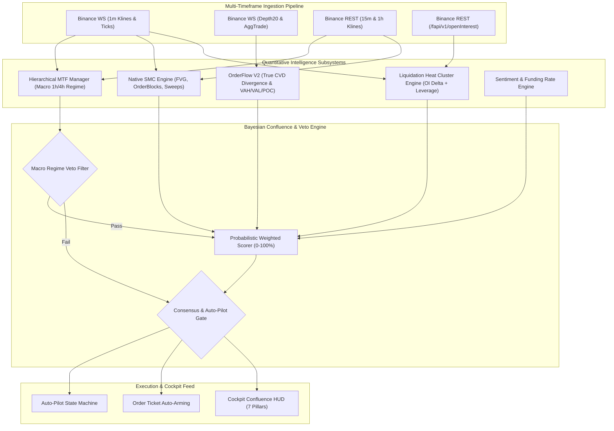

# Institutional Quantitative Confluence Engine & Autonomous Market Intelligence

* **Author:** fxbluster
* **Status:** Draft
* **Date:** 2026-11-21

--------------------------------------------------------------------------------

## Overview

This technical specification details the architectural overhaul of TradeOS's 6+1 Confluence Matrix, transitioning it from a basic heuristic indicator counter into an institutional-grade Quantitative Market Intelligence Engine. The redesigned system replaces lagging heuristics, uncalibrated equal-weight voting, and dormant external dependencies with true multi-timeframe structural regimes (Macro 4h/1h, Intermediate 15m, Micro 1m), native Smart Money Concepts (FVG, Order Blocks, Liquidity Sweeps), mathematically verified CVD absorption anomalies, dynamic liquidation cluster mapping, and volatility-scaled Bayesian consensus.

## The Problem

While the TradeOS cockpit execution pipeline, safety armor (Dead-SL, 400ms hold, circuit breaker), and 60fps charting are robust, the current 6+1 Confluence Matrix suffers from structural deficiencies when evaluated against institutional quantitative trading desk standards:

1. **Pseudo-Multi-Timeframe Trend (Single-Frame Vulnerability):** The `MTF_TREND` pillar evaluates only the active chart timeframe (e.g., 1m or 5m) against EMA 9/21/50/200 and ADX 14. It lacks hierarchical higher-timeframe (HTF) macro filtering (1h/4h), allowing the engine to buy directly into strong higher-timeframe resistance zones or sell into macro liquidity pools.
2. **False CVD Absorption Mechanics:** In `confluenceEngine.ts`, CVD evaluation currently treats raw cumulative delta (`cvd > 0` vs `cvd < 0`) as absorption. In quantitative finance, true absorption is a divergence phenomenon where aggressive market orders fail to push price further due to heavy resting passive limit orders (e.g., CVD makes new highs while price prints lower highs).
3. **Dead-Weight External PineScript Dependency:** Pillar 7 (`PINE_SMC`) is entirely dormant unless an external user configures third-party TradingView webhook infrastructure. When inactive, the matrix permanently forfeits 10% of its decision score.
4. **Parabolic Momentum Inversion:** Pillar 2 (`MOMENTUM`) treats RSI > 65 as an "Overbought Warning" (`WAIT` status). In crypto momentum breakouts, persistent RSI elevation above 65 with expanding volume indicates strong institutional trend continuation rather than an immediate reversal.
5. **Static Liquidation Heuristics:** Pillar 5 (`LIQ_MAGNET`) relies on a static $\pm 1.0\text{x ATR}$ boundary around swing highs/lows without calculating leverage distribution density (10x, 25x, 50x, 100x liquidation levels) or monitoring Binance real-time Open Interest (OI) net changes.
6. **Equal-Weighted Arbitrary Consensus:** The current matrix relies on a coarse 4-out-of-7 integer threshold. A lagging sentiment reading from a news headline carries the same voting weight as Level 2 order book order flow and multi-timeframe market structure.

## Goals

* **True Hierarchical Multi-Timeframe Matrix:** Enforce a strict 3-tier timeframe hierarchy (Macro 1h/4h for regime directional filter, Intermediate 15m for market structure, Micro 1m/5m for execution entry timing).
* **Native Server-Side Smart Money Concepts (SMC):** Implement an in-memory algorithmic SMC engine in `@tradeos/server` that detects Fair Value Gaps (FVG), Bullish/Bearish Order Blocks (OB), and Liquidity Sweeps without requiring external TradingView webhooks.
* **True Order Flow Divergence & Volume Profile:** Upgrade `orderFlowEngine.ts` to calculate real absorption divergences (Price delta vs CVD delta) and Point of Control (POC) / Value Area High & Low (VAH/VAL).
* **Binance Open Interest (OI) & Liquidation Cluster Matrix:** Ingest live Binance Futures open interest and calculate leverage-weighted liquidation heat clusters.
* **Bayesian Probabilistic Weighting & Veto Architecture:** Replace equal-weight counting with a dynamic 3-tier confidence model where Macro Regime and SMC structure possess hard veto power over lagging oscillators.

## Non-Goals

* Building a machine-learning neural network or black-box deep learning model requiring GPU clusters.
* Arbitrage trading across multiple external exchanges (system remains strictly dedicated to Binance Futures USDT-M pairs).
* High-frequency microsecond colocation trading (TradeOS operates in the swing / day-trading execution regime with 250ms–1s tick updates).

## Open Questions

* **Question 1 (Macro Kline Ingestion Architecture):** Should higher-timeframe candles (1h, 4h) be fetched on-demand via REST upon symbol selection and cached in an in-memory ring buffer, or continuously streamed via dedicated background Binance WebSocket connections for the active symbol?
* **Question 2 (SMC Native Calculation Depth):** How many historical candles (200 vs 500) should the native SMC detector evaluate for Fair Value Gaps and Order Blocks to maintain sub-5ms tick execution latency on single-threaded Node.js?

## Critical User Journeys (CUJs)

### CUJ 1: Macro-Aligned Trend Continuation Entry
* **Given**: BTCUSDT 1h trend is strongly bullish (Price > 1h EMA200, 1h ADX > 25), while 1m price pulls back into a 15m Fair Value Gap (FVG).
* **When**: 1m CVD prints aggressive seller absorption (CVD drops while price refuses to breach FVG low) and Order Flow turns 2.5x Buy.
* **Then**: The Confluence Matrix upgrades from `WAIT` to `4/7 BULLISH CONSENSUS (Score: 82%)`, Auto-Pilot triggers an institutional Long entry, arms a Stop Loss below the FVG invalidation level, and sets TP1 at the nearest 1h liquidation cluster.

### CUJ 2: Bear Trap & Liquidity Sweep Reversal
* **Given**: SOLUSDT breaks below a key 4h swing low, triggering retail stop-loss liquidations.
* **When**: Binance Open Interest drops sharply (forced liquidation flush), price immediately sweeps back above the swing low within 2 candles, and native SMC flags a Liquidity Sweep.
* **Then**: The Confluence Matrix immediately vetoes any short signal, flags `BULLISH SWEEP DETECTED`, and presents a high-probability reversal long opportunity with a tight risk boundary.

--------------------------------------------------------------------------------

## Technical Plan (Architecture)

### 1. High-Level System Topology

### 2. Core Quantitative Subsystems

#### A. Hierarchical MTF Manager (`hierarchicalMtfManager.ts`)
* **3-Tier Structure:**
  * **Macro Regime (1h / 4h):** Calculates 200 EMA, SuperTrend (10, 3.0), and Directional Movement (ADX 14). Establishes the non-negotiable macro bias (`MACRO_BULLISH`, `MACRO_BEARISH`, or `MACRO_RANGING`).
  * **Intermediate Structure (15m):** Establishes swing high/low market structure, detects breaks of structure (BOS), and frames valid trading zones.
  * **Micro Execution (1m / 5m):** High-frequency tick updates for precision entries, stop loss pinning, and invalidation monitoring.
* **Hard Invalidation Veto:** If the Macro Regime is `MACRO_BEARISH` (Price < 1h EMA200 with ADX > 25), the engine strictly vetoes all automated Long proposals, preventing retail trap entries regardless of 1m oversold bounces.

#### B. Native Server-Side SMC Engine (`nativeSmcEngine.ts`)
* Eliminates reliance on external TradingView PineScript webhooks.
* **Fair Value Gap (FVG) Detector:**
  * Identifies 3-candle imbalances:
    * Bullish FVG: `Low(candle[i]) > High(candle[i-2])`
    * Bearish FVG: `High(candle[i]) < Low(candle[i-2])`
  * Tracks mitigation state: An FVG remains active until subsequent candle wicks completely overlap its imbalance zone.
* **Order Block (OB) Detector:**
  * Identifies the last down-candle before a violent upward expansion that breaks 15m structure (Bullish OB) or last up-candle before a violent breakdown (Bearish OB).
* **Liquidity Sweep & CHoCH (Change of Character):**
  * Flags when price wicks beyond a recent 20-candle swing high/low and closes back inside within 2 candles.

#### C. Order Flow V2: True CVD Absorption & Volume Profile (`orderFlowEngine.ts`)
* **Absorption Anomaly Detector:**
  * Ingests 60-second rolling taker volume and 60-second price delta.
  * *Bullish Absorption:* Rolling aggressive seller delta $> +2.0\sigma$ while price delta $\ge 0$ (large passive buyers completely absorbing aggressive market sells).
  * *Bearish Absorption:* Rolling aggressive buyer delta $> +2.0\sigma$ while price delta $\le 0$ (large passive iceberg sell orders absorbing aggressive market buys).
* **Micro Volume Profile:**
  * Computes Point of Control (POC), Value Area High (VAH, 70% volume), and Value Area Low (VAL). Price accepting above VAH is bullish continuation; rejection at POC signals mean reversion.

#### D. Dynamic Liquidation Cluster Engine (`liquidationEngine.ts`)
* Combines live Binance Open Interest (`/fapi/v1/openInterest`) with recent volatility swings.
* Projects liquidation price distributions for 10x ($9.0\%$ margin), 25x ($3.6\%$ margin), 50x ($1.8\%$ margin), and 100x ($0.8\%$ margin) positions.
* When price approaches an estimated cluster of $> \$5M$ within $1.2\text{x ATR}$, Pillar 5 activates `LIQUIDATION_MAGNET_ACTIVE`.

### 3. Bayesian Weighted Consensus Model (`math.ts`)

Replaces flat integer counting ($4/7$) with an institutional weighted scoring matrix:

| Pillar ID | Pillar Name | Category | Weight | Invalidation Veto Power? |
|---|---|---|---|---|
| `MACRO_REGIME` | 1h/4h Macro Trend & Bias | Tier 1 (Structural) | **25%** | **YES** (Hard directional block) |
| `NATIVE_SMC` | FVG, Order Blocks & Sweeps | Tier 1 (Structural) | **25%** | No |
| `CVD_ABSORPTION` | Order Flow Divergence / Absorption | Tier 2 (Flow) | **20%** | No |
| `ORDER_FLOW_L2` | 60s Flow & Top-20 Book Imbalance | Tier 2 (Flow) | **15%** | No |
| `LIQ_CLUSTERS` | OI Delta & Liquidation Magnet | Tier 3 (Tactical) | **7.5%** | No |
| `MOMENTUM_RVOL` | Volatility-Adjusted RVOL & Momentum | Tier 3 (Tactical) | **5%** | No |
| `SENTIMENT_MACRO`| Funding Rate & News Sentiment | Tier 3 (Tactical) | **2.5%** | No |
| **Total** | **Unified Confluence Engine** | — | **100%** | — |

* **Execution Thresholds:**
  * `Composite Score >= 75%` AND `No Macro Veto`: **STRONG_CONSENSUS** (Auto-Pilot executes, full margin up to cap).
  * `60% <= Composite Score < 75%`: **MODERATE_CONSENSUS** (Permits manual discretionary execution with halved risk).
  * `Composite Score < 60%` OR `Macro Veto Active`: **GÖZLƏ (WAITING / BLOCKED)**.

--------------------------------------------------------------------------------

## Alternatives Considered

### Alternative A: Offloading SMC & Quant Calculations to an External Python Microservice

* **Pros:** Enables direct leverage of scientific Python ecosystems (`pandas-ta`, `scipy`, `numpy`) and existing open-source backtesting frameworks.
* **Cons:** Introduces cross-process inter-process communication (IPC) and HTTP serialization latency (50–100ms per market tick); adds a second runtime dependency stack (Python 3.11, pip packages, virtual environments); complicates single-command production deployment and introduces dual supervisor crash modes.
* **Reason for Rejection:** Rejected by author: TradeOS is engineered as an ultra-low-latency, sub-5ms unified TypeScript platform. Computing SMC geometries and moving averages natively in memory in Node.js eliminates IPC serialization overhead and keeps memory consumption below 150MB.

### Alternative B: Black-Box Machine Learning (LSTM / Transformer) Price Predictor

* **Pros:** Capable of capturing non-linear multi-variate statistical interactions across large historical tick datasets.
* **Cons:** Black-box predictions cannot be audited or explained; highly vulnerable to severe out-of-distribution regime shifts during crypto volatility shocks; requires significant GPU compute resources; produces high model inference latency.
* **Reason for Rejection:** Rejected by author: Institutional capital preservation requires deterministic, explainable rules (market structure breaks, order flow absorption, and verifiable support/resistance levels) with transparent invalidation boundaries rather than opaque probabilistic guesses.

### Alternative C: Polling Binance REST API for Multi-Timeframe Candles on Every Tick

* **Pros:** Simple to implement; does not require maintaining background historical candle ring buffers.
* **Cons:** Exhausts Binance API weight limits (1200 request weight/min) in seconds when managing multiple timeframes across pairs, triggering HTTP 429 IP bans; introduces 200–500ms REST round-trip latency on every execution tick.
* **Reason for Rejection:** Rejected by author: Violates exchange rate-limit and latency invariants. Pre-warming historical 15m and 1h ring buffers once upon symbol selection and updating live candles incrementally via WebSocket tick events consumes negligible API weight while guaranteeing sub-millisecond execution readiness.

--------------------------------------------------------------------------------

## Non-Functional Requirements

### 1. Performance & Execution Latency
* **Tick Evaluation Budget:** Ingestion of a market tick, MTF regime check, SMC scanning, and Bayesian score calculation must complete in $\le 5\text{ms}$ on the Node.js event loop.
* **Memory Footprint:** Ring buffers for 1m, 15m, and 1h candles must enforce strict bounds ($200$ candles per timeframe) to ensure heap usage remains below $150\text{MB}$.

### 2. Failure Modes & Mitigations
* **Macro Data Desynchronization:** If higher-timeframe 1h data fails to load or drops out, the matrix downgrades to `DEGRADED_MODE`, disengages automated Auto-Pilot execution, and flags a visible amber warning on the Cockpit HUD.
* **Rate-Limit Resilience:** All REST pre-warming calls must use exponential backoff with jitter and respect Binance API weight headers (`X-MBX-USED-WEIGHT-1M`).

--------------------------------------------------------------------------------

## Detailed Implementation Plan

### Target Files to Create / Modify

#### 1. `packages/shared/src/types.ts` (Modify)
* **Type / Scope:** TypeScript Domain Model Contracts.
* **Proposed Changes:**
  * Define `MacroRegime` (`'MACRO_BULLISH' | 'MACRO_BEARISH' | 'MACRO_RANGING' | 'DEGRADED'`).
  * Define `FairValueGap` interface (`id`, `timeframe`, `type: 'BULLISH' | 'BEARISH'`, `high`, `low`, `mitigated: boolean`, `formedAt: number`).
  * Define `OrderBlock` interface (`id`, `timeframe`, `type: 'BULLISH' | 'BEARISH'`, `high`, `low`, `invalidationPrice: number`, `volume: number`).
  * Define `LiquiditySweep` interface (`id`, `direction: 'SWEEP_HIGH' | 'SWEEP_LOW'`, `sweepPrice: number`, `reclaimPrice: number`, `time: number`).
  * Update `ConfluencePillarId` union to:
    `'MACRO_REGIME' | 'NATIVE_SMC' | 'CVD_ABSORPTION' | 'ORDER_FLOW_L2' | 'LIQ_CLUSTERS' | 'MOMENTUM_RVOL' | 'SENTIMENT_MACRO'`.
  * Extend `ConfluenceSnapshot` with `macroVetoActive: boolean` and `macroRegime: MacroRegime`.

#### 2. `packages/shared/src/math.ts` (Modify)
* **Type / Scope:** Core Quantitative Mathematics.
* **Proposed Changes:**
  * Update `calculateCompositeConfluenceScore`:
    * Implement the 7-pillar Bayesian weighting (25%, 25%, 20%, 15%, 7.5%, 5%, 2.5%).
    * Enforce Hard Macro Veto: If `MACRO_REGIME` is active and opposing the direction, clamp `recommendedAction = 'GÖZLƏ'` and `compositeScore = Math.min(compositeScore, 49)`.

#### 3. `packages/shared/src/__tests__/math.test.ts` (Modify)
* **Type / Scope:** Financial Math Unit Tests.
* **Proposed Changes:**
  * Add unit tests verifying:
    * 100% total weight normalization across all 7 pillars.
    * Macro Veto clamping when lower timeframes attempt trading against 1h EMA200.
    * Score thresholds for `STRONG_CONSENSUS` ($\ge 75\%$) and `MODERATE_CONSENSUS` ($60-74\%$).

#### 4. `apps/server/src/quant/hierarchicalMtfManager.ts` (Create)
* **Type / Scope:** Server-side Multi-Timeframe State Manager.
* **Proposed Changes:**
  * Manage 200-candle circular ring buffers for 1m, 15m, and 1h intervals.
  * Compute 1h EMA200, SuperTrend (10, 3.0), and ADX(14) to return `MacroRegime`.
  * Expose `getMacroBias(symbol: string): { regime: MacroRegime; adx: number; ema200: number }`.

#### 5. `apps/server/src/quant/nativeSmcEngine.ts` (Create)
* **Type / Scope:** Server-side Smart Money Concepts Detector.
* **Proposed Changes:**
  * Implement `detectFairValueGaps(candles: KlineCandle[]): FairValueGap[]`.
  * Implement `detectOrderBlocks(candles: KlineCandle[], swingLookback: number): OrderBlock[]`.
  * Implement `detectLiquiditySweeps(candles: KlineCandle[], currentPrice: number): LiquiditySweep | null`.
  * Evaluate proximity of current mark price to active FVG and OB zones.

#### 6. `apps/server/src/quant/orderFlowEngine.ts` (Modify)
* **Type / Scope:** Server-side Microstructure & Order Flow Engine.
* **Proposed Changes:**
  * Add Absorption Divergence calculation: Compare 60s aggressive taker delta against 60s price delta, emitting `ABSORPTION_BUY` or `ABSORPTION_SELL` when delta variance exceeds $2.0\sigma$.
  * Compute Volume Profile Point of Control (POC), Value Area High (VAH), and Value Area Low (VAL).

#### 7. `apps/server/src/quant/liquidationEngine.ts` (Modify)
* **Type / Scope:** Liquidation Heat Cluster Engine.
* **Proposed Changes:**
  * Ingest Binance live Open Interest (`client.getOpenInterest(symbol)`).
  * Project estimated liquidation clusters at 10x, 25x, 50x, 100x margin bounds.

#### 8. `apps/server/src/quant/confluenceEngine.ts` (Modify)
* **Type / Scope:** Master Confluence Aggregator.
* **Proposed Changes:**
  * Wire `HierarchicalMtfManager`, `NativeSmcEngine`, upgraded `OrderFlowEngine`, and `LiquidationEngine`.
  * Enforce Macro Veto before evaluating Auto-Pilot triggers.
  * Broadcast enhanced `ConfluenceSnapshot` via WebSocket.

#### 9. `apps/server/src/services/autoPilotManager.ts` (Modify)
* **Type / Scope:** Autonomous Execution Controller.
* **Proposed Changes:**
  * Update entry condition to require `snapshot.compositeScore >= 75` AND `!snapshot.macroVetoActive`.
  * Auto-pin Stop Loss to the invalidation boundary of the triggering SMC zone (FVG low for longs, FVG high for shorts) or $-1.5\text{x ATR}$, whichever is safer.

#### 10. `apps/server/src/quant/__tests__/confluence_and_smc.test.ts` (Create)
* **Type / Scope:** Server Quantitative Integration Test Suite.
* **Proposed Changes:**
  * Unit and integration tests for FVG detection, Order Block validation, Macro Veto rejection, and CVD absorption anomalies.

#### 11. `apps/web/src/components/ConfluenceHUD.tsx` (Modify)
* **Type / Scope:** Frontend HUD Component.
* **Proposed Changes:**
  * Render the 7 new institutional pillars with progress bars and dynamic score chips.
  * Render an unmistakable amber warning banner when Macro Veto is active (`MACRO VETO ENGAGED: Longs blocked below 1h EMA200`).

#### 12. `apps/web/src/components/ChartCanvas.tsx` (Modify)
* **Type / Scope:** Frontend Charting Engine.
* **Proposed Changes:**
  * Add visual canvas overlay markers for active FVG zones (shaded rectangular price bands) and Liquidity Sweeps with a toggle button in the chart header toolbar.

### Verification Plan

* **Compilation & Type Check:** Run `npm run build` across `@tradeos/shared`, `@tradeos/server`, and `@tradeos/web` with zero TypeScript errors (`tsc --noEmit`).
* **Unit Tests:** Execute `npx vitest run` and ensure 100% pass rate across both shared math and server quantitative test suites.
* **Latency Benchmark:** Assert that native SMC detection and multi-timeframe evaluation execute in $\le 5\text{ms}$ per tick under high-load synthetic trade streams.
* **Visual Cockpit Verification:** Inspect the live Cockpit HUD in Chrome DevTools to verify that Macro Regime, SMC Zones, and CVD Divergences reflect real Binance market data without chart stutter or frame drops.

--------------------------------------------------------------------------------

*Drafted with EGM*
