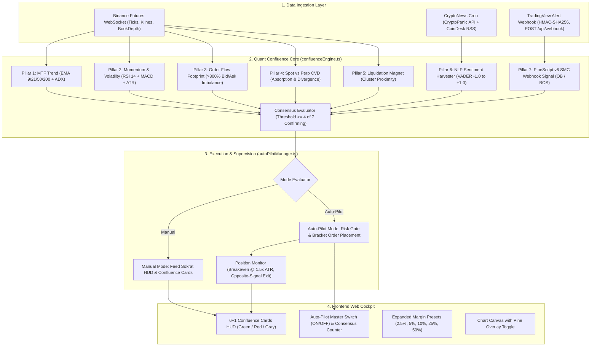

# TradeOS v2: 6+1 Confluence Engine, Autonomous Auto-Pilot Execution, and PineScript v6 Ingestion

*   **Author:** fxbluster
*   **Status:** Draft
*   **Date:** 2026-11-20

--------------------------------------------------------------------------------

## Overview

TradeOS v2 provides institutional-grade risk limits and direct Binance Demo/Testnet execution. This specification introduces an advanced market intelligence and algorithmic execution layer:
1. **6+1 Confluence Decision Engine:** Six core real-time quantitative pillars (MTF Trend, Momentum/Volatility, Order Flow Footprint, CVD Absorption, Liquidation Magnets, NLP News Sentiment) plus a 7th backend pillar (TradingView PineScript v6 Smart Money Webhook Ingestion).
2. **Dual-Mode Execution Architecture:**
   - **Manual Mode:** Visual status cards for all pillars with human-in-the-loop 400ms physical hold-to-trade confirmation.
   - **Autonomous Auto-Pilot Mode:** Triggers algorithmic bracket entry (Entry, Stop-Loss, TP1, TP2) when consensus reaches >= 4 out of 7 pillars, with automated position lifecycle management (auto-breakeven, trailing stops, and opposite-confluence emergency early exit).
3. **UI Enhancements & Control:** Expanded margin allocation presets (2.5%, 5%, 10%, 25%, up to 50%) and visual chart overlay toggles (hiding PineScript graphics on chart while keeping the 7th pillar active in the backend).

## The Problem

Crypto futures markets operate 24/7 with rapid regime shifts. Traders face cognitive fatigue and execution delay trying to manually cross-reference order books, multi-timeframe moving averages, delta absorption, and breaking headlines. In TradeOS v1, analytical tools were tightly coupled into a fragile monolithic script. In TradeOS v2, core execution is robust, but the user currently lacks:
- A synthesized multi-factor validation framework to confirm entries before pulling the trigger.
- An optional hands-off Auto-Pilot mode to capture high-probability algorithmic setups when consensus is strong.
- Flexibility in margin sizing (previously capped at 10% presets).
- Clean ingestion of external Smart Money Concept (SMC) signals from TradingView without visual clutter on the chart.

## Goals

*   **G1 (6+1 Confluence Matrix):** Implement modular quantitative calculators in `@tradeos/shared` and `apps/server/src/quant` covering MTF Trend, Momentum, Order Flow, CVD, Liquidation Magnet, NLP News Sentiment, and PineScript Webhook Signals.
*   **G2 (Consensus Engine >= 4 of 7):** Formulate an algorithmic consensus score where >= 4 confirming pillars in the same direction unlocks auto-execution or marks manual entry as high-confidence.
*   **G3 (Fail-Closed Auto-Pilot):** Implement an autonomous trading state machine that places bracket orders with strict 10x leverage, monitors open positions, migrates SL to breakeven at 1.5x ATR profit, and closes immediately if market consensus flips to the opposite direction.
*   **G4 (Circuit-Breakers):** Enforce strict safety throttles in auto-pilot: max 1 concurrent open position, max 2 consecutive losses before a mandatory 60-minute cooldown, and 0.10% max slippage rejection.
*   **G5 (Background PineScript Ingestion with UI Toggle):** Support TradingView alert webhooks (`POST /api/webhook`) with HMAC authentication and deduplication, allowing the user to hide visual chart markers while keeping the backend signal pillar active.
*   **G6 (Expanded Margin Allocation):** Update order execution controls to support 2.5%, 5.0%, 10.0%, 25.0%, and up to 50.0% margin allocation presets with real-time balance recalculation.

## Non-Goals

*   **NG1 (Uncapped Martingale / Averaging Down):** No grid trading or martingale doubling on losing positions. Each trade has an independent fixed risk envelope.
*   **NG2 (Desktop WPF/Electron Overlay):** No re-creation of legacy Windows desktop native overlays; all controls and cards reside in the responsive web cockpit.
*   **NG3 (Paid Data Subscriptions):** All 6 quantitative pillars and sentiment feeds must operate on free public feeds (Binance WebSocket, CryptoPanic public API, CoinDesk RSS).

## Open Questions

*   **Question 1 (Auto-Pilot Order Type):** Should Auto-Pilot execute via Taker MARKET orders to guarantee fill on fast breakouts, or via MAKER LIMIT orders placed at the nearest Order Block / FVG zone to save fees?
*   **Question 2 (Auto-Pilot Re-Entry Throttling):** After an auto-trade hits TP1 or closes at breakeven, how many candles (e.g. minimum 3 bars / 3 minutes) must elapse before entering another trade on the same symbol?

## Critical User Journeys (CUJs)

### CUJ 1: Autonomous Auto-Pilot Entry & Opposite-Confluence Exit
*   **Given**: Auto-Pilot mode is enabled with 10% margin, 10x leverage, and consensus threshold set to >= 4 pillars.
*   **When**: MTF Trend (Bullish), CVD Divergence (Bullish Absorption), Order Flow (+320% Buy Imbalance), and PineScript Webhook (SMC Long) confirm simultaneously (4/7 pillars).
*   **Then**: The engine automatically places a BUY order on Binance Testnet, sets Stop-Loss at 1.5x ATR below entry, sets TP1 at +2.5%, and updates the UI status badge to "AUTO-PILOT ACTIVE". If 15 minutes later 5 pillars flip to Bearish, the engine immediately executes a reduceOnly market close to safeguard capital.

### CUJ 2: Manual Trading with 6-Card Confluence HUD
*   **Given**: Manual mode is active. The user is observing SOLUSDT.
*   **When**: The trader inspects the 6 Confluence Cards. Three are Green (Bullish), two are Gray (Neutral), and one is Red (Bearish) (3/7 pillars).
*   **Then**: Sokrat Mentor displays "CAUTION: Insufficient Confluence (3/7)". The trader waits until a fourth card turns Green, then holds the 400ms button to execute with full risk armor.

### CUJ 3: Background PineScript Signal Ingestion with Chart Toggle Off
*   **Given**: TradingView indicator is sending webhook alerts to `POST /api/webhook`. The user finds the chart too cluttered.
*   **When**: The user toggles the "Hide Pine Overlay" button on the TradeOS chart.
*   **Then**: The chart displays clean candles without visual noise, but Pillar 7 in the backend and on the Confluence HUD continues to register PineScript signals in real time.

--------------------------------------------------------------------------------

## Technical Plan (Architecture)

### 1. High-Level System Architecture



### 2. Component Boundaries & Responsibilities

#### A. `@tradeos/shared` (Data Types & Invariants)
- **`ConfluencePillarId`**: `'MTF_TREND' | 'MOMENTUM' | 'ORDER_FLOW' | 'CVD' | 'LIQ_MAGNET' | 'NLP_NEWS' | 'PINE_SMC'`.
- **`PillarEvaluation`**:
  ```typescript
  export interface PillarEvaluation {
    id: ConfluencePillarId;
    title: string;
    score: number; // 0 to 100
    bias: 'BULLISH' | 'BEARISH' | 'NEUTRAL';
    valueText: string;
    subText: string;
    confirmed: boolean; // meets pillar threshold
    updatedAt: number;
  }
  ```
- **`ConfluenceSnapshot`**:
  ```typescript
  export interface ConfluenceSnapshot {
    symbol: string;
    pillars: PillarEvaluation[];
    bullishCount: number;
    bearishCount: number;
    neutralCount: number;
    consensusBias: 'BULLISH' | 'BEARISH' | 'NEUTRAL';
    consensusMet: boolean; // confirmingCount >= threshold (default 4)
    threshold: number; // 4
    compositeScore: number; // 0 - 100
    recommendedAction: 'STRONG_BUY' | 'BUY' | 'GÖZLƏ' | 'SELL' | 'STRONG_SELL';
  }
  ```
- **`AutoPilotConfig`**:
  ```typescript
  export interface AutoPilotConfig {
    enabled: boolean;
    consensusThreshold: number; // default 4
    marginAllocationPct: number; // 2.5, 5, 10, 25, 50
    leverage: number; // strict 10
    oppositeExitEnabled: boolean; // true
    circuitBreakerConsecutiveLosses: number; // 2
    circuitBreakerCooldownMs: number; // 3,600,000 (1 hour)
  }
  ```

#### B. Quantitative Calculation Engines (`apps/server/src/quant/`)
1. **`confluenceEngine.ts`**: Aggregates the 7 pillars into a cohesive snapshot. Caches previous evaluations to eliminate duplicate CPU cycles.
2. **`orderFlowEngine.ts`**: Analyzes the recent tick ring buffer and level-2 depth to detect bid-ask aggression and trade size imbalances exceeding 3.0x.
3. **`cvdEngine.ts` (Upgraded)**: Tracks cumulative delta volume and compares perpetual futures volume vs spot reference klines to flag hidden institutional absorption.
4. **`sentimentHarvester.ts`**: Background worker polling CryptoPanic API and CoinDesk RSS every 3 minutes. Evaluates headlines using a zero-dependency VADER lexicon analyzer.
5. **`liquidationEngine.ts`**: Evaluates price distance to open interest liquidation magnet clusters.

#### C. Autonomous Auto-Pilot Service (`apps/server/src/services/autoPilotManager.ts`)
- Evaluates the active symbol's `ConfluenceSnapshot` on every candle close and 4Hz tick.
- **Entry Logic**:
  - Preconditions: `AutoPilotConfig.enabled === true`, no existing active trade on symbol (`tradesRepo.getActivePosition(mode, symbol) === null`), cooldown lock not active.
  - Signal Trigger: `consensusMet === true` (at least 4 pillars confirm BUY or SELL).
  - Validation: Runs `validateOrderRisk()` via `riskEngine.ts`.
  - Execution: Calls `tradeManager.openPosition({ symbol, side, marginUsd, leverage: 10, stopLoss, tp1, tp2 })`.
- **Position Management & Early Exit Logic**:
  - Monitors open position. Migrates Stop-Loss to Breakeven (+0.15% fee buffer) when unrealized PnL reaches 1.5x ATR.
  - **Opposite-Confluence Exit**: If currently in a LONG position and the Confluence Engine flips to Bearish consensus (>= 4 pillars BEARISH), auto-pilot triggers `tradeManager.closePosition(symbol, 'OPPOSITE_CONFLUENCE_REVERSAL')` to protect capital.

#### D. External Webhook Receiver (`apps/server/src/api/routes.ts`)
- **`POST /api/webhook`**:
  - Validates `x-tradeos-signature` using HMAC-SHA256 (`WEBHOOK_SECRET`).
  - Checks timestamp drift (rejects requests older than 30 seconds to prevent replay attacks).
  - Validates payload: `{ symbol, side, entryPrice, stopLoss, tp1, tp2, time }`.
  - Updates Pillar 7 (`PINE_SMC`) in the Confluence Engine.
  - If Auto-Pilot is enabled and consensus is satisfied, forwards order to `autoPilotManager`.

#### E. Frontend Cockpit Enhancements (`apps/web/src/components/`)
1. **`ConfluenceHUD.tsx`**: Top-level 6+1 card grid with color-coded status badges, real-time pillar metrics, and a master consensus progress meter (e.g. `[4/7 BUY CONFIRMED]`).
2. **`AutoPilotControls.tsx`**: Toggle switch for Autonomous mode with safety visual indicators (cooldown status, daily loss guard).
3. **`OrderForm.tsx` Expansion**: Update margin quick-select buttons to: `[2.5%] [5.0%] [10.0%] [25.0%] [50.0%]`.
4. **`ChartCanvas.tsx`**: Add toggle button `[Hide/Show Pine Overlay]` to suppress TradingView visual markers while keeping background ingestion active.

--------------------------------------------------------------------------------

## Alternatives Considered

### Alternative A: 7-out-of-7 Unanimous Consensus Requirement
*   **Pros**: Filters out maximum noise; only trades when every single technical, order book, delta, sentiment, and external indicator aligns in the exact same direction.
*   **Cons**: Markets rarely exhibit complete synchronization across all disparate timeframes and metrics simultaneously. Results in near-zero trade frequency.
*   **Reason for Rejection**: *Rejected by author: A 7/7 unanimous consensus rule paralyzes the trading system, causing valid high-probability trend moves to be missed. A >= 4 out of 7 threshold provides the optimal balance of statistical edge and actionable frequency.*

### Alternative B: Direct Webhook-to-Exchange Execution
*   **Pros**: Simplifies architecture into a dumb pass-through webhook proxy from TradingView to Binance.
*   **Cons**: Exposes capital to unfiltered indicator errors, external network spam, and false signals during high-volatility news spikes. Bypasses the local risk engine.
*   **Reason for Rejection**: *Rejected by author: External webhook signals must act as an input (Pillar 7) within the 7-pillar confluence matrix and pass deterministic risk checks (`validateOrderRisk`) before triggering any trade.*

### Alternative C: Uncapped Martingale Averaging Down in Auto-Pilot
*   **Pros**: Temporarily elevates nominal win rates in choppy range-bound markets.
*   **Cons**: Exponential liquidation risk during strong directional trend days. Guaranteed account ruin over sufficient sample size.
*   **Reason for Rejection**: *Rejected by author: Violates the core TradeOS solvency invariant. Auto-Pilot strictly executes isolated bracket trades with predetermined Stop-Loss envelopes and zero position doubling.*

### Alternative D: Synchronous In-Process Scraping for Pillar 6 (News Sentiment)
*   **Pros**: Guarantees headlines are evaluated on the exact millisecond of every price tick.
*   **Cons**: External HTTP requests to RSS feeds take 500ms–3000ms. Running them synchronously blocks the Node.js event loop, freezing WebSocket price broadcasts and order execution.
*   **Reason for Rejection**: *Rejected by author: Pillar 6 must operate as an asynchronous background worker with a 3-minute atomic cache, ensuring 0ms latency impact on the core trade execution loop.*

--------------------------------------------------------------------------------

## Detailed Implementation Plan

### Target Files to Create / Modify

#### 1. `packages/shared/src/types.ts` (Modify)
*   **Type / Scope**: Shared TypeScript Data Contracts.
*   **Proposed Changes**:
    *   Define `ConfluencePillarId`, `PillarEvaluation`, `ConfluenceSnapshot`, `AutoPilotConfig`, `WebhookAlertPayload`.
    *   Expand `OpenOrderRequest` and `OrderPreviewRequest` to accept `marginAllocationPct` up to 50.0.
    *   Add `CONFLUENCE_UPDATE` and `AUTOPILOT_STATUS` message shapes to `WsServerMessage`.

#### 2. `packages/shared/src/math.ts` (Modify)
*   **Type / Scope**: Shared Mathematical & Financial Functions.
*   **Proposed Changes**:
    *   Implement MACD (12, 26, 9) histogram divergence calculations.
    *   Implement Bollinger Bands (20, 2) standard deviation and bandwidth squeeze/expansion detection.
    *   Implement ADX (14) trend strength filter (+DI, -DI, ADX score).
    *   Implement composite weighted confluence score formula with clamping (0–100).

#### 3. `apps/server/src/quant/confluenceEngine.ts` (Create)
*   **Type / Scope**: Server Quantitative Service.
*   **Proposed Changes**:
    *   Aggregates live evaluations from the 7 pillars:
        1. MTF Trend (`indicators.ts` + `math.ts`).
        2. Momentum & Volatility (`indicators.ts` + `math.ts`).
        3. Order Flow Footprint (`orderFlowEngine.ts`).
        4. Spot vs Perp CVD (`cvd.ts`).
        5. Liquidation Magnet (`liquidationEngine.ts`).
        6. NLP News Sentiment (`sentimentHarvester.ts`).
        7. PineScript SMC Webhook (cached from `POST /api/webhook`).
    *   Evaluates consensus: counts `bullishCount` vs `bearishCount`, determines `consensusMet` against threshold (default 4).
    *   Emits updates to `autoPilotManager` and `wsHub`.

#### 4. `apps/server/src/quant/orderFlowEngine.ts` (Create)
*   **Type / Scope**: Real-Time Microstructure Analyzer.
*   **Proposed Changes**:
    *   Inspects rolling trade tick stream and book depth.
    *   Computes bid/ask volume ratio over recent 100 trades. Flags imbalance when buy/sell ratio exceeds 3.0x.

#### 5. `apps/server/src/quant/sentimentHarvester.ts` (Create)
*   **Type / Scope**: Background NLP News Service.
*   **Proposed Changes**:
    *   Runs background polling loop every 3 minutes.
    *   Queries `https://cryptopanic.com/api/free/v1/posts/?public=true` and `https://www.coindesk.com/arc/outboundfeeds/rss/`.
    *   Parses headlines with built-in zero-dependency VADER lexicon dictionary.
    *   Produces compound score (-1.0 to +1.0) with localized status labels (`MÜSBƏT`, `MƏNFİ`, `NEYTRAL`).

#### 6. `apps/server/src/quant/cvd.ts` (Modify)
*   **Type / Scope**: Volume Delta Engine.
*   **Proposed Changes**:
    *   Add Spot reference price feed comparison to calculate absorption (e.g. perp aggressive sell while spot absorbs, indicating hidden institutional accumulation).

#### 7. `apps/server/src/quant/liquidationEngine.ts` (Create)
*   **Type / Scope**: Liquidation Cluster Proximity Service.
*   **Proposed Changes**:
    *   Calculates estimated upper and lower liquidation density clusters based on high-leverage (10x–50x) price ranges.
    *   Determines whether market is within 1.0% distance to an upper magnet (Bullish pull) or lower magnet (Bearish pull).

#### 8. `apps/server/src/services/autoPilotManager.ts` (Create)
*   **Type / Scope**: Autonomous State Machine Service.
*   **Proposed Changes**:
    *   Maintains `AutoPilotConfig` and tracks execution states (`IDLE`, `ANALYZING`, `POSITION_OPEN`, `COOLDOWN_ACTIVE`).
    *   Subscribes to `confluenceEngine` ticks.
    *   When `consensusMet === true` (>= 4 confirming):
        *   Checks risk bounds via `riskEngine.validateOrderRisk()`.
        *   Dispatches bracket entry via `tradeManager.openPosition()`.
    *   Active Position Management:
        *   Tracks unrealized PnL. Calls `tradeManager.moveToBreakeven()` when profit >= 1.5x ATR.
        *   Monitors Confluence: If 4+ pillars flip to the opposite direction, immediately calls `tradeManager.closePosition(symbol, 'OPPOSITE_CONFLUENCE_REVERSAL')`.
    *   Circuit-Breakers: Tracks consecutive losses. If 2 consecutive stop-outs occur, sets cooldown lock for 60 minutes.

#### 9. `apps/server/src/api/routes.ts` (Modify)
*   **Type / Scope**: REST API Layer.
*   **Proposed Changes**:
    *   `POST /api/webhook`: Validates HMAC-SHA256 signature, validates price bounds, updates Pillar 7.
    *   `GET /api/confluence`: Returns active symbol `ConfluenceSnapshot`.
    *   `POST /api/autopilot/config`: Updates auto-pilot parameters (threshold, margin allocation, auto-exit).
    *   `POST /api/autopilot/toggle`: Quick on/off toggle.
    *   Update `GET /api/state` to include live `confluence` and `autoPilot` in cockpit payload.

#### 10. `apps/server/src/api/wsHub.ts` (Modify)
*   **Type / Scope**: Real-Time WebSocket Broadcaster.
*   **Proposed Changes**:
    *   Throttle-broadcasts `CONFLUENCE_UPDATE` at up to 2Hz to keep UI cards synchronized with zero frontend polling.

#### 11. `apps/web/src/components/ConfluenceHUD.tsx` (Create)
*   **Type / Scope**: React Component.
*   **Proposed Changes**:
    *   Grid of 7 cards: MTF Trend, Momentum, Order Flow, CVD Absorption, Liq Magnet, News NLP, PineScript SMC.
    *   Color-coded cards: Green (Bullish), Red (Bearish), Gray (Neutral).
    *   Consensus indicator bar: shows `4 / 7 CONFIRMED` with target directional badge.

#### 12. `apps/web/src/components/AutoPilotControls.tsx` (Create)
*   **Type / Scope**: React Component.
*   **Proposed Changes**:
    *   Toggle switch `[AUTONOMOUS MODE: ON / OFF]` with pulsating safety ring.
    *   Status readout: Active state, threshold setting (>= 4), circuit breaker indicator.

#### 13. `apps/web/src/components/OrderForm.tsx` (Modify)
*   **Type / Scope**: React Component.
*   **Proposed Changes**:
    *   Update margin quick-select buttons from 10% ceiling to: `[2.5%] [5.0%] [10.0%] [25.0%] [50.0%]`.
    *   Update margin calculation slider max range up to 50% of available balance.

#### 14. `apps/web/src/components/ChartCanvas.tsx` (Modify)
*   **Type / Scope**: React Component.
*   **Proposed Changes**:
    *   Add toggle button `[Hide/Show Pine Overlay]` in the top-right toolbar of the chart.
    *   Suppresses visual overlays on candles while preserving backend signal ingestion.

#### 15. `tradingview/TradeOS_AI_Assistant_Pro.pine` (Create / Update)
*   **Type / Scope**: PineScript v6 Source.
*   **Proposed Changes**:
    *   Cleaned, modernized 822-line PineScript v6 indicator.
    *   Contains webhook alert JSON template pre-configured for `https://<tunnel>/api/webhook` with HMAC signature.

### Verification Plan

*   **Compilation / Build**:
    *   `npm --prefix packages/shared run build`
    *   `npm --prefix apps/server run build`
    *   `npm --prefix apps/web run build`
*   **Unit Tests**:
    *   `packages/shared/src/__tests__/confluence_math.test.ts`: Test ADX, MACD, Bollinger Bands, and composite confluence weighting (100% pass).
    *   `apps/server/src/quant/__tests__/confluenceEngine.test.ts`: Verify 7-pillar aggregation and consensus threshold evaluation (100% pass).
    *   `apps/server/src/quant/__tests__/orderFlow_and_sentiment.test.ts`: Test order flow imbalance detection and VADER sentiment lexicon (100% pass).
    *   `apps/server/src/services/__tests__/autoPilotManager.test.ts`: Test auto-entry trigger, breakeven migration, opposite-confluence exit, and 2-loss cooldown circuit-breaker (100% pass).
    *   `apps/server/src/api/__tests__/webhook_and_autopilot.test.ts`: Test HMAC-SHA256 webhook ingress, replay rejection, and REST API endpoints (100% pass).
*   **E2E Integration Verification**:
    *   Simulate 4/7 bullish pillars: Verify auto-pilot opens order on Binance Testnet within risk limits.
    *   Simulate opposite reversal: Verify auto-pilot immediately triggers reduceOnly market close.
    *   Simulate PineScript webhook POST: Verify Pillar 7 turns Green and updates HUD in real time.
    *   Verify UI Margin 50% preset recalculates margin USD and quantity correctly.
