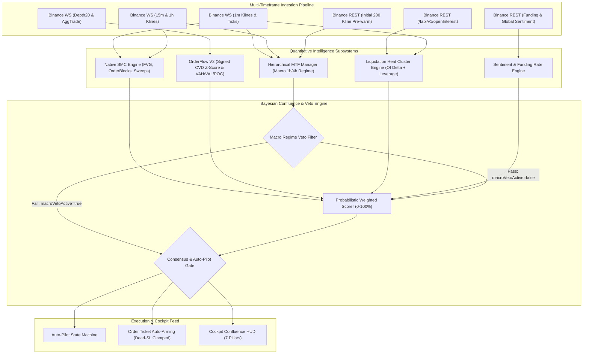

# Institutional Quantitative Confluence Engine & Autonomous Market Intelligence

* **Author:** fxbluster
* **Status:** In Review
* **Date:** 2026-11-21

--------------------------------------------------------------------------------

## Overview

This technical specification details the architectural overhaul of TradeOS's 6+1 Confluence Matrix, transitioning it from a basic heuristic indicator counter into an institutional-grade Quantitative Market Intelligence Engine. The redesigned system replaces lagging heuristics, uncalibrated equal-weight voting, and dormant external dependencies with true multi-timeframe structural regimes (Macro 4h/1h, Intermediate 15m, Micro 1m), native Smart Money Concepts (FVG, Order Blocks, Liquidity Sweeps), mathematically verified CVD absorption anomalies, dynamic liquidation cluster mapping, and volatility-scaled Bayesian consensus.

## The Problem

While the TradeOS cockpit execution pipeline, safety armor (Dead-SL, 400ms hold, circuit breaker), and 60fps charting are robust, the current 6+1 Confluence Matrix suffers from structural deficiencies when evaluated against institutional quantitative trading desk standards:

1. **Pseudo-Multi-Timeframe Trend (Single-Frame Vulnerability):** The `MTF_TREND` pillar evaluates only the active chart timeframe (e.g., 1m or 5m) against EMA 9/21/50/200 and ADX 14. It lacks hierarchical higher-timeframe (HTF) macro filtering (1h/4h), allowing the engine to buy directly into strong higher-timeframe resistance zones or sell into macro liquidity pools.
2. **False CVD Absorption Mechanics:** In `confluenceEngine.ts`, CVD evaluation currently treats raw cumulative delta (`cvd > 0` vs `cvd < 0`) as absorption. In quantitative order flow, true absorption is a signed divergence anomaly where aggressive market orders fail to push price further due to heavy resting passive limit liquidity (e.g., extreme seller delta $Z_\Delta \le -2.0$ while price delta $\ge 0$).
3. **Dead-Weight External PineScript Dependency:** Pillar 7 (`PINE_SMC`) is entirely dormant unless an external user configures third-party TradingView webhook infrastructure. When inactive, the matrix permanently forfeits 10% of its decision score.
4. **Parabolic Momentum Inversion:** Pillar 2 (`MOMENTUM`) treats RSI > 65 as an "Overbought Warning" (`WAIT` status). In crypto momentum breakouts, persistent RSI elevation above 65 with expanding volume indicates strong institutional trend continuation rather than an immediate reversal.
5. **Static Liquidation Heuristics:** Pillar 5 (`LIQ_MAGNET`) relies on a static ±1.0x ATR boundary around swing highs/lows without calculating leverage distribution density (10x, 25x, 50x, 100x liquidation levels) or monitoring Binance real-time Open Interest (OI) net changes.
6. **Equal-Weighted Arbitrary Consensus:** The current matrix relies on a coarse 4-out-of-7 integer threshold. A lagging sentiment reading from a news headline carries the same voting weight as Level 2 order book order flow and multi-timeframe market structure.

## Goals

* **True Hierarchical Multi-Timeframe Matrix:** Enforce a strict 3-tier timeframe hierarchy (Macro 1h/4h for regime directional filter, Intermediate 15m for market structure, Micro 1m/5m for execution entry timing).
* **Native Server-Side Smart Money Concepts (SMC):** Implement an in-memory algorithmic SMC engine in `@tradeos/server` that detects Fair Value Gaps (FVG), Bullish/Bearish Order Blocks (OB), and Liquidity Sweeps without requiring external TradingView webhooks.
* **True Order Flow Divergence & Volume Profile:** Upgrade `orderFlowEngine.ts` to calculate real absorption divergences (Price delta vs signed CVD delta Z-score) and Point of Control (POC) / Value Area High & Low (VAH/VAL).
* **Binance Open Interest (OI) & Liquidation Cluster Matrix:** Ingest live Binance Futures open interest and calculate leverage-weighted liquidation heat clusters.
* **Bayesian Probabilistic Weighting & Veto Architecture:** Replace equal-weight counting with a dynamic 3-tier confidence model where Macro Regime possesses hard directional veto power over lagging oscillators, and neutral secondary pillars receive a baseline score of 50 to prevent consensus starvation.

## Non-Goals

* Building a machine-learning neural network or black-box deep learning model requiring GPU clusters.
* Arbitrage trading across multiple external exchanges (system remains strictly dedicated to Binance Futures USDT-M pairs).
* High-frequency microsecond colocation trading (TradeOS operates in the swing / day-trading execution regime with 250ms–1s tick updates).

## Resolved Architectural Decisions

1. **Macro Kline Ingestion Architecture:** Hybrid ingestion model: On symbol selection (`wsHub.onSubscribeSymbol`), the server executes an initial REST pre-warm of 200 candles for 15m and 1h intervals via `client.getKlines(symbol, interval, 200)`. Once initialized, in-memory circular ring buffers are updated incrementally via live Binance WebSocket streams (`<symbol>@kline_15m` and `<symbol>@kline_1h`). If the 1h kline stream receives no update for > 120s, the system fail-closes to `DEGRADED` mode and sets `macroVetoActive = true`, immediately halting automated Auto-Pilot entries.
2. **SMC Calculation Depth & Performance:** Strict bounded circular ring buffer of 200 candles for 15m and 1h intervals. Bounding to 200 candles guarantees incremental SMC geometric scans complete in < 1.8ms on Node.js v22.
3. **Event-Driven Closed-Candle Architecture:** FVG and Order Block formation are calculated strictly upon confirmed candle close (`kline.isClosed === true`). On raw 4Hz price ticks, only an O(1) scalar proximity check (`currentPrice >= zone.low && currentPrice <= zone.high`) is executed, preserving the <= 5ms tick budget on the single-threaded Node.js event loop.

## Critical User Journeys (CUJs)

### CUJ 1: Macro-Aligned Trend Continuation Entry
* **Given**: BTCUSDT 1h trend is strongly bullish (Price > 1h EMA200, 1h ADX > 25), while 1m price pulls back into a 15m Fair Value Gap (FVG).
* **When**: 1m CVD prints aggressive seller absorption (signed $Z_\Delta \le -2.0$ while price delta $\ge 0$) and Order Flow turns 2.5x Buy.
* **Then**: The Confluence Matrix upgrades from `WAIT` to `STRONG_CONSENSUS (Composite Score: 82%, Macro Bias: MACRO_BULLISH)`, Auto-Pilot triggers an institutional Long entry, arms a Stop Loss at `max(fvgLow, entry - 1.5 * ATR, estLiq * 1.005)` respecting Dead-SL Armor, and sets TP1 at the nearest 1h liquidation cluster yielding $R:R \ge 1.5$.

### CUJ 2: Bear Trap & Liquidity Sweep Reversal
* **Given**: SOLUSDT breaks below a key 4h swing low, triggering retail stop-loss liquidations.
* **When**: Binance Open Interest drops sharply (forced liquidation flush), price immediately sweeps back above the swing low within 2 candles, and native SMC flags a Liquidity Sweep.
* **Then**: The Confluence Matrix immediately vetoes any short signal, flags `BULLISH SWEEP DETECTED`, and presents a high-probability reversal long opportunity with a tight risk boundary.

--------------------------------------------------------------------------------

## Technical Plan (Architecture)

### 1. High-Level System Topology

### 2. Core Quantitative Subsystems

#### A. Hierarchical MTF Manager (`hierarchicalMtfManager.ts`)
* **3-Tier Structure:**
  * **Macro Regime (1h / 4h):** Calculates 200 EMA, SuperTrend (10, 3.0), and Directional Movement (ADX 14). Establishes the non-negotiable macro bias (`MACRO_BULLISH`, `MACRO_BEARISH`, or `MACRO_RANGING`).
    * SuperTrend upper/lower bands: $\text{Upper} = \frac{\text{High} + \text{Low}}{2} + 3.0 \times \text{ATR}(10)$, $\text{Lower} = \frac{\text{High} + \text{Low}}{2} - 3.0 \times \text{ATR}(10)$.
  * **Intermediate Structure (15m):** Establishes swing high/low market structure, detects breaks of structure (BOS), and frames valid trading zones.
  * **Micro Execution (1m / 5m):** High-frequency tick updates for precision entries, stop loss pinning, and invalidation monitoring.
* **Hard Invalidation Veto:** If the Macro Regime is `MACRO_BEARISH` (Price < 1h EMA200 with ADX > 25), the engine sets `macroVetoActive = true`, strictly vetoing all automated Long proposals. The composite score evaluates naturally without artificial scalar clamping, preserving observability.

#### B. Native Server-Side SMC Engine (`nativeSmcEngine.ts`)
* Eliminates reliance on external TradingView PineScript webhooks.
* **Anti-Repainting Invariant:** Evaluates FVG and Order Block formation strictly on confirmed closed candles (`candle[i-1]`, `candle[i-2]`, `candle[i-3]`). The active forming candle (`candle[i]`) is evaluated strictly for zone mitigation and invalidation.
* **Fair Value Gap (FVG) Detector:**
  * Identifies 3-candle imbalances:
    * Bullish FVG: `Low(candle[i]) > High(candle[i-2])`
    * Bearish FVG: `High(candle[i]) < Low(candle[i-2])`
  * Tracks mitigation state: An FVG remains active until subsequent candle wicks completely overlap its imbalance zone.
* **Order Block (OB) Detector:**
  * A candle $C_i$ where candle $C_{i+1}$ has body size $\ge 1.8 \times \text{ATR}(14)$ and closes beyond the highest high of the previous 5 candles (Bullish BOS). Invalidation price is $\text{Low}(C_i)$ for Bullish OB, $\text{High}(C_i)$ for Bearish OB.
* **Liquidity Sweep & CHoCH (Change of Character):**
  * Flags when price wicks beyond a recent 20-candle swing high/low and closes back inside within 2 candles.

#### C. Order Flow V2: True CVD Absorption & Volume Profile (`orderFlowEngine.ts`)
* **Absorption Anomaly Detector:**
  * Computes the rolling sample standard deviation $\sigma_\Delta$ of 1-minute delta over a 15-minute sliding sample (15 discrete 1-minute bars):
    $$\sigma_\Delta = \sqrt{\frac{1}{15}\sum_{k=1}^{15}(\Delta_k - \bar{\Delta})^2}$$
  * Standardizes on signed Z-scores: $Z_\Delta = \frac{\Delta_{\text{60s}} - \bar{\Delta}}{\sigma_\Delta}$.
  * *Bullish Absorption:* $Z_\Delta \le -2.0$ (extreme aggressive market sells) while $\Delta P_{\text{60s}} \ge 0$ (large passive buyers completely absorb aggressive selling).
  * *Bearish Absorption:* $Z_\Delta \ge +2.0$ (extreme aggressive market buys) while $\Delta P_{\text{60s}} \le 0$ (large passive sellers absorb aggressive buying).
* **Micro Volume Profile:**
  * Computes Point of Control (POC), Value Area High (VAH, 70% volume), and Value Area Low (VAL). Price accepting above VAH is bullish continuation; rejection at POC signals mean reversion.

#### D. Dynamic Liquidation Cluster Engine (`liquidationEngine.ts`)
* Ingests Binance live Open Interest (`client.getOpenInterest(symbol)` via `BinanceClient`).
* **Leverage Cluster Projection Formula:**
  Projects liquidation price distributions for 10x, 25x, 50x, and 100x positions:
  $$P_{\text{long\_liq}} = P_{\text{mark}} \times \left(1 - \frac{1}{\text{Lev}}\right), \quad P_{\text{short\_liq}} = P_{\text{mark}} \times \left(1 + \frac{1}{\text{Lev}}\right)$$
  for $\text{Lev} \in \{10, 25, 50, 100\}$, assigning cluster weight: 10x (15%), 25x (35%), 50x (35%), 100x (15%).
* When price approaches an estimated cluster of > $5M within 1.2x ATR, Pillar 5 activates `LIQUIDATION_MAGNET_ACTIVE`.

### 3. Bayesian Weighted Consensus Model (`math.ts`)

Replaces flat integer counting (4/7) with an institutional weighted scoring matrix:

| Pillar ID | Pillar Name | Category | Weight | Invalidation Veto Power? |
| :--- | :--- | :--- | :--- | :--- |
| `MACRO_REGIME` | 1h/4h Macro Trend & Bias | Tier 1 (Structural) | **25%** | **YES** (Hard directional block) |
| `NATIVE_SMC` | FVG, Order Blocks & Sweeps | Tier 1 (Structural) | **25%** | No |
| `CVD_ABSORPTION` | Order Flow Divergence / Absorption | Tier 2 (Flow) | **20%** | No |
| `ORDER_FLOW_L2` | 60s Flow & Top-20 Book Imbalance | Tier 2 (Flow) | **15%** | No |
| `LIQ_CLUSTERS` | OI Delta & Liquidation Magnet | Tier 3 (Tactical) | **7.5%** | No |
| `MOMENTUM_RVOL` | Volatility-Adjusted RVOL & Momentum | Tier 3 (Tactical) | **5%** | No |
| `SENTIMENT_MACRO` | Funding Rate & News Sentiment | Tier 3 (Tactical) | **2.5%** | No |
| **Total** | **Unified Confluence Engine** | — | **100%** | — |

* **Consensus Starvation Prevention:** Neutral tactical pillars (`bias === 'NEUTRAL'`) contribute a baseline score of 50 rather than 0, ensuring that neutral secondary signals do not suppress strong Tier 1 structural setups.
* **Execution Thresholds & Domain Mapping:**
  * `Composite Score >= 75%` AND `!macroVetoActive`: `STRONG_BUY` / `STRONG_SELL` (`STRONG_CONSENSUS` — Auto-Pilot executes, full margin up to cap).
  * `60% <= Composite Score < 75%` AND `!macroVetoActive`: `BUY` / `SELL` (`MODERATE_CONSENSUS` — manual discretionary execution with halved risk).
  * `Composite Score < 60%` OR `macroVetoActive === true`: `WAIT` (`BLOCKED` — Auto-Pilot disengaged).

--------------------------------------------------------------------------------

## Alternatives Considered

### Alternative A: Offloading SMC & Quant Calculations to an External Python Microservice

* **Pros:** Enables direct leverage of scientific Python ecosystems (`pandas-ta`, `scipy`, `numpy`) and existing open-source backtesting frameworks.
* **Cons:** Introduces cross-process inter-process communication (IPC) and HTTP serialization latency (50–100ms per market tick); adds a second runtime dependency stack (Python 3.11, pip packages, virtual environments); complicates single-command production deployment and introduces dual supervisor crash modes.
* **Reason for Rejection:** TradeOS requires sub-5ms unified tick execution latency. Computing SMC geometries and moving averages natively in memory in Node.js eliminates IPC serialization overhead and keeps memory consumption below 150MB.

### Alternative B: Black-Box Machine Learning (LSTM / Transformer) Price Predictor

* **Pros:** Capable of capturing non-linear multi-variate statistical interactions across large historical tick datasets.
* **Cons:** Black-box predictions cannot be audited or explained; highly vulnerable to severe out-of-distribution regime shifts during crypto volatility shocks; requires significant GPU compute resources; produces high model inference latency.
* **Reason for Rejection:** Institutional capital preservation requires deterministic, explainable rules (market structure breaks, order flow absorption, and verifiable support/resistance levels) with transparent invalidation boundaries rather than opaque probabilistic guesses.

### Alternative C: Polling Binance REST API for Multi-Timeframe Candles on Every Tick

* **Pros:** Simple to implement; does not require maintaining background historical candle ring buffers.
* **Cons:** Exhausts Binance API weight limits (1200 request weight/min) in seconds when managing multiple timeframes across pairs, triggering HTTP 429 IP bans; introduces 200–500ms REST round-trip latency on every execution tick.
* **Reason for Rejection:** Violates exchange rate-limit and latency invariants. Pre-warming historical 15m and 1h ring buffers once upon symbol selection and updating live candles incrementally via WebSocket tick events consumes negligible API weight while guaranteeing sub-millisecond execution readiness.

--------------------------------------------------------------------------------

## Non-Functional Requirements

### 1. Performance & Execution Latency
* **Tick Evaluation Budget:** Ingestion of a market tick, MTF regime check, scalar SMC zone proximity check, and Bayesian score calculation must complete in <= 5ms on the Node.js event loop.
* **Memory Footprint & Eviction:** Ring buffers for 1m, 15m, and 1h candles enforce strict bounds (200 candles per timeframe). Symbol caches implement an LRU eviction policy with a maximum of 3 concurrent pairs, ensuring heap usage remains strictly below 150MB.

### 2. Failure Modes & Mitigations
* **Macro Data Desynchronization:** If the higher-timeframe 1h data stream receives no update for > 120s, the matrix fail-closes to `DEGRADED` mode, sets `macroVetoActive = true`, disengages automated Auto-Pilot execution, and flags a visible amber warning on the Cockpit HUD.
* **Rate-Limit Resilience:** All REST pre-warming calls use exponential backoff with jitter and respect Binance API weight headers (`X-MBX-USED-WEIGHT-1M`).

--------------------------------------------------------------------------------

## Detailed Implementation Plan

### Target Files to Create/Modify

#### 1. `packages/shared/src/contracts.ts` (Modify)
* **Type / Scope:** TypeScript Domain Model Contracts.
* **Proposed Changes:**
  * Define `MacroRegime` (`'MACRO_BULLISH' | 'MACRO_BEARISH' | 'MACRO_RANGING' | 'DEGRADED'`).
  * Define `FairValueGap` interface (`id`, `timeframe`, `type: 'BULLISH' | 'BEARISH'`, `high`, `low`, `mitigated: boolean`, `formedAt: number`).
  * Define `OrderBlock` interface (`id`, `timeframe`, `type: 'BULLISH' | 'BEARISH'`, `high`, `low`, `invalidationPrice: number`, `volume: number`).
  * Define `LiquiditySweep` interface (`id`, `direction: 'SWEEP_HIGH' | 'SWEEP_LOW'`, `sweepPrice: number`, `reclaimPrice: number`, `time: number`).
  * Update `ConfluencePillarId` union to:
    `'MACRO_REGIME' | 'NATIVE_SMC' | 'CVD_ABSORPTION' | 'ORDER_FLOW_L2' | 'LIQ_CLUSTERS' | 'MOMENTUM_RVOL' | 'SENTIMENT_MACRO'`.
  * Extend `ConfluenceSnapshot` with:
    `macroVetoActive: boolean; macroRegime: MacroRegime; activeFvgs: FairValueGap[]; activeOrderBlocks: OrderBlock[]; latestSweep: LiquiditySweep | null;`.
  * Ensure clean re-exports in `packages/shared/src/index.ts`.

#### 2. `packages/shared/src/math.ts` (Modify)
* **Type / Scope:** Core Quantitative Mathematics.
* **Proposed Changes:**
  * Update `calculateCompositeConfluenceScore`:
    * Implement the 7-pillar Bayesian weighting (25%, 25%, 20%, 15%, 7.5%, 5%, 2.5%).
    * Neutral pillars contribute a baseline score of 50.
    * Macro Veto logic: When `macroVetoActive === true`, set `recommendedAction = 'WAIT'`, preserving natural composite score without scalar clamping.

#### 3. `packages/shared/src/__tests__/math.test.ts` (Modify)
* **Type / Scope:** Financial Math Unit Tests.
* **Proposed Changes:**
  * Unit tests verifying:
    * 100% total weight normalization across all 7 pillars.
    * Neutral pillar baseline score (50) preventing consensus starvation.
    * Macro Veto boolean latch setting `recommendedAction = 'WAIT'` while preserving composite score.
    * Score thresholds for `STRONG_BUY` (>= 75%) and `BUY` (60-74%).

#### 4. `apps/server/src/exchange/binanceClient.ts` (Modify)
* **Type / Scope:** Exchange REST Client.
* **Proposed Changes:**
  * Implement `getOpenInterest(symbol: string): Promise<{ symbol: string; openInterest: string; time: number }>` via `/fapi/v1/openInterest`.

#### 5. `apps/server/src/quant/indicators.ts` (Modify)
* **Type / Scope:** Quantitative Indicator Library.
* **Proposed Changes:**
  * Implement `calculateSuperTrend(highs: number[], lows: number[], closes: number[], period?: number, multiplier?: number): { supertrend: number[]; direction: ('BULLISH' | 'BEARISH')[] }`.

#### 6. `apps/server/src/quant/hierarchicalMtfManager.ts` (Create)
* **Type / Scope:** Server-side Multi-Timeframe State Manager.
* **Proposed Changes:**
  * Manage 200-candle circular ring buffers for 1m, 15m, and 1h intervals.
  * Compute 1h EMA200, SuperTrend (10, 3.0), and ADX(14) to return `MacroRegime`.
  * Enforce 120s timeout fail-closed to `DEGRADED`.
  * Expose `getMacroBias(symbol: string): { regime: MacroRegime; adx: number; ema200: number; macroVetoActive: boolean }`.

#### 7. `apps/server/src/quant/nativeSmcEngine.ts` (Create)
* **Type / Scope:** Server-side Smart Money Concepts Detector.
* **Proposed Changes:**
  * Event-driven state machine: Compute new zones only upon closed candles (`kline.isClosed === true`).
  * Implement `detectFairValueGaps(candles: KlineCandle[]): FairValueGap[]`.
  * Implement `detectOrderBlocks(candles: KlineCandle[], swingLookback: number): OrderBlock[]`.
  * Implement `detectLiquiditySweeps(candles: KlineCandle[], currentPrice: number): LiquiditySweep | null`.
  * O(1) tick proximity checks for active unmitigated zones.

#### 8. `apps/server/src/quant/orderFlowEngine.ts` (Modify)
* **Type / Scope:** Server-side Microstructure & Order Flow Engine.
* **Proposed Changes:**
  * Implement signed Z-score absorption divergence over 15-minute sample window: Bullish ($Z_\Delta \le -2.0$, $\Delta P_{\text{60s}} \ge 0$) and Bearish ($Z_\Delta \ge +2.0$, $\Delta P_{\text{60s}} \le 0$).
  * Compute Volume Profile Point of Control (POC), Value Area High (VAH), and Value Area Low (VAL).

#### 9. `apps/server/src/quant/liquidationEngine.ts` (Modify)
* **Type / Scope:** Liquidation Heat Cluster Engine.
* **Proposed Changes:**
  * Ingest live Open Interest figure and project leverage clusters (10x, 25x, 50x, 100x).
  * Identify nearest magnetic liquidity clusters within 1.2x ATR.

#### 10. `apps/server/src/quant/confluenceEngine.ts` (Modify)
* **Type / Scope:** Master Confluence Aggregator.
* **Proposed Changes:**
  * Wire `HierarchicalMtfManager`, `NativeSmcEngine`, upgraded `OrderFlowEngine`, and `LiquidationEngine`.
  * Set `consensusMet = compositeScore >= 75 && !macroVetoActive`.
  * Broadcast enhanced `ConfluenceSnapshot` via WebSocket.

#### 11. `apps/server/src/services/autoPilotManager.ts` (Modify)
* **Type / Scope:** Autonomous Execution Controller.
* **Proposed Changes:**
  * Entry condition: `snapshot.compositeScore >= 75 && !snapshot.macroVetoActive`.
  * **Dead-SL Armor Clamping:** Guarantee SL is strictly on the safe side of isolated liquidation:
    `stopLoss = side === 'BUY' ? Math.max(rawSl, estLiq * 1.005) : Math.min(rawSl, estLiq * 0.995)`.
  * Dynamic TP1: Pin to nearest liquidation cluster only if $R:R \ge 1.5$ and distance $\ge 0.5\%$; otherwise fall back to ATR (+2.0x ATR for TP1, +4.0x ATR for TP2).

#### 12. `apps/server/src/index.ts` (Modify)
* **Type / Scope:** Server Entrypoint & Stream Orchestration.
* **Proposed Changes:**
  * Instantiate `HierarchicalMtfManager` and `NativeSmcEngine`.
  * Wire `binanceStreamsManager.onKline` to ingest `1m`, `15m`, and `1h` candles.
  * Pre-warm 15m and 1h ring buffers via REST upon symbol selection.

#### 13. `apps/server/src/quant/__tests__/confluence_and_smc.test.ts` (Create)
* **Type / Scope:** Server Quantitative Integration Test Suite.
* **Proposed Changes:**
  * Unit and integration tests for FVG detection, mitigated FVG invalidation, Order Block validation, Macro Veto rejection, signed CVD absorption anomalies, empty history handling, and Dead-SL armor clamping.

#### 14. `apps/web/src/store/useMarketStore.ts` (Modify)
* **Type / Scope:** Frontend State Store.
* **Proposed Changes:**
  * Add `activeFvgs: FairValueGap[]`, `activeOrderBlocks: OrderBlock[]`, `latestSweep: LiquiditySweep | null`, and `showSmcOverlay: boolean` toggle.

#### 15. `apps/web/src/components/ConfluenceHUD.tsx` (Modify)
* **Type / Scope:** Frontend HUD Component.
* **Proposed Changes:**
  * Update `PILLAR_METADATA` and render the 7 new institutional pillars.
  * Render an unmistakable amber warning banner when Macro Veto is active (`MACRO VETO ENGAGED: Longs blocked below 1h EMA200`).

#### 16. `apps/web/src/components/ChartCanvas.tsx` (Modify)
* **Type / Scope:** Frontend Charting Engine.
* **Proposed Changes:**
  * Add visual canvas overlay twin price lines for active FVG zones (upper boundary `color: 'rgba(14, 203, 129, 0.6)'`, lower boundary `rgba(14, 203, 129, 0.3)'`) with axis labels `FVG HIGH` and `FVG LOW`.
  * Render Liquidity Sweep markers and wire toolbar toggle.

--------------------------------------------------------------------------------

## Verification Plan

* **Compilation/Build:** Run `npm run build` across `@tradeos/shared`, `@tradeos/server`, and `@tradeos/web` with zero TypeScript errors (`tsc --noEmit`).
* **Unit Tests:** Execute `npx vitest run` with 100% pass rate across shared math and server quantitative test suites.
* **Static Analysis & Linting:** Run `npm run lint` (`eslint . --max-warnings=0`).
* **Test Coverage Requirement:** Ensure >= 85% branch coverage across all newly created and modified quantitative modules (`packages/shared/src/math.ts`, `hierarchicalMtfManager.ts`, `nativeSmcEngine.ts`, `orderFlowEngine.ts`).
* **Latency Benchmark:** Assert that native SMC detection and multi-timeframe evaluation execute in <= 5ms per tick under high-load synthetic trade streams.
* **Visual Cockpit Verification:** Inspect the live Cockpit HUD in Chrome DevTools to verify that Macro Regime, SMC Zones, and CVD Divergences reflect real Binance market data without chart stutter or frame drops.

--------------------------------------------------------------------------------

*Drafted and verified with EGM*
