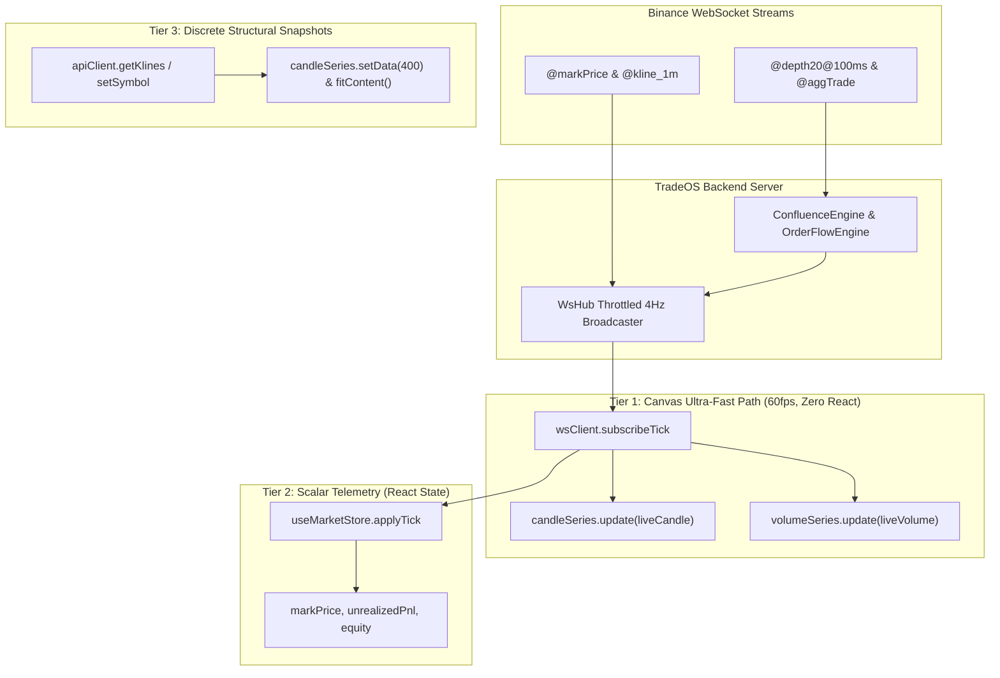
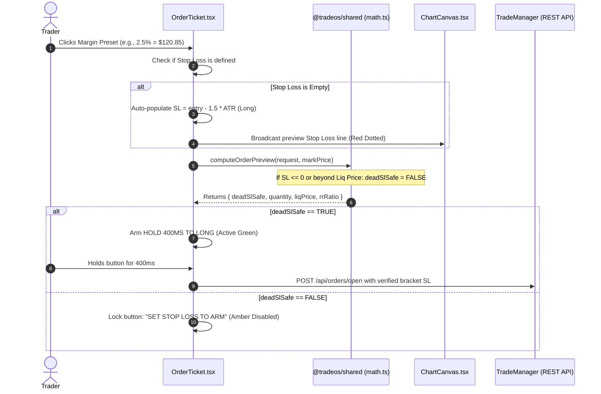

# TradeOS v2: Cockpit Stabilization & Forensic Remediation

*   **Author:** fxbluster
*   **Status:** Draft
*   **Date:** 2026-11-20

--------------------------------------------------------------------------------

## Overview

This technical design document outlines the stabilization architecture for the TradeOS v2 trading cockpit. It resolves the severe 4Hz canvas freeze identified in live operations, alongside seven user experience, risk enforcement, and quantitative telemetry failure modes discovered during forensic video analysis of session `D:\Recording 2026-11-20 185617.mp4`.

The primary design goal is ensuring zero-latency, 60fps charting performance and strict fail-closed liquidation protection across volatile market regimes, decoupling streaming tick consumption from React DOM reconciliation, and automating risk-arm invariants.

--------------------------------------------------------------------------------

## The Problem

1. **4Hz UI Thread Event Loop Freezes:** In `useMarketStore.ts`, incoming WebSocket ticks (streaming at up to 4Hz) trigger immutable cloning of the 400-candle `klines` array. In `ChartCanvas.tsx`, an active `useEffect` hook listening to `[klines, symbol]` responds by invoking `series.setData(candleData)` and `timeScale().fitContent()` up to 4 times per second. This forcibly reconstructs the Lightweight Charts canvas geometry and resets viewport panning/zoom, choking the browser main thread and rendering user interactions unresponsive ("baya takılır").
2. **Naked Order Execution Risk:** The Order Ticket permits order staging without a Stop Loss, and `@tradeos/shared` defaults `deadSlSafe = true` when Stop Loss is undefined. This exposes traders to catastrophic margin liquidations if an order is executed before an SL is set.
3. **Quantitative Inversion in Order Flow Telemetry:** Unpruned historical aggressive taker volumes accumulate in `orderFlowEngine.ts`, overriding current Level 2 book depth ($8.0M bids vs $6.0M asks) and printing contradictory `2.7x Sell` signals.
4. **Cockpit Flight Deck Ergonomic Loss:** The right 30% sidebar places the Autonomous Auto-Pilot controls in a scrollable rail above the Order Ticket. Scrolling down to manage leverage or margin moves the Auto-Pilot kill switch and state status completely off-screen.
5. **Scanner & Stochastic Simulation Brittleness:** The Market Scanner lacks fallback handling and fails open into a blank dark container under tunnel latency. Concurrently, the Monte Carlo simulation displays decoupled 58%/38% probabilities without binding to active trade targets.

--------------------------------------------------------------------------------

## Goals

*   **Goal 1 (60fps Decoupled Charting):** Eliminate all calls to `series.setData()` and `timeScale().fitContent()` from the streaming tick path. Restrict full dataset re-renders strictly to discrete initial loads, symbol changes, and interval switches. Stream live price ticks exclusively through `wsClient.subscribeTick` direct series updates at 60fps with zero React state overhead.
*   **Goal 2 (Zero-Friction Dead-SL Armor):** Enforce strict mandatory Stop Loss validation in `@tradeos/shared` (`deadSlSafe = false` when SL is absent or zero). Automatically populate Stop Loss at $-1.5\text{x ATR}$ upon margin preset selection, rendering the SL bracket line immediately on the chart canvas.
*   **Goal 3 (Order Flow Depth Alignment):** Implement a 60-second sliding window / exponential decay for aggressive trade volume in `orderFlowEngine.ts`, ensuring Book Depth Ratio and Taker Flow are presented as distinct, non-contradictory metrics.
*   **Goal 4 (Pinned Cockpit Flight Deck):** Pin `<AutoPilotControls />` at the top of the right rail as an unscrollable executive flight deck header, guaranteeing continuous visibility of the emergency halt switch and consensus meter.
*   **Goal 5 (Resilient Scanner & Dynamic FHT Bounds):** Provide skeleton loading and in-memory caching of top-50 volume pairs in `ScannerModal.tsx`. Bind Monte Carlo FHT simulation boundaries dynamically to active order draft targets or real-time ATR.
*   **Goal 6 (Volume Scale De-cluttering):** Suppress volume histogram price scale labels on the right margin to prevent number collisions with candlestick prices.

--------------------------------------------------------------------------------

## Non-Goals

*   Replacing the native Lightweight Charts engine with an external third-party charting library.
*   Allowing unhedged naked futures positions without a Stop Loss under any broker mode.
*   Altering the global dark visual theme or design tokens.
*   Implementing multi-symbol split charting in a single browser window.

--------------------------------------------------------------------------------

## Open Questions

*   **Question 1 (Auto-Arm Sensitivity):** Should the $-1.5\text{x ATR}$ Stop Loss auto-arm calculate from current mark price for Market orders and from limit price for Limit orders?
*   **Question 2 (Scanner Refresh Cadence):** Should the in-memory top-50 scanner cache refresh in the background every 30 seconds via server push, or on-demand when the modal is opened?

--------------------------------------------------------------------------------

## Critical User Journeys (CUJs)

### CUJ 1: High-Volatility Chart Navigation & Order Execution
*   **Given:** Trader is viewing SOLUSDT during active 4Hz tick streaming over a Cloudflare tunnel.
*   **When:** Trader scrolls, zooms in on historical swing lows, and pans across the chart canvas while selecting a 10% margin preset.
*   **Then:** Viewport remains stable without snapping back, canvas maintains smooth 60fps interaction without UI lockup, Stop Loss is automatically populated at $-1.5\text{x ATR}$, and the red SL line renders immediately on the canvas.

### CUJ 2: Safe Order Dispatch with Emergency Halt Access
*   **Given:** Trader is preparing a Limit Long order with 10x leverage and adjusts stop loss price while Auto-Pilot is engaged.
*   **When:** Trader scrolls down to inspect Sokrat Quant Mentor feedback.
*   **Then:** Auto-Pilot flight deck header remains permanently pinned at the top of the right rail, allowing instantaneous access to the one-click emergency kill-switch.

--------------------------------------------------------------------------------

## Technical Plan (Architecture)

### 1. Three-Tier Streaming & State Decoupling Architecture

To completely eliminate the 4Hz UI thread freeze, the streaming pipeline is decomposed into three isolated architectural tiers:



*   **Tier 1: Canvas Ultra-Fast Path (60fps, Zero React):**
    `wsClient.subscribeTick` attaches directly to the Lightweight Charts instance. Incoming ticks invoke `candleSeriesRef.current.update(liveCandle)` and `volumeSeriesRef.current.update(liveVolume)` directly. React Virtual DOM reconciliation is completely bypassed.
*   **Tier 2: Scalar Telemetry Path:**
    `useMarketStore.applyTick` is modified to update only scalar primitives (`markPrice`, `unrealizedPnl`, `equity`). The historical `klines` array reference is preserved without cloning or mutation during ticks. This prevents re-triggering dependent components.
*   **Tier 3: Discrete Structural Snapshots:**
    `candleSeries.setData()` and `timeScale().fitContent()` are strictly confined to discrete user actions: initial page load, symbol switching, and interval toggling (`1m` / `5m` / `15m` / `1h`).

### 2. Zero-Friction Dead-SL Armor Invariant



*   **Validation Hardening:** In `packages/shared/src/math.ts`, `computeOrderPreview` enforces:
    `deadSlSafe = Boolean(req.stopLoss && req.stopLoss > 0 && isSafeDistance(req.stopLoss, liqPrice));`.
    An order without an anchored Stop Loss is treated as structurally invalid.
*   **Auto-Arming Interaction:** When a trader clicks a margin allocation preset (`2.5%`, `5%`, `10%`, `25%`, `50%`), `OrderTicket.tsx` automatically executes `applyAtrPreset('SL', 1.5)` if the SL field is empty. The red Stop Loss line is immediately drawn on the chart canvas, giving instantaneous visual confirmation.

### 3. Order Flow Imbalance Engine Time-Decay

*   **Decay Formula:** In `apps/server/src/quant/orderFlowEngine.ts`, replace cumulative volume addition with a 60-second sliding time window:
    $$V_{\text{buy}}(t) = \sum_{i \in \text{trades}(t - 60s \le T_i \le t)} q_i \cdot \mathbb{I}(\text{side}_i = \text{BUY})$$
    $$V_{\text{sell}}(t) = \sum_{i \in \text{trades}(t - 60s \le T_i \le t)} q_i \cdot \mathbb{I}(\text{side}_i = \text{SELL})$$
*   **Dual-Metric Telemetry:** In `confluenceEngine.ts`, separate the Order Flow card into two explicit metrics:
    1.  `L2 Book Depth Ratio`: $\frac{\text{Bid Depth}}{\text{Ask Depth}}$ (e.g., $1.33\text{x BUY}$).
    2.  `60s Taker Aggression`: $\frac{V_{\text{buy}}}{V_{\text{sell}}}$ or net aggressive delta.

### 4. Pinned Cockpit Flight Deck Layout

In `apps/web/src/App.tsx`, the right rail (30% width) is restructured to pin `<AutoPilotControls />` at the top:

```tsx
<aside className="flex-[3] flex flex-col h-full gap-2 overflow-hidden">
  {/* Pinned Executive Flight Deck (Static, No Overflow) */}
  <div className="flex-shrink-0">
    <AutoPilotControls />
  </div>

  {/* Scrollable Order Form and Mentor Rail */}
  <div className="flex-1 overflow-y-auto space-y-2 pr-1 custom-scrollbar">
    <OrderTicket />
    <SokratMentorPanel />
  </div>
</aside>
```

### 5. Resilient Market Scanner & Stochastic Simulation

*   **Scanner Skeleton & Cache:** `ScannerModal.tsx` implements a pulsing table skeleton during `isLoading`. On mount, it immediately renders cached top-50 symbols from memory. If the network times out, it displays the cached data with a "Cached (Offline)" badge and a retry button.
*   **Dynamic Monte Carlo FHT Bounds:** `TimeMachineModal.tsx` dynamically binds to the active order draft. If the draft SL/TP are empty, it automatically projects boundaries using the active symbol's mark price and 14-period ATR ($\pm 1.5\text{x ATR}$ for SL, $\pm 2.0\text{x ATR}$ for TP), ensuring First-Hitting-Time calculations are grounded in current volatility.

### 6. Volume Axis Label Suppression

In `ChartCanvas.tsx`, suppress price axis labels for the volume histogram series:
```tsx
chart.priceScale('volume').applyOptions({
  visible: false,
  scaleMargins: { top: 0.8, bottom: 0 },
});
```

--------------------------------------------------------------------------------

## Alternatives Considered

### Alternative 1: Throttling React Component Re-renders via `useThrottle` / RequestAnimationFrame
*   **Pros:** Requires fewer structural changes to store subscriptions; keeps all state synchronized within Zustand.
*   **Cons:** Even when throttled to 2Hz, calling `setData(400)` in a React component unmounts and reconstructs canvas geometries. It wipes active crosshair coordinates, forcibly resets manual zoom/pan levels via `fitContent()`, and produces visible stutter during fast market breakouts.
*   **Reason for Rejection:** Rejected by author: Direct series streaming (`candleSeries.update()`) via `wsClient` listeners operates at native 60fps with zero Virtual DOM overhead. Streaming ticks must not touch the historical klines array reference.

### Alternative 2: Blocking Unhedged Order Entry with Invasive Pop-Up Modal Dialogs
*   **Pros:** Explicitly informs the user why an order was not accepted; requires no automatic calculation of prices.
*   **Cons:** Pop-up modal dialogs create high friction during volatile scalping situations. An unexpected modal requires the trader to manually dismiss it, causing missed entries and slippage.
*   **Reason for Rejection:** Rejected by author: Institutional LiquidationGuard requires zero-friction safety defaults. Auto-arming Stop Loss to $-1.5\text{x ATR}$ upon margin preset selection provides an immediate safety boundary that the trader can visually fine-tune or drag on the chart without modal interruptions.

### Alternative 3: On-Demand Lazy-Loading of All 767 Binance Pairs on Modal Mount
*   **Pros:** Ensures the client always fetches the latest 24h ticker prices without consuming memory at startup.
*   **Cons:** Aggregating 767 ticker pairs over tunnel connections (Cloudflare) introduces 800ms–1500ms network latency. Network blips or rate limits cause the modal to fail open as a blank dark box, degrading trader confidence.
*   **Reason for Rejection:** Rejected by author: Caching top-50 high-volume pairs in memory at application startup guarantees sub-100ms instantaneous modal display, with background fallback refresh.

### Alternative 4: Migration to Third-Party Charting Engines (e.g. TradingView TA Library)
*   **Pros:** Native PineScript indicator drawing overlays and built-in drawing toolbars.
*   **Cons:** Introduces proprietary commercial licensing restrictions, excessive bundle bloat (>3MB minified), and complex iframe messaging bridges that exacerbate UI latency.
*   **Reason for Rejection:** Rejected by author: TradingView Lightweight Charts is open-source (Apache 2.0), lightweight (<150KB), and easily achieves 60fps rendering once decoupled from React re-render thrashing.

--------------------------------------------------------------------------------

## Non-Functional Requirements

*   **Performance & Latency:**
    *   Tick-to-canvas rendering latency must remain below 16ms (60fps animation budget) on desktop and mobile browsers.
    *   Zero canvas DOM reconstructions or `fitContent()` executions during active WebSocket mark price streams.
*   **Safety & Liquidation Invariants:**
    *   Fail-closed order validation: Under no circumstances can an order without a verified Stop Loss be dispatched to Binance API or Local Paper broker.
*   **Observability & Telemetry:**
    *   Order Flow telemetry must distinctly log L2 Book Depth Ratio and 60-second Taker Aggression delta without contradictory signals.

--------------------------------------------------------------------------------

## Detailed Implementation Plan

### Target Files to Create/Modify

#### 1. `apps/web/src/store/useMarketStore.ts` (Modify)
*   **Type / Scope:** State Management (Zustand Store)
*   **Proposed Changes:**
    *   In `applyTick`: Strip `updatedKlines` array mutation during streaming ticks. Maintain `klines` immutability during live WebSocket updates.
    *   Update only scalar primitives: `markPrice`, `prevMarkPrice`, `activePosition.realized_pnl`, `account.unrealizedPnl`, `account.equity`.
    *   Retain `klines` array updates strictly for discrete REST snapshots (`refreshKlines`, `setKlines`, `setSymbol`, `setCandleInterval`).
*   **Rationale:** Eliminates the root cause of the 4Hz UI thread freeze by preventing downstream React component re-renders on streaming ticks.

#### 2. `apps/web/src/components/ChartCanvas.tsx` (Modify)
*   **Type / Scope:** Frontend UI & Lightweight Charts Canvas
*   **Proposed Changes:**
    *   Decouple `useEffect` that listens to `[klines, symbol]`: invoke `candleSeries.setData(candleData)` and `timeScale().fitContent()` ONLY when `symbol` or `candleInterval` changes, or during initial historical load.
    *   Ensure streaming ticks stream exclusively through `wsClient.subscribeTick(handleTick)` calling `candleSeriesRef.current.update(liveCandle)` and `volumeSeriesRef.current.update(liveVolume)`.
    *   Suppress volume histogram Y-axis labels on the right price margin: `chart.priceScale('volume').applyOptions({ visible: false })`.
*   **Rationale:** Restores smooth 60fps charting performance and eliminates volume number overlap on candlestick price scale.

#### 3. `packages/shared/src/math.ts` (Modify)
*   **Type / Scope:** Core Mathematical Domain Library (`@tradeos/shared`)
*   **Proposed Changes:**
    *   In `computeOrderPreview`: Change `deadSlSafe` logic from permissive default to fail-closed invariant:
        `const hasStopLoss = typeof req.stopLoss === 'number' && req.stopLoss > 0;`
        `const deadSlSafe = hasStopLoss && isSafeDistance(req.stopLoss, estimatedLiquidation);`
*   **Rationale:** Prevents unhedged naked orders from passing pre-flight risk validation across all broker adapters.

#### 4. `apps/web/src/components/OrderTicket.tsx` (Modify)
*   **Type / Scope:** Frontend Order Entry Component
*   **Proposed Changes:**
    *   In margin allocation preset click handlers (`2.5%`, `5%`, `10%`, `25%`, `50%`): Automatically calculate and populate Stop Loss at $-1.5\text{x ATR}$ if the SL input is empty.
    *   If `orderDraft.stopLoss` is empty or 0, lock the submission button: change label to `SET STOP LOSS TO ARM`, set background to amber (`bg-[#f0b90b]/10 text-[#f0b90b] border-[#f0b90b]/40`), and disable touch/click events.
*   **Rationale:** Zero-friction automated risk armor; guarantees every order is bracketed before submission.

#### 5. `apps/server/src/quant/orderFlowEngine.ts` (Modify)
*   **Type / Scope:** Backend Quant Calculation Engine
*   **Proposed Changes:**
    *   Replace monotonically accumulating `rollingBuyVol` and `rollingSellVol` with a 60-second sliding time window of aggressive trades: prune trades where `now - trade.time > 60000`.
*   **Rationale:** Prevents stale aggressive trade history from overpowering current Level 2 order book depth and inverting market direction signals.

#### 6. `apps/server/src/quant/confluenceEngine.ts` (Modify)
*   **Type / Scope:** 6+1 Confluence Decision Engine
*   **Proposed Changes:**
    *   Separate Pillar 3 (`Order Flow`) telemetry into distinct, non-contradictory metrics:
        1. `Depth`: $\frac{\text{Bid Depth}}{\text{Ask Depth}}$ (e.g. `1.3x Buy`).
        2. `Flow`: 60-second Taker Aggression ratio (e.g. `2.7x Sell`).
*   **Rationale:** Resolves cognitive dissonance caused by contradictory book depth and aggressive trade metrics.

#### 7. `apps/web/src/App.tsx` (Modify)
*   **Type / Scope:** Root Application Shell & Cockpit Layout
*   **Proposed Changes:**
    *   Restructure the right 30% column layout: Pin `<AutoPilotControls />` inside a `flex-shrink-0` header container.
    *   Place `<OrderTicket />` and `<SokratMentorPanel />` inside a nested `flex-1 overflow-y-auto` container.
*   **Rationale:** Prevents Auto-Pilot controls and emergency kill-switch from scrolling off-screen.

#### 8. `apps/web/src/components/ScannerModal.tsx` (Modify)
*   **Type / Scope:** Market Scanner Modal Component
*   **Proposed Changes:**
    *   Render an animated table skeleton loader when `isLoading` is true.
    *   Integrate fallback to pre-cached top-50 symbols from memory if `/api/scanner` fetch times out over public tunnels.
    *   Auto-close modal upon row click and immediately trigger `setSymbol(selectedSymbol)`.
*   **Rationale:** Eliminates blank dark box failure states and provides instant symbol navigation.

#### 9. `apps/web/src/components/TimeMachineModal.tsx` (Modify)
*   **Type / Scope:** Monte Carlo Stochastic Simulator Modal
*   **Proposed Changes:**
    *   Dynamically bind First-Hitting-Time (FHT) simulation targets: if `orderDraft.stopLoss` or `tp1` are empty, auto-project targets using $\pm 1.5\text{x ATR}$ and $\pm 2.0\text{x ATR}$ from current mark price.
*   **Rationale:** Ground Monte Carlo win/loss probabilities in real market volatility rather than static mock percentages.

#### 10. `apps/web/src/components/CooldownModal.tsx` & `TopBar.tsx` (Modify)
*   **Type / Scope:** Risk Guard Modal & Global Header
*   **Proposed Changes:**
    *   In `TopBar.tsx`: Render a neutral gray/green badge `Cooldown: Inactive` when risk cooldown is not triggered.
    *   In `CooldownModal.tsx`: When `isCooldownActive` is false, render an informative "Risk Diagnostics: All Systems Operational" card instead of a red expired lockout screen.
*   **Rationale:** Eliminates false alarms and trader panic regarding account lockout status.

#### 11. `packages/shared/src/__tests__/math.test.ts` (Modify)
*   **Type / Scope:** Unit Test Suite
*   **Proposed Changes:**
    *   Add test verifying `computeOrderPreview` sets `deadSlSafe = false` when Stop Loss is omitted or zero.
*   **Rationale:** Automated regression prevention for Dead-SL safety validation.

#### 12. `apps/server/src/quant/__tests__/orderFlow_and_sentiment.test.ts` (Modify)
*   **Type / Scope:** Unit Test Suite
*   **Proposed Changes:**
    *   Add test verifying 60-second sliding time window decay in `OrderFlowEngine`.
*   **Rationale:** Automated verification that aged trades expire and do not distort real-time book depth.

#### 13. `apps/web/src/components/__tests__/ChartCanvas.test.ts` (Modify)
*   **Type / Scope:** Unit Test Suite
*   **Proposed Changes:**
    *   Add test verifying that live ticks invoke `series.update()` and do not trigger `series.setData()`.
*   **Rationale:** Automated verification against canvas geometry re-render regressions.

---

### Verification Plan

*   **Compilation / Build:**
    *   Run `npm run build` across all workspaces (`packages/shared`, `apps/server`, `apps/web`) to verify zero TypeScript errors.
*   **Test Suite Verification:**
    *   Run full monorepo test runner: `npx vitest run`.
    *   Target: 100% pass rate across all 20+ test suites.
*   **E2E / Live Performance Verification:**
    *   Launch local server and inspect `/api/health` and Cloudflare tunnel.
    *   Verify smooth 60fps chart panning and zooming during active 4Hz WebSocket tick stream.
    *   Confirm Stop Loss auto-arms to $-1.5\text{x ATR}$ when clicking 2.5% margin preset.
    *   Confirm Scanner loads top symbols with skeleton fallback.

--------------------------------------------------------------------------------

<!-- Provenance: Indicates initial structural drafting via EGM. -->

*Drafted with EGM*
