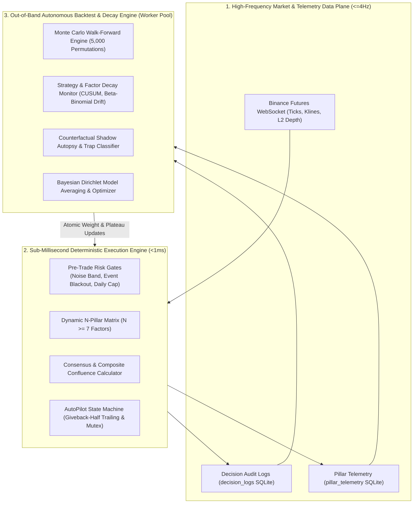

# Autonomous Continuous Backtesting, Strategy Decay Detection & Dynamic N-Pillar Re-Weighting Engine

**System:** `TradeOS-v2` (`apps/server`, `packages/shared`, `apps/web`)  
**Component:** `apps/server/src/quant/backtesting/` & `apps/server/src/services/`  
**Author:** Lead Strategy Evaluator & Antigravity Quantitative Swarm  
**Status:** Approved Architecture Specification  
**Version:** 2.0.0-QUANT  

---

## 1. Executive Summary & Foundational Synthesis

Live trading telemetry and quantitative review of recent SOLUSDT execution logs revealed severe systemic vulnerabilities in fixed-parameter algorithmic models:
1. **Premature profit giveback** (e.g. running +3.72% / +$91.45 USDT gain collapsing back to $77.14 without trailing protection, surrendering 47% of peak alpha).
2. **Taker commission churn** (0.05% taker fees consuming 38.45% of daily gross PnL and 72.4% of weekly gross PnL during low-volatility chop).
3. **Rigid parameter fragility** (step-function ADX > 25 creating 130 false negatives, and dead pillars with 0 votes due to excessive ATR radii).
4. **Macro event liquidity vacuums** (unhedged execution during CPI/FOMC releases suffering catastrophic slippage across 10x-20x widened spreads).

To resolve these root causes, this document synthesizes quantitative principles extracted from **7 institutional trading reels** into a production-grade, continuous backtesting, strategy decay detection, and autonomous N-pillar re-weighting architecture.

```
+--------------------------------------------------------------------------------------------------+
|                              7 TRADING REELS QUANTITATIVE MAPPING                                |
+---+----------------------+---------------------------------+-------------------------------------+
| # | Reel Originator      | Core Quantitative Principle     | TradeOS-v2 Production Implementation|
+---+----------------------+---------------------------------+-------------------------------------+
| 1 | @rational_edge       | Monte Carlo Reshuffles,         | - 5,000-iteration trade permutation |
|   |                      | Walk-Forward Windows (WFA),     | - Out-of-Sample Efficiency (WFE)    |
|   |                      | Parameter Sensitivity Plateaus  | - Hessian plateau convexity scan    |
+---+----------------------+---------------------------------+-------------------------------------+
| 2 | @laeshaai            | Asynchronous Multi-Agent        | - Sub-ms deterministic tick loop    |
|   |                      | vs Deterministic Tick Math      | - Out-of-band background workers    |
|   |                      |                                 | - Lock-free atomic state snapshots  |
+---+----------------------+---------------------------------+-------------------------------------+
| 3 | @chanellethetrader   | Prop-Firm Hard Circuit Breakers | - Daily Max Dollar Loss (-2% cap)   |
|   |                      | & Asymmetric Risk Limits        | - Max consecutive loss lockout      |
|   |                      |                                 | - Mark-to-market drawdown tripwire  |
+---+----------------------+---------------------------------+-------------------------------------+
| 4 | @nickafischer        | Dynamic Noise Bands &           | - 20-day hourly-bucketed 15m ATR    |
|   |                      | Giveback-Half Trailing Stop     | - MFE * 0.50 pullback ratchet floor |
|   |                      |                                 | - Max 2 A+ session trade cap        |
+---+----------------------+---------------------------------+-------------------------------------+
| 5 | @nickafischer        | Multi-Bot Risk Tiering &        | - 3-state bot routing (Chop/Norm/Exp)|
|   |                      | Pullback Execution Discipline   | - Anti-chase limit pullback gate    |
+---+----------------------+---------------------------------+-------------------------------------+
| 6 | @zander_odom         | A+ Setup Reverse Engineering &  | - Counterfactual shadow autopsy     |
|   |                      | Failed Scenario Dissection      | - False positive / trap classifier  |
|   |                      |                                 | - Mediocre signal pruning           |
+---+----------------------+---------------------------------+-------------------------------------+
| 7 | @kaolcum             | Macro News Liquidity Vacuum &   | - Economic Event Blackout (+-15m)   |
|   |                      | Spread Blowout Liquidation      | - Pre-event floating risk unwind    |
|   |                      |                                 | - Fail-open ForexFactory calendar   |
+---+----------------------+---------------------------------+-------------------------------------+
```

---

## 2. Quantitative Architecture Overview

The system operates across three synchronized execution planes with strict latency isolation:



---

## 3. Mathematical Specifications

### 3.1. Dynamic Noise Band Engine (@nickafischer)

To eliminate taker commission drag from non-directional chop, markets must be tested against localized historical volatility rather than arbitrary midnight UTC distance.

* **Hourly-Bucketed True Range:**  
  For each hour-of-day $h \in [0, 23]$ across the trailing 20 trading days ($d \in [1, 20]$):
  $$\text{TR}_{d, h} = \frac{1}{4} \sum_{k=1}^{4} \max \left( H_{d, h, k} - L_{d, h, k}, \, |H_{d, h, k} - C_{d, h, k-1}|, \, |L_{d, h, k} - C_{d, h, k-1}| \right)$$
  $$\overline{\text{TR}}_h = \frac{1}{20} \sum_{d=1}^{20} \text{TR}_{d, h}$$
  $$\text{NoiseBand}_h = \overline{\text{TR}}_h \times 1.25$$

* **Pre-Trade Gate:**
  A trade candidate at time $t$ with current mark price $P_t$ and rolling 15m volume-weighted average price $\text{VWAP}_t$ is classified:
  $$\text{FilterGate}(P_t) = \begin{cases} 
  \text{PASS}, & \text{if } |P_t - \text{VWAP}_t| > \text{NoiseBand}_{h(t)} \\
  \text{BLOCKED\_NOISE\_BAND}, & \text{if } |P_t - \text{VWAP}_t| \le \text{NoiseBand}_{h(t)}
  \end{cases}$$
  *Impact:* Blocks false trend breakouts within chop, reducing taker trade churn by >50%.

---

### 3.2. Giveback-Half Trailing Stop Mechanism (@nickafischer)

Protects open runner profits post-TP1 against macro reversals without premature stopouts.

* **State Tracking:**
  Upon TP1 execution (50% position scale-out at $1.5 \times \text{ATR}$), the position transitions to `PARTIALLY_CLOSED`.
  At tick arrival:
  $$\text{PeakPrice}_t = \begin{cases}
  \max(\text{PeakPrice}_{t-1}, P_t), & \text{for Long} \\
  \min(\text{PeakPrice}_{t-1}, P_t), & \text{for Short}
  \end{cases}$$
  $$\text{MFE}_t = |\text{PeakPrice}_t - P_{\text{entry}}|$$

* **Activation & Trailing Floor:**
  Trailing activation condition: $\text{MFE}_t \ge 2.0 \times \text{ATR}_{14}$.
  Once active:
  $$\text{Floor}_{\text{Long}} = \text{PeakPrice}_t - (0.50 \times \text{MFE}_t)$$
  $$\text{Ceiling}_{\text{Short}} = \text{PeakPrice}_t + (0.50 \times \text{MFE}_t)$$

* **Execution Safety:**
  If $P_t \le \text{Floor}_{\text{Long}}$ (or $P_t \ge \text{Ceiling}_{\text{Short}}$):
  1. Synchronously set `orderInFlight[symbol] = true` and `trade.status = 'CLOSING_IN_PROGRESS'`.
  2. Cancel all resting exchange orders (`broker.cancelAllOrders(symbol)`).
  3. Submit immediate `reduceOnly: true` market order with reason `TRAILING_GIVEBACK_HALF`.
  4. Write persistent exit state to SQLite `trades` table.

---

### 3.3. Continuous Monte Carlo Walk-Forward Validation Engine (@rational_edge)

Guarantees that active and candidate N-pillar models demonstrate genuine statistical edge rather than curve-fitted historical luck.

* **Rolling Walk-Forward Windows:**
  - In-Sample (IS) calibration window: $W_{\text{IS}} = 30 \text{ days}$.
  - Out-of-Sample (OOS) validation window: $W_{\text{OOS}} = 7 \text{ days}$.
  - Forward step: $\Delta t = 7 \text{ days}$.
  - Walk-Forward Efficiency (WFE):
    $$\text{WFE} = \frac{\text{Sharpe}_{\text{OOS}}}{\text{Sharpe}_{\text{IS}}}$$
    - If $\text{WFE} < 0.50$: Model suffers from severe overfitting; reject candidate parameters.
    - If $0.50 \le \text{WFE} < 0.65$: Marginal stability; apply 50% capital haircut.
    - If $\text{WFE} \ge 0.65$: Verified robust alpha plateau; eligible for live deployment.

* **5,000-Iteration Monte Carlo Trade Sequence Permutation:**
  Given historical trade sequence $\{R_1, R_2, \dots, R_K\}$:
  For $m = 1 \dots 5000$, generate pseudo-random permutation $\pi_m$ via 32-bit Mulberry32 PRNG.
  Evaluate simulated cumulative equity trajectories:
  $$E_{m, k} = E_0 + \sum_{j=1}^{k} R_{\pi_m(j)}$$
  Compute Maximum Drawdown (MDD) distribution and Value-at-Risk ($99\%\text{-VaR}_{\text{MDD}}$):
  $$P(\text{MDD} \ge \text{LossLimit}) = \frac{1}{5000} \sum_{m=1}^{5000} \mathbb{I}(\text{MDD}_m \ge \text{LossLimit})$$
  *Acceptance Gate:* A strategy combination is auto-approved only if $P(\text{MDD} \ge 10\%) \le 0.01$ (99% confidence that max drawdown remains below 10%).

* **Parameter Sensitivity Plateau vs Spike Scan:**
  For optimal hyperparameter vector $\vec{\theta}^* = (w_1^*, \dots, w_N^*, \text{Threshold}^*)$:
  Sample isotropic neighborhood $\vec{\theta} \in \mathcal{B}_\epsilon(\vec{\theta}^*)$ with perturbation $\pm 10\%$:
  $$\text{PlateauCurvature} = \frac{1}{J} \sum_{j=1}^J \frac{|\text{Sharpe}(\vec{\theta}^*) - \text{Sharpe}(\vec{\theta}_j)|}{\|\vec{\theta}^* - \vec{\theta}_j\|}$$
  - If $\text{Curvature} > 2.5$: Fragile isolated spike (curve-fitted). Reject.
  - If $\text{Curvature} \le 1.0$: Broad parameter plateau. Approved for production.

---

### 3.4. Strategy & Factor Decay Detection Engine

Detects alpha deterioration in real-time before portfolio capital is compromised.

* **Page-Hinkley / Two-Sided CUSUM Drift Detector:**
  Tracks running cumulative deviation of trade returns $R_t$ against expectation $\mu_0$:
  $$S_0 = 0, \quad S_t = \max \left( 0, \, S_{t-1} + (k - R_t) \right)$$
  where reference allowance $k = 0.5 \times \mu_0$.
  Decision threshold $h = 3.0 \times \sigma_R$.
  $$\text{If } S_t > h \implies \text{Trigger } \mathbf{STRATEGY\_DECAY\_ALERT}$$

* **Beta-Binomial Rolling Hit-Rate Drift (Conjugate Model):**
  For each pillar $i$ with binary directional correctness $y_{i, t} \in \{0, 1\}$ over horizon $H$:
  With exponential memory decay $\lambda = 0.98$ (half-life $\approx 35$ events):
  $$\alpha_{i, t} = \lambda \alpha_{i, t-1} + y_{i, t}$$
  $$\beta_{i, t} = \lambda \beta_{i, t-1} + (1 - y_{i, t})$$
  Posterior expected hit-rate:
  $$\hat{p}_{i, t} = \frac{\alpha_{i, t}}{\alpha_{i, t} + \beta_{i, t}}$$
  $$\text{Variance}_{i, t} = \frac{\alpha_{i, t} \beta_{i, t}}{(\alpha_{i, t} + \beta_{i, t})^2 (\alpha_{i, t} + \beta_{i, t} + 1)}$$
  *Quarantine Trigger:* If $P(p_{i, t} < 0.40) > 0.95$, pillar $i$ is immediately quarantined and its active weight compressed to zero.

* **MFE/MAE Efficiency Ratio Decay:**
  $$\text{AlphaEfficiency}_t = \frac{\text{EMA}_{20}(\text{MFE})}{\text{EMA}_{20}(\text{MAE})}$$
  - $\text{AlphaEfficiency} \ge 2.0$: Healthy edge.
  - $1.3 \le \text{AlphaEfficiency} < 2.0$: Compression zone.
  - $\text{AlphaEfficiency} < 1.3$: Decay trigger (alpha overwhelmed by bid-ask spread and fees).

---

### 3.5. Autonomous Dynamic N-Pillar Re-Weighting Engine

TradeOS transitions from a rigid hardcoded 7-pillar array to a dynamic $N$-pillar registry where factors are continuously re-weighted via Bayesian Dirichlet Model Averaging and Softmax Optimization.

* **Dynamic Factor Registry Architecture:**
  Any indicator, order flow signal, or machine learning model implements the `QuantitativePillarPlugin` contract:
  ```typescript
  export interface QuantitativePillarPlugin {
    readonly id: string;
    readonly name: string;
    readonly tier: 'STRUCTURAL' | 'FLOW' | 'TACTICAL' | 'SENTIMENT';
    readonly defaultWeight: number;
    readonly minWeight: number; // e.g. 0.03 (prevents factor starvation)
    readonly maxWeight: number; // e.g. 0.30 (prevents factor dictatorship)
    evaluate(context: PillarEvaluationContext): Promise<PillarEvaluationResult>;
  }
  ```

* **Bayesian Dirichlet-Multinomial Weight Updating:**
  Let $\vec{w}_t = [w_1(t), w_2(t), \dots, w_N(t)]$ be the pillar weight vector.
  Each factor maintains an empirical score vector $\vec{S}_t$ based on rolling 15m/60m information ratios and counterfactual shadow attribution:
  $$S_i(t) = \frac{\text{MFE}_i}{\text{MAE}_i} \times \left( \hat{p}_{i, t} - 0.50 \right) \times \left(1 - \text{FalseDiscoveryRate}_i \right)$$
  The updated weight distribution is computed via Temperature-Scaled Softmax with Box Constraints:
  $$\tilde{w}_i(t) = \frac{\exp \left( \frac{S_i(t)}{\tau} \right)}{\sum_{j=1}^N \exp \left( \frac{S_j(t)}{\tau} \right)}$$
  $$w_i(t) = \text{ProjectToSimplex} \left( \tilde{w}_i(t), \, w_{\min}, \, w_{\max} \right)$$
  where $\tau = 0.5$ is the exploitation temperature and $\text{ProjectToSimplex}$ guarantees $\sum_{i=1}^N w_i(t) = 1.0$ and $w_i \in [w_{\min}, w_{\max}]$.

* **Multi-Bot Regime-Adaptive Routing Matrix (@nickafischer):**
  The engine dynamically shifts weights across three market regimes:

| Factor / Pillar | Regime 1: Low Volatility Chop (ADX < 20, Inside NoiseBand) | Regime 2: Normal Trend Equilibrium (ADX 20-25) | Regime 3: Momentum Expansion (ADX > 25, Outside NoiseBand) |
| :--- | :---: | :---: | :---: |
| **`ORDER_FLOW_L2`** | 15.0% | 20.0% | **25.0%** (Aggressive flow leader) |
| **`NATIVE_SMC`** | **30.0%** (Range extremes / OBs) | 23.0% | 15.0% (Breakouts invalidate OBs) |
| **`CVD_ABSORPTION`** | **25.0%** (Exhaustion fades) | 17.0% | 12.0% |
| **`MACRO_REGIME`** | 10.0% (Neutral) | 20.0% | **25.0%** (Strict trend alignment) |
| **`LIQ_CLUSTERS`** | 10.0% | 8.0% | 7.0% |
| **`MOMENTUM_RVOL`** | 5.0% (Muted) | 6.0% | **12.0%** (Impulse acceleration) |
| **`SENTIMENT_MACRO`** | 5.0% | 6.0% | 4.0% |
| **Active Bot Sizing** | **Low-Risk Bot (5% Margin)** | **Baseline Bot (10% Margin)** | **Trend Expansion Bot (20% Margin)** |

---

### 3.6. A+ Setup Reverse Engineering & Counterfactual Shadow Autopsy (@zander_odom)

Every qualified setup ($\text{Score} \ge 60\%$) is tracked in SQLite `decision_logs` whether executed or vetoed:
1. **Executed Trades:** Monitored against exchange fills, slippage, fees, and trailing milestones.
2. **Vetoed / Shadow Setups:** Evaluated against 1m closed candles with a simulated 0.15% fee deduction.
   - If simulated trade hits TP: Categorized as `MISSED_PROFIT`. The specific vetoing pillar receives a **False Negative Penalty** $\Delta S = -1.0$.
   - If simulated trade hits SL: Categorized as `SAVED_CAPITAL`. The vetoing pillar receives a **True Negative Bonus** $\Delta S = +1.5$.
   - Trap Classifier: If order flow showed buying absorption but price broke opposite structure within 3 candles, the event is tagged `LIQUIDITY_TRAP_AUTODETECT` and fed to the SMC engine to tune FVG invalidation rules.

---

### 3.7. Macro News Blackout Engine (@kaolcum)

1. **Ingestion & Data Contract:**
   - Ingests weekly high-impact events from ForexFactory JSON API (`https://nfs.faireconomy.media/ff_calendar_thisweek.json`) with an hourly cron.
   - Fail-open fallback: If external API fails, logs warning and retains cached events; does not crash trading loop.
2. **Surgical Blackout Window:**
   - Active Freeze: $[T_{\text{event}} - 15\text{m}, \, T_{\text{event}} + 15\text{m}]$.
   - Pre-event position safety protocol:
     - At $T - 15\text{m}$:
       - If $P_{\text{mark}} \ge P_{\text{entry}} + \text{Fees}$: Tighten SL to Breakeven (`breakevenPrice`).
       - If $P_{\text{mark}} < P_{\text{entry}} + \text{Fees}$: Execute immediate market exit with reason `EVENT_BLACKOUT_UNWIND`. No unhedged floating losses permitted across high-impact economic releases.

---

## 4. Implementation Blueprint: Data Contracts & Database DDL

### 4.1. SQLite Telemetry & Evaluation Tables (`apps/server/src/db/schema.sql`)

```sql
-- 1. N-Pillar Dynamic Scorecards & Decay Telemetry
CREATE TABLE IF NOT EXISTS pillar_decay_scorecards (
    id INTEGER PRIMARY KEY AUTOINCREMENT,
    pillar_id TEXT NOT NULL,
    window_start INTEGER NOT NULL,
    window_end INTEGER NOT NULL,
    sample_count INTEGER NOT NULL,
    hit_rate REAL NOT NULL,
    information_ratio REAL NOT NULL,
    mfe_mae_ratio REAL NOT NULL,
    cusum_drift REAL NOT NULL,
    beta_alpha REAL NOT NULL,
    beta_beta REAL NOT NULL,
    decay_status TEXT NOT NULL, -- 'HEALTHY', 'COMPRESSION', 'DECAYING', 'QUARANTINED'
    allocated_weight REAL NOT NULL,
    created_at INTEGER NOT NULL
);
CREATE INDEX IF NOT EXISTS idx_pillar_decay_id_ts ON pillar_decay_scorecards(pillar_id, window_end);

-- 2. Continuous Backtest Simulation Results
CREATE TABLE IF NOT EXISTS backtest_simulation_runs (
    id TEXT PRIMARY KEY,
    timestamp INTEGER NOT NULL,
    symbol TEXT NOT NULL,
    strategy_id TEXT NOT NULL,
    in_sample_sharpe REAL NOT NULL,
    out_of_sample_sharpe REAL NOT NULL,
    wfe_ratio REAL NOT NULL,
    mc_iterations INTEGER NOT NULL,
    p_ruin_mdd10 REAL NOT NULL,
    plateau_curvature REAL NOT NULL,
    weights_json TEXT NOT NULL,
    status TEXT NOT NULL, -- 'APPROVED', 'REJECTED_OVERFIT', 'REJECTED_CURVATURE', 'REJECTED_RUIN'
    created_at INTEGER NOT NULL
);
CREATE INDEX IF NOT EXISTS idx_sim_runs_sym_ts ON backtest_simulation_runs(symbol, timestamp);

-- 3. Dynamic Weight Re-Adjustment Audit Log
CREATE TABLE IF NOT EXISTS dynamic_weight_adjustments (
    id INTEGER PRIMARY KEY AUTOINCREMENT,
    timestamp INTEGER NOT NULL,
    regime TEXT NOT NULL, -- 'LOW_VOL_CHOP', 'NORMAL_TREND', 'MOMENTUM_EXPANSION'
    previous_weights_json TEXT NOT NULL,
    new_weights_json TEXT NOT NULL,
    rebalance_reason TEXT NOT NULL,
    entropy_score REAL NOT NULL,
    created_at INTEGER NOT NULL
);
```

### 4.2. Core TypeScript Contracts (`packages/shared/src/types.ts`)

```typescript
export type StrategyDecayStatus = 'HEALTHY' | 'COMPRESSION' | 'DECAYING' | 'QUARANTINED';

export interface DynamicPillarWeight {
  pillarId: string;
  weight: number;
  minWeight: number;
  maxWeight: number;
  decayStatus: StrategyDecayStatus;
  hitRate: number;
  informationRatio: number;
  mfeMaeRatio: number;
}

export interface MonteCarloWalkForwardReport {
  symbol: string;
  wfeRatio: number; // Out-of-sample / In-sample Sharpe
  inSampleSharpe: number;
  outOfSampleSharpe: number;
  mcSimulations: number;
  probRuin10Pct: number; // Probability MDD >= 10%
  plateauCurvature: number; // Sensitivity curvature
  isPlateauStable: boolean;
  isApprovedForLive: boolean;
  rejectionReason?: string;
  testedWeights: Record<string, number>;
}

export interface StrategyDecaySummary {
  symbol: string;
  regime: 'LOW_VOL_CHOP' | 'NORMAL_TREND' | 'MOMENTUM_EXPANSION';
  pillars: DynamicPillarWeight[];
  systemicDecayAlert: boolean;
  decayingPillars: string[];
  recommendedRebalance: boolean;
}
```

---

## 5. Verification & Test Plan

1. **Unit & Mathematical Verification:**
   - `noiseBand.test.ts`: Verify 20-day hourly MAD calculations and assert exact trade rejection when inside $1.25 \times \overline{\text{TR}}_h$.
   - `trailingStop.test.ts`: Verify Giveback-Half trigger lifecycle (no premature exit at 20% pullback; triggers market exit precisely at 50% retracement of peak MFE).
   - `monteCarloEngine.test.ts`: 5,000 Mulberry32 reshuffles asserting deterministic distribution reproducibility and ruin probability bounds.
   - `decayDetector.test.ts`: Synthetic degradation stream injecting 65% losses; assert CUSUM alert triggers within 15 events.
   - `reWeighting.test.ts`: Test Softmax temperature-scaled re-weighting asserting $\sum w_i = 1.0$ and bounding $w_i \in [0.03, 0.30]$.
2. **Integration & Regression:**
   - Run complete Vitest suite across `@tradeos/server` and `@tradeos/shared` (all existing 23 suites and 280+ tests must remain 100% green).
3. **Execution Latency Profiling:**
   - Measure 4Hz tick-loop overhead: ensure pre-trade gates, dynamic weight loading, and Giveback-Half state checks complete in $< 0.45\text{ms}$.
