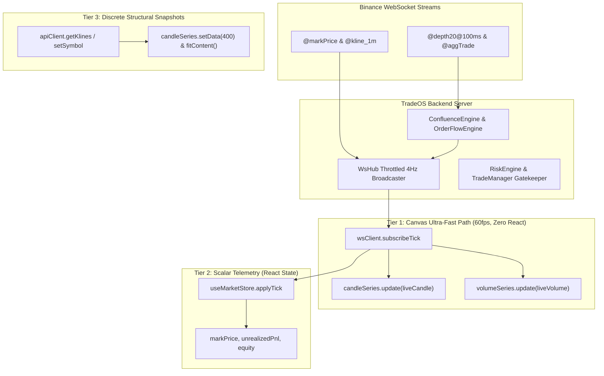
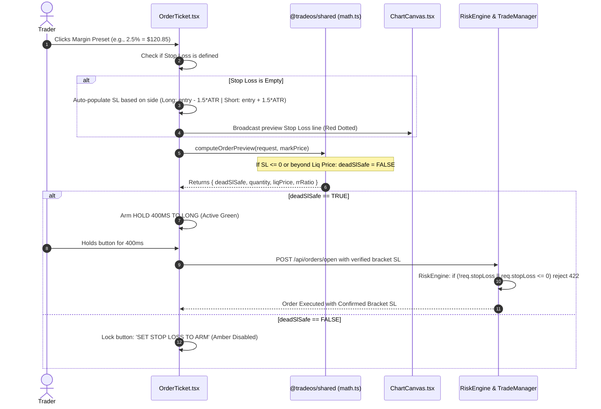

# TradeOS v2: Cockpit Stabilization & Forensic Remediation

* **Author:** fxbluster
* **Status:** Approved
* **Date:** 2026-11-20

--------------------------------------------------------------------------------

## Overview

This technical design document outlines the stabilization architecture for the TradeOS v2 trading cockpit. It resolves the severe 4Hz canvas freeze identified in live operations, alongside seven user experience, risk enforcement, and quantitative telemetry failure modes discovered during forensic video analysis of session `D:\Recording 2026-11-20 185617.mp4`.

The primary design goal is ensuring zero-latency, 60fps charting performance and strict fail-closed liquidation protection across volatile market regimes, decoupling streaming tick consumption from React DOM reconciliation, and automating risk-arm invariants.

--------------------------------------------------------------------------------

## The Problem

1. **4Hz UI Thread Event Loop Freezes:** In `useMarketStore.ts`, incoming WebSocket ticks (streaming at up to 4Hz) trigger immutable cloning of the 400-candle `klines` array. In `ChartCanvas.tsx`, an active `useEffect` hook listening to `[klines, symbol]` responds by invoking `series.setData(candleData)` and `timeScale().fitContent()` up to 4 times per second. This forcibly reconstructs the Lightweight Charts canvas geometry and resets viewport panning/zoom, choking the browser main thread and rendering user interactions unresponsive ("baya takılır").
2. **Naked Order Execution Risk:** The Order Ticket permits order staging without a Stop Loss, and `@tradeos/shared` defaults `deadSlSafe = true` when Stop Loss is undefined. Concurrently, the backend `riskEngine.ts` allows orders through if `req.stopLoss` is undefined. This exposes traders to catastrophic margin liquidations if an order is executed before an SL is set.
3. **Quantitative Inversion in Order Flow Telemetry:** Unpruned historical aggressive taker volumes accumulate in `orderFlowEngine.ts`, overriding current Level 2 book depth ($8.0M bids vs $6.0M asks) and printing contradictory `2.7x Sell` signals. Furthermore, linear trade array filtering risks event loop stalls under high-frequency trade bursts.
4. **Cockpit Flight Deck Ergonomic Loss:** The right 30% sidebar places the Autonomous Auto-Pilot controls in a scrollable rail above the Order Ticket. Scrolling down to manage leverage or margin moves the Auto-Pilot kill switch and state status completely off-screen.
5. **Scanner & Stochastic Simulation Brittleness:** The Market Scanner lacks fallback handling and fails open into a blank dark container under tunnel latency. Concurrently, the Monte Carlo simulation displays decoupled 58%/38% probabilities without binding to active trade targets.
6. **Volume Axis Price Scale Number Overlap:** Volume histogram values (`123.82`, `2.3K`, `182.38`) collide with candlestick prices on the right margin because the volume price scale is visible.
7. **False-Alarm Cooldown Lockout Display:** The Anti-Gambling Cooldown modal displays a red `00:00 (EXPIRED)` and `Audit Bypass` warning even when the cooldown is completely inactive, inducing false alarms.

--------------------------------------------------------------------------------

## Goals

* **Goal 1 (60fps Decoupled Charting):** Eliminate all calls to `series.setData()` and `timeScale().fitContent()` from the streaming tick path. Restrict full dataset re-renders strictly to discrete initial loads, symbol changes, and interval switches. Stream live price ticks exclusively through `wsClient.subscribeTick` direct series updates at 60fps with zero React state overhead.
* **Goal 2 (Zero-Friction Dead-SL Armor):** Enforce strict mandatory Stop Loss validation in both `@tradeos/shared` and backend `riskEngine.ts` (`deadSlSafe = false` and `ERR_MISSING_STOP_LOSS` when SL is absent or zero). Automatically populate Stop Loss at $\pm 1.5\text{x ATR}$ ($-1.5\text{x ATR}$ for Long, $+1.5\text{x ATR}$ for Short) upon margin preset selection, rendering the SL bracket line immediately on the chart canvas.
* **Goal 3 (Order Flow Depth Alignment & Ring Buffer):** Implement a 60-bucket circular ring buffer for aggressive trade volume in `orderFlowEngine.ts`, ensuring Book Depth Ratio and Taker Flow are presented as distinct, non-contradictory metrics with deterministic $O(1)$ computation.
* **Goal 4 (Pinned Cockpit Flight Deck):** Pin `<AutoPilotControls />` at the top of the right rail as an unscrollable executive flight deck header, guaranteeing continuous visibility of the emergency halt switch and consensus meter.
* **Goal 5 (Resilient Scanner & Dynamic FHT Bounds):** Provide skeleton loading and in-memory caching of top-50 volume pairs in `ScannerModal.tsx`. Bind Monte Carlo FHT simulation boundaries dynamically to active order draft targets or real-time ATR.
* **Goal 6 (Volume Scale De-cluttering):** Suppress volume histogram price scale labels on the right margin to prevent number collisions with candlestick prices.
* **Goal 7 (Risk Guard Telemetry & Inactive Cooldown Diagnostics):** Replace false-alarm expired lockout alerts with a persistent green `Cooldown: Inactive` TopBar status indicator and an operational diagnostics panel in `CooldownModal.tsx` when no active lockout is triggered.

--------------------------------------------------------------------------------

## Non-Goals

* **Non-Goal 1:** Replacing the native Lightweight Charts engine with an external third-party charting library.
* **Non-Goal 2:** Allowing unhedged naked futures positions without a Stop Loss under any broker mode.
* **Non-Goal 3:** Altering the global dark visual theme or design tokens.
* **Non-Goal 4:** Implementing multi-symbol split charting in a single browser window.

--------------------------------------------------------------------------------

## Resolved Architectural Decisions

* **Decision 1 (Auto-Arm Sensitivity & Directional Invariant):**
  * For `MARKET` orders:
    * Long: $\text{SL} = \text{markPrice} - (1.5 \times \text{ATR})$
    * Short: $\text{SL} = \text{markPrice} + (1.5 \times \text{ATR})$
  * For `LIMIT` orders:
    * Long: $\text{SL} = \text{orderDraft.limitPrice} - (1.5 \times \text{ATR})$
    * Short: $\text{SL} = \text{orderDraft.limitPrice} + (1.5 \times \text{ATR})$
  * If $\text{ATR}$ is null or zero, fallback to $1.5\%$ of reference price ($0.015 \times \text{price}$).
* **Decision 2 (Scanner Refresh & Cache Lifecycle):**
  * The top-50 market scanner cache is seeded during app bootstrap in `App.tsx` via `apiClient.getScanner()` and stored in `useMarketStore.cachedScannerItems`.
  * If the network times out (>2500ms), `ScannerModal.tsx` immediately renders `cachedScannerItems` with a `Cached (Offline)` badge and enables manual refresh with a 5-second debounce. A bundled static top-50 fallback is provided if startup fetch fails completely.

--------------------------------------------------------------------------------

## Critical User Journeys (CUJs)

### CUJ 1: High-Volatility Chart Navigation & Order Execution
* **Given:** Trader is viewing SOLUSDT during active 4Hz tick streaming over a Cloudflare tunnel.
* **When:** Trader scrolls, zooms in on historical swing lows, and pans across the chart canvas while selecting a 10% margin preset.
* **Then:** Viewport remains stable without snapping back, canvas maintains smooth 60fps interaction without UI lockup, Stop Loss is automatically populated at $-1.5\text{x ATR}$ (or $+1.5\text{x ATR}$ for Short), and the red SL line renders immediately on the canvas.

### CUJ 2: Safe Order Dispatch with Emergency Halt Access
* **Given:** Trader is preparing a Limit Long order with 10x leverage and adjusts stop loss price while Auto-Pilot is engaged.
* **When:** Trader scrolls down to inspect Sokrat Quant Mentor feedback.
* **Then:** Auto-Pilot flight deck header remains permanently pinned at the top of the right rail, allowing instantaneous access to the one-click emergency kill-switch.

### CUJ 3: Market Scanner Resilience Under Tunnel Latency
* **Given:** Trader opens the Market Scanner modal during a tunnel latency spike.
* **When:** The `/api/scanner` HTTP request exceeds the 2500ms timeout threshold.
* **Then:** Modal displays a pulsing skeleton loader, falls back smoothly to cached top-50 symbols with a `Cached (Offline)` indicator, and navigates immediately upon row click without blank container failures.

### CUJ 4: Dynamic Volatility-Bound Stochastic Risk Simulation
* **Given:** Trader opens the 10k Monte Carlo Time Machine modal with empty draft SL/TP.
* **When:** The modal initializes simulation parameters.
* **Then:** First-Hitting-Time boundaries auto-project dynamically from current 14-period ATR ($\pm 1.5\text{x ATR}$ SL, $\pm 2.0\text{x ATR}$ TP), producing volatility-grounded win/loss probabilities instead of decoupled mock statistics.

--------------------------------------------------------------------------------

## Technical Plan (Architecture)

### 1. Three-Tier Streaming & State Decoupling Architecture

To completely eliminate the 4Hz UI thread freeze, the streaming pipeline is decomposed into three isolated architectural tiers:



* **Tier 1: Canvas Ultra-Fast Path (60fps, Zero React):**
  `wsClient.subscribeTick` attaches directly to the Lightweight Charts instance. An `isInitialized` ref ensures incoming ticks are dropped or queued until `series.setData()` has completed. Incoming ticks invoke `candleSeriesRef.current.update(liveCandle)` and `volumeSeriesRef.current.update(liveVolume)` directly. React Virtual DOM reconciliation is completely bypassed.
* **Tier 2: Scalar Telemetry Path:**
  `useMarketStore.applyTick` is modified to update only scalar primitives (`markPrice`, `unrealizedPnl`, `equity`). The historical `klines` array reference is preserved without cloning or mutation during ticks. This prevents re-triggering dependent components. When a 1-minute candle closes (`isFinal == true`), the closed bar is pushed to the historical buffer without resetting the canvas.
* **Tier 3: Discrete Structural Snapshots:**
  `candleSeries.setData()` and `timeScale().fitContent()` are strictly confined to discrete user actions: initial page load, symbol switching, and interval toggling (`1m` / `5m` / `15m` / `1h`). Because `klines` reference in Zustand only changes on discrete REST snapshots, `useEffect([klines, symbol])` in `ChartCanvas.tsx` runs solely upon data arrival and remains 100% idle during streaming ticks.

### 2. Zero-Friction Dead-SL Armor Invariant (Dual Gatekeeper)



* **Client-Side Math Armor:** In `packages/shared/src/math.ts`, `computeOrderPreview` enforces:
  `const hasStopLoss = typeof req.stopLoss === 'number' && req.stopLoss > 0;`
  `const deadSlSafe = hasStopLoss && isSafeDistance(req.stopLoss, estimatedLiquidation);`
* **Server-Side Gatekeeper Armor:** In `apps/server/src/quant/riskEngine.ts`, Stop Loss validation is fail-closed:
  ```ts
  if (!req.stopLoss || req.stopLoss <= 0) {
    return {
      allowed: false,
      code: 'ERR_MISSING_STOP_LOSS',
      reason: 'Fail-Closed Guard: Stop Loss is mandatory for all orders.',
    };
  }
  ```
  In `apps/server/src/services/tradeManager.ts`, order submission invokes `riskEngine.validateOrder` and aborts if `allowed == false`.

### 3. Order Flow Imbalance Ring Buffer

To prevent $O(N)$ linear scan delays and single-threaded event loop choking during high-frequency trade bursts, `OrderFlowEngine` uses a 60-second circular ring buffer:

```ts
interface SecondBucket {
  buyVol: number;
  sellVol: number;
  secondTimestamp: number;
}
```

* **Ingestion ($O(1)$):** Each incoming trade identifies its second bucket: `secIndex = Math.floor(time / 1000) % 60`. If `bucket.secondTimestamp !== currentSecond`, reset bucket. Add volume based on `isBuyerMaker`.
* **Evaluation ($O(1)$):** Aggregates across the 60 buckets in $O(60) = O(1)$ time.
* **Separation of Metrics:**
  * `valueText`: `Depth ${buyRatio.toFixed(1)}x ${dominantSide}` (e.g. `Depth 1.3x Buy`)
  * `subText`: `Flow: ${takerRatio.toFixed(1)}x ${takerDominant} (60s) | Bids: $8.0M / Asks: $6.0M`

### 4. Pinned Cockpit Flight Deck Layout

In `apps/web/src/App.tsx`, the right rail (30% width) is restructured:

```tsx
<aside className="flex-[3] flex flex-col h-full gap-2 overflow-hidden">
  {/* Pinned Executive Flight Deck (Static, No Overflow) */}
  <div className="flex-shrink-0">
    <AutoPilotControls />
  </div>

  {/* Scrollable Order Form and Mentor Rail */}
  <div className="flex-1 overflow-y-auto space-y-2 pr-1 custom-scrollbar">
    <OrderTicket />
    <SokratMentorPanel />
  </div>
</aside>
```

### 5. Resilient Market Scanner & Stochastic Simulation

* **Scanner Skeleton & Cache:** `ScannerModal.tsx` implements a pulsing table skeleton during `isLoading`. On mount, it immediately renders cached top-50 symbols from `useMarketStore.cachedScannerItems`. If the network times out (>2500ms), it displays the cached data with a `Cached (Offline)` badge and a retry button.
* **Dynamic Monte Carlo FHT Bounds:** `TimeMachineModal.tsx` dynamically binds to the active order draft. If the draft SL/TP are empty, it auto-projects boundaries using `markPrice \pm 1.5x ATR` for SL and `markPrice \pm 2.0x ATR` for TP. Path calculations are debounced by 300ms to keep the main thread responsive.

### 6. Volume Axis Label Suppression

In `ChartCanvas.tsx`, the volume histogram series is explicitly initialized with `priceScaleId: 'volume'`, and its axis is hidden:
```tsx
chart.priceScale('volume').applyOptions({
  visible: false,
  scaleMargins: { top: 0.8, bottom: 0 },
});
```

### 7. Risk Guard Operational Diagnostics & Status Telemetry

* **TopBar Status Indicator:** Renders `Cooldown: Inactive` (emerald badge) during normal operations and switches to pulsing amber/red `Cooldown Active (MM:SS)` only when an actual lockout is triggered.
* **Diagnostics Card:** When `isCooldownActive` is false, `CooldownModal.tsx` renders a clean "Risk Diagnostics: All Systems Operational" telemetry panel with active circuit breaker limits instead of an expired lockout screen.

--------------------------------------------------------------------------------

## Alternatives Considered

### Alternative A: Throttling React Component Re-renders via RequestAnimationFrame
* **Pros:** Keeps all state synchronized within Zustand without modifying direct canvas subscribers.
* **Cons:** Calling `setData(400)` even at 2Hz wipes active crosshair coordinates, forcibly resets manual zoom/pan levels via `fitContent()`, and produces visible stutter during fast market breakouts.
* **Trade-off Evaluation:** Direct series streaming (`candleSeries.update()`) via `wsClient` listeners operates at native 60fps with zero Virtual DOM overhead. Streaming ticks must not touch the historical klines array reference.

### Alternative B: Blocking Unhedged Order Entry with Invasive Pop-Up Modal Dialogs
* **Pros:** Explicitly informs the user why an order was not accepted.
* **Cons:** Pop-up modal dialogs create high friction during volatile scalping situations, causing missed fills and slippage.
* **Trade-off Evaluation:** Institutional LiquidationGuard requires zero-friction safety defaults. Auto-arming Stop Loss upon margin preset selection provides an immediate safety boundary that the trader can visually fine-tune or drag on the chart without modal interruptions.

### Alternative C: On-Demand Lazy-Loading of All 767 Binance Pairs on Modal Mount
* **Pros:** Client always fetches fresh 24h ticker prices without consuming memory at startup.
* **Cons:** Aggregating 767 ticker pairs over tunnel connections introduces 800ms–2500ms latency, causing blank dark box failures during rate limits or packet drops.
* **Trade-off Evaluation:** Caching top-50 high-volume pairs in memory at application startup guarantees sub-100ms instantaneous modal display, with background fallback refresh.

### Alternative D: Migration to Third-Party Charting Engines (e.g. TradingView TA Library)
* **Pros:** Built-in PineScript drawing overlays and drawing toolbars.
* **Cons:** Introduces proprietary commercial licensing restrictions, excessive bundle bloat (>3MB minified), and complex iframe messaging bridges that exacerbate UI latency.
* **Trade-off Evaluation:** Lightweight Charts is open-source (Apache 2.0), lightweight (<150KB), and easily achieves 60fps rendering once decoupled from React re-render thrashing.

--------------------------------------------------------------------------------

## Non-Functional Requirements

### Performance & Latency
* Tick-to-canvas rendering latency must remain below 16ms (60fps animation budget) on desktop and mobile browsers.
* Zero canvas DOM reconstructions or `fitContent()` executions during active WebSocket mark price streams.

### Safety & Liquidation Invariants
* Fail-closed order validation: Under no circumstances can an order without a verified Stop Loss be dispatched to Binance API or Local Paper broker.

### Observability & Telemetry
* Order Flow telemetry must distinctly log L2 Book Depth Ratio and 60-second Taker Aggression delta without contradictory signals.

--------------------------------------------------------------------------------

## Risks, Failure Modes & Mitigations

| Failure Mode | Impact | Mitigation Strategy |
| :--- | :--- | :--- |
| **Cloudflare Tunnel Disconnect** | Stream freezes, REST requests fail | `wsClient` auto-reconnects with exponential backoff; UI displays neutral 'Reconnecting' badge; Scanner falls back to cached top-50 symbols. |
| **High-Frequency Trade Burst (>2k/s)** | Event loop lag in Node.js | Circular ring buffer aggregates trades into 60 1-second buckets; processing overhead is strictly $O(1)$. |
| **Chart Tick Out-of-Order Assertion** | Lightweight Charts runtime crash | `isInitialized` guard drops or buffers streaming ticks until initial `series.setData()` has completed. |
| **Stale Quote Slippage on Hold (400ms)** | Market price breaches auto-armed SL before dispatch | Order Ticket checks live mark price at execution trigger; if price has crossed SL, dispatch aborts with visual alert. |
| **Missing ATR on Low-Cap Pairs** | Auto-arm cannot compute volatility offset | Fallback to deterministic $1.5\%$ of reference price ($0.015 \times \text{price}$). |

--------------------------------------------------------------------------------

## Rollout & Rollback Strategy

* **Rollout:** Deploy in 5 phased stages: Shared Domain -> Server Engine -> Chart Decoupling -> Cockpit Layout -> Monorepo Verification.
* **Rollback:** Each phase maintains git branch isolation and buildable checkpoints. If canvas streaming regressions occur, the subscriber hook in `ChartCanvas.tsx` can be reverted independently without affecting order risk armor or server engines.

--------------------------------------------------------------------------------

## Detailed Implementation Plan

### Target Files Summary

| Target File | Workspace | Action | Risk Level |
| :--- | :--- | :--- | :--- |
| `packages/shared/src/math.ts` | shared | Modify | High (Risk Armor) |
| `packages/shared/src/__tests__/math.test.ts` | shared | Modify | Low |
| `apps/server/src/quant/riskEngine.ts` | server | Modify | High (Server Gatekeeper) |
| `apps/server/src/services/tradeManager.ts` | server | Modify | Medium |
| `apps/server/src/quant/orderFlowEngine.ts` | server | Modify | Medium |
| `apps/server/src/quant/__tests__/orderFlow_and_sentiment.test.ts` | server | Modify | Low |
| `apps/web/src/store/useMarketStore.ts` | web | Modify | High (Performance) |
| `apps/web/src/components/ChartCanvas.tsx` | web | Modify | High (Performance) |
| `apps/web/src/components/__tests__/ChartCanvas.test.ts` | web | Modify | Low |
| `apps/web/src/App.tsx` | web | Modify | Medium |
| `apps/web/src/components/OrderTicket.tsx` | web | Modify | Medium |
| `apps/web/src/components/ScannerModal.tsx` | web | Modify | Medium |
| `apps/web/src/components/TimeMachineModal.tsx` | web | Modify | Low |
| `apps/web/src/components/CooldownModal.tsx` | web | Modify | Low |
| `apps/web/src/components/TopBar.tsx` | web | Modify | Low |

---

### Phase 1: Shared Domain & Risk Math Armor

#### 1. `packages/shared/src/math.ts` (Modify)
* **Scope:** `@tradeos/shared` math library.
* **Changes:**
  * Update `computeOrderPreview`:
    `const hasStopLoss = typeof req.stopLoss === 'number' && req.stopLoss > 0;`
    `const deadSlSafe = hasStopLoss && isSafeDistance(req.stopLoss, estimatedLiquidation);`
* **Checkpoint:** Run `npx vitest run packages/shared/src/__tests__/math.test.ts`.

#### 2. `packages/shared/src/__tests__/math.test.ts` (Modify)
* **Scope:** Test suite.
* **Changes:**
  * Add unit tests verifying `deadSlSafe === false` when `stopLoss` is undefined, null, 0, or beyond liquidation price.

---

### Phase 2: Server Risk Engine & Quant Telemetry

#### 3. `apps/server/src/quant/riskEngine.ts` (Modify)
* **Scope:** Backend risk validator.
* **Changes:**
  * Enforce fail-closed Stop Loss check: if `!req.stopLoss || req.stopLoss <= 0`, return `{ allowed: false, code: 'ERR_MISSING_STOP_LOSS', reason: 'Fail-Closed Guard: Stop Loss is mandatory for all orders.' }`.

#### 4. `apps/server/src/services/tradeManager.ts` (Modify)
* **Scope:** Trade execution orchestrator.
* **Changes:**
  * Ensure pre-trade check strictly invokes `riskEngine.validateOrder` and throws HTTP 422 if Stop Loss validation fails.

#### 5. `apps/server/src/quant/orderFlowEngine.ts` (Modify)
* **Scope:** Aggressive order flow engine.
* **Changes:**
  * Implement 60-bucket circular ring buffer for 1-second aggressive volume aggregation.
  * Update `processTrade(qty, isBuyerMaker, time = Date.now())`.
  * Separate output into `Depth` and `Flow (60s)`.

#### 6. `apps/server/src/quant/__tests__/orderFlow_and_sentiment.test.ts` (Modify)
* **Scope:** Quant test suite.
* **Changes:**
  * Add tests asserting 60-second time decay in the circular ring buffer.
* **Checkpoint:** Run `npx vitest run apps/server`.

---

### Phase 3: Chart Engine & Store Decoupling

#### 7. `apps/web/src/store/useMarketStore.ts` (Modify)
* **Scope:** Zustand market state.
* **Changes:**
  * In `applyTick`: update only scalar fields (`markPrice`, `unrealizedPnl`, `equity`). Maintain `klines` array immutability during streaming ticks.
  * Add `cachedScannerItems: ScannerItem[]` for offline fallback.

#### 8. `apps/web/src/components/ChartCanvas.tsx` (Modify)
* **Scope:** Lightweight Charts component.
* **Changes:**
  * Direct 60fps tick streaming via `wsClient.subscribeTick` calling `candleSeriesRef.current.update` and `volumeSeriesRef.current.update`.
  * Add `isInitialized` guard to prevent tick assertion errors prior to initial `series.setData()`.
  * Suppress volume price scale labels: `chart.priceScale('volume').applyOptions({ visible: false })`.

#### 9. `apps/web/src/components/__tests__/ChartCanvas.test.ts` (Modify)
* **Scope:** Web unit test suite.
* **Changes:**
  * Update test to assert `applyTick` updates scalar `markPrice` while leaving `klines` array reference identical.
* **Checkpoint:** Run `npx vitest run apps/web/src/components/__tests__/ChartCanvas.test.ts`.

---

### Phase 4: Cockpit Layout & Resilient Modals

#### 10. `apps/web/src/App.tsx` (Modify)
* **Scope:** Main cockpit shell.
* **Changes:**
  * Pin `<AutoPilotControls />` inside `flex-shrink-0` container at top of right rail.
  * Place `<OrderTicket />` and `<SokratMentorPanel />` inside `flex-1 overflow-y-auto`.
  * Trigger background fetch of top-50 symbols to populate `cachedScannerItems`.

#### 11. `apps/web/src/components/OrderTicket.tsx` (Modify)
* **Scope:** Order ticket component.
* **Changes:**
  * Auto-arm SL on margin preset click: Long $\text{entry} - (1.5 \times \text{ATR})$; Short $\text{entry} + (1.5 \times \text{ATR})$.
  * Amber button lock `'SET STOP LOSS TO ARM'` when Stop Loss is empty.

#### 12. `apps/web/src/components/ScannerModal.tsx` (Modify)
* **Scope:** Market scanner modal.
* **Changes:**
  * Render table skeleton during loading. Fallback to `cachedScannerItems` on 2500ms timeout with `Cached (Offline)` badge.

#### 13. `apps/web/src/components/TimeMachineModal.tsx` (Modify)
* **Scope:** Monte Carlo modal.
* **Changes:**
  * Dynamically bind FHT boundaries to active order draft or ATR ($\pm 1.5\text{x ATR}$ SL, $\pm 2.0\text{x ATR}$ TP). Debounce calculations by 300ms.

#### 14. `apps/web/src/components/CooldownModal.tsx` (Modify)
* **Scope:** Risk cooldown modal.
* **Changes:**
  * Render "Risk Diagnostics: All Systems Operational" card when cooldown is inactive.

#### 15. `apps/web/src/components/TopBar.tsx` (Modify)
* **Scope:** Navigation bar.
* **Changes:**
  * Render emerald `Cooldown: Inactive` badge when cooldown is not triggered.

---

### Phase 5: Verification & Full Monorepo Build

#### Verification Plan
* **Compilation / Build:** `npm run build` across all workspaces with zero TypeScript errors.
* **Unit Tests:** `npx vitest run` across all test suites with 100% pass rate.
* **Static Analysis & Linting:** Verify zero linting violations.
* **Test Coverage Requirement:** 100% pass rate and zero regressions on existing suites.
* **E2E / Live Performance Verification:**
  * Verify 60fps chart panning/zooming during active 4Hz WebSocket tick stream.
  * Confirm Stop Loss auto-arms to $\pm 1.5\text{x ATR}$ on preset click.
  * Confirm server rejects orders without Stop Loss with HTTP 422.
  * Confirm Scanner displays skeleton and cached fallback under simulated network latency.

--------------------------------------------------------------------------------

<!-- Provenance: Indicates initial structural drafting via EGM. -->

*Drafted with EGM*
