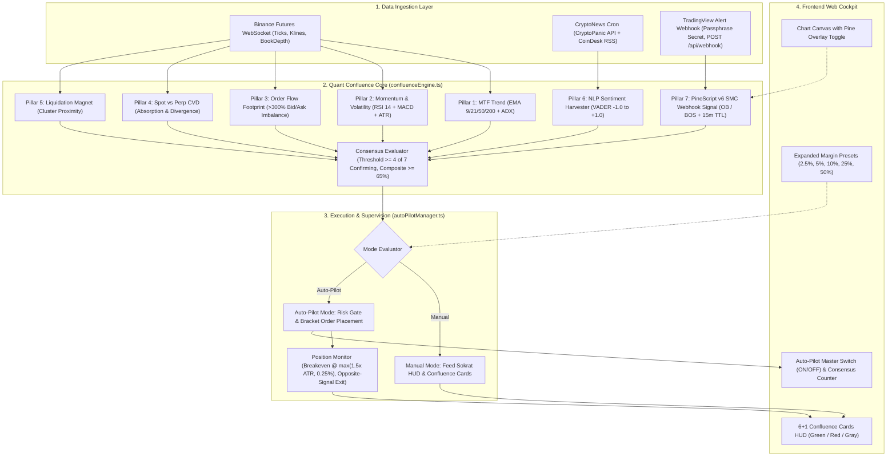

# TradeOS v2: 6+1 Confluence Engine, Autonomous Auto-Pilot Execution, and PineScript v6 Ingestion

*   **Author:** fxbluster
*   **Status:** In Review (Round 2)
*   **Date:** 2026-11-20

--------------------------------------------------------------------------------

## Overview

TradeOS v2 provides institutional-grade risk limits and direct Binance Demo/Testnet execution. This specification introduces an advanced market intelligence and algorithmic execution layer:
1. **6+1 Confluence Decision Engine:** Six core real-time quantitative pillars (MTF Trend, Momentum/Volatility, Order Flow Footprint, CVD Absorption, Liquidation Magnets, NLP News Sentiment) plus a 7th backend pillar (TradingView PineScript v6 Smart Money Webhook Ingestion).
2. **Dual-Mode Execution Architecture:**
   - **Manual Mode:** Visual status cards for all pillars with human-in-the-loop 400ms physical hold-to-trade confirmation.
   - **Autonomous Auto-Pilot Mode:** Triggers algorithmic bracket entry (Entry, Stop-Loss, TP1, TP2) when consensus reaches >= 4 out of 7 pillars, with automated position lifecycle management (auto-breakeven, trailing stops, and opposite-confluence emergency early exit).
3. **UI Enhancements & Control:** Expanded margin allocation presets (2.5%, 5%, 10%, 25%, up to 50%) and visual chart overlay toggles (hiding PineScript graphics on chart while keeping the 7th pillar active in the backend).

## The Problem

Crypto futures markets operate 24/7 with rapid regime shifts. Traders face cognitive fatigue and execution delay trying to manually cross-reference order books, multi-timeframe moving averages, delta absorption, and breaking headlines. In TradeOS v1, analytical tools were tightly coupled into a fragile monolithic script. In TradeOS v2, core execution is robust, but the user currently lacks:
- A synthesized multi-factor validation framework to confirm entries before pulling the trigger.
- An optional hands-off Auto-Pilot mode to capture high-probability algorithmic setups when consensus is strong.
- Flexibility in margin sizing (previously capped at 10% presets).
- Clean ingestion of external Smart Money Concept (SMC) signals from TradingView without visual clutter on the chart.

## Goals

*   **G1 (6+1 Confluence Matrix):** Implement modular quantitative calculators in `@tradeos/shared` and `apps/server/src/quant` covering MTF Trend, Momentum, Order Flow, CVD, Liquidation Magnet, NLP News Sentiment, and PineScript Webhook Signals.
*   **G2 (Consensus Engine >= 4 of 7):** Formulate an algorithmic consensus score where >= 4 confirming pillars in the same direction unlocks auto-execution or marks manual entry as high-confidence.
*   **G3 (Fail-Closed Auto-Pilot):** Implement an autonomous trading state machine that places bracket orders with strict 10x leverage, monitors open positions, migrates SL to breakeven at `Math.max(1.5 * ATR, entryPrice * 0.0025)` profit, and closes immediately if market consensus flips to the opposite direction for 2 consecutive ticks.
*   **G4 (Circuit-Breakers & State Latches):** Enforce strict safety throttles in auto-pilot: max 1 concurrent open position, synchronous in-memory `PLACING_ORDER` mutex to eliminate 4Hz tick race conditions, max 2 consecutive losses before a mandatory 60-minute cooldown persisted in SQLite `settings`, and 0.10% max slippage rejection.
*   **G5 (Background PineScript Ingestion with UI Toggle):** Support TradingView alert webhooks (`POST /api/webhook`) with constant-time payload passphrase authentication, 60s LRU nonce deduplication, and 15-minute TTL signal decay, allowing the user to hide visual chart markers via `useMarketStore` while keeping the backend signal pillar active.
*   **G6 (Expanded Margin Allocation & Policy Bifurcation):** Update order execution controls to support 2.5%, 5.0%, 10.0%, 25.0%, and up to 50.0% margin allocation presets. Auto-Pilot mode is strictly clamped to max 10.0% margin allocation to protect solvency; Discretionary Manual mode permits presets up to 50.0% with `riskEngine.ts` Gate 3 updated to evaluate mode-aware limits.

## Non-Goals

*   **NG1 (Uncapped Martingale / Averaging Down):** No grid trading or martingale doubling on losing positions. Each trade has an independent fixed risk envelope.
*   **NG2 (Desktop WPF/Electron Overlay):** No re-creation of legacy Windows desktop native overlays; all controls and cards reside in the responsive web cockpit.
*   **NG3 (Paid Data Subscriptions):** All 6 quantitative pillars and sentiment feeds must operate on free public feeds (Binance WebSocket, CryptoPanic public API, CoinDesk RSS).

## Critical User Journeys (CUJs)

### CUJ 1: Autonomous Auto-Pilot Entry & Opposite-Confluence Exit
*   **Given**: Auto-Pilot mode is enabled with 10% margin, 10x leverage, and consensus threshold set to >= 4 pillars.
*   **When**: MTF Trend (Bullish), CVD Divergence (Bullish Absorption), Order Flow (+320% Buy Imbalance), and PineScript Webhook (SMC Long) confirm simultaneously (4/7 pillars).
*   **Then**: The engine locks the execution latch (`PLACING_ORDER`), places a marketable IOC LIMIT order on Binance Testnet with 0.10% slippage bounds, sets Stop-Loss at 1.5x ATR below entry, sets TP1 at +2.5%, and updates the UI status badge to "AUTO-PILOT ACTIVE". If 15 minutes later 4+ pillars flip to Bearish for 2 consecutive ticks, the engine immediately executes a reduceOnly market close to safeguard capital, followed by a 180s re-entry lockout.

### CUJ 2: Manual Trading with 6-Card Confluence HUD
*   **Given**: Manual mode is active. The user is observing SOLUSDT.
*   **When**: The trader inspects the 6 Confluence Cards. Three are Green (Bullish), two are Gray (Neutral), and one is Red (Bearish) (3/7 pillars).
*   **Then**: Sokrat Mentor displays "CAUTION: Insufficient Confluence (3/7)". The trader waits until a fourth card turns Green, then holds the 400ms button to execute with full risk armor.

### CUJ 3: Background PineScript Signal Ingestion with Chart Toggle Off
*   **Given**: TradingView indicator is sending webhook alerts to `POST /api/webhook`. The user finds the chart too cluttered.
*   **When**: The user toggles the "Hide Pine Overlay" button on the TradeOS chart.
*   **Then**: The chart displays clean candles without visual noise, but Pillar 7 in the backend and on the Confluence HUD continues to register PineScript signals in real time.

--------------------------------------------------------------------------------

## Technical Plan (Architecture)

### 1. High-Level System Architecture



### 2. Component Boundaries & Responsibilities

#### A. `@tradeos/shared` (`packages/shared/src/contracts.ts`)
- **`ConfluencePillarId`**: `'MTF_TREND' | 'MOMENTUM' | 'ORDER_FLOW' | 'CVD' | 'LIQ_MAGNET' | 'NLP_NEWS' | 'PINE_SMC'`.
- **`PillarEvaluation`**:
  ```typescript
  export interface PillarEvaluation {
    id: ConfluencePillarId;
    title: string;
    score: number; // 0 to 100
    bias: 'BULLISH' | 'BEARISH' | 'NEUTRAL';
    valueText: string;
    subText: string;
    confirmed: boolean; // meets pillar threshold
    updatedAt: number;
  }
  ```
- **`ConfluenceSnapshot`**:
  ```typescript
  export interface ConfluenceSnapshot {
    symbol: string;
    pillars: PillarEvaluation[];
    bullishCount: number;
    bearishCount: number;
    neutralCount: number;
    consensusBias: 'BULLISH' | 'BEARISH' | 'NEUTRAL';
    consensusMet: boolean; // confirmingCount >= threshold (default 4)
    threshold: number; // 4
    compositeScore: number; // 0 - 100
    recommendedAction: 'STRONG_BUY' | 'BUY' | 'GÖZLƏ' | 'SELL' | 'STRONG_SELL';
  }
  ```
- **`AutoPilotConfig`**:
  ```typescript
  export interface AutoPilotConfig {
    enabled: boolean;
    consensusThreshold: number; // default 4
    marginAllocationPct: number; // 2.5, 5, 10 (strictly capped at 10% in auto-pilot)
    leverage: number; // strict 10
    oppositeExitEnabled: boolean; // true
    circuitBreakerConsecutiveLosses: number; // 2
    circuitBreakerCooldownMs: number; // 3,600,000 (1 hour)
  }
  ```
- **`WebhookAlertPayload`**:
  ```typescript
  export interface WebhookAlertPayload {
    secret: string;
    alert_id?: string;
    symbol: string;
    side: 'BUY' | 'SELL';
    entryPrice: number;
    stopLoss: number;
    tp1: number;
    tp2: number;
    time: number;
  }
  ```

#### B. Quantitative Calculation Engines (`apps/server/src/quant/`)
1. **`confluenceEngine.ts`**: Aggregates the 7 pillars into a cohesive snapshot. Caches previous evaluations to eliminate duplicate CPU cycles.
   - **Composite Score Weights Table**:
     | Pillar | Weight | Metric Evaluated | Confirmation Condition |
     |---|---|---|---|
     | `MTF_TREND` | 20% | EMA 9/21/50/200 Stack & ADX | Price > EMA 200 & EMA 9 > 21 & ADX > 22 |
     | `MOMENTUM` | 15% | RSI (14) & MACD Histogram | RSI between 45-65 & MACD Hist > 0 |
     | `ORDER_FLOW` | 20% | Bid/Ask Ratio in depth & trades | Imbalance >= 3.0x on active side |
     | `CVD` | 15% | Perpetual vs Spot Volume Delta | Delta divergence / absorption pattern |
     | `LIQ_MAGNET` | 10% | Distance to nearest liquidation pool | Proximity within 1.0x ATR to pool |
     | `NLP_NEWS` | 10% | VADER score of last 3h headlines | Compound score > +0.25 (Bullish) / < -0.25 (Bearish) |
     | `PINE_SMC` | 10% | TradingView Webhook SMC Signal | Active alert within 15m TTL |
     - **Threshold Matrix**:
       - `compositeScore >= 65`: `BUY` / `SELL` (Consensus candidate).
       - `compositeScore >= 85`: `STRONG_BUY` / `STRONG_SELL`.
       - `compositeScore < 65`: `GÖZLƏ` (`NEUTRAL`).
2. **`orderFlowEngine.ts`**: Analyzes the recent tick ring buffer and level-2 depth to detect bid-ask aggression and trade size imbalances exceeding 3.0x.
3. **`cvdEngine.ts`**: Tracks cumulative delta volume and compares perpetual futures volume vs spot reference klines to flag hidden institutional absorption.
4. **`sentimentHarvester.ts`**: Background worker polling CryptoPanic API and CoinDesk RSS every 3 minutes. Evaluates headlines using a zero-dependency VADER lexicon analyzer.
5. **`liquidationEngine.ts`**: Evaluates price distance to open interest liquidation magnet clusters.

#### C. Autonomous Auto-Pilot Service (`apps/server/src/services/autoPilotManager.ts`)
- **Symbol Decoupling**: Maintains independent ticker and candle subscriptions for all active auto-managed positions, decoupled from UI `activeSymbol`.
- **State Machine**: Maintains synchronous state `state: 'IDLE' | 'EVALUATING' | 'PLACING_ORDER' | 'POSITION_OPEN' | 'CLOSING' | 'COOLDOWN_ACTIVE'`.
- Evaluates the symbol's `ConfluenceSnapshot` on every candle close and 4Hz tick.
- **Entry Logic**:
  - Preconditions: `AutoPilotConfig.enabled === true`, `state === 'IDLE'`, no existing active trade on symbol, cooldown lock not active.
  - Signal Trigger: `consensusMet === true` (at least 4 pillars confirm BUY or SELL, composite >= 65%).
  - State Latch: Synchronously sets `state = 'PLACING_ORDER'`, locking out subsequent 4Hz ticks.
  - Order Execution: Uses marketable `LIMIT` order with Time-In-Force `IOC` (Immediate-Or-Cancel), priced at `markPrice * 1.0010` (Long) or `markPrice * 0.9990` (Short) for 0.10% slippage ceiling.
  - Risk Gate: Passes through `riskEngine.validateOrderRisk()` ensuring margin <= 10% available equity.
  - Dispatches `tradeManager.openPosition({ symbol, side, marginUsd, leverage: 10, stopLoss, tp1, tp2 })`.
  - On fill confirmation, transitions to `POSITION_OPEN`. On failure/rejection, resets to `IDLE`.
- **Position Management & Early Exit Logic**:
  - Monitors open position. Migrates Stop-Loss to Breakeven (+0.15% fee buffer) when unrealized PnL reaches `triggerProfitUsd = Math.max(1.5 * atr, entryPrice * 0.0025)`.
  - **Opposite-Confluence Exit**: If currently in a LONG position and the Confluence Engine flips to Bearish consensus (>= 4 pillars BEARISH) and **persists for at least 2 consecutive 4Hz ticks**, auto-pilot triggers `tradeManager.closePosition(symbol, 'OPPOSITE_CONFLUENCE_REVERSAL')`.
  - **Re-Entry Lockout**: Minimum 180 seconds (3 completed 1-minute bars) mandatory symbol cooldown after position close before re-entry can occur.
  - **Circuit-Breakers**: If 2 consecutive stop-outs occur, sets 60-minute cooldown and persists `autopilot_cooldown_until` to SQLite `settings` table via `SettingsRepo`.

#### D. External Webhook Receiver (`apps/server/src/api/routes.ts`)
- **`POST /api/webhook`**:
  - Validates `payload.secret` against `config.WEBHOOK_SECRET` using `crypto.timingSafeEqual`.
  - Checks `alert_id` against 60-second in-memory LRU cache to reject duplicates and replay attacks.
  - Checks timestamp drift (rejects requests older than 30 seconds).
  - Updates Pillar 7 (`PINE_SMC`) in `confluenceEngine`. Sets a 15-minute TTL timer; upon expiration, Pillar 7 decays back to `'NEUTRAL'`.
  - Bypasses bearer token session auth (exempt in `apps/server/src/security/auth.ts`).

#### E. Frontend Cockpit Enhancements (`apps/web/src/components/`)
1. **`ConfluenceHUD.tsx`**: Top-level 6+1 card grid with color-coded status badges, real-time pillar metrics, and a master consensus progress meter (e.g. `[4/7 BUY CONFIRMED]`).
2. **`AutoPilotControls.tsx`**: Toggle switch for Autonomous mode with safety visual indicators (cooldown status, daily loss guard).
3. **`OrderTicket.tsx` Expansion**: Update margin quick-select buttons to: `[2.5%] [5.0%] [10.0%] [25.0%] [50.0%]`. Allows up to 50% for manual orders.
4. **`ChartCanvas.tsx` & `useMarketStore.ts`**: Add `hidePineOverlay: boolean` toggle in Zustand store to suppress visual markers on the canvas without severing backend ingestion.

--------------------------------------------------------------------------------

## Risks & Mitigations

| Risk Vector | Severity | Impact | Mitigation Strategy |
|---|---|---|---|
| **WebSocket Connection Drop during Open Position** | Critical | Loss of live mark price and delayed exit | Fail-closed heartbeat check. If Binance WebSocket is silent for > 5 seconds, local position monitor uses direct REST ticker polling. If disconnected > 30s, active orders on exchange have pre-placed native exchange Stop-Loss to guarantee solvency. |
| **4Hz Tick Concurrency Race Condition** | High | Redundant duplicate orders placed within 250ms | Synchronous in-memory state latch (`state: 'PLACING_ORDER'`) in `autoPilotManager.ts`. Ticks arriving while a promise is pending are discarded synchronously. |
| **High Leverage Liquidation on Margin Expansion (50%)** | Critical | Instant liquidation on sharp market whipsaw | Strict policy bifurcation: Auto-Pilot is clamped to max 10.0% margin. Manual 50% margin requires explicit 400ms hold-to-trade confirmation and pre-trade liquidation distance validation. |
| **Stale News NLP & Sentiment False Triggers** | Medium | Irrelevant historical headline triggers bad trade | 3-minute hard TTL on cached news sentiment. If CryptoPanic or CoinDesk fail/timeout, Pillar 6 fails soft and defaults to `'NEUTRAL'` (score 50, weight 0%). |
| **TradingView Webhook Replay / Spam Attack** | Medium | False external signals skewing consensus | Constant-time passphrase comparison, 60-second LRU nonce cache for `alert_id`, 30-second timestamp drift ceiling, and 15-minute TTL signal decay. |

--------------------------------------------------------------------------------

## Alternatives Considered

### Alternative A: 7-out-of-7 Unanimous Consensus Requirement
*   **Pros**: Filters out maximum noise; only trades when every single technical, order book, delta, sentiment, and external indicator aligns in the exact same direction.
*   **Cons**: Markets rarely exhibit complete synchronization across all disparate timeframes and metrics simultaneously. Results in near-zero trade frequency.
*   **Rejection Rationale**: A 7/7 unanimous consensus rule paralyzes the trading system, causing valid high-probability trend moves to be missed. A >= 4 out of 7 threshold provides the optimal balance of statistical edge and actionable frequency while maintaining strict Stop-Loss bounds.

### Alternative B: Direct Webhook-to-Exchange Execution
*   **Pros**: Simplifies architecture into a pass-through webhook proxy from TradingView to Binance.
*   **Cons**: Exposes capital to unfiltered indicator errors, external network spam, and false signals during high-volatility news spikes. Bypasses the local risk engine.
*   **Rejection Rationale**: External webhook signals must act as an input (Pillar 7) within the 7-pillar confluence matrix and pass deterministic risk checks (`validateOrderRisk`) before triggering any trade. Direct exchange pass-through violates core safety invariants.

### Alternative C: Uncapped Martingale Averaging Down in Auto-Pilot
*   **Pros**: Temporarily elevates nominal win rates in choppy range-bound markets.
*   **Cons**: Exponential liquidation risk during strong directional trend days. Guaranteed account ruin over sufficient sample size.
*   **Rejection Rationale**: Violates the core TradeOS solvency invariant. Auto-Pilot strictly executes isolated bracket trades with predetermined Stop-Loss envelopes and zero position doubling.

### Alternative D: Synchronous In-Process Scraping for Pillar 6 (News Sentiment)
*   **Pros**: Guarantees headlines are evaluated on the exact millisecond of every price tick.
*   **Cons**: External HTTP requests to RSS feeds take 500ms–3000ms. Running them synchronously blocks the Node.js event loop, freezing WebSocket price broadcasts and order execution.
*   **Rejection Rationale**: Pillar 6 must operate as an asynchronous background worker with a 3-minute atomic cache, ensuring 0ms latency impact on the core trade execution loop.

--------------------------------------------------------------------------------

## Detailed Implementation Plan (Phased Execution)

### Target Files to Create / Modify

| File Path | Action | Scope / Responsibility |
|---|---|---|
| `packages/shared/src/contracts.ts` | Modify | Define `ConfluencePillarId`, `PillarEvaluation`, `ConfluenceSnapshot`, `AutoPilotConfig`, `WebhookAlertPayload`, expand `OpenOrderRequest` up to 50% margin, and add WebSocket message types. |
| `packages/shared/src/math.ts` | Modify | Shared financial math and composite confluence weighting calculation (re-exporting indicator utilities from server). |
| `apps/server/src/quant/confluenceEngine.ts` | Create | Core 7-pillar confluence aggregator with composite scoring, caching, 60s LRU nonce cache, and 15m TTL signal decay. |
| `apps/server/src/quant/orderFlowEngine.ts` | Create | L2 depth and tick imbalance analyzer (> 3.0x bid/ask ratio). |
| `apps/server/src/quant/sentimentHarvester.ts` | Create | Background worker polling CryptoPanic API and CoinDesk RSS with zero-dependency VADER lexicon analyzer. |
| `apps/server/src/quant/liquidationEngine.ts` | Create | Evaluates price proximity to open interest liquidation magnet clusters. |
| `apps/server/src/quant/riskEngine.ts` | Modify | Update Gate 3 to enforce mode-aware margin limits: Auto-Pilot clamped to 10%, manual allowed up to 50%. |
| `apps/server/src/config.ts` | Modify | Export `WEBHOOK_SECRET` and `CRYPTOPANIC_API_KEY`. |
| `apps/server/src/security/auth.ts` | Modify | Exempt `POST /api/webhook` from bearer token authentication. |
| `apps/server/src/services/autoPilotManager.ts` | Create | Autonomous state machine with `PLACING_ORDER` mutex, 180s re-entry lockout, `Math.max(1.5*ATR, 0.25%)` breakeven, 2-tick opposite exit, and SQLite 60m cooldown persistence. |
| `apps/server/src/api/routes.ts` | Modify | Add `POST /api/webhook`, `GET /api/confluence`, `POST /api/autopilot/config`, `POST /api/autopilot/toggle`. |
| `apps/server/src/api/wsHub.ts` | Modify | Throttle-broadcast `CONFLUENCE_UPDATE` at 2Hz. |
| `apps/server/src/index.ts` | Modify | Bootstrap and wire `sentimentHarvester`, `confluenceEngine`, and `autoPilotManager`. |
| `apps/web/src/components/ConfluenceHUD.tsx` | Create | Responsive 6+1 card grid displaying live pillar statuses and consensus progress meter. |
| `apps/web/src/components/AutoPilotControls.tsx` | Create | Master toggle switch with status indicators and threshold slider. |
| `apps/web/src/components/OrderTicket.tsx` | Modify | Expand margin quick-select buttons to `[2.5%] [5.0%] [10.0%] [25.0%] [50.0%]`. |
| `apps/web/src/stores/useMarketStore.ts` | Modify | Add `hidePineOverlay` toggle and Pine marker state slice. |
| `apps/web/src/components/ChartCanvas.tsx` | Modify | Add `[Hide/Show Pine Overlay]` toolbar toggle. |
| `tradingview/TradeOS_AI_Assistant_Pro.pine` | Create | Modernized 822-line PineScript v6 indicator with alert JSON payload template containing shared secret. |

---

### Implementation Phases

#### Phase 1: Shared Data Contracts & Mathematical Foundations
- Update `packages/shared/src/contracts.ts` with all confluence and auto-pilot interfaces.
- Update `packages/shared/src/math.ts` with composite score calculation.
- Run `npm --prefix packages/shared run build` and unit tests.

#### Phase 2: Quantitative Micro-Engines & Confluence Aggregator
- Implement `orderFlowEngine.ts`, `sentimentHarvester.ts`, `liquidationEngine.ts`.
- Implement `confluenceEngine.ts` with 15-minute TTL decay, 60s LRU nonce deduplication, and composite weighting.
- Run server unit tests on quant engines.

#### Phase 3: Webhook Ingress & Security Layer
- Update `config.ts` and exempt `/api/webhook` in `auth.ts`.
- Implement `POST /api/webhook` in `routes.ts` with constant-time passphrase verification.
- Verify webhook payload handling with automated mock test.

#### Phase 4: Auto-Pilot State Machine & Risk Enforcement
- Update `riskEngine.ts` Gate 3 for mode-aware margin caps.
- Implement `autoPilotManager.ts` with `PLACING_ORDER` mutex, IOC marketable limit execution, `Math.max(1.5*ATR, 0.25%)` breakeven, 2-tick opposite exit, and SQLite 60m cooldown persistence.
- Wire into `index.ts` and verify unit tests.

#### Phase 5: Web Cockpit Confluence HUD, Margin Ticket & Controls
- Implement `ConfluenceHUD.tsx` and `AutoPilotControls.tsx`.
- Update `OrderTicket.tsx` with 2.5%, 5%, 10%, 25%, 50% margin presets.
- Update `ChartCanvas.tsx` and `useMarketStore.ts` for Pine overlay toggling.
- Run `npm --prefix apps/web run build`.

#### Phase 6: End-to-End System Integration & Circuit-Breaker Verification
- Full integration test: simulate 4/7 bullish confluence trigger, order placement, breakeven migration, opposite-confluence exit, and 2-consecutive-loss circuit breaker.
- Modernize PineScript v6 file in `tradingview/TradeOS_AI_Assistant_Pro.pine`.

---

### Verification Plan

*   **Compilation / Build**:
    *   `npm --prefix packages/shared run build`
    *   `npm --prefix apps/server run build`
    *   `npm --prefix apps/web run build`
*   **Unit Tests**:
    *   `packages/shared/src/__tests__/confluence_math.test.ts`: Test composite confluence weighting (100% pass).
    *   `apps/server/src/quant/__tests__/confluenceEngine.test.ts`: Verify 7-pillar aggregation, TTL decay, and consensus threshold evaluation (100% pass).
    *   `apps/server/src/quant/__tests__/orderFlow_and_sentiment.test.ts`: Test order flow imbalance detection and VADER sentiment lexicon (100% pass).
    *   `apps/server/src/services/__tests__/autoPilotManager.test.ts`: Test `PLACING_ORDER` mutex, auto-entry trigger, breakeven migration, opposite-confluence exit, and 2-loss cooldown circuit-breaker (100% pass).
    *   `apps/server/src/api/__tests__/webhook_and_autopilot.test.ts`: Test constant-time secret webhook ingress, replay rejection, and REST API endpoints (100% pass).
*   **E2E Integration Verification**:
    *   Simulate 4/7 bullish pillars: Verify auto-pilot opens order on Binance Testnet within risk limits.
    *   Simulate opposite reversal: Verify auto-pilot immediately triggers reduceOnly market close after 2 ticks.
    *   Simulate PineScript webhook POST: Verify Pillar 7 turns Green and updates HUD in real time.
    *   Verify UI Margin 50% preset recalculates margin USD and quantity correctly in manual mode.

--------------------------------------------------------------------------------

*Drafted with EGM*
