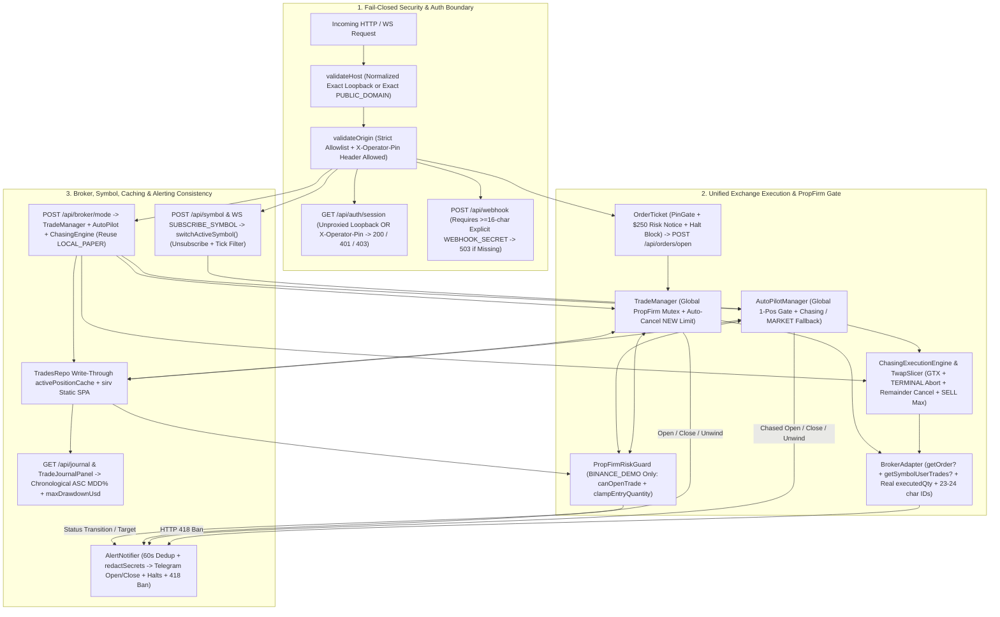

# TradeOS Critical Execution, Security & Prop-Firm Integrity Remediation

* **Author:** fxbluster
* **Status:** Implemented
* **Date:** 2026-11-26

---

## Overview

An independent Red-Team architecture and code audit of TradeOS v2 uncovered five critical execution, risk, and security failures across the live Binance Futures order path, the Upcomers $50K Prop-Firm guardrails, and the HTTP/WebSocket authentication boundary, alongside high-priority analytics math, hot-path caching, and symbol-switching defects. Because existing automated tests mock `BinanceDemoAdapter` and `BinanceClient`, these failures pass the test suite while breaking or endangering live exchange execution.

This design defines the complete remediation plan to close all P0 critical execution and security holes, fix the live analytics and symbol-desync bugs, and establish clean architectural boundaries before running live Upcomers $50K challenge sessions or exposing the server over a network tunnel.

---

## Problem Statement

1. **P0 — `clientAlgoId` 43-Character Overflow Kills Every Chased Trade (`apps/server/src/services/autoPilotManager.ts:982, 1146, 1174`, `apps/server/src/exchange/binanceClient.ts:580-582`):**
   Binance Futures enforces a strict 36-character maximum on `newClientOrderId` and `clientAlgoId`. While `TradeManager` respects this limit with 16-char hex IDs (`apps/server/src/services/tradeManager.ts:368-371`), `AutoPilotManager`'s Maker Limit-Chasing branch generates a 36-char UUID via `crypto.randomUUID()` and builds `tos_${tradeId}_sl` (**43 characters**). When sent verbatim to `/fapi/v1/algoOrder` (`binanceClient.ts:581`), Binance rejects Stop-Loss placement, triggering an immediate `SL_PLACEMENT_FAILED_EMERGENCY_UNWIND` market exit (`autoPilotManager.ts:1179-1190`) on every chased entry.

2. **P0 — Phantom `FILLED` State & False `GTX` Maker Accounting (`apps/server/src/services/autoPilotManager.ts:998-1021`, `apps/server/src/exchange/binanceDemoAdapter.ts:199, 245`, `apps/server/src/services/tradeManager.ts:411-412, 532, 559`):**
   * `AutoPilotManager.checkFill()` treats any order absent from `getOpenOrders()` (`!found`) as 100% `FILLED`, even when canceled, expired, or rejected by the exchange—causing SQLite to record non-existent open positions and dispatch `reduceOnly` brackets against flat exposure.
   * `AutoPilotManager`'s chaser routes limit entries through `broker.openOrder({ orderType: 'LIMIT' })`, which hardcodes `timeInForce: 'GTC'` (`binanceDemoAdapter.ts:199`) instead of Post-Only `'GTX'`. Orders can cross the spread as Taker fills while `AutoPilotManager` records false maker fee savings (`autoPilotManager.ts:1054`). Furthermore, `ChasingExecutionEngine` (`apps/server/src/services/chasingExecutionEngine.ts:303-304`) applies `Math.min` instead of `Math.max` on `SELL` `-5022` backoffs, pushing ask quotes toward the bid.
   * `BinanceDemoAdapter.openOrder()` coerces `executedQty: executedQty > 0 ? executedQty : qty` (`binanceDemoAdapter.ts:245`), and `TradeManager.openPosition()` (`tradeManager.ts:411-412`) repeats that coercion when inserting `OPEN` trades (`tradeManager.ts:532, 559`), prematurely marking unfilled resting `LIMIT` orders (`status: 'NEW'`, `executedQty: 0`) as live filled positions.

3. **P0 — Manual Trading & Chased Multi-Symbol Stacking Bypass Upcomers $50K Risk Guard (`apps/server/src/services/tradeManager.ts:325-373`, `apps/server/src/quant/riskEngine.ts:57-66`, `apps/server/src/index.ts:371-380`, `apps/web/src/components/OrderTicket.tsx:182`):**
   `PropFirmRiskGuard` (`canOpenTrade`, `$250` per-trade risk clamp via `clampEntryQuantity`, `$1,250` daily halt lock, 1-position limit) is enforced only inside `AutoPilotManager` (per-symbol only at `autoPilotManager.ts:580`). Manual orders submitted through `POST /api/orders/open` -> `TradeManager.openPosition()` allow up to **50% wallet margin** (`riskEngine.ts:57-66`) with zero PropFirm checks, even during `UPCOMERS_DAILY_HALT`, while `index.ts:371-380` still records resulting losses into the active PropFirm cycle without filtering by `broker_mode` (`BINANCE_DEMO` vs `LOCAL_PAPER`).

4. **P0 — Broker Mode Split-Brain & Partial Symbol Reset (`apps/server/src/api/routes.ts:131, 288-296, 302-328`, `apps/server/src/index.ts:302-360`):**
   * Switching `BINANCE_DEMO` <-> `LOCAL_PAPER` via `POST /api/broker/mode` updates `TradeManager` (`routes.ts:317`) while omitting `IN_FLIGHT_AUTOPILOT_STATES` and `'CLOSING_IN_PROGRESS'` guards, recreating `LocalPaperAdapter` whenever `db` is passed (`apps/server/src/exchange/broker.ts:103`), and leaving `AutoPilotManager` (`autoPilotManager.ts:149`) and `ChasingExecutionEngine` (`chasingExecutionEngine.ts:82`) bound to the initial boot adapter.
   * Switching symbols via REST `POST /api/symbol` fails to reset `mtfManager`, `smcEngine`, `confluenceEngine`, and `autoPilotManager.activeSymbol` (whereas WS `SUBSCRIBE_SYMBOL` at `index.ts:302-359` fails to unsubscribe prior streams, filter `onMarkPrice`/`onKline` by `activeSymbol`, or update `routes.ts:131`'s local closure `let activeSymbol`).

5. **P0 — Unauthenticated Session Token Leak & Tunnel CORS Exposure (`apps/server/src/security/auth.ts:26-30, 55-60, 73, 97`, `apps/server/src/api/routes.ts:159`, `apps/server/src/config.ts:22`, `apps/web/src/lib/apiClient.ts:38-55`):**
   `GET /api/auth/session` is exempted from authentication and returns `{ token: SESSION_TOKEN }` to any caller. Combined with wildcard `*.trycloudflare.com` Host/Origin allowlisting (`Access-Control-Allow-Credentials: true`), `host.startsWith(PUBLIC_DOMAIN)` suffix spoofing at `auth.ts:30`, and a hardcoded fallback `WEBHOOK_SECRET`, external callers over a tunnel can harvest the bearer token or inject spoofed signals. Meanwhile, `apiClient.ts:52` silently falls back to `'local-dev-token'` on auth failure without prompting for an operator PIN.

6. **P1/P2 — Analytics Distortion (`9782.0%` MDD), Hot-Path Sync Queries & Missing Alerts (`apps/web/src/components/TradeJournalPanel.tsx:83`, `apps/server/src/quant/riskEngine.ts:208`, `apps/server/src/index.ts:475, 550, 834`, `apps/web/src/components/OrderTicket.tsx:104`):**
   `calculateMaxDrawdown()` returns USD dollars (`riskEngine.ts:208-227`) and receives reverse-chronological, paginated slices from `GET /api/journal` (`routes.ts:455-469`), yet `TradeJournalPanel.tsx:83` multiplies by 100 and appends `%` (rendering `$97.82` as `9782.0%`). Additionally, duplicate `apps/web/src/stores/useMarketStore.ts`, missing unmount timer cleanup in `OrderTicket.tsx`, redundant per-tick synchronous `tradesRepo.getActivePosition()` SQLite `SELECT` reads (`index.ts:475, 550`), synchronous `fs.readFileSync()` SPA asset reads (`index.ts:834`), and lack of external Telegram notifications on trade lifecycle and critical halts degrade stability.

---

## Goals

* **G-1 (Exchange-Compliant Order Lifecycle & Real Fill Verification):** Shorten AutoPilot `tradeId` generation to fit strictly within Binance's 36-character `clientOrderId` / `clientAlgoId` ceiling (`23-24` chars), enforce real `GTX` Post-Only execution across `ChasingExecutionEngine` & `TwapExecutionSlicer` (fixing `SELL` `-5022` backoff), verify exact order status via direct `getOrder()` polling (canceling remainders on partial fill and aborting on terminal states), remove fabricated `executedQty` fallbacks, and auto-cancel unfilled resting manual `LIMIT` orders.
* **G-2 (Unified Prop-Firm Enforcement Across Manual & Auto Paths):** Enforce `PropFirmRiskGuard` (`canOpenTrade`, global 1-position limit across all symbols, `clampEntryQuantity` `$250` risk cap) unconditionally on both manual `TradeManager.openPosition()` and chased `AutoPilotManager.executeAutoEntry()` paths, scope PropFirm tracking strictly to `BINANCE_DEMO`, and reconcile offline closed fills from `/fapi/v1/userTrades` on startup.
* **G-3 (Consistent Broker Mode & Symbol State Propagation):** Propagate `setBroker()` to `AutoPilotManager` and `ChasingExecutionEngine` during `POST /api/broker/mode` switches (preserving `LOCAL_PAPER` state), unify `POST /api/symbol` and WS `SUBSCRIBE_SYMBOL` through a single `switchActiveSymbol()` handler, and filter incoming ticks/klines strictly to the active symbol.
* **G-4 (Fail-Closed Authentication & Tunnel Hardening):** Gate `GET /api/auth/session` strictly to unproxied loopback requests or constant-time `X-Operator-Pin` header verification (with matching `apiClient.ts` UI `PinGate`), remove wildcard `*.trycloudflare.com` and `host.startsWith` (`auth.ts:30`) allowlisting, and require an explicit non-default `WEBHOOK_SECRET`.
* **G-5 (Accurate Drawdown Analytics, Hot-Path Hygiene & Full Alerting):** Fix `calculateMaxDrawdown` chronological percentage math and `JournalSummary.maxDrawdownUsd`, delete `apps/web/src/stores/useMarketStore.ts`, add unmount cleanup and PropFirm indicators in `OrderTicket.tsx`, reuse `sirv` for static SPA serving, cache active-position tick lookups in memory via `TradesRepo` write-through cache, and emit deduplicated Telegram alerts (`AlertNotifier`) on trade open/close and P0 halts/`418` bans.

---

## Non-Goals

* **NG-1 (MetaTrader 5 / TradeLocker Live Adapter):** Building an external MT5 or TradeLocker execution bridge for real Upcomers funded deployment is deferred to a separate specification so critical Binance execution and security fixes can ship immediately.
* **NG-2 (Multi-Tenant SaaS Rewrite / PostgreSQL Migration):** Converting TradeOS from a single-operator local/dedicated instance into a multi-user cloud SaaS with `user_id` partitioning across every SQLite repository is out of scope for this remediation phase.
* **NG-3 (Multi-Symbol Concurrent Trading Portfolio):** Refactoring the single `activeSymbol` tick/order-book pipeline into simultaneous multi-pair portfolio execution is deferred to a dedicated scalability RFC.
* **NG-4 (Live Production `BINANCE_LIVE` Adapter):** Switching `BinanceClient` from `testnetBaseUrl` to real-money `prodBaseUrl` (`BINANCE_LIVE` broker mode) is deferred to a dedicated post-certification production release RFC requiring live-capital safety interlocks.

---

## Resolved Decisions

* **D-1 (Unconditional PropFirm Guard Enforcement):** Whenever `PropFirmRiskGuard` is wired and `BINANCE_DEMO` challenge mode is active, both manual `OrderTicket` orders and autonomous `AutoPilotManager` entries pass unconditionally through `$250` `clampEntryQuantity()`, global 1-position gating, and daily/trailing halt locks. No separate unguarded `Free Sandbox` override toggle is exposed in `PropFirmChallengeHUD`.
* **D-2 (Tunnel Auth Transport):** Localhost desktop/automation continues passwordless token acquisition strictly when `req.socket?.remoteAddress` is loopback without forwarding proxy headers. Remote/proxied callers (`PUBLIC_DOMAIN` / tunnel) authenticate `GET /api/auth/session` via the `X-Operator-Pin` HTTP header (`OPERATOR_ACCESS_PIN >= 16` chars env secret, `crypto.timingSafeEqual`), supported cross-origin by `Access-Control-Allow-Headers` and prompted in the browser by a minimal `PinGate` in `apiClient.ts`.
* **D-3 (Full Telegram Alerting Scope in Phase 3):** `apps/server/src/services/alertNotifier.ts` is included in Phase 3 to send fire-and-forget Telegram notifications on both normal trade open/close events and P0 halts/unwinds/`418` IP bans, protected by transition-only + 60s per-key burst deduplication and `redactSecrets()`.

---

## Critical User Journeys (CUJs)

### CUJ 1: Maker-Chased Entry Completes Without False SL Rejection or Phantom Fills
* **Given**: AutoPilot is armed and `ConfluenceEngine` signals an entry on `SOLUSDT` using `ChasingExecutionEngine`.
* **When**: The limit chaser places a Post-Only `GTX` order, handles any `-5022` tick backoff, and polls `broker.getOrder()`.
* **Then**:
  1. If the limit order is `CANCELED`, `EXPIRED`, or `REJECTED`, `checkFill` returns `{ status: 'TERMINAL', reason }` and `chase()` aborts immediately with `status: 'CANCELLED'` and `fillQty: 0`, recording zero phantom positions.
  2. Upon genuine `FILLED` (or `PARTIALLY_FILLED` after canceling any open remainder), `tradeId` is 16 chars hex so `tos_${tradeId}_sl` (23 chars) and `_tp1`/`_tp2`/`_ent` (24 chars) pass Binance's 36-char ceiling and arm server-side `STOP_MARKET` protection without `SL_PLACEMENT_FAILED_EMERGENCY_UNWIND`.

### CUJ 2: Manual Trade Attempt Under Active Upcomers Daily Halt Is Blocked
* **Given**: `PropFirmRiskGuard` is in `HALTED_DAILY_BUFFER` (`-$1,250` reached) or an active position is already open on any symbol.
* **When**: An operator attempts to open a manual order via `OrderTicket` (`POST /api/orders/open`) with 50% margin.
* **Then**: `OrderTicket` visibly disables Hold-to-Confirm (`!propFirmStatus.canTrade`), and server-side `TradeManager.openPosition()` rejects the request with `403` (`UPCOMERS_DAILY_HALT`) or `409` (`ERR_POSITION_EXISTS`), protecting challenge compliance.

### CUJ 3: Unauthenticated Remote Caller Cannot Harvest Session Token
* **Given**: TradeOS server is running behind `PUBLIC_DOMAIN` / proxy forwarding headers with strict auth hardening enabled.
* **When**: A remote or unauthorized cross-origin caller requests `GET /api/auth/session` without a valid `X-Operator-Pin`, sends a spoofed `Host: example.com.evil.tld`, or posts a webhook with the removed legacy default secret.
* **Then**: Requests fail closed with `401 Unauthorized`, `403 Forbidden`, or `503 Webhook Disabled`.

### CUJ 4: Broker Mode & Symbol Switching Synchronizes All Execution & Stream Engines
* **Given**: AutoPilot is `IDLE` (no active position or in-flight chase) on `SOLUSDT` in `BINANCE_DEMO`.
* **When**: The operator switches symbol to `BTCUSDT` via REST `POST /api/symbol` or WS `SUBSCRIBE_SYMBOL`, or toggles `LOCAL_PAPER` via `POST /api/broker/mode`.
* **Then**: `switchActiveSymbol()` unsubscribes `SOLUSDT`, drops non-`BTCUSDT` stream ticks, updates `AutoPilotManager.activeSymbol` and `AppContext`, and resets all indicator/SMC engines; `POST /api/broker/mode` preserves cached `LOCAL_PAPER` state and updates `TradeManager`, `AutoPilotManager`, and `ChasingExecutionEngine` in lockstep.

### CUJ 5: Trade Journal Displays Chronological Percentage Drawdown Without `9782.0%` Inflation
* **Given**: Closed trades exist with `-$97.82` peak-to-trough drawdown on a `$50,000.00` challenge baseline.
* **When**: The operator opens the Quant & Logs / Trade Journal view (`GET /api/journal`).
* **Then**: `calculateMaxDrawdown()` computes `0.0020` (`0.2%`) over chronological `closed_at ASC` trades and `TradeJournalPanel` renders `0.2% (-$97.82)` cleanly.

---

## Technical Plan (Architecture)

### Architectural Remediation Flow

### Component Details

#### 1. Exchange-Compliant Order Lifecycle & Real Fill Verification
* **Short Deterministic IDs & Correlation (`apps/server/src/services/autoPilotManager.ts`, `apps/server/src/services/twapExecutionSlicer.ts`):**
  * Replace `crypto.randomUUID()` (36 chars) inside `AutoPilotManager.executeAutoEntry()` (`autoPilotManager.ts:982`) with `crypto.randomBytes(8).toString('hex')` (16 hex chars).
  * Resulting Binance IDs are **23–24 characters** (`tos_${tradeId}_sl` = 23 chars; `tos_${tradeId}_ent`, `tos_${tradeId}_tp1`, `tos_${tradeId}_tp2` = 24 chars), strictly within the 36-character Binance Futures ceiling.
  * Pass `clientOrderId: "tos_${tradeId}_ent"` (template literal) on single-order `ChasingExecutionEngine` `openOrder` calls (`autoPilotManager.ts:1013`), generate unique per-slice IDs (`tos_${tradeId}_s${i}`) in `TwapExecutionSlicer`, and persist the real exchange order ID (`chaseResult.orderId`) into `entry_order_id` (`autoPilotManager.ts:1149`).
* **True Post-Only `GTX` & `-5022` Backoff Fixes (`packages/shared/src/contracts.ts`, `apps/server/src/exchange/binanceDemoAdapter.ts`, `apps/server/src/exchange/binanceClient.ts`, `apps/server/src/services/chasingExecutionEngine.ts`):**
  * Add optional `timeInForce?: 'GTC' | 'IOC' | 'FOK' | 'GTX'` on `OpenOrderRequest` (`contracts.ts:131-142`).
  * Pass `timeInForce: 'GTX'` from `AutoPilotManager`'s `placeOrder` callback when invoked via `ChasingExecutionEngine` / `TwapExecutionSlicer`.
  * In `BinanceDemoAdapter.openOrder()`, pass `req.timeInForce ?? 'GTC'` instead of hardcoding `'GTC'` (`binanceDemoAdapter.ts:199`), and **re-throw `BinanceApiError` unwrapped** (`binanceDemoAdapter.ts:248-252`) instead of masking `-5022` inside `ExchangeDegradedError`.
  * In `BinanceClient.modifyOrder()` (`binanceClient.ts:696-705`), include the required `side` parameter (`'BUY' | 'SELL'`) on `PUT /fapi/v1/order`.
  * In `ChasingExecutionEngine.chase()`: wrap initial `params.placeOrder(initialPrice)` (`chasingExecutionEngine.ts:181`) in `-5022` 1-tick backoff retry; fix `-5022` retry pricing at `chasingExecutionEngine.ts:303-304` to use `side === 'BUY' ? Math.min(backedOffPrice, requeotedPrice) : Math.max(backedOffPrice, requeotedPrice)`.
* **Discriminated `checkFill` Abort, Direct `getOrder()`, Remainder Cancel & Unfilled `LIMIT` Guard (`apps/server/src/exchange/broker.ts`, `apps/server/src/exchange/localPaperAdapter.ts`, `apps/server/src/services/tradeManager.ts`):**
  * Add optional `getOrder?(symbol: string, orderId: string): Promise<OrderExecutionResult | null>` and `getSymbolUserTrades?(symbol: string, startTimeMs: number): Promise<FillRecord[]>` on `BrokerAdapter` (`broker.ts:54-69`) so existing mock brokers continue compiling while required test mocks are updated cleanly.
  * Implement `BinanceDemoAdapter.getOrder()` via signed `GET /fapi/v1/order`: return `null` on Binance error `-2013` ("Order does not exist") and throw `ExchangeDegradedError` on HTTP `5xx` or network timeouts.
  * Implement `LocalPaperAdapter` simulation rules in `localPaperAdapter.ts`: maintain `ordersById: Map<string, OrderExecutionResult>`; for `LIMIT` orders, throw `BinanceApiError(..., 400, -5022)` in both `openOrder()` and `modifyOrder()` when `timeInForce === 'GTX'` crosses mark (`BUY: price >= markPrice` or `SELL: price <= markPrice`); persist non-crossing `LIMIT` orders as resting `status: 'NEW'` (`executedQty: 0`) in `this.openOrders` and `ordersById`; return historical/resting state from `getOrder()`.
  * Update `ChasingExecutionEngine.chase()` & `TwapExecutionSlicer.execute()` `checkFill` return type to `{ status: 'FILLED'; fillPrice: number; fillQty: number } | { status: 'TERMINAL'; reason: string } | null`.
  * In `AutoPilotManager.checkFill(orderId)`: query `this.broker.getOrder(symbol, orderId)` directly on a `>= 300ms` cadence (removing redundant 10Hz `getOpenOrders()` + `getOpenAlgoOrders()` scans, retrying once on transient `ExchangeDegradedError`):
    1. If `order === null` or `status` is `'CANCELED'`, `'EXPIRED'`, or `'REJECTED'`, return `{ status: 'TERMINAL', reason: order?.status ?? 'NOT_FOUND' }` so `chase()` exits immediately with `status: 'CANCELLED'` and `fillQty: 0`.
    2. If `order.status === 'PARTIALLY_FILLED' && order.executedQty > 0`, first call `await this.broker.cancelOrder(symbol, orderId, false)` to kill any unhedged remainder before returning `{ status: 'FILLED', fillPrice: order.avgPrice, fillQty: order.executedQty }`.
    3. If `order.status === 'FILLED' && order.executedQty > 0`, return `{ status: 'FILLED', fillPrice: order.avgPrice, fillQty: order.executedQty }`; otherwise (`NEW`) return `null`.
  * Remove `executedQty` coercion at **both** `binanceDemoAdapter.ts:245` and `tradeManager.ts:411-412` (`const executedQty = entryResult.executedQty`). In `TradeManager.openPosition()`, when `req.orderType === 'LIMIT'` returns `executedQty <= 0` (`status === 'NEW'`), immediately execute `await this.broker.cancelOrder(req.symbol, entryResult.orderId, false)` and throw `new TradeManagerError('Unfilled resting LIMIT entry cancelled; use AutoPilot chaser for passive fills', 409, 'ERR_LIMIT_ORDER_UNFILLED')`. Update `AutoPilotManager.executeAutoEntry()`'s non-chaser fallback (`autoPilotManager.ts:1262`) to `orderType: 'MARKET'` so passive limits always route through `ChasingExecutionEngine`.

#### 2. Unified PropFirm Risk Enforcement & Startup Recovery
* **Unified Gate in `TradeManager` & `AutoPilotManager` (`apps/server/src/services/tradeManager.ts`, `apps/server/src/services/autoPilotManager.ts`, `apps/server/src/index.ts`):**
  * Inject `propFirmRiskGuard` into `new TradeManager({ ..., propFirmRiskGuard })` at `index.ts:365`.
  * Inside `TradeManager.openPosition()`, whenever `this.propFirmRiskGuard` is wired and `this.brokerMode === 'BINANCE_DEMO'`:
    1. Acquire a global pre-trade mutex (preventing concurrent cross-symbol opens on `BTCUSDT` + `SOLUSDT` from racing the 1-position check).
    2. Check `const guardCheck = this.propFirmRiskGuard.canOpenTrade()`: if disallowed, throw `new TradeManagerError(guardCheck.details ?? guardCheck.reason, 403, guardCheck.reason)`.
    3. Check `this.tradesRepo.getActivePosition(this.brokerMode)` **without** symbol filter: if any trade exists across any symbol, throw `new TradeManagerError('Upcomers challenge permits at most 1 active position across all symbols', 409, 'ERR_POSITION_EXISTS')`.
    4. Clamp quantity using the exact existing method `propFirmRiskGuard.clampEntryQuantity({ desiredQty: targetQty, entryPrice: effectiveEntryPrice, stopLossPrice: req.stopLoss })` (`propFirmRiskGuard.ts:229`): if `clamped.qty <= 0`, throw `new TradeManagerError('Stop-loss risk exceeds Upcomers $250.00 limit even after clamping', 400, 'ERR_PROPFIRM_RISK_LIMIT')`; otherwise update `effectiveQty = clamped.qty`, recalculate `effectiveNotionalUsd = effectiveQty * effectiveEntryPrice` and `effectiveMarginUsd = effectiveNotionalUsd / req.leverage` prior to `validateOrderRisk()` and SQLite persistence (`tradeManager.ts:538`).
  * Inside `AutoPilotManager.executeAutoEntry()` before chasing begins: enforce the global `this.tradesRepo.getActivePosition(this.broker.mode)` check without symbol filter (preventing `SOLUSDT` AutoPilot entries from stacking onto a manual `ETHUSDT` trade).
  * Scope `index.ts:371-380` (`onTradeClosed`) and `index.ts:561` (`evaluateLiveEquity`) PropFirm ledger updates strictly to `activeBroker.mode === 'BINANCE_DEMO'` so `LOCAL_PAPER` practice never mutates Upcomers `$50K` cycles.
* **Manual Bypass Prevention in `OrderTicket.tsx` (`apps/web/src/components/OrderTicket.tsx`):**
  * Subscribe to `const propFirmStatus = useMarketStore((s) => s.propFirmStatus)`.
  * Include `Boolean(propFirmStatus && !propFirmStatus.canTrade)` in `isBlocked` (`OrderTicket.tsx:172`), rendering an explicit lock banner (`propFirmStatus.haltReason`) disabling Hold-to-Confirm.
  * When `propFirmStatus` is active (`brokerMode === 'BINANCE_DEMO'`) and `(orderDraft.preview?.maxLossUsd ?? 0) > 250`, display an explicit amber auto-clamp warning badge (`Upcomers Limit: risk auto-clamped to $250.00 max on submit`) next to the `Order Execution` cap header (`OrderTicket.tsx:182`).
* **Startup Realized-Fill Sync (`apps/server/src/services/tradeManager.ts`, `apps/server/src/quant/propFirmRiskGuard.ts`, `apps/server/src/exchange/binanceClient.ts`):**
  * Add `getUserTrades(symbol, startTimeMs)` in `BinanceClient` (`GET /fapi/v1/userTrades`) exposed via `BrokerAdapter.getSymbolUserTrades?()`.
  * Update `TradeManager.reconcileWithExchange()` (`tradeManager.ts:1147, 1300-1311`) to collect all distinct symbols with `OPEN`/`PARTIALLY_CLOSED` trades in SQLite (plus `targetSymbol`). For any trade closed offline while down (`Case 2`), query `getSymbolUserTrades?(trade.symbol, trade.opened_at)`, sum fill `realizedPnl` and `commission` to compute `exit_price`, `realized_pnl`, and `fees_usd`, and persist those values to SQLite **before** calling `this.notifyTradeClosed(closed)` (`index.ts:375`).
  * Persist/hydrate `PropFirmRiskGuard.recordedTradeIds` from SQLite closed trade IDs within the active cycle on initialization (`propFirmRiskGuard.ts:166`) so restarts never re-count settled trades.

#### 3. Broker Mode Propagation & Unified Symbol Switching
* **`setBroker()` Propagation & `LOCAL_PAPER` Reuse (`apps/server/src/services/chasingExecutionEngine.ts`, `apps/server/src/services/autoPilotManager.ts`, `apps/server/src/exchange/broker.ts`, `apps/server/src/api/routes.ts`, `apps/server/src/index.ts`):**
  * Remove `readonly` from `private broker: BrokerAdapter` in `ChasingExecutionEngine` (`chasingExecutionEngine.ts:82`) and add `public setBroker(broker: BrokerAdapter): void`.
  * Add `public setBroker(broker: BrokerAdapter): void` to `AutoPilotManager`, updating `this.broker`, calling `this.chasingExecutionEngine?.setBroker(broker)`, and resetting/refreshing `this.cachedBalance`.
  * Add `forceNew?: boolean` on `BrokerFactoryOptions` and fix `BrokerFactory.getAdapter('LOCAL_PAPER')` (`broker.ts:103`) so an already-initialized `paperAdapterInstance` is reused when switching back to `LOCAL_PAPER` unless `forceNew: true` is passed.
  * Add `binanceClient?: BinanceClient` and `getActiveSymbol: () => activeSymbol` to `AppContext` (`routes.ts:60-80`, `index.ts:699-780`).
  * Guard `POST /api/broker/mode` (`routes.ts:302-328`) against `'OPEN' | 'PARTIALLY_CLOSED' | 'CLOSING' | 'CLOSING_IN_PROGRESS'` AND `IN_FLIGHT_AUTOPILOT_STATES.has(ctx.autoPilotManager?.getStatus().state ?? 'IDLE')`, construct `BINANCE_DEMO` using `{ db: ctx.db, client: ctx.binanceClient ?? new BinanceClient() }`, call `setBroker()` on `tradeManager`, `autoPilotManager`, and `chasingExecutionEngine`, and invalidate/re-seed the active-position cache.
* **Unified `switchActiveSymbol(symbol)` (`apps/server/src/index.ts`, `apps/server/src/api/routes.ts`):**
  * Extract one shared `switchActiveSymbol(sym)` callback invoked identically by both REST `POST /api/symbol` and WS `SUBSCRIBE_SYMBOL` (`contracts.ts:435`, `wsHub.ts:228`): unsubscribes the previous symbol stream (when flat), updates `activeSymbol`, calls `autoPilotManager.setActiveSymbol(sym)`, resets `cvdEngine`, `mtfManager`, `smcEngine`, and `confluenceEngine`, subscribes `streamsManager`, and pre-warms `1m`/`15m`/`1h` klines.
  * Remove the stale local `let activeSymbol` variable in `routes.ts:131` (read `ctx.getActiveSymbol()` everywhere) and remove redundant direct `streamsManager`/`cvdEngine` calls in `routes.ts:291-296`.
  * Filter `streamsManager.onMarkPrice` (`index.ts:440`) and `streamsManager.onKline` (`index.ts:572`) with `if (event.symbol.toUpperCase() !== activeSymbol) return;`.

#### 4. Fail-Closed Authentication & Tunnel Hardening
* **Strict Host & CORS Normalization (`apps/server/src/security/auth.ts`, `apps/server/src/config.ts`):**
  * Extract normalized hostname `hostWithoutPort = host.split(':')[0]` in `validateHost` (`auth.ts:25-30`), remove `.trycloudflare.com` wildcards (`auth.ts:27-28, 56`) and suffix-spoofable `host.startsWith(PUBLIC_DOMAIN)` (`auth.ts:30`), permitting only `ALLOWED_HOSTS.has(host)` or exact `hostWithoutPort === normalizedPublicDomainHostname`.
  * Add `X-Operator-Pin` to `Access-Control-Allow-Headers` (`auth.ts:73`).
  * Remove `'tradeos-webhook-secret-passphrase'` static default (`config.ts:22`); expose `getWebhookSecret()` and `getOperatorAccessPin()` helpers reading `process.env` dynamically; add `pin` to `redactSecrets()` regex (`config.ts:71`). If `!getWebhookSecret() || getWebhookSecret().length < 16`, `POST /api/webhook` returns `503 Webhook Disabled`.
* **Exact `/api/auth/session` Truth Table & Frontend `PinGate` (`apps/server/src/api/routes.ts`, `apps/web/src/lib/apiClient.ts`, `apps/web/src/App.tsx`):**
  * Implement `isUnproxiedLoopback(req)`: returns `true` only when `req.socket?.remoteAddress` matches `127.0.0.1` / `::1` / `::ffff:127.0.0.1` **AND** none of `x-forwarded-for`, `cf-connecting-ip`, `forwarded`, `x-real-ip`, or `true-client-ip` are present.
  * Evaluate `GET /api/auth/session` strictly as:
    1. `!req.socket?.remoteAddress` -> `403 Forbidden` (fail closed).
    2. If `process.env.PUBLIC_DOMAIN` is set and `getOperatorAccessPin().length < 16` -> `403 Forbidden` (misconfigured tunnel).
    3. If `isUnproxiedLoopback(req)` -> `200 { token: SESSION_TOKEN }`.
    4. Otherwise (proxied or non-loopback): compare `req.headers['x-operator-pin']` against `getOperatorAccessPin()` via `crypto.timingSafeEqual`; return `200 { token: SESSION_TOKEN }` on match or `401 Unauthorized` on mismatch/missing header.
  * Update `apps/web/src/lib/apiClient.ts:38-55`: remove the `'local-dev-token'` catch fallback (`line 52`, throwing or triggering a `PinRequiredError` state instead), include saved `sessionStorage.getItem('tradeos_operator_pin')` in `X-Operator-Pin`, and mount a minimal `PinGate` overlay in `App.tsx` whenever `/api/auth/session` returns `401` over a tunnel. Update synthetic test requests in `routes.test.ts` and `auth.test.ts` to include `socket: { remoteAddress: '127.0.0.1' }`.

#### 5. Analytics Math Fix, Hot-Path Caching & Full Alerting
* **Canonical Chronological Drawdown Math (`apps/server/src/quant/riskEngine.ts`, `packages/shared/src/contracts.ts`, `apps/server/src/api/routes.ts`, `apps/web/src/components/TradeJournalPanel.tsx`):**
  * Keep canonical scalar return `calculateMaxDrawdown(trades: TradeRecord[], initialEquity: number = 50_000): number` returning bounded `[0, 1]` fractional peak-to-trough ratio (`maxDD / peak`, sorting trades chronologically by `(a.closed_at ?? a.opened_at) - (b.closed_at ?? b.opened_at)` before accumulating equity).
  * Add `calculateMaxDrawdownUsd(trades: TradeRecord[]): number` returning dollar max drawdown (`>= 0`), and add `maxDrawdownUsd: number` on `JournalSummary` (`contracts.ts:404-411`).
  * In `GET /api/journal` (`routes.ts:455-471`), compute aggregate statistics (`winRate`, `profitFactor`, `maxDrawdown`, `maxDrawdownUsd`, `kellyCriterion`) over the full chronological closed trade history (`ORDER BY closed_at ASC`) using `initialEquity = ctx.propFirmRiskGuard && ctx.broker.mode === 'BINANCE_DEMO' ? 50_000 : (ctx.getPropFirmWalletBalance?.() || 10_000)`, while keeping the paginated `trades` slice for table display.
  * Update `TradeJournalPanel.tsx:83` to render `${(journal.maxDrawdown * 100).toFixed(1)}%` alongside `-$${(journal.maxDrawdownUsd ?? 0).toFixed(2)}`.
* **Frontend Hygiene & Installed Library Reuse (`apps/web/src/stores/useMarketStore.ts`, `apps/web/src/components/OrderTicket.tsx`, `apps/server/src/index.ts`):**
  * Delete dead duplicate shim `apps/web/src/stores/useMarketStore.ts`.
  * Add `useEffect(() => () => cancelHold(), [])` unmount cleanup inside `OrderTicket.tsx`.
  * Replace synchronous per-request `fs.readFileSync()` SPA asset reads (`index.ts:805-854`) with the already-installed `sirv` dependency (`apps/server/package.json:14`, mounted with `fs.existsSync(webDistPath)` guard).
* **Shared Write-Through Active-Position Cache (`apps/server/src/db/sqlite.ts`, `apps/server/src/index.ts`, `apps/server/src/services/autoPilotManager.ts`, `apps/server/src/services/tradeManager.ts`):**
  * Add an in-memory `activePositionCache: Map<string, TradeRecord | null>` (keyed by `${brokerMode}:${symbol}`) inside `TradesRepo` (`sqlite.ts`), seeded at startup (`reconcileWithExchange` / bootstrap), updated automatically inside `TradesRepo.insert()` and `TradesRepo.update()` (covering **both** `TradeManager` and `AutoPilotManager`'s direct `tradesRepo` mutations), and cleared on `POST /api/broker/mode`.
  * Replace per-tick SQLite `SELECT` calls at `index.ts:475` and `index.ts:550` with `tradesRepo.getActivePositionCached(activeBroker.mode, event.symbol)`.
* **Deduplicated Trade & Halt `AlertNotifier` (`apps/server/src/services/alertNotifier.ts`):**
  * Implement `AlertNotifier` with optional `TELEGRAM_BOT_TOKEN` & `TELEGRAM_CHAT_ID`, async `fetch` (`AbortSignal.timeout(3000)`), `redactSecrets()` sanitization on message payloads, and per-event-key **60-second cooldown** + PropFirm state-transition filtering (`prevStatus !== nextStatus`) to prevent `2 Hz` watchdog alert storms.
  * Wire `AlertNotifier` to: `TradeManager` (`onTradeOpened`, `onTradeClosed`, `SL_PLACEMENT_FAIL_UNWIND`), `AutoPilotManager` (chased open/close, `SL_PLACEMENT_FAILED_EMERGENCY_UNWIND`), `PropFirmRiskGuard` (`UPCOMERS_DAILY_HALT`, `UPCOMERS_TRAILING_HALT`, `PROPFIRM_TARGET_REACHED`), and `BinanceClient` (`onIpBan` callback on HTTP `418` at `binanceClient.ts:284`).

---

## Alternatives Considered

### Alternative A: Unconditional Password Login Screen vs Loopback Exemption + Proxied `X-Operator-Pin`

* **Pros**: Eliminates any special-case loopback logic; all callers use the same authentication flow.
* **Cons**: Breaks local `127.0.0.1:3400` automated browser verification, local desktop bookmarks, and WebSocket auto-connect on local startup without manual credential injection. Conversely, keeping `GET /api/auth/session` open behind reverse proxies leaks `SESSION_TOKEN` to external attackers.
* **Reason for Rejection**: Permitting passwordless session acquisition strictly on unproxied loopback connections while requiring constant-time `X-Operator-Pin` + browser `PinGate` behind `PUBLIC_DOMAIN` / tunnels closes the exploit cleanly without degrading local workflows.

### Alternative B: Exempting Manual `OrderTicket` Orders from `PropFirmRiskGuard`

* **Pros**: Retains full 50% margin manual override flexibility alongside automated `$50K` PropFirm simulation.
* **Cons**: Because closed fills already feed `propFirmRiskGuard.recordTradeClosed()`, one un-clamped manual trade can bypass `$250` risk limits, breach the `$1,250` daily limit, or stack concurrent positions while AutoPilot is halted—invalidating challenge compliance metrics.
* **Reason for Rejection**: All trades executed in `BINANCE_DEMO` challenge mode must pass `PropFirmRiskGuard` unconditionally.

### Alternative C: Bundling Multi-Tenant PostgreSQL & MT5 Bridge Into This Patch

* **Pros**: Delivers full SaaS multi-tenancy and live Upcomers MT5 integration in a single release cycle.
* **Cons**: Introduces massive schema churn, external MetaApi/Python MT5 runtime dependencies, and multi-week delays while critical Binance order defects (`clientAlgoId` 43-char rejection, `!found` phantom fills, and `auth.ts` token leaks) remain active.
* **Reason for Rejection**: Live execution and security vulnerabilities require immediate remediation before adding external platform integrations or multi-user SaaS infrastructure.

### Alternative D: Auto-Cancel Unfilled Manual `LIMIT` Orders vs Async `PENDING` Lifecycle

* **Pros**: Adding a `'PENDING'` state across SQLite, shared contracts, `TradesRepo`, and User-Data WS `leg === 'ent'` would let manual resting limit orders stay open on Binance indefinitely until filled.
* **Cons**: Requires introducing a new database/shared-type status (`PENDING`), retrofitting `TradeManager.handleOrderTradeUpdate()` to arm SL/TP algo orders asynchronously inside WebSocket callbacks (creating a naked-position race window if WS lags), and maintaining stale `PENDING` startup cleanup—when TradeOS already has `ChasingExecutionEngine` specifically for passive limit entries.
* **Reason for Rejection**: Auto-canceling unfilled manual `LIMIT` orders (`executedQty === 0 && status === 'NEW'`) in `TradeManager.openPosition()` removes phantom positions immediately with zero risk of unhedged naked fills.

---

## Non-Functional Requirements

### 1. Security & Fail-Closed Boundaries
* **Token Exposure:** Zero bearer tokens returned to remote or proxied `GET /api/auth/session` requests without constant-time `X-Operator-Pin` verification; zero `'local-dev-token'` fallback in production frontend API requests.
* **Webhook Rejection:** `POST /api/webhook` fails closed (`503`) if `WEBHOOK_SECRET` is unset or shorter than 16 characters.

### 2. Execution, Event-Loop Latency & Operational Bounds
* **Pre-Trade Guard Latency:** Unified `TradeManager` global mutex + `PropFirmRiskGuard` validation adds `<= 1ms` overhead per order open.
* **Hot-Path Caching & Serving:** `TradesRepo` write-through `activePositionCache` eliminates duplicate per-tick synchronous SQLite `SELECT` queries (`index.ts:475, 550`); `sirv` static serving assumes `apps/web/dist` rebuilds occur while stopped or require server restart to invalidate `ETag`/file metadata.
* **Rate-Limit & Alert Burst Bounds:** `ChasingExecutionEngine` polls `broker.getOrder()` at `>= 300ms` intervals (1 weight/poll instead of 20 req/sec `openOrders` + `openAlgoOrders` scans); `AlertNotifier` enforces 3s `AbortSignal.timeout` and a 60s per-event-key cooldown so repeated `418` or watchdog ticks drop duplicate alerts without saturating Telegram API limits.

---

## Risks & Mitigations

| Risk | Impact | Likelihood | Mitigation Strategy |
| :--- | :--- | :---: | :--- |
| **Binance `GTX` Post-Only Immediate Crossing (`-5022`)** | High rejection rate on volatile spreads causing missed entries | Medium | Unwrap `BinanceApiError` in `BinanceDemoAdapter`, wrap initial `placeOrder()` in `-5022` backoff retry, fix `SELL` `Math.max` backoff in `chasingExecutionEngine.ts:303-304`, and include `side` in `BinanceClient.modifyOrder()`. |
| **API Weight Exhaustion Under Chase Polling** | Exceeding Binance `1200/min` weight limit (`429`/`418`) | Low | Replace 10Hz `getOpenOrders()` + `getOpenAlgoOrders()` scans with direct single-order `broker.getOrder()` lookup at `>= 300ms` cadence (`<= 3.3 req/sec`, `<= 50` calls per 15s chase). |
| **Transient Empty Response on `getOrder()` During `checkFill`** | Network glitch could cause false abort or missed fill tracking | Medium | Return `null` ONLY on confirmed `-2013`; throw `ExchangeDegradedError` on `5xx`/network timeouts so `checkFill` retries once before aborting. |
| **User Switches Broker While AutoPilot Is Chasing** | Split-brain execution or orphaned resting order on old adapter | Low | Guard `POST /api/broker/mode` using `IN_FLIGHT_AUTOPILOT_STATES` plus `'CLOSING_IN_PROGRESS'`, reuse `LOCAL_PAPER` singleton unless `forceNew`, and update `TradeManager`, `AutoPilotManager`, and `ChasingExecutionEngine` atomically. |
| **Remote Operator Locked Out When `PUBLIC_DOMAIN` Set Without PIN** | `GET /api/auth/session` returns `403` over tunnel | Low | Emit explicit startup warning in logs if `PUBLIC_DOMAIN` is set without `OPERATOR_ACCESS_PIN >= 16` chars and document all env keys in `.env.example`. |

---

## Detailed Implementation Plan

### Phase 1: Shared Order Contracts, Tunnel Auth Hardening & Env Config
* **Target Files**:
  * `packages/shared/src/contracts.ts` (Modify)
  * `apps/server/src/config.ts` (Modify)
  * `apps/server/src/security/auth.ts` (Modify)
  * `apps/server/src/api/routes.ts` (Modify)
  * `apps/web/src/lib/apiClient.ts` (Modify)
  * `apps/web/src/App.tsx` (Modify)
  * `.env.example` (Modify)
  * `apps/server/src/security/__tests__/authHardening.test.ts` (Create)
  * `apps/server/src/security/__tests__/auth.test.ts` (Modify)
  * `apps/server/src/api/__tests__/routes.test.ts` (Modify)
* **Rationale & Exact Changes**:
  1. In `packages/shared/src/contracts.ts`, add optional `timeInForce?: 'GTC' | 'IOC' | 'FOK' | 'GTX'` to `OpenOrderRequest` (`L131-142`) and required `maxDrawdownUsd: number` to `JournalSummary` (`L404-411`).
  2. In `apps/server/src/config.ts`, remove static fallback `'tradeos-webhook-secret-passphrase'`, expose dynamic `getWebhookSecret()` / `getOperatorAccessPin()` env getters plus `TELEGRAM_BOT_TOKEN` / `TELEGRAM_CHAT_ID`, and add `pin` to `redactSecrets()` regex (`config.ts:71`). Document `PUBLIC_DOMAIN`, `OPERATOR_ACCESS_PIN`, `WEBHOOK_SECRET`, `TELEGRAM_BOT_TOKEN`, and `TELEGRAM_CHAT_ID` in `.env.example`.
  3. In `apps/server/src/security/auth.ts`, remove `.trycloudflare.com` wildcards (`L27-28, L56`) and suffix-spoofable `host.startsWith` (`L30`), compare normalized hostname (`host.split(':')[0]`) against `PUBLIC_DOMAIN` by exact equality, and add `X-Operator-Pin` to `Access-Control-Allow-Headers` (`L73`).
  4. In `apps/server/src/api/routes.ts`, implement `isUnproxiedLoopback(req)` checking `req.socket?.remoteAddress` AND absence of `x-forwarded-for`, `cf-connecting-ip`, `forwarded`, `x-real-ip`, `true-client-ip`; enforce the `403` / `200` / `401` truth table on `GET /api/auth/session` (`L159`), and fail closed (`503`) on `POST /api/webhook` when `!getWebhookSecret() || getWebhookSecret().length < 16`.
  5. In `apps/web/src/lib/apiClient.ts` and `apps/web/src/App.tsx`, remove `'local-dev-token'` fallback (`apiClient.ts:52`), pass `X-Operator-Pin` from `sessionStorage` when present, and render a `PinGate` prompt overlay on `401` from `/api/auth/session`.
  6. Add `socket: { remoteAddress: '127.0.0.1' }` to synthetic requests in `auth.test.ts` and `routes.test.ts`, and verify tunnel/loopback/PIN/webhook matrices in `authHardening.test.ts`.
* **Verification Gate**: `npm run build -w @tradeos/shared`, `auth.test.ts`, `routes.test.ts`, and `authHardening.test.ts` pass 100%.

### Phase 2: Exchange Adapter `GTX` Post-Only, Direct `getOrder()` & Chaser Fixes
* **Target Files**:
  * `apps/server/src/exchange/broker.ts` (Modify)
  * `apps/server/src/exchange/binanceClient.ts` (Modify)
  * `apps/server/src/exchange/binanceDemoAdapter.ts` (Modify)
  * `apps/server/src/exchange/localPaperAdapter.ts` (Modify)
  * `apps/server/src/services/chasingExecutionEngine.ts` (Modify)
  * `apps/server/src/services/twapExecutionSlicer.ts` (Modify)
  * `apps/server/src/exchange/__tests__/binanceDemoAdapter.test.ts` (Modify)
  * `apps/server/test/chasingExecution.test.ts` (Modify)
* **Rationale & Exact Changes**:
  1. In `broker.ts`, add optional `getOrder?(symbol: string, orderId: string): Promise<OrderExecutionResult | null>` and `getSymbolUserTrades?(symbol: string, startTimeMs: number): Promise<FillRecord[]>` on `BrokerAdapter`, and add `forceNew?: boolean` to `BrokerFactoryOptions` so `LOCAL_PAPER` preserves singleton state across switches unless `forceNew` is set.
  2. In `binanceClient.ts`, implement `getOrder(symbol, orderId)` (`GET /fapi/v1/order`), `getUserTrades(symbol, startTimeMs)` (`GET /fapi/v1/userTrades`), add required `side` parameter to `modifyOrder()` (`L696-705`), and add optional `onIpBan?: (retryAfterSec: number, statusCode: number) => void` hook on HTTP `418`/`429` (`L284-298`).
  3. In `binanceDemoAdapter.ts`, forward `req.timeInForce ?? 'GTC'` (`L199`), return exact `executedQty` (`0` when `NEW`, removing coercion at `L245`), re-throw `BinanceApiError` unwrapped on order placement errors (`L248-252`), implement `getOrder()` returning `null` on Binance `-2013` and `ExchangeDegradedError` on `5xx`/network errors, and implement `getSymbolUserTrades()`.
  4. In `localPaperAdapter.ts`, persist orders in `ordersById: Map<string, OrderExecutionResult>`, store non-crossing `LIMIT` orders (`BUY: price < mark`, `SELL: price > mark`) as `NEW` in `this.openOrders`, throw `BinanceApiError(..., 400, -5022)` in both `openOrder()` and `modifyOrder()` when `timeInForce === 'GTX'` crosses mark, and implement `getOrder()` & `getSymbolUserTrades()`.
  5. In `chasingExecutionEngine.ts` & `twapExecutionSlicer.ts`: remove `readonly` from `broker` (`L82`) and add `setBroker(broker)`; change poll cadence to `>= 300ms`; update `checkFill` return type to `{ status: 'FILLED'; fillPrice: number; fillQty: number } | { status: 'TERMINAL'; reason: string } | null` handling `TERMINAL` abort immediately (`status: 'CANCELLED', fillQty: 0`); wrap initial `placeOrder()` in `-5022` retry; fix `SELL` `-5022` backoff (`chasingExecutionEngine.ts:303-304` `Math.max`); assign unique slice `clientOrderId`s in `TwapExecutionSlicer`.
* **Verification Gate**: `binanceDemoAdapter.test.ts` and `chasingExecution.test.ts` pass 100% covering `-5022` `BUY`/`SELL` backoffs, `TERMINAL` abort, `NEW`/`FILLED` truth, and `getOrder()`.

### Phase 3: AutoPilot Chasing, Unified PropFirm Gate, Broker/Symbol Sync, Cache & Alerts
* **Target Files**:
  * `apps/server/src/db/sqlite.ts` (Modify)
  * `apps/server/src/quant/propFirmRiskGuard.ts` (Modify)
  * `apps/server/src/services/autoPilotManager.ts` (Modify)
  * `apps/server/src/services/tradeManager.ts` (Modify)
  * `apps/server/src/services/alertNotifier.ts` (Create)
  * `apps/server/src/index.ts` (Modify)
  * `apps/server/src/api/routes.ts` (Modify)
  * `apps/server/src/services/__tests__/propFirmRuntime.test.ts` (Modify)
  * `apps/server/src/services/__tests__/tradeManager.test.ts` (Modify)
  * `apps/server/src/services/__tests__/alertNotifier.test.ts` (Create)
  * `apps/server/src/api/__tests__/routes.test.ts` (Modify)
* **Rationale & Exact Changes**:
  1. In `sqlite.ts` (`TradesRepo`), add `activePositionCache: Map<string, TradeRecord | null>`, auto-updated inside `insert()`/`update()` (covering both `TradeManager` and `AutoPilotManager`) plus `getActivePositionCached(mode, symbol)` and `invalidateActiveCache()`.
  2. In `propFirmRiskGuard.ts`, hydrate `recordedTradeIds` from SQLite closed trades of the active cycle at startup, and emit status transitions (`onStatusUpdate` / halt/target alerts) cleanly.
  3. In `autoPilotManager.ts`:
     * Enforce global 1-position guard (`this.tradesRepo.getActivePosition(this.broker.mode)` without symbol filter) before chasing starts.
     * Use `crypto.randomBytes(8).toString('hex')` at `L982` (`23-24` char IDs); pass `clientOrderId: "tos_${tradeId}_ent"` (template literal) and `timeInForce: 'GTX'` (`L1013`); persist `chaseResult.orderId` in `entry_order_id` (`L1149`); update non-chaser fallback (`L1262`) to `MARKET`.
     * Update `checkFill(orderId)` to call `this.broker.getOrder(symbol, orderId)` (1 retry on `ExchangeDegradedError`), return `{ status: 'TERMINAL' }` on canceled/expired/rejected/`null`, cancel remainder via `broker.cancelOrder` on `PARTIALLY_FILLED` before returning `FILLED`, and fail closed if `getOrder` is unimplemented.
     * Add `public setBroker(broker: BrokerAdapter): void` updating `this.broker`, `this.chasingExecutionEngine?.setBroker(broker)`, and refreshing `this.cachedBalance`.
  4. In `tradeManager.ts`:
     * Accept `propFirmRiskGuard?: PropFirmRiskGuard` and `onTradeOpened?: (trade: TradeRecord) => void` in `TradeManagerOptions` (wired in `index.ts:365`).
     * Inside `openPosition()` when `propFirmRiskGuard` is wired and `brokerMode === 'BINANCE_DEMO'`, acquire global pre-trade mutex, verify `canOpenTrade()` (`403`), enforce global `tradesRepo.getActivePosition(this.brokerMode)` (`409`), call `propFirmRiskGuard.clampEntryQuantity(...)` (`400` if `qty <= 0`) and recalculate `notionalUsd`/`marginUsd` before `validateOrderRisk()` and insert.
     * Remove `targetQty` coercion at `L411-412`; for unfilled resting `LIMIT` (`executedQty <= 0`), execute `await this.broker.cancelOrder(...)` and throw `409 ERR_LIMIT_ORDER_UNFILLED`.
     * Update `reconcileWithExchange()` (`L1147, 1300-1311`) to iterate all open-trade SQLite symbols, fetch `getSymbolUserTrades?()`, persist `exit_price`, `realized_pnl`, and `fees_usd` *before* invoking `this.notifyTradeClosed(closed)`.
  5. Create `alertNotifier.ts` with `notifyTradeOpened`, `notifyTradeClosed`, `notifyCriticalEvent`, 3s timeout, `redactSecrets()`, and 60s per-key + transition deduplication; hook `TradeManager`, `AutoPilotManager` (covering both `SL_PLACEMENT_FAIL_UNWIND` & `SL_PLACEMENT_FAILED_EMERGENCY_UNWIND`), `PropFirmRiskGuard`, and `BinanceClient.onIpBan`.
  6. In `index.ts` & `routes.ts`:
     * Scope PropFirm callbacks (`L371-380, 561`) to `activeBroker.mode === 'BINANCE_DEMO'`.
     * Extract shared `switchActiveSymbol(sym)` called by `POST /api/symbol` & WS `SUBSCRIBE_SYMBOL` (unsubscribe prior symbol, call `autoPilotManager.setActiveSymbol(sym)`, reset `cvdEngine`/`mtfManager`/`smcEngine`/`confluenceEngine`, filter `onMarkPrice`/`onKline` ticks strictly to `activeSymbol`); remove stale `let activeSymbol` (`routes.ts:131`) using `ctx.getActiveSymbol()`.
     * Guard `POST /api/broker/mode` using `IN_FLIGHT_AUTOPILOT_STATES` + `'CLOSING_IN_PROGRESS'`, pass `ctx.binanceClient`, update all execution engines + invalidate active cache.
     * Replace `index.ts:475, 550` with `tradesRepo.getActivePositionCached()` and replace `index.ts:805-854` custom file reads with `sirv(webDistPath, { single: true })`.
  7. Update `propFirmRuntime.test.ts:311-393` to assert `$250` clamping and halt rejection when `propFirmRiskGuard` is wired.
* **Verification Gate**: `npm test -w apps/server` and `npm run build -w apps/server` pass 100%.

### Phase 4: Chronological Drawdown Math & Frontend Cleanup
* **Target Files**:
  * `apps/server/src/quant/riskEngine.ts` (Modify)
  * `apps/server/src/api/routes.ts` (Modify)
  * `apps/web/src/components/TradeJournalPanel.tsx` (Modify)
  * `apps/web/src/components/OrderTicket.tsx` (Modify)
  * `apps/web/src/stores/useMarketStore.ts` (Delete)
  * `apps/server/src/quant/__tests__/server_quant_units.test.ts` (Modify)
  * `apps/web/src/components/__tests__/TradeJournalPanel.test.tsx` (Create)
  * `apps/web/src/components/__tests__/OrderTicket.test.tsx` (Create)
* **Rationale & Exact Changes**:
  1. In `riskEngine.ts`, update `calculateMaxDrawdown(trades: TradeRecord[], initialEquity: number = 50_000): number` to sort chronologically (`closed_at ASC`) and return bounded `[0, 1]` peak-to-trough ratio (`maxDD / peak`); add `calculateMaxDrawdownUsd(trades: TradeRecord[]): number`.
  2. In `routes.ts:455-471` (`GET /api/journal`), compute aggregate journal metrics (`winRate`, `profitFactor`, `maxDrawdown`, `maxDrawdownUsd`, `kellyCriterion`) over chronological closed trades (`ASC`) passing `initialEquity = ctx.propFirmRiskGuard && ctx.broker.mode === 'BINANCE_DEMO' ? 50_000 : (ctx.getPropFirmWalletBalance?.() || 10_000)`.
  3. In `TradeJournalPanel.tsx:83`, render `${(journal.maxDrawdown * 100).toFixed(1)}%` alongside `-$${(journal.maxDrawdownUsd ?? 0).toFixed(2)}`.
  4. Delete dead duplicate shim `apps/web/src/stores/useMarketStore.ts`.
  5. In `OrderTicket.tsx`, add `useEffect(() => () => cancelHold(), [])` unmount cleanup, wire `propFirmStatus` (`!canTrade` disables Hold-to-Confirm with halt banner), and render `$250.00` auto-clamp warning when `maxLossUsd > 250`.
  6. Author `TradeJournalPanel.test.tsx` and `OrderTicket.test.tsx` using existing `react-dom/client` (`createRoot` + `act`) / `vitest` / `jsdom` dependencies without adding new npm packages.
* **Verification Gate**: `npm test` and `npm run build` pass 100% across `@tradeos/shared`, `apps/server`, and `apps/web`.

---

## Verification Plan

### Test Traceability Matrix

| Test Suite File | Subsystem Audited | Key Assertions & Verification Criteria |
| :--- | :--- | :--- |
| `apps/server/src/security/__tests__/authHardening.test.ts` & `auth.test.ts` | Auth & Tunnel Boundary | Rejects `*.trycloudflare.com` wildcards and `host.startsWith` suffix spoofing (`auth.ts:30`); enforces unproxied loopback vs `401`/`403` `X-Operator-Pin` truth table; fails `503` on missing `WEBHOOK_SECRET`. |
| `apps/server/src/exchange/__tests__/binanceDemoAdapter.test.ts` | Exchange Order Truth & Paper Sim | Verifies `GTX` passthrough, unwrapped `BinanceApiError` (`-5022`), `executedQty: 0` on `NEW` limits, `getOrder()` (`-2013 -> null`, `5xx -> ExchangeDegradedError`), `getSymbolUserTrades()`, and `LocalPaperAdapter` resting/`-5022` rules. |
| `apps/server/test/chasingExecution.test.ts` | Chaser & TWAP Engines | Verifies `-5022` initial retry + `SELL` `Math.max` backoff, `TERMINAL` immediate abort (`CANCELLED`), `setBroker()`, and unique TWAP slice IDs. |
| `apps/server/src/services/__tests__/propFirmRuntime.test.ts` | AutoPilot + PropFirm Runtime | Verifies 23–24 char IDs, `getOrder()` verification without phantom `FILLED`, partial-fill remainder cancellation, global 1-pos block across symbols, `BINANCE_DEMO`-scoped tracking, and updated manual `$250`/terminal enforcement (`L311-393`). |
| `apps/server/src/services/__tests__/tradeManager.test.ts` | Manual Gate & Startup Sync | Verifies `403` halt lock, `409` global 1-pos limit, `clampEntryQuantity()` + `marginUsd` recompute, unfilled `NEW` limit cancel+reject (`409`), and offline `reconcileWithExchange()` PnL fill sync & cache updates. |
| `apps/server/src/services/__tests__/alertNotifier.test.ts` | Trade & Critical Alerting | Verifies Telegram open/close + halt + `418` formatting, `redactSecrets()` sanitization, 3s timeout resilience, and 60s transition deduplication. |
| `apps/server/src/api/__tests__/routes.test.ts` | Routing, Broker/Symbol Sync & Journal | Verifies mock-socket `/api/auth/session`, unified `switchActiveSymbol()`, `POST /api/broker/mode` in-flight guard & adapter propagation, and chronological `GET /api/journal` stats. |
| `apps/server/src/quant/__tests__/server_quant_units.test.ts` | Drawdown Math | Verifies chronological `calculateMaxDrawdown()` bounded `[0, 1]` ratio and `calculateMaxDrawdownUsd()`. |
| `apps/web/src/components/__tests__/TradeJournalPanel.test.tsx` | Journal UI Rendering | Asserts `react-dom/client` rendered percentage (`0.2%`, zero `9782.0%` inflation) and clean USD drawdown display. |
| `apps/web/src/components/__tests__/OrderTicket.test.tsx` | OrderTicket Guard & Hygiene | Asserts unmount `cancelHold()` timer cleanup, `!propFirmStatus.canTrade` halt lock, and `$250.00` cap warning. |

### Release Verification Gates

* **Compilation / Build:** `npm run build` zero errors across `@tradeos/shared`, `apps/server`, and `apps/web`.
* **Unit & Integration Suites:** `npm test` (`vitest run`) 100% pass rate with zero skipped or relaxed assertions across all workspaces.
* **Live Browser Verification:** Chrome DevTools snapshot + console check on `http://127.0.0.1:3400/` (`Ticarət`, `Fon Hesabı ($50K)`, and `Quant & Loqlar` views) confirming accurate `TradeJournalPanel` drawdown formatting, `OrderTicket` PropFirm guard state, symbol switching stability, and zero console/WS errors.

---

*Drafted & Resolved with EGM*
