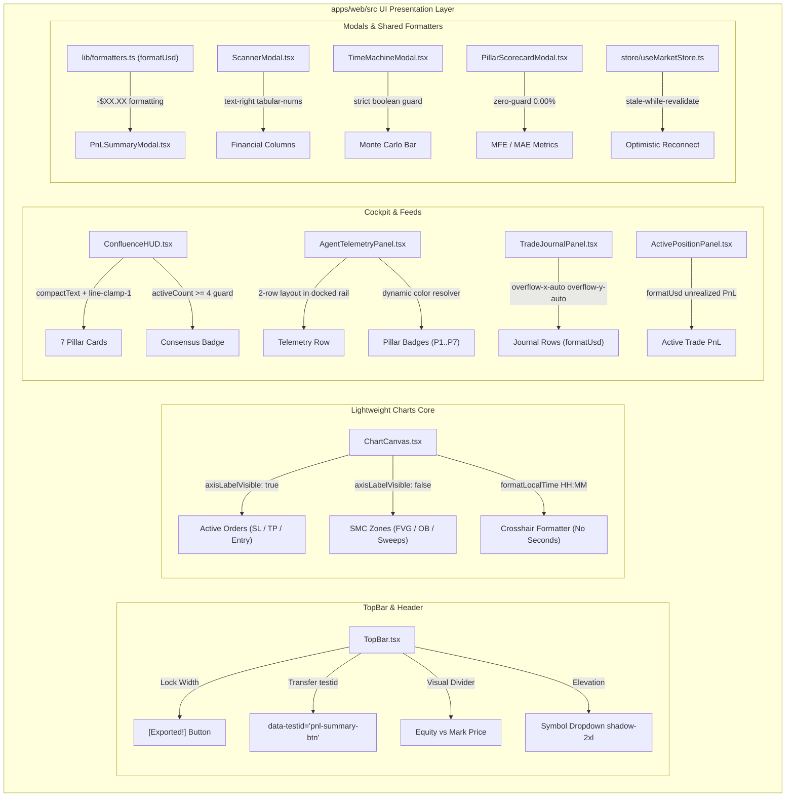

# TradeOS-v2 Frontend UI/UX Stabilization & Remediation

*   **Author:** fxbluster
*   **Status:** Approved
*   **Date:** 2026-11-23

--------------------------------------------------------------------------------

## Overview

This design document defines the comprehensive remediation plan for the TradeOS-v2 web frontend ([`apps/web/src/`](file:///C:/Users/HP/TradeOS-v2/apps/web/src/)). Based on a forensic video and frame-by-frame audit of a 78.7-second operational session ([`tradeos_v2_ui_ux_video_audit.md`](file:///C:/Users/HP/.gemini/antigravity/brain/7a2ce988-d260-48e7-a50a-20e8f26d0277/tradeos_v2_ui_ux_video_audit.md)), 20 distinct UI/UX defects were identified across four execution phases. 

The primary purpose of this design is to resolve all 20 defects—spanning Y-axis chart clutter, docked sidebar layout collapse, Confluence HUD text truncation, financial currency formatting errors (`$-`), false consensus indications, reconnect state drops, and table alignment—without modifying backend WebSocket contracts, risk engine logic, or breaking existing test suites.

## The Problem

TradeOS-v2 is an institutional-grade cryptocurrency trading cockpit. However, operational inspection revealed significant presentation defects:

1.  **Price Scale Occlusion (Critical)**: When the SMC (Smart Money Concepts) overlay is toggled on, Fair Value Gaps, Order Blocks, and Liquidity Sweeps each register independent price lines with axis labels enabled (`axisLabelVisible: true`). Combined with active trade levels (Entry, SL, TP1, TP2, Breakeven, Liq), 18+ stacked badges completely occlude the numerical Y-axis between $67.00 and $74.00.
2.  **Telemetry Sidebar Layout Breakdown (Critical)**: In right-docked mode (~360px), [`AgentTelemetryPanel.tsx`](file:///C:/Users/HP/TradeOS-v2/apps/web/src/components/AgentTelemetryPanel.tsx) attempts to render eight elements in a single horizontal flex line without wrapping. This forces mark price text to break onto a second line directly underneath and colliding with the consensus badge.
3.  **Quantitative Data Truncation (Major)**: In [`ConfluenceHUD.tsx`](file:///C:/Users/HP/TradeOS-v2/apps/web/src/components/ConfluenceHUD.tsx), rigid 7-column grid cards (~120px each) combined with `truncate` chop off critical numeric and zone context across 5 of 7 pillars with ellipses (`...`).
4.  **Misleading Consensus Signalling (Major)**: When consensus reaches 3/7, the badge displays pulsing green `3/7 BULLISH CONSENSUS`, contradicting the explicit header requirement of `Min 4 Req` and creating false directional bias.
5.  **Financial Formatting & Semantic Errors (Major)**: PnL values format negative dollars as `$-107.70` instead of `-$107.70` across modals, TopBar, and journals. News sentiment displays hardcoded red badges even when neutral. Market scanner tables left-align financial metrics instead of standard right-aligned tabular numerals.
6.  **Reconnect State Drop & Screen Flicker (Major)**: Momentary network drops or reconnects flash equity to `$0.00`, mark price to `0.00`, and temporarily unmount the active position card.
7.  **Visual Jitters & Glitches (Minor)**: Table row clipping, button width shifts during export, stray characters rendered from boolean zero expressions, and unseparated header metrics.

## Goals

*   **Goal 1**: Restore clear, unoccluded Y-axis price scale visibility in [`ChartCanvas.tsx`](file:///C:/Users/HP/TradeOS-v2/apps/web/src/components/ChartCanvas.tsx) by setting `axisLabelVisible: false` on secondary SMC zones while preserving canvas visual lines.
*   **Goal 2**: Implement adaptive multi-line layout and compact badge variants in [`AgentTelemetryPanel.tsx`](file:///C:/Users/HP/TradeOS-v2/apps/web/src/components/AgentTelemetryPanel.tsx) when docked in the right sidebar (`isDockedRight={true}`).
*   **Goal 3**: Eliminate text truncation across all 7 cards in [`ConfluenceHUD.tsx`](file:///C:/Users/HP/TradeOS-v2/apps/web/src/components/ConfluenceHUD.tsx) using safe text compacting, line-clamp, and contextual tooltips.
*   **Goal 4**: Enforce strict minimum threshold checking (`directionalCount >= 4`) before displaying green/red directional consensus badges, avoiding false signals on `NEUTRAL` bias.
*   **Goal 5**: Standardize financial formatting globally via a hardened `formatUsd` helper (`-$XX.XX`) guarding against signed zeros (`-$0.00`), `NaN`, and sub-cent values, and format numerical table columns with `text-right tabular-nums font-mono`.
*   **Goal 6**: Implement optimistic state retention in [`useMarketStore.ts`](file:///C:/Users/HP/TradeOS-v2/apps/web/src/store/useMarketStore.ts) during reconnection to eliminate screen flash and temporary `$0.00` balances.
*   **Goal 7**: Resolve all minor aesthetic and interactive defects (Monte Carlo stray character, signed zeros, button asymmetry, layout jumps, symbol dropdown contrast).
*   **Goal 8**: Maintain 100% pass rate across existing 273 server tests and ensure zero TypeScript compilation errors (`tsc --noEmit`).

## Non-Goals

*   **Non-Goal 1**: Replacing or rewriting the Lightweight Charts rendering engine.
*   **Non-Goal 2**: Modifying server-side WebSocket schemas, database models (`tradeos.db`), or API response contracts.
*   **Non-Goal 3**: Altering quant engine risk algorithms, order execution parameters, or trailing stop logic.
*   **Non-Goal 4**: Redesigning the entire application visual theme or altering the institutional color system (`#020305`, `#080c14`, `#151d2c`, emerald `#0ecb81`, rose `#f6465d`).

## Open Questions

*   *(None. All 20 forensic audit defects and 12 EGM review findings are fully resolved and mapped to specific TSX lines and Tailwind classes.)*

## Critical User Journeys (CUJs)

### CUJ 1: Execution Monitoring with SMC Overlay
*   **Given**: An active LONG trade is running with Entry, SL, TP1, and TP2 lines displayed on the chart.
*   **When**: The user enables the SMC Overlay switch to inspect unmitigated FVGs and Order Blocks.
*   **Then**: FVG and Order Block boundary lines are visible across candles, but their labels do not occupy the right price axis scale. The price numbers and active position SL/TP markers remain clearly readable.

### CUJ 2: Monitoring Quantitative Signals in Docked Sidebar Mode
*   **Given**: The user docks `AgentTelemetryPanel` to the right sidebar (~360px viewport).
*   **When**: Real-time evaluation logs and consensus decisions arrive via WebSocket.
*   **Then**: The telemetry summary rows wrap cleanly without text overlapping. The mark price and consensus badge remain readable on distinct visual lines.

### CUJ 3: Persistent Confluence Matrix Monitoring
*   **Given**: The trader monitors live market conditions across 7 quantitative pillars in the cockpit header.
*   **When**: Incoming WebSocket ticks update institutional metrics.
*   **Then**: All 7 cards display full context without text truncation, and consensus turns green only when at least 4 directional pillars align.

### CUJ 4: PnL Performance Audit & Currency Precision
*   **Given**: The user opens TradeOS-v2 and clicks "Qazanc İcmalı" to review past trade statistics.
*   **When**: The PnL Summary modal renders.
*   **Then**: All negative dollar values render strictly as `-$XX.XX`, fees render without false positive signs, and breakeven trades are explicitly annotated alongside zero losses.

--------------------------------------------------------------------------------

## Technical Plan (Architecture)

The remediation focuses exclusively on the presentation layer ([`apps/web/src/`](file:///C:/Users/HP/TradeOS-v2/apps/web/src/)), isolating changes by functional area to eliminate risk of regressions.



### 1. Chart Rendering Architecture ([`ChartCanvas.tsx`](file:///C:/Users/HP/TradeOS-v2/apps/web/src/components/ChartCanvas.tsx))

*   **Label Decoupling**: Lightweight Charts supports `axisLabelVisible: boolean` per price line.
    *   **Primary Price Lines (Execution)**: `POS ENTRY`, `ACTIVE SL`, `TP1`, `TP2`, `BREAKEVEN`, and `LIQUIDATION` retain `axisLabelVisible: true`.
    *   **Secondary Price Lines (Analytical Zones)**:
        *   Lines 516 & 526 (FVG High / Low): Set `axisLabelVisible: false`.
        *   Lines 547 & 557 (OB High / Low): Set `axisLabelVisible: false`.
        *   Line 573 (Sweep Line): Set `axisLabelVisible: false`.
*   **Crosshair Scale Formatting**:
    *   Update `formatLocalTime(timestampSec: number)` in [`ChartCanvas.tsx#L27-L36`](file:///C:/Users/HP/TradeOS-v2/apps/web/src/components/ChartCanvas.tsx#L27-L36) to omit `second: '2-digit'`. This natively reduces crosshair pill width, preventing collisions with adjacent scale tick labels without invalid options objects.

### 2. Confluence & Consensus Logic ([`ConfluenceHUD.tsx`](file:///C:/Users/HP/TradeOS-v2/apps/web/src/components/ConfluenceHUD.tsx))

*   **Safe Dynamic Text Compactor**:
    ```typescript
    const compactText = (t?: string): string => {
      if (!t) return '';
      return t
        .replace('Equilibrium (No Active Zones)', 'No Active Zones')
        .replace('Delta flow within normal bounds', 'Normal Bounds')
        .replace('unmitigated FVGs', 'FVGs')
        .replace('Order Blocks', 'OB');
    };
    ```
*   **Card Container Optimization**:
    *   Change padding from `p-2` to `p-1.5`.
    *   Replace hard `truncate` on line 264 and line 267 with `line-clamp-1 break-words`.
    *   Bind full string `${pillar.valueText} - ${pillar.subText}` to container `title`.
*   **Directional Consensus Threshold Enforcement**:
    ```typescript
    const isEffectiveConsensusMet = Boolean(
      consensusMet &&
      ((consensusBias === 'BULLISH' && bullishCount >= 4) ||
       (consensusBias === 'BEARISH' && bearishCount >= 4))
    );
    ```

### 3. Agent Telemetry Panel Layout ([`AgentTelemetryPanel.tsx`](file:///C:/Users/HP/TradeOS-v2/apps/web/src/components/AgentTelemetryPanel.tsx))

*   **Structured Docked Layout**: When `isDockedRight === true`, render a clean two-row vertical flex stack:
    *   Row 1: Timestamp (`font-mono text-slate-400`), Symbol badge (`BTCUSDT`), Side badge (`BUY` / `SELL`), Composite Score.
    *   Row 2: Mark Price (`$76.72 font-mono`), Consensus Pill (`3/7 Pillars`), Status indicator, and Expand Chevron.
*   **Dynamic Pillar Badge Color Resolver**:
    ```typescript
    const getPillarBadgeColor = (bias?: string): string => {
      if (bias === 'BULLISH' || bias === 'BUY') return 'border bg-[#0ecb81]/10 text-[#0ecb81] border-[#0ecb81]/30';
      if (bias === 'BEARISH' || bias === 'SELL') return 'border bg-[#f6465d]/10 text-[#f6465d] border-[#f6465d]/30';
      return 'border bg-[#151d2c] text-[#7d8590] border-[#151d2c]';
    };
    ```

### 4. Shared Financial Formatters & Table Standards ([`apps/web/src/lib/formatters.ts`](file:///C:/Users/HP/TradeOS-v2/apps/web/src/lib/formatters.ts))

*   **Hardened Currency Formatter**:
    ```typescript
    const usdFormatter = new Intl.NumberFormat('en-US', {
      minimumFractionDigits: 2,
      maximumFractionDigits: 2,
    });

    export const formatUsd = (val: number | null | undefined, showPlus = false): string => {
      if (val === null || val === undefined || !Number.isFinite(val) || Math.abs(val) < 0.005) {
        return '$0.00';
      }
      const isNeg = val < 0;
      const absStr = usdFormatter.format(Math.abs(val));
      if (isNeg) return `-$${absStr}`;
      return `${showPlus ? '+' : ''}$${absStr}`;
    };
    ```
*   **Application Scope for `formatUsd`**:
    *   [`PnLSummaryModal.tsx`](file:///C:/Users/HP/TradeOS-v2/apps/web/src/components/PnLSummaryModal.tsx): Lines 160, 231, 248, 284, 328, 344 (`showPlus=true`); Commissions lines 253, 296, 349 (`showPlus=false`).
    *   [`TradeJournalPanel.tsx`](file:///C:/Users/HP/TradeOS-v2/apps/web/src/components/TradeJournalPanel.tsx): Line 150 (`showPlus=true`).
    *   [`ActivePositionPanel.tsx`](file:///C:/Users/HP/TradeOS-v2/apps/web/src/components/ActivePositionPanel.tsx): Line 122 (`showPlus=true`).
    *   [`TopBar.tsx`](file:///C:/Users/HP/TradeOS-v2/apps/web/src/components/TopBar.tsx): Lines 213–214 (`showPlus=true`).
*   **Scanner Table Alignment ([`ScannerModal.tsx`](file:///C:/Users/HP/TradeOS-v2/apps/web/src/components/ScannerModal.tsx))**:
    *   Apply `text-right tabular-nums font-mono` to columns 2–5 and `justify-end` to header flex wrappers.
*   **Signed Zero Protection ([`PillarScorecardModal.tsx`](file:///C:/Users/HP/TradeOS-v2/apps/web/src/components/PillarScorecardModal.tsx))**:
    *   Line 248: `{Math.abs(row.avgMfePct) < 0.005 ? '0.00%' : `+${row.avgMfePct.toFixed(2)}%`}`
    *   Line 252: `{Math.abs(row.avgMaePct) < 0.005 ? '0.00%' : `-${row.avgMaePct.toFixed(2)}%`}`

### 5. Layout Stabilization & Store Reconnect Resilience

*   **[`TopBar.tsx`](file:///C:/Users/HP/TradeOS-v2/apps/web/src/components/TopBar.tsx)**:
    *   Add `data-testid="pnl-summary-btn"` to center button (line 196) before removing duplicate right toolbar button.
    *   Place `DollarSign` icon before the label: `<DollarSign className="w-3 h-3 text-[#0ecb81]" /> <span>Qazanc / PnL İcmalı</span>`.
    *   Add vertical divider between Mark Price and Equity: `border-r border-[#151d2c] pr-3 mr-2`.
    *   Add `shadow-2xl ring-1 ring-white/10` to symbol dropdown container (line 152).
    *   Lock `[Daily Audit]` button width with `min-w-[108px] text-center justify-center`.
*   **[`TradeJournalPanel.tsx`](file:///C:/Users/HP/TradeOS-v2/apps/web/src/components/TradeJournalPanel.tsx)**:
    *   Use `overflow-x-auto overflow-y-auto max-h-[160px] custom-scrollbar` to retain horizontal and vertical scrolling.
*   **[`store/useMarketStore.ts`](file:///C:/Users/HP/TradeOS-v2/apps/web/src/store/useMarketStore.ts)**:
    *   Implement optimistic snapshot retention during WebSocket reconnects to prevent dropping equity to `$0.00`.
*   **[`App.tsx`](file:///C:/Users/HP/TradeOS-v2/apps/web/src/App.tsx)**:
    *   Bound bottom expanded panel to `max-h-[45vh] min-h-[300px]` alongside `min-h-[220px]` chart canvas to prevent vertical clipping on laptop displays.

--------------------------------------------------------------------------------

## Alternatives Considered

### Alternative A: Completely Removing FVG & Order Block Price Lines from ChartCanvas

*   **Pros**: Completely eliminates Y-axis label clutter and canvas line clutter.
*   **Cons**: Strips away critical SMC price action context. The trader can no longer see where unmitigated gaps or institutional blocks sit on the price chart.
*   **Reason for Rejection**: Rejected due to unacceptable loss of market structure context for trade execution; setting `axisLabelVisible: false` preserves full canvas context while freeing the price scale.

### Alternative B: Modifying Server-Side WebSocket Payload Strings to Pre-Truncate Confluence Cards

*   **Pros**: Saves minor network byte overhead over WebSockets.
*   **Cons**: Violates separation of concerns. Destroys rich quantitative context needed by modals, scorecard analytics, and future high-resolution views.
*   **Reason for Rejection**: Rejected due to separation-of-concerns violation between data transport and presentation layers; presentation compaction belongs strictly in the client.

### Alternative C: Custom HTML Canvas Overlay for Price Axis Badges

*   **Pros**: Provides arbitrary absolute control over badge placement and collision detection algorithms.
*   **Cons**: Requires reimplementing complex price-to-pixel coordinate transforms and scroll/zoom synchronization that Lightweight Charts already provides natively, introducing high maintenance overhead and potential visual desynchronization bugs.
*   **Reason for Rejection**: Rejected due to excessive implementation complexity and maintenance overhead when Lightweight Charts provides native `axisLabelVisible` flags.

--------------------------------------------------------------------------------

## Risks & Mitigations

*   **Risk 1: Null/Undefined Telemetry in Text Compaction (`compactText`)**:
    *   *Failure Mode*: WebSocket feed transmitting null, numeric, or unmapped zone descriptions causes client runtime exception.
    *   *Mitigation*: Implement safe fallback: `const compactText = (t?: string): string => (!t ? '' : t.replace(...));`.
*   **Risk 2: Edge Cases in Currency Formatting (`formatUsd`)**:
    *   *Failure Mode*: `NaN`, `Infinity`, or sub-cent floats outputting malformed strings or broken layouts.
    *   *Mitigation*: Guard `if (!Number.isFinite(val) || Math.abs(val) < 0.005) return '$0.00';` and validate with dedicated Vitest unit tests.
*   **Risk 3: Viewport Compression Below 320px in Right-Docked Rail**:
    *   *Failure Mode*: Dense badge layouts causing horizontal overflow in extreme narrow viewports.
    *   *Mitigation*: Enforce `min-w-0` and `truncate` safety guards on symbol/timestamp badges alongside flex wrapping.
*   **Risk 4: Reconnect Data Drop Panic**:
    *   *Failure Mode*: Instantaneous network hiccup resets equity to `$0.00` causing trader panic.
    *   *Mitigation*: Preserve previous state snapshot in `useMarketStore.ts` until new snapshot arrives.

--------------------------------------------------------------------------------

## Non-Functional Requirements

*   **Security & Privacy**: Changes are restricted exclusively to the client-side presentation tier ([`apps/web/src/`](file:///C:/Users/HP/TradeOS-v2/apps/web/src/)). No credentials, tokens, or private trading telemetry are exposed.
*   **Performance & Latency**: UI updates must maintain 60 FPS rendering under high-frequency WebSocket tick streams (up to 4Hz). String compaction and formatting helpers are O(1) operations with pre-allocated `Intl.NumberFormat`.
*   **Rollout & Rollback**: Delivered as atomic presentation-tier commits. Completely decoupled from database schemas or backend server processes, allowing instant zero-downtime rollback via standard git revert if needed.

--------------------------------------------------------------------------------

## Detailed Implementation Plan

### Target Files to Create/Modify

#### 1. [`apps/web/src/lib/formatters.ts`](file:///C:/Users/HP/TradeOS-v2/apps/web/src/lib/formatters.ts) (Modify or Create)
*   **Type / Scope**: TypeScript shared formatting module.
*   **Proposed Changes**: Implement and export `formatUsd(val: number | null | undefined, showPlus?: boolean): string`. Formats negative numbers strictly as `-$XX.XX`, zero and values `< 0.005` as `$0.00`, and positive numbers as `+$XX.XX` (when `showPlus=true`) or `$XX.XX`.

#### 2. [`apps/web/src/components/ChartCanvas.tsx`](file:///C:/Users/HP/TradeOS-v2/apps/web/src/components/ChartCanvas.tsx) (Modify)
*   **Type / Scope**: React charting component with Lightweight Charts.
*   **Proposed Changes**: Set `axisLabelVisible: false` on lines 516 (FVG High), 526 (FVG Low), 547 (OB High), 557 (OB Low), and 573 (Sweep price line). In `formatLocalTime(timestampSec)` (lines 27–36), omit `second: '2-digit'`.

#### 3. [`apps/web/src/components/AgentTelemetryPanel.tsx`](file:///C:/Users/HP/TradeOS-v2/apps/web/src/components/AgentTelemetryPanel.tsx) (Modify)
*   **Type / Scope**: React real-time telemetry feed component.
*   **Proposed Changes**: Implement a structured two-row layout for `isDockedRight === true` on lines 241–274. Replace hardcoded red classes on P7 badge (lines 317–331) with dynamic helper `getPillarBadgeColor(bias)`.

#### 4. [`apps/web/src/components/ConfluenceHUD.tsx`](file:///C:/Users/HP/TradeOS-v2/apps/web/src/components/ConfluenceHUD.tsx) (Modify)
*   **Type / Scope**: React 7-pillar institutional matrix HUD.
*   **Proposed Changes**: Reduce card padding from `p-2` to `p-1.5` in grid cards. Add `compactText(t?: string)` helper. Replace `truncate` on line 264 and 267 with `line-clamp-1 break-words` and add container `title` tooltip. Update consensus badge logic (lines 152–163) with `isEffectiveConsensusMet`.

#### 5. [`apps/web/src/components/PnLSummaryModal.tsx`](file:///C:/Users/HP/TradeOS-v2/apps/web/src/components/PnLSummaryModal.tsx) (Modify)
*   **Type / Scope**: React PnL analytics modal.
*   **Proposed Changes**: Apply `formatUsd(val, true)` to lines 160, 231, 248, 284, 328, 344; apply `formatUsd(val, false)` to commissions (lines 253, 296, 349). In 3-day summary, compute `const beCount = Math.max(0, data.threeDays.tradeCount - data.threeDays.winCount - data.threeDays.lossCount)` and render `{data.threeDays.lossCount} ({beCount} Breakeven)`. Update line 353 with dynamic `Müsbət`/`Mənfi` label.

#### 6. [`apps/web/src/components/ScannerModal.tsx`](file:///C:/Users/HP/TradeOS-v2/apps/web/src/components/ScannerModal.tsx) (Modify)
*   **Type / Scope**: React multi-symbol scanner modal.
*   **Proposed Changes**: Update table headers and data cells for columns 2–5 with `text-right tabular-nums font-mono` and add `justify-end` to inner header flex divs.

#### 7. [`apps/web/src/components/TimeMachineModal.tsx`](file:///C:/Users/HP/TradeOS-v2/apps/web/src/components/TimeMachineModal.tsx) (Modify)
*   **Type / Scope**: React Monte Carlo probability modal.
*   **Proposed Changes**: On lines 204–211, replace `{timeoutProb && timeoutProb > 0.01 && <div .../>}` with `{timeoutProb !== null && timeoutProb > 0.01 ? <div .../> : null}`.

#### 8. [`apps/web/src/components/PillarScorecardModal.tsx`](file:///C:/Users/HP/TradeOS-v2/apps/web/src/components/PillarScorecardModal.tsx) (Modify)
*   **Type / Scope**: React scorecard modal.
*   **Proposed Changes**: Add zero guards for MFE and MAE percentages: line 248 `{Math.abs(row.avgMfePct) < 0.005 ? '0.00%' : ...}` and line 252 `{Math.abs(row.avgMaePct) < 0.005 ? '0.00%' : ...}`.

#### 9. [`apps/web/src/components/TopBar.tsx`](file:///C:/Users/HP/TradeOS-v2/apps/web/src/components/TopBar.tsx) (Modify)
*   **Type / Scope**: React navigation header bar.
*   **Proposed Changes**: Add `data-testid="pnl-summary-btn"` to center button (line 196) and remove duplicate button (lines 222–230). Place `DollarSign` icon before text. Add vertical divider between Mark Price and Equity (`border-r border-[#151d2c] pr-3 mr-2`). Add `shadow-2xl ring-1 ring-white/10` to symbol dropdown (line 152). Set `min-w-[108px]` on `[Daily Audit]`. Format unrealized and session PnL with `formatUsd(val, true)` (lines 213–214).

#### 10. [`apps/web/src/components/TradeJournalPanel.tsx`](file:///C:/Users/HP/TradeOS-v2/apps/web/src/components/TradeJournalPanel.tsx) (Modify)
*   **Type / Scope**: React trade journal table panel.
*   **Proposed Changes**: On line 114, update table container with `overflow-x-auto overflow-y-auto max-h-[160px] custom-scrollbar`. Format realized PnL on line 150 with `formatUsd(t.realized_pnl, true)` and apply `text-right tabular-nums font-mono` to financial columns.

#### 11. [`apps/web/src/components/ActivePositionPanel.tsx`](file:///C:/Users/HP/TradeOS-v2/apps/web/src/components/ActivePositionPanel.tsx) (Modify)
*   **Type / Scope**: React active trade position panel.
*   **Proposed Changes**: On line 122, format unrealized PnL with `formatUsd(unrealizedPnlUsd, true)` to eliminate `($-XX.XX)`.

#### 12. [`apps/web/src/store/useMarketStore.ts`](file:///C:/Users/HP/TradeOS-v2/apps/web/src/store/useMarketStore.ts) (Modify)
*   **Type / Scope**: Zustand state management store.
*   **Proposed Changes**: Implement optimistic retention during WebSocket reconnection (`wsStatus === 'RECONNECTING'`) to preserve the last valid snapshot of `account` and `activePosition`.

#### 13. [`apps/web/src/App.tsx`](file:///C:/Users/HP/TradeOS-v2/apps/web/src/App.tsx) (Modify)
*   **Type / Scope**: Root application layout component.
*   **Proposed Changes**: Bound expanded bottom dock to `max-h-[45vh] min-h-[300px]` while ensuring ChartCanvas maintains `min-h-[220px]`.

#### 14. [`apps/web/src/lib/__tests__/formatters.test.ts`](file:///C:/Users/HP/TradeOS-v2/apps/web/src/lib/__tests__/formatters.test.ts) (Create)
*   **Type / Scope**: Vitest unit test suite.
*   **Proposed Changes**: Comprehensive unit test coverage for `formatUsd`:
    *   Negative numbers format strictly as `-$XX.XX`.
    *   Signed zero values (`-0`, `-0.001`, `0`, `0.004`) format strictly as `$0.00` regardless of `showPlus`.
    *   Non-finite inputs (`NaN`, `Infinity`, `null`, `undefined`) format safely as `$0.00`.
    *   Positive values format with or without leading `+` based on `showPlus`.

### Verification Plan

*   **Compilation / Type Checking**:
    *   Command: `npx tsc --noEmit -p apps/web/tsconfig.json`
    *   Requirement: Exit code 0, 0 type errors.
*   **Static Analysis & Linting**:
    *   Command: `npx eslint apps/web/src/lib/formatters.ts apps/web/src/components/ChartCanvas.tsx`
    *   Requirement: 0 ESLint warnings or errors.
*   **Unit Tests**:
    *   Command: `npx vitest run apps/web/src/lib/__tests__/formatters.test.ts`
    *   Requirement: 100% assertions passing for currency formatting edge cases.
*   **Test Coverage Requirement**:
    *   Requirement: 100% statement and branch coverage on `apps/web/src/lib/formatters.ts`.
*   **Regression Guard (Server & Web Bundling)**:
    *   Command: `npm --workspace=apps/server test && npm --workspace=apps/web run build`
    *   Requirement: All 26 server test files and 273 tests pass with 0 failures; Vite production bundle generates cleanly.
*   **Manual Visual Verification**:
    *   Inspect key frames: Y-axis price labels free of FVG/OB markers, right docked rail wraps cleanly without text overlap, and all negative currencies display as `-$XX.XX`.

--------------------------------------------------------------------------------

*Drafted with EGM*
