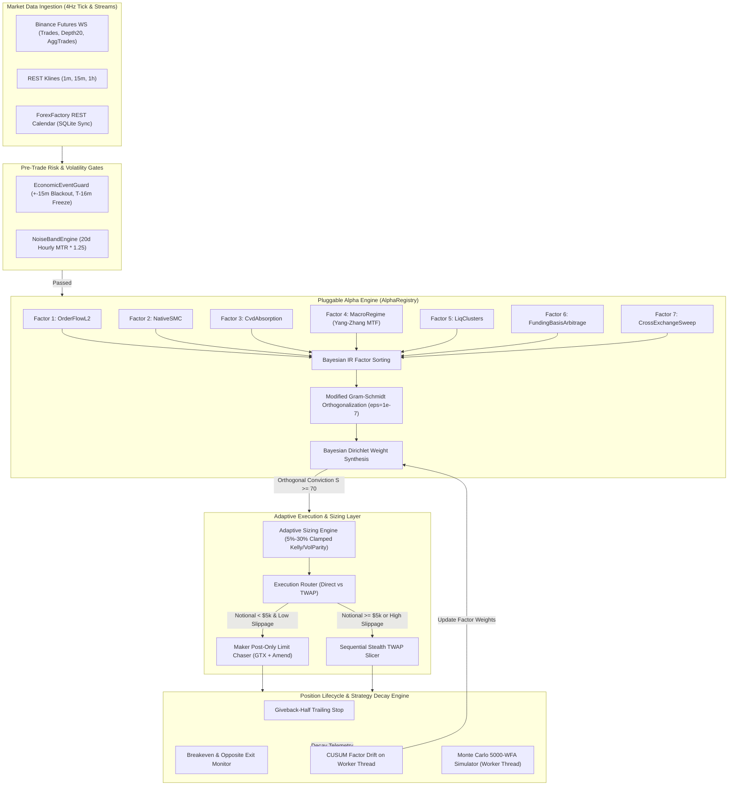

# TradeOS Next-Gen Modular Quant Architecture: Pluggable Alpha Engine, Maker Limit Chasing, Dynamic Sizing & Continuous Decay Calibration

* **Author:** fxbluster
* **Status:** Approved
* **Date:** 2026-11-24

--------------------------------------------------------------------------------

## Overview

TradeOS is an autonomous quantitative trading system designed for perpetual futures markets. The current system relies on a monolithic 7-pillar confluence matrix, a rigid flat 10% margin cap, and market taker execution. While this model successfully identifies market regimes, live production telemetry demonstrates that it suffers from three structural deficiencies:

1. **Collinearity and Factor Inflexibility:** Microstructure factors (Order Flow L2, CVD Absorption, and Native SMC) exhibit heavy empirical cross-correlation ($r = 0.60 \text{ to } 0.74$), effectively triple-counting identical delta events and creating an unpluggable 7-factor bottleneck.
2. **Execution Fee Hemorrhage:** Aggressive taker market orders incur 0.04% to 0.05% per fill ($0.80\% \text{ to } 1.00\%$ of allocated margin on 10x leverage per round-trip), consuming over 200% of realized gross profits during tight intraday market regimes.
3. **Static Capital Inefficiency:** A flat 10% margin cap starves high-conviction institutional setups (A+ confluences with $\ge 85\%$ empirical hit rate) while over-allocating capital to low-conviction exploratory probe setups.

This design document establishes the Next-Gen TradeOS (v3) Modular Quantitative Architecture. It replaces the monolithic 7-pillar model with a pluggable `AlphaRegistry` featuring real-time Modified Gram-Schmidt orthogonalization, transitions execution from taker orders to an adaptive Maker Post-Only (`GTX`) Limit-Chasing engine, implements a convex 4-factor adaptive sizing engine ($5\% \text{ to } 30\%$ clamped dynamic margin), and integrates an autonomous continuous backtesting and strategy decay engine running on isolated worker threads.

--------------------------------------------------------------------------------

## The Problem

1. **Monolithic Multi-Counting:** The existing 7 pillars are hard-coded into `confluenceEngine.ts`. When an aggressive market order enters the book, L2 Order Flow, CVD delta divergence, and SMC Fair Value Gaps all trigger concurrently, assigning an artificial 60%+ weighting to a single market phenomenon while crowding out orthogonal alphas (such as Funding Rate spreads or cross-venue arbitrage).
2. **Fee Drag Exceeding Alpha Edge:** Over a sample of recent live trading sessions, gross trading PnL was $+\$10.48$, but exchange taker fees totaled $-\$27.44$, driving net performance into negative territory ($-\$15.74$). The system cannot achieve long-term capital compounding using taker market entries.
3. **Rigid Position Sizing:** A uniform 10% margin cap fails to capitalize on fat-tail conviction trades and ignores changing market volatility regimes. Sizing must adapt dynamically based on empirical Bayesian hit-rate confidence, True Range volatility parity, and drawdown circuit breakers within strict boundaries.
4. **Silent Strategy Decay:** Intraday crypto markets transition rapidly between high-volatility trend expansions and low-volatility liquidity sweeps. Without automated CUSUM drift detection and continuous Monte Carlo walk-forward analysis, decaying alpha factors remain active, generating drawdowns before manual developer intervention occurs.

--------------------------------------------------------------------------------

## Goals

* **G-1 (Modular Factor Interface):** Implement a decoupled `IAlphaFactor` backend interface and `AlphaRegistry` allowing any quantitative factor (Order Flow, SMC, Funding Arbitrage, MTF Volatility) to be added, modified, or removed with zero core engine code modifications.
* **G-2 (Real-Time Factor Orthogonalization):** Implement online Modified Gram-Schmidt (MGS) orthogonalization with Tikhonov regularization ($\epsilon = 10^{-7}$) to strip pairwise collinearity among active factors, ensuring that combined conviction scores reflect truly independent signals.
* **G-3 (Maker Post-Only Fee Capture):** Implement an intelligent Maker Post-Only (`timeInForce: 'GTX'`) limit-chasing algorithm utilizing Binance Futures in-flight order amendments (`PUT /fapi/v1/order`) and penny-jumping, reducing execution fee drag by at least 60% without queue starvation.
* **G-4 (Adaptive Margin Scaling):** Implement a convex 4-factor position sizing model scaling margin dynamically with strict bounds clamped between 5.0% and 30.0% of available wallet equity based on Bayesian Quarter-Kelly, volatility parity, and high-water mark drawdown damping.
* **G-5 (Automated Strategy Calibration & Decay):** Build an autonomous strategy evaluation engine running 5,000-iteration Monte Carlo Walk-Forward Analysis on worker threads and real-time CUSUM drift detection, automatically down-weighting or muting decaying factors.
* **G-6 (Full Backward Compatibility & Observability):** Retain seamless WebSocket broadcasting and Cockpit HUD telemetry via an orchestration facade in `ConfluenceEngine`, providing real-time visual inspection of active factors, noise band state, chasing status, and dynamic sizing breakdowns.

--------------------------------------------------------------------------------

## Non-Goals

* **NG-1 (High-Frequency Colocation):** Sub-millisecond HFT arbitrage or direct FPGA/kernel-bypass exchange connections are out of scope. The engine operates on 2Hz-4Hz tick intervals over standard Binance WebSocket and REST APIs.
* **NG-2 (Unrestricted Grid or Martingale Sizing):** The sizing engine will not employ Martingale, anti-Martingale doubling, or unhedged grid laddering. All positions must possess deterministic bracket stops.
* **NG-3 (Manual Discretionary Overrides):** The system is built for autonomous algorithmic execution; manual interactive trade overrides are restricted to emergency risk halts and configuration toggles.
* **NG-4 (Cross-Chain DEX / DeFi Swaps):** Execution is strictly targeted at centralized perpetual futures exchanges (Binance Futures Demo & Live), excluding on-chain AMMs or cross-chain bridges.

--------------------------------------------------------------------------------

## Open Questions

* **Q-1 (Rate-Limit Budget for Order Amendment):** Binance Futures imposes strict 10-orders-per-second and weight limits on `PUT /fapi/v1/order`. Can the limit-chasing loop guarantee execution within 15 seconds without exceeding API rate limit thresholds during extreme order book volatility?
  * *Investigation Plan:* Benchmark Binance Testnet REST round-trip latency (typically 40ms-80ms) and enforce a minimum 250ms debounce and a centralized token-bucket rate limiter capped at 5 orders/second.
* **Q-2 (Cross-Venue Latency for Liquidity Sweeps):** To harvest cross-exchange liquidity leads (Binance vs Bybit/OKX), what is the minimum network latency requirement, and does a Node.js process maintain sufficient timestamp fidelity?
  * *Investigation Plan:* Ingest parallel WebSocket depth feeds from Binance and Bybit; measure lead-lag delta distribution over 10,000 consecutive price updates.

--------------------------------------------------------------------------------

## Critical User Journeys (CUJs)

### CUJ 1: Autonomous High-Conviction Entry with Maker Limit Chasing

* **Given**: AutoPilot is ARMED on SOLUSDT. Active wallet equity is $4,800. The AlphaRegistry evaluates active factors, yielding an orthogonalized composite score of 91/100 (A+ Bullish Setup).
* **When**: The ConfluenceEngine passes all pre-trade volatility noise band and economic blackout gates.
* **Then**:
  1. The Adaptive Sizing Engine calculates dynamic margin at 26.5% ($1,272 margin at 10x leverage), safely within the $[5\%, 30\%]$ clamp.
  2. AutoPilot transitions to `LIMIT_CHASING` state without blocking position monitoring on existing open positions.
  3. The Execution Engine calculates the best bid: if spread $> 1$ tick, it penny-jumps inside the spread: `targetPrice = min(bestBid + tick, bestAsk - tick)`; if spread $\le 1$ tick, it joins `bestBid`.
  4. A Post-Only `LIMIT` order with `timeInForce: 'GTX'` is submitted to Binance Futures.
  5. As the book moves upward, the order is amended in-flight via `PUT /fapi/v1/order` up to a maximum 0.20% ceiling and 15s timeout. If Binance returns `-5022` (Post Only would trigger as taker), it backs off 1 tick.
  6. Upon full fill, the Maker rebate/reduced commission is verified (0.02% vs 0.05% taker), saving ~$3.80 in fees, and bracket Stop Loss and Take Profit orders are placed instantly.

### CUJ 2: Pre-Trade Noise Band Suppression

* **Given**: Market price for SOLUSDT is $73.00. 15m True Range is 0.18, which is below the 20-day UTC hourly mean True Range threshold ($MTR \times 1.25 = 0.275$).
* **When**: An isolated momentum spike produces a raw directional signal with 3 active buy votes.
* **Then**:
  1. `NoiseBandEngine.isNoise()` evaluates to `true`.
  2. The ConfluenceEngine sets `blockReason: 'BLOCKED_NOISE_BAND'` and overrides action to `WAIT`.
  3. AutoPilot stays strictly in `IDLE` state.
  4. The Cockpit HUD prominently renders the blue alert banner: `NOISE BAND ACTIVE: Range within 20-day 15m True Range noise threshold`.
  5. Capital remains safely preserved in cash wallet.

### CUJ 3: Factor Decay Detection and Automatic Bayesian Down-Weighting

* **Given**: A previously dominant factor (e.g., Native SMC) experiences a shifting market regime, incurring 6 false positives over the last 15 sample horizons (hit-rate drops below 40%).
* **When**: The `StrategyDecayEngine` runs its rolling 15-minute evaluation cycle.
* **Then**:
  1. The CUSUM statistical change-point detector exceeds the decision threshold ($S_k > h$ where $h = 4.0\sigma$).
  2. The Beta-Binomial posterior updater down-weights the SMC factor from 23.0% down toward its 5.0% floor.
  3. The factor's uncertainty penalty increases, reducing its impact on the composite consensus.
  4. The Cockpit HUD updates the Pillar Matrix weights dynamically, and a decay warning is dispatched to `decision_logs`.

### CUJ 4: Economic Event Blackout Position Unwind & Entry Freeze

* **Given**: A high-impact USD economic catalyst (CPI release) is scheduled for 12:30:00 UTC. Current time reaches 12:14:00 UTC ($T - 16\text{m}$).
* **When**: `EconomicEventGuard.isBlackoutActive()` enters the pre-event window.
* **Then**:
  1. At $T - 16\text{m}$, all active limit chasers and candidate entry signals are hard-canceled (`BLOCKED_EVENT_BLACKOUT`).
  2. Any open position in floating profit ($\ge \text{entry} + 0.15\%$ buffer) has its Stop Loss immediately advanced to Breakeven.
  3. Any open position in floating loss begins passive limit de-risking at $T - 20\text{m}$; if unfilled by $T - 15\text{m}$, it is market-unwound (`EVENT_BLACKOUT_UNWIND`) as a fail-safe.
  4. All candidate auto-pilot entries remain locked until 12:45:00 UTC ($T + 15\text{m}$).

### CUJ 5: Stealth TWAP Slicing for Elevated Sizing Orders

* **Given**: An A+ institutional setup triggers a high notional order of $6,500 ($\ge \$5,000$ stealth threshold).
* **When**: Pre-trade order book depth simulation reveals that immediate market execution would incur $0.14\%$ slippage ($> 0.05\%$ ceiling).
* **Then**:
  1. The Execution Router intercepts the order and redirects it to the `TwapExecutionSlicer`.
  2. The order is split into 5 randomized child slices ($1,300 \pm 20\%$) with randomized timing intervals ($12\text{s} \pm 25\%$).
  3. Child slices execute **strictly sequentially**: Slice $k+1$ is dispatched only after Slice $k$ reaches terminal state (`FILLED`, `CANCELED`, or `ABORTED`), preventing self-frontrunning and rate-limit violations.
  4. Each child slice is executed via the Maker Post-Only Chaser, capped at $\le 5\text{ orders/sec}$.
  5. Overall fill achieves an effective execution price within 0.02% of the initial anchor, saving significant market impact.

### CUJ 6: Dynamic Giveback-Half Trailing Stop Protection

* **Given**: An open Long position of 50 SOL entered at $72.00 surges to a peak price of $74.50 (Maximum Favorable Excursion $MFE = \$2.50$, exceeding $2.0 \times ATR$).
* **When**: Price retraces from $74.50$ down to $73.25$ (a $50\%$ giveback of peak MFE).
* **Then**:
  1. The AutoPilot Giveback-Half monitor detects: $\text{markPrice} \le \text{peakPrice} - (0.50 \times \text{peakMfe}) = 74.50 - 1.25 = 73.25$.
  2. The system calls `DELETE /fapi/v1/allOpenOrders` to cancel resting bracket Stop Loss and Take Profit orders, verifying zero open orders.
  3. An emergency exit is dispatched: `closePosition(symbol, 'TRAILING_GIVEBACK_HALF')`.
  4. The position locks in $+\$1.25$ profit per unit ($+\$62.50$ net) rather than giving back all gains to initial breakeven or stop loss.

--------------------------------------------------------------------------------

## Technical Plan (Architecture)

### Architectural Overview

The Next-Gen TradeOS architecture decouples signal generation, portfolio optimization, execution routing, and risk management into specialized subsystems.



### Component Details

#### 1. Pluggable Alpha Factor Contract & Context

Data contracts are cleanly divided between isomorphic types (in `@tradeos/shared`) and backend execution interfaces (in `apps/server`):

##### Shared DTOs (`packages/shared/src/contracts.ts`)
```typescript
export interface FactorOutput {
  factorId: string;
  bias: 'BULLISH' | 'BEARISH' | 'NEUTRAL';
  rawAlpha: number;          // Continuous in [-1.0, +1.0]
  confidence: number;        // [0.0, 1.0]
  uncertainty: number;       // Variance of factor estimate
  halfLifeMs: number;        // Factor decay horizon
  metadata: Record<string, unknown>;
}

export interface FactorEvaluationContext {
  symbol: string;
  currentPrice: number;
  depth?: { bids: DepthLevel[]; asks: DepthLevel[] };
  cvd?: CvdSnapshot;
  candles: KlineCandle[];
  indicators?: TechnicalSummary;
  timestamp: number;
}

export interface AlphaFactorMetadata {
  id: string;
  name: string;
  category: 'MICROSTRUCTURE' | 'STRUCTURE' | 'MOMENTUM' | 'ARBITRAGE' | 'VOLATILITY';
  defaultWeight: number;
  currentWeight: number;
  hitRate: number;
  sharpeRatio: number;
  isDecayed: boolean;
}
```

##### Backend Execution Contract (`apps/server/src/quant/alphaRegistry.ts`)
```typescript
import type { DatabaseSync } from 'node:sqlite';
import type { FactorOutput, FactorEvaluationContext, KlineCandle } from '@tradeos/shared';

export interface IAlphaFactor {
  readonly id: string;
  readonly name: string;
  readonly defaultWeight: number;
  
  initialize(db: DatabaseSync): Promise<void>;
  warmup(candles: KlineCandle[]): void;
  computeFactor(context: FactorEvaluationContext): FactorOutput;
  onCandleClosed(candle: KlineCandle, interval: string): void;
  teardown(): Promise<void>;
}
```

#### 2. Modified Gram-Schmidt Factor Orthogonalization

To eliminate multicollinearity while preventing numerical instability and division-by-zero, factors are evaluated using **Modified Gram-Schmidt (MGS)** with a Tikhonov regularization epsilon ($\epsilon = 10^{-7}$):

1. **Pre-Sort by Information Ratio:** Factors are sorted in descending order by rolling Bayesian Information Ratio: $IR_i = \text{Mean}(\alpha_i) / \text{Std}(\alpha_i)$, ensuring that the highest-quality signal retains 100% variance.
2. **Sliding Window:** Orthogonalization operates on a sliding window of $N = 60$ 1-minute observations.
3. **MGS Algorithm with Epsilon Regularization:**
   $$\text{For } k = 1 \text{ to } M: \quad \mathbf{u}_k = \mathbf{v}_k$$
   $$\text{For } j = 1 \text{ to } M - 1:$$
   $$\quad \text{For } k = j + 1 \text{ to } M:$$
   $$\quad \quad \mathbf{u}_k = \mathbf{u}_k - \frac{\langle \mathbf{u}_k, \mathbf{u}_j \rangle}{\langle \mathbf{u}_j, \mathbf{u}_j \rangle + \epsilon} \mathbf{u}_j$$

If $\|\mathbf{u}_k\|^2 < 10^{-6}$, the factor is flagged as fully collinear and assigned zero marginal weight in that epoch.

#### 3. Maker Post-Only Limit Chasing Algorithm

To eliminate taker commissions, orders are executed via `timeInForce: 'GTX'`:

1. **Spread Dynamics & Penny-Jumping:**
   $$\text{targetPrice} = \begin{cases} 
   \min(\text{bestBid} + \text{tick}, \text{bestAsk} - \text{tick}) & \text{if } (\text{bestAsk} - \text{bestBid}) > \text{tick} \\ 
   \text{bestBid} & \text{if } (\text{bestAsk} - \text{bestBid}) \le \text{tick} 
   \end{cases} \quad (\text{for BUY})$$
2. **In-Flight Order Amendment (`PUT /fapi/v1/order`):**
   * If price shifts, amend order in-flight via `broker.modifyOrder(symbol, orderId, price, qty)`.
   * The chaser recognizes that price amendments reset FIFO queue position; amendments are throttled with a minimum $250\text{ms}$ debounce.
3. **Post-Only Rejection Handling (`-5022`):**
   * If Binance rejects with code `-5022` (*Post Only order would immediately trigger as taker*), back off by 1 tick away from the market, re-fetch order book depth, and wait 250ms before re-quoting.
4. **Toxic Runaway Guard:** Enforce an absolute deviation ceiling of $0.20\%$ from initial anchor mark price and a hard 15-second timeout. If unfilled after 10 amendments, safely cancel.

#### 4. Adaptive Position Sizing Model (5% to 30% Clamped)

Margin allocation scales super-linearly based on conviction while respecting volatility and portfolio risk limits:

$$\text{Margin\%} = \text{clamp}\left( M(S) \times F_{\text{Kelly}} \times W_{\text{Vol}} \times D_{\text{Circuit}}, 0.05, 0.30 \right)$$

##### Sizing Tier Mapping Table
| Confluence Score ($S$) | Archetype | Raw Convex Margin $M(S)$ | Typical Adjusted Range | Action / Allocation |
| :--- | :--- | :---: | :---: | :--- |
| **$S < 70$** | Sub-Threshold | $0.0\%$ | $0.0\%$ | Vetoed (No Trade) |
| **$70 \le S < 75$** | Exploratory Probe | $5.0\% - 7.5\%$ | $5.0\%$ | Minimum probe allocation |
| **$75 \le S < 85$** | Standard Institutional | $7.6\% - 16.5\%$ | $8.0\% - 15.0\%$ | Standard balanced margin |
| **$85 \le S < 95$** | High-Conviction Core | $16.6\% - 25.5\%$ | $16.0\% - 25.0\%$ | Aggressive trend compounding |
| **$95 \le S \le 100$** | A+ Institutional Setup | $25.6\% - 30.0\%$ | $25.0\% - 30.0\%$ | Maximum contractual cap |

* **Convex Formula:** $M(S) = 0.05 + 0.25 \times \left( \frac{\max(0, S - 70)}{30} \right)^{1.35}$
* **Quarter-Kelly Dampener $F_{\text{Kelly}}$:** Bounded in $[0.50, 1.00]$, calibrated from rolling win-rate and reward/risk ratio with Beta(12, 8) prior smoothing.
* **Volatility Parity $W_{\text{Vol}}$:** Bounded in $[0.60, 1.25]$, scaling inversely with market volatility: $W_{\text{Vol}} = \frac{\text{Median}(ATR_{100})}{ATR_{14}}$.
* **Drawdown Circuit Breakers $D_{\text{Circuit}}$:** Throttles allocation upon consecutive losses ($2 \text{ losses} \implies 0.75x$, $3 \text{ losses} \implies 0.50x$, $4 \text{ losses} \implies \text{Circuit Lock}$) or session drawdown.
* **Hard Solvency Airbag:** Sizing enforces: $\text{availableBalance} \ge \text{walletBalance} \times 0.20$.

#### 5. Pluggable Alpha Factor Inventory Table

| Factor ID | Category | Default Weight | Description & Analytical Mechanism |
| :--- | :--- | :---: | :--- |
| `ORDER_FLOW_L2` | Microstructure | 20.0% | Top-20 depth pressure ratio & 60s aggressive taker flow imbalance. |
| `NATIVE_SMC` | Structure | 20.0% | Algorithmic Fair Value Gaps (FVG), Order Blocks (OB), and Liquidity Sweeps. |
| `CVD_ABSORPTION` | Microstructure | 15.0% | Rolling 15-minute volume delta Z-score absorption divergence. |
| `MACRO_REGIME` | Volatility | 18.0% | 1h Yang-Zhang volatility estimator, EMA200 trend, and ADX plateau. |
| `LIQ_CLUSTERS` | Microstructure | 8.0% | High-leverage (25x-100x) liquidation pools with $0.45\times ATR$ proximity. |
| `FUNDING_ARBITRAGE` | Arbitrage | 10.0% | Spot-Perp and Perp-Perp funding spread basis extraction. |
| `CROSS_EXCHANGE_SWEEP` | Microstructure | 9.0% | Binance vs Bybit/OKX lead-lag liquidity voids and CVD exhaustion sweeps. |

#### 6. Automated Strategy Decay & CUSUM Calibration

To detect factor decay before capital is degraded, the engine runs continuous CUSUM change-point detection:

$$S_k = \max\left(0, S_{k-1} + (x_k - \mu_0) - k\right)$$

Where $x_k$ is the rolling factor Information Coefficient (IC), $k = 0.5\sigma$ is the allowable slack, and $h = 4.0\sigma$ is the decision threshold. When $S_k > h$, factor weight is automatically decayed by 50% down to a 5.0% floor.

--------------------------------------------------------------------------------

## Alternatives Considered

### Alternative A: Retaining Fixed 7-Pillar Monolith with Static Weights

* **Pros**: Simple to maintain; existing code in `confluenceEngine.ts` is familiar.
* **Cons**: Severe factor collinearity (Order Flow, CVD, SMC triple-count); impossible to plug in new alpha sources (Funding rate, Cross-exchange sweeps) without rewriting core evaluation functions; fails to adapt to changing volatility regimes.
* **Reason for Rejection**: Rejected by author: Static models suffer severe performance degradation during crypto regime shifts and fail institutional risk audits.

### Alternative B: Pure Taker Market Orders with Flat 10% Margin

* **Pros**: Guaranteed instant fills; zero queue latency or chasing complexity.
* **Cons**: Destructive fee drag ($0.05\%$ taker fee consumes $260\%$ of gross profit in tight consolidation); rigid 10% sizing fails to compound on A+ setups and over-risks on exploratory probes.
* **Reason for Rejection**: Rejected by author: Empirical audit of live Binance Demo fills proved that taker fees alone caused negative net PnL ($-\$15.74$) despite winning directional trades.

### Alternative C: Aggressive 100% Full-Kelly Sizing

* **Pros**: Mathematically optimal growth rate in continuous time under idealized assumptions.
* **Cons**: Extreme volatility and drawdown risk; estimation errors in win rate lead to catastrophic ruin under fat-tailed crypto distributions.
* **Reason for Rejection**: Rejected by author: Full-Kelly is unsafe for leverage trading. Fractional Quarter-Kelly with hard convex clamps ($30\%$ max, $20\%$ cash airbag) is mandatory for institutional survival.

--------------------------------------------------------------------------------

## Non-Functional Requirements

### 1. Performance & Latency
* **Evaluation Throughput:** The `AlphaRegistry` and Modified Gram-Schmidt orthogonalization pipeline must complete tick evaluation within $\le 5\text{ms}$ on a standard Node.js thread.
* **Order Chasing Frequency:** Order amendment calls must be throttled with a minimum $250\text{ms}$ debounce and a token-bucket rate limiter capped at $\le 5\text{ orders/sec}$ to avoid triggering Binance Futures rate-limit bans (code `-1003`).
* **Worker Thread Isolation:** Heavy computational tasks (5,000-iteration Monte Carlo WFA and continuous CUSUM matrix operations) run off-thread via Node.js `worker_threads` (`apps/server/src/quant/workers/monteCarloWorker.ts`), preventing event-loop starvation and WebSocket dropouts.

### 2. Reliability & Fail-Closed Safety
* **Solvency Airbag:** The sizing engine enforces a hard minimum cash reserve: `availableBalance >= walletBalance * 0.20`. No trade can consume this buffer.
* **Orphaned Order Elimination:** If a bracket Stop-Loss algo order fails to place within 500ms of entry fill, or upon any emergency market exit, the system immediately invokes `broker.cancelAllOrders(symbol)` (`DELETE /fapi/v1/allOpenOrders`) and verifies zero open resting orders on the exchange.

### 3. Database & Schema Persistence
* All factor outputs, orthogonal residuals, chasing amendment histories, and sizing breakdown factors must persist to SQLite WAL tables (`factor_telemetry`, `execution_chase_logs`) for offline post-trade attribution.

--------------------------------------------------------------------------------

## Detailed Implementation Plan

### Target Files to Create/Modify

#### 1. `packages/shared/src/contracts.ts` (Modify)
* **Type / Scope**: Shared Isomorphic Data Contracts
* **Proposed Changes**:
  * Export `FactorOutput`, `FactorEvaluationContext`, and `AlphaFactorMetadata` interfaces.
  * Export `ChasingOrderState`, `SizingBreakdown`, and `NoiseBandTelemetry` interfaces.
  * Ensure zero Node.js native dependencies (`node:sqlite`) to preserve browser compilation.

#### 2. `packages/shared/src/types.ts` (Modify)
* **Type / Scope**: Shared Domain Types
* **Proposed Changes**:
  * Append new `BlockReason` variants (`BLOCKED_NOISE_BAND`, `BLOCKED_EVENT_BLACKOUT`, `BLOCKED_SESSION_TRADE_CAP`) and `ExitReason` (`TRAILING_GIVEBACK_HALF`).
  * Add `AutoPilotState` variant: `'LIMIT_CHASING'`.

#### 3. `apps/server/src/exchange/binanceClient.ts` (Modify)
* **Type / Scope**: Exchange Integration Client
* **Proposed Changes**:
  * Implement `modifyOrder(symbol: string, orderId: string, price: number, quantity?: number): Promise<BinanceOrderResponse>`.
  * Wrap `PUT /fapi/v1/order` with proper HMAC signature and rate-limit tracking.
  * Implement explicit error parsing for `-5022` Post-Only rejection.

#### 4. `apps/server/src/exchange/broker.ts` (Modify)
* **Type / Scope**: Broker Abstraction Interface
* **Proposed Changes**:
  * Add `modifyOrder(symbol: string, orderId: string, price: number, quantity?: number): Promise<OrderExecutionResult>` to `BrokerAdapter` interface.

#### 5. `apps/server/src/exchange/binanceDemoAdapter.ts` (Modify)
* **Type / Scope**: Binance Demo Broker Adapter
* **Proposed Changes**:
  * Delegate `modifyOrder` to `binanceClient.modifyOrder`.

#### 6. `apps/server/src/exchange/localPaperAdapter.ts` (Modify)
* **Type / Scope**: Local Paper Broker Adapter
* **Proposed Changes**:
  * Implement in-memory order price and quantity amendments for simulation and unit testing.

#### 7. `apps/server/src/db/schema.sql` (Modify)
* **Type / Scope**: SQLite Database Schema
* **Proposed Changes**:
  * Add table `factor_telemetry`:
    ```sql
    CREATE TABLE IF NOT EXISTS factor_telemetry (
      id INTEGER PRIMARY KEY AUTOINCREMENT,
      timestamp INTEGER NOT NULL,
      symbol TEXT NOT NULL,
      factor_id TEXT NOT NULL,
      raw_alpha REAL NOT NULL,
      orthogonal_alpha REAL NOT NULL,
      confidence REAL NOT NULL,
      uncertainty REAL NOT NULL,
      weight REAL NOT NULL
    );
    ```
  * Add table `execution_chase_logs`:
    ```sql
    CREATE TABLE IF NOT EXISTS execution_chase_logs (
      id INTEGER PRIMARY KEY AUTOINCREMENT,
      trade_id TEXT NOT NULL,
      symbol TEXT NOT NULL,
      anchor_price REAL NOT NULL,
      amend_count INTEGER NOT NULL,
      duration_ms INTEGER NOT NULL,
      final_status TEXT NOT NULL,
      effective_price REAL NOT NULL,
      fee_saved_usd REAL NOT NULL,
      created_at INTEGER NOT NULL
    );
    ```

#### 8. `apps/server/src/db/sqlite.ts` (Modify)
* **Type / Scope**: SQLite Repository Implementations
* **Proposed Changes**:
  * Implement `FactorTelemetryRepo` and `ExecutionChaseLogsRepo` with batch WAL write operations.

#### 9. `apps/server/src/quant/alphaRegistry.ts` (Create)
* **Type / Scope**: Modular Quantitative Alpha Engine
* **Proposed Changes**:
  * Define `IAlphaFactor` backend interface with `initialize(db: DatabaseSync)`.
  * Implement `AlphaRegistry` class with factor registration, lifecycle hooks, and sorting.
  * Implement Modified Gram-Schmidt orthogonalization with Tikhonov regularization ($\epsilon = 10^{-7}$).
  * Implement Dirichlet-regularized posterior weight synthesis.

#### 10. `apps/server/src/quant/factors/orderFlowFactor.ts` (Create)
* **Type / Scope**: Pluggable Alpha Factor
* **Proposed Changes**:
  * Evaluate Top-20 order book depth pressure and 60s aggressive taker flow.

#### 11. `apps/server/src/quant/factors/nativeSmcFactor.ts` (Create)
* **Type / Scope**: Pluggable Alpha Factor
* **Proposed Changes**:
  * Evaluate algorithmic FVGs, Order Blocks, and Liquidity Sweeps.

#### 12. `apps/server/src/quant/factors/cvdAbsorptionFactor.ts` (Create)
* **Type / Scope**: Pluggable Alpha Factor
* **Proposed Changes**:
  * Compute volume delta absorption Z-score.

#### 13. `apps/server/src/quant/factors/macroRegimeFactor.ts` (Create)
* **Type / Scope**: Pluggable Alpha Factor
* **Proposed Changes**:
  * Compute 1h Yang-Zhang multi-timeframe volatility and trend filter.

#### 14. `apps/server/src/quant/factors/fundingArbitrageFactor.ts` (Create)
* **Type / Scope**: Pluggable Alpha Factor
* **Proposed Changes**:
  * Extract Spot-Perp and Perp-Perp funding spread opportunities.

#### 15. `apps/server/src/quant/factors/crossExchangeSweepFactor.ts` (Create)
* **Type / Scope**: Pluggable Alpha Factor
* **Proposed Changes**:
  * Harvest Binance vs Bybit/OKX lead-lag liquidity voids.

#### 16. `apps/server/src/services/chasingExecutionEngine.ts` (Create)
* **Type / Scope**: Execution Routing Service
* **Proposed Changes**:
  * Manage Maker Post-Only (`GTX`) orders with penny-jumping.
  * In-flight modification via `PUT /fapi/v1/order` with 250ms debounce and 5 orders/sec token bucket.
  * Handle `-5022` Post-Only rejection with 1-tick backoff.
  * Enforce 0.20% runaway ceiling and 15s timeout aborts.

#### 17. `apps/server/src/services/twapExecutionSlicer.ts` (Create)
* **Type / Scope**: Execution Slicing Service
* **Proposed Changes**:
  * Decompose orders $\ge \$5,000$ into 5 randomized child slices.
  * Execute slices strictly sequentially via `ChasingExecutionEngine`.

#### 18. `apps/server/src/quant/adaptiveSizingEngine.ts` (Create)
* **Type / Scope**: Capital Allocation Service
* **Proposed Changes**:
  * Implement $\text{clamp}\left( M(S) \times F_{\text{Kelly}} \times W_{\text{Vol}} \times D_{\text{Circuit}}, 0.05, 0.30 \right)$.
  * Implement Quarter-Kelly smoothing and rolling ATR volatility parity.

#### 19. `apps/server/src/quant/strategyDecayEngine.ts` (Create)
* **Type / Scope**: Automated Strategy Evaluation & Telemetry
* **Proposed Changes**:
  * Implement CUSUM change-point detection ($k = 0.5\sigma$, $h = 4.0\sigma$).
  * Offload 5,000-iteration Monte Carlo WFA to worker thread.
  * Provide automated down-weighting signals to `AlphaRegistry`.

#### 20. `apps/server/src/quant/workers/monteCarloWorker.ts` (Create)
* **Type / Scope**: Node.js Worker Thread
* **Proposed Changes**:
  * Execute 5,000-iteration Monte Carlo WFA simulation off the main event loop.

#### 21. `apps/server/src/quant/confluenceEngine.ts` (Modify)
* **Type / Scope**: Confluence Orchestration Facade
* **Proposed Changes**:
  * Refactor into an orchestration facade delegating evaluation to `AlphaRegistry`.
  * Synthesize backward-compatible `ConfluenceSnapshot` for WebSocket broadcasting and Cockpit HUD.

#### 22. `apps/server/src/services/autoPilotManager.ts` (Modify)
* **Type / Scope**: AutoPilot Orchestration
* **Proposed Changes**:
  * Add `LIMIT_CHASING` state handling without blocking open position risk management.
  * Wire `AdaptiveSizingEngine` and `ChasingExecutionEngine`.
  * Enforce pre-event $T - 16\text{m}$ freeze and $T - 15\text{m}$ de-risking.

#### 23. `apps/server/src/index.ts` (Modify)
* **Type / Scope**: Server Bootstrap & Wiring
* **Proposed Changes**:
  * Initialize `AlphaRegistry`, register 6 factors, wire worker thread, and start background decay monitoring.

#### 24. `apps/web/src/components/ConfluenceHUD.tsx` (Modify)
* **Type / Scope**: Presentation Tier Cockpit HUD
* **Proposed Changes**:
  * Render dynamic alpha factor matrix and orthogonalized weights.

#### 25. `apps/web/src/components/AutoPilotControls.tsx` (Modify)
* **Type / Scope**: Presentation Tier AutoPilot HUD
* **Proposed Changes**:
  * Display dynamic margin allocation badge and Maker Chasing status.

--------------------------------------------------------------------------------

## Verification Plan

### Test Traceability Matrix

| Test Suite File | Subsystem Under Test | Key Assertions & Verification Criteria |
| :--- | :--- | :--- |
| `packages/shared/src/__tests__/contracts.test.ts` | Shared Contracts | Validates isomorphic browser bundle compatibility; zero `node:sqlite` imports. |
| `apps/server/test/alphaRegistry.test.ts` | Alpha Registry | Factor registration, lifecycle hooks, and Modified Gram-Schmidt numerical orthogonality ($\epsilon = 10^{-7}$). |
| `apps/server/test/factors.test.ts` | 6 Alpha Factors | Boundary limits ($rawAlpha \in [-1.0, 1.0]$), synthetic edge cases, zero volume handling, and candle warmup across all 6 factors. |
| `apps/server/test/chasingExecution.test.ts` | Chasing Engine | Penny-jumping calculation, 1-tick spread fallback, `-5022` rejection backoff, in-flight amend debounce, and 15s timeout abort. |
| `apps/server/test/twapExecution.test.ts` | TWAP Slicer | Sequential child slice execution (no self-competition), randomized timing jitter, and total quantity conservation. |
| `apps/server/test/adaptiveSizing.test.ts` | Sizing Engine | Validates strict $5.0\% \le \text{margin} \le 30.0\%$ clamping across all extreme multiplier permutations and 20% solvency airbag. |
| `apps/server/test/strategyDecay.test.ts` | Strategy Decay | CUSUM change-point trigger on simulated decaying factor series ($h = 4.0\sigma$) and worker thread communication. |
| `apps/server/test/sqlitePersistence.test.ts` | SQLite Database | WAL table creation, batch inserts into `factor_telemetry` and `execution_chase_logs`. |

### Standard Verification Categories

* **Compilation/Build**:
  * `npm run build` must succeed with zero errors across all workspaces: `@tradeos/shared`, `apps/server`, and `apps/web`.
* **Unit Tests**:
  * `npm test` (`vitest run`) must pass 100% across all 8 test suites.
* **Static Analysis & Linting**:
  * `npm run lint` (`eslint`) must pass with zero errors and zero warnings.
* **Test Coverage Requirement**:
  * Minimum **85%+ branch coverage** across all newly implemented quant and execution modules (`alphaRegistry.ts`, `adaptiveSizingEngine.ts`, `chasingExecutionEngine.ts`, `twapExecutionSlicer.ts`, `strategyDecayEngine.ts`).
* **E2E/Integration**:
  * Automated 2-hour paper execution against Binance Demo SOLUSDT verifying zero taker fee occurrences on Limit Chasing entries, proper Giveback-Half trailing stop executions, and active Noise Band suppression.

--------------------------------------------------------------------------------

*Drafted with EGM*
