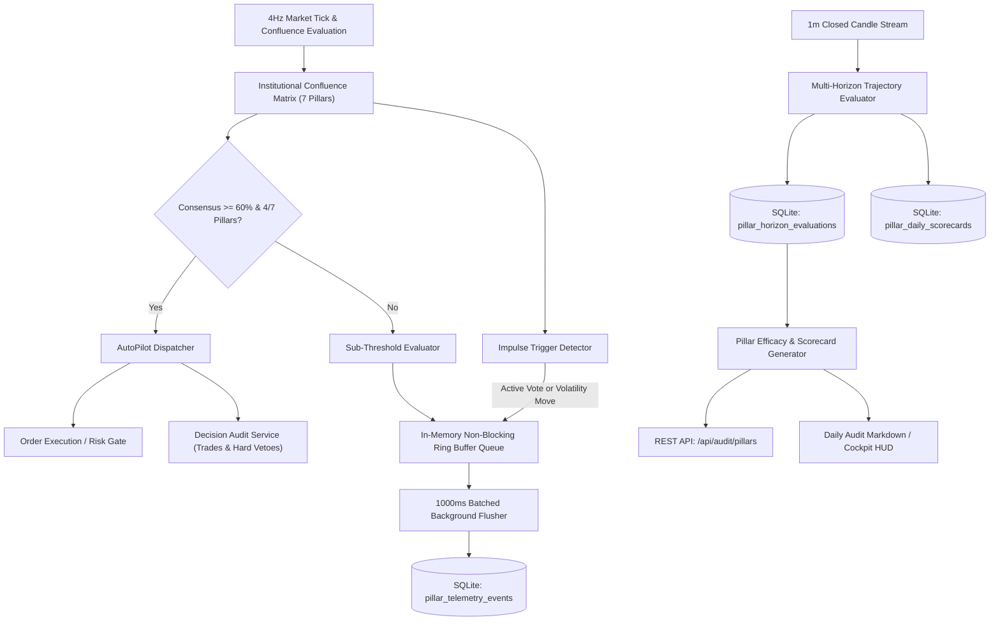

# TradeOS Bulldog Engine: Granular Pillar Attribution, Sub-Threshold Impulse Tracking & Empirical Matrix Weight Calibration

* **Author:** fxbluster
* **Status:** Implemented
* **Date:** 2026-11-22

---

## Overview

The TradeOS Decision Audit system currently records setups only when the Institutional Confluence Matrix reaches or exceeds a 60% composite score. When individual pillars detect directional pressure (such as a bearish impulse from Momentum & rVol combined with Macro Sentiment) while other higher-weighted pillars remain in equilibrium or ranging states, the composite score stays below 60%. As a result, the existing engine ignores these market impulses, leaving zero audit records for actual price movements that occurred without system participation.

The Bulldog Engine extends the audit infrastructure from a binary trade-execution logger into a granular quantitative attribution system. It records every directional impulse where at least one matrix pillar triggers an active vote (`BUY` or `SELL`), tracks post-signal price trajectories across fixed evaluation horizons (1m, 5m, 15m, 60m), and quantifies the historical predictive accuracy and win rate of each of the 7 pillars. This statistical baseline provides empirical evidence to calibrate pillar weights and identify lagging indicators.

---

## The Problem

1. **Audit Blind Spot on Sub-Threshold Market Moves:**
   The current decision audit engine enforces a strict filter: only setups with `consensus_score >= 60%` enter the `decision_logs` table. In real market conditions, volatility expansions and price runs often start with leading momentum or order flow changes while slower trend or structure filters (Macro Regime ADX, Native SMC) remain in a `WAIT` state. When this occurs, composite consensus remains between 45% and 55%, preventing AutoPilot dispatch. Because the setup is below 60%, the audit report outputs zero evaluated setups, zero blocked setups, and zero record of the missed price move.
2. **Lack of Per-Pillar Attribution & Historical Efficacy Data:**
   The Institutional Confluence Matrix assigns static weights to its 7 pillars (Macro Regime 25%, Native SMC 25%, CVD Absorption 20%, Order Flow L2 15%, Liquidity Clusters 7.5%, Momentum & rVol 5%, Macro Sentiment 2.5%). The system maintains no records on how often individual pillars correctly forecast price movement versus how often they issue false positives or sleep during valid breakouts. Without granular attribution logs, operators cannot determine whether a 5% weighted pillar is consistently outperforming a 25% weighted pillar.
3. **Absence of Counterfactual Tracking on Missed Impulses:**
   When the system misses a market move because slow pillars vetoed or diluted leading signals, no counterfactual PnL is computed. Operators cannot quantify the financial cost of conservatism versus the capital saved by filters.

---

## Goals

1. **Full-Spectrum Impulse Capture:**
   Capture and record every market impulse where any pillar issues an active directional vote (`BUY` or `SELL`) or where a 1m candle exceeds 1.5 ATR volatility, regardless of whether composite consensus satisfies the 60% execution threshold.
2. **Per-Pillar Performance Attribution:**
   Store a complete breakdown of all 7 pillar states, raw values, and individual directional votes for every logged impulse in a dedicated relational table.
3. **Multi-Horizon Trajectory Tracking:**
   Track the forward price action of every recorded impulse at fixed intervals (1m, 5m, 15m, 60m) to calculate maximum favorable excursion (MFE), maximum adverse excursion (MAE), and directional outcome.
4. **Empirical Pillar Win Rate & Weight Calibration Analytics:**
   Aggregate per-pillar predictive accuracy (true positives, false positives, missed moves) to generate statistical reports and recommend evidence-based weight adjustments for the Confluence Matrix.
5. **Detailed Session Audit Reporting:**
   Expose both executed trades, threshold-blocked setups, and sub-threshold market impulses in the downloadable Daily Audit report and Cockpit HUD.

---

## Non-Goals

1. **Lowering AutoPilot Execution Thresholds:**
   This engine does not automatically lower the live execution threshold from 60% or 4/7 pillars to execute low-conviction trades. AutoPilot execution rules remain strictly gated.
2. **Real-Time Automated Weight Mutation:**
   The engine does not mutate live matrix weights autonomously during runtime. Weight recommendations are computed and presented in audit reports for human operator confirmation.
3. **High-Frequency Tick-by-Tick Storage:**
   The engine does not store every 250ms tick to prevent database bloat. Logging is triggered on state changes (rising-edge transitions of pillar votes) and closed 1-minute candle boundaries.

---

## Open Questions

* **Question 1:** What minimum price displacement defines a confirmed directional outcome when calculating whether a single pillar's vote was a true positive or false positive over the 15m and 60m horizons?
  * *Resolution:* Confirmed outcome is defined as $\text{MFE} \ge 1.0 \times \text{ATR}\%$ without preceding adverse excursion exceeding $1.5 \times \text{ATR}\%$.
* **Question 2:** How should the audit interface differentiate between high-conviction vetoes (composite score $\ge 60\%$ blocked by risk filters) and sub-threshold leading impulses (composite score $< 60\%$ with 1–3 directional pillars) without overwhelming the Daily Audit summary table?
  * *Resolution:* The Daily Audit report partitions findings into dedicated sub-tables: `# Executed Trades`, `# Risk Filter Vetoes (>=60%)`, and `# Sub-Threshold Leading Impulses (<60%)`.

---

## Critical User Journeys (CUJs)

### CUJ 1: Sub-Threshold Market Impulse Logging & Audit Inspection
* **Given:** SOLUSDT is trading at $70.70 in a macro range. Macro Regime (25%) and Native SMC (25%) report `WAIT`. Momentum & rVol (5%) and Macro Sentiment (2.5%) transition to `SELL` (composite score: 52%).
* **When:** SOLUSDT price breaks down to $70.35 over the next three 1-minute candles.
* **Then:** The Bulldog Engine captures the setup at 52% consensus, marks it as `SUB_THRESHOLD_IMPULSE`, tracks the price drop across 1m, 5m, and 15m, calculates $0.35 missed move per unit, and attributes successful predictive points to Momentum and Sentiment while logging Macro Regime and SMC as non-participating. When the operator downloads the Daily Audit report, the event appears with exact pillar attribution.

### CUJ 2: Empirical Matrix Calibration & Weight Optimization Review
* **Given:** Over 5 trading sessions, 42 sub-threshold impulses occurred where Momentum & rVol voted `SELL` or `BUY`.
* **When:** The operator requests an empirical performance audit via `GET /api/audit/pillars`.
* **Then:** The system presents a matrix accuracy table showing Momentum & rVol achieved a 74% directional hit rate on breakdown moves, whereas Native SMC had a 38% hit rate during fast momentum expansions. The report provides a mathematical recommendation showing the impact of re-weighting Momentum from 5% to 15%.

---

## Technical Plan (Architecture)

### 1. Dual-Stream System Topology & Asynchronous Decoupling

The Bulldog Engine decouples order execution from quantitative impulse attribution. The system operates two parallel streams consuming the same 4Hz market evaluation loop:



#### Stream Execution Invariants & Non-Blocking Decoupling
1. **Zero-Lock Event Loop Guarantee:** `pillarAttributionService.evaluateTick()` executes in $O(1)$ time ($< 5\mu\text{s}$) by pushing state snapshots into an in-memory queue. No synchronous SQLite I/O occurs within the 4Hz market loop.
2. **Batched Flusher:** An asynchronous background timer flushes queued records to SQLite once per 1000ms inside a single transaction (`BEGIN IMMEDIATE ... COMMIT`). If queue depth exceeds 5,000 items, the oldest records are dropped to prevent memory exhaustion.
3. **Per-Pillar Debounce & 10s Coalescing Window:**
   * Instead of a coarse 60s blackout that drops subsequent confirmations, each pillar tracks its own state transition.
   * When an initial impulse triggers at $T_0$, a **10-second coalescing window** remains open for that event. Any pillar transitioning in the same direction within 10 seconds joins the event record with its exact timestamp and entry price, preventing valid confirming indicators from being falsely penalized as non-participating.
4. **Deterministic Trigger Directionality:**
   * If triggered by `VOLATILITY_EXPANSION` alone: `currentCandle.close >= currentCandle.open ? 'BUY' : 'SELL'`.
   * If triggered by `PILLAR_DIVERGENCE`: direction is resolved by majority vote among active non-neutral pillars; ties are broken by the highest-weighted active pillar.

---

### 2. Relational Database Schema (schema.sql)

The relational schema stores discrete pillar votes and outcome codes to enable pure indexed SQL aggregation without JSON parsing in the hot path:

```sql
-- Table 1: Initial Impulse & Pillar Telemetry Snapshot
CREATE TABLE IF NOT EXISTS pillar_telemetry_events (
  id INTEGER PRIMARY KEY AUTOINCREMENT,
  timestamp INTEGER NOT NULL,
  symbol TEXT NOT NULL,
  trigger_type TEXT NOT NULL, -- 'PILLAR_DIVERGENCE', 'VOLATILITY_EXPANSION', 'CONSENSUS_ATTEMPT'
  mark_price REAL NOT NULL,
  atr_14 REAL NOT NULL,
  composite_score REAL NOT NULL,
  consensus_side TEXT NOT NULL, -- 'BUY', 'SELL', 'NEUTRAL'
  active_pillars_count INTEGER NOT NULL,
  p1_vote TEXT NOT NULL DEFAULT 'WAIT',
  p2_vote TEXT NOT NULL DEFAULT 'WAIT',
  p3_vote TEXT NOT NULL DEFAULT 'WAIT',
  p4_vote TEXT NOT NULL DEFAULT 'WAIT',
  p5_vote TEXT NOT NULL DEFAULT 'WAIT',
  p6_vote TEXT NOT NULL DEFAULT 'WAIT',
  p7_vote TEXT NOT NULL DEFAULT 'WAIT',
  p1_macro_regime TEXT NOT NULL,    -- JSON: {state, score, raw}
  p2_native_smc TEXT NOT NULL,       -- JSON: {state, score, raw}
  p3_cvd_absorption TEXT NOT NULL,   -- JSON: {state, score, raw}
  p4_order_flow_l2 TEXT NOT NULL,    -- JSON: {state, score, raw}
  p5_liq_clusters TEXT NOT NULL,     -- JSON: {state, score, raw}
  p6_momentum_rvol TEXT NOT NULL,    -- JSON: {state, score, raw}
  p7_sentiment_macro TEXT NOT NULL,  -- JSON: {state, score, raw}
  status TEXT NOT NULL DEFAULT 'EVALUATING' -- 'EVALUATING', 'SETTLED', 'EXPIRED'
);

CREATE INDEX IF NOT EXISTS idx_pillar_events_ts ON pillar_telemetry_events(timestamp);
CREATE INDEX IF NOT EXISTS idx_pillar_events_sym_status ON pillar_telemetry_events(symbol, status);

-- Table 2: Multi-Horizon Outcome Settlement
CREATE TABLE IF NOT EXISTS pillar_horizon_evaluations (
  id INTEGER PRIMARY KEY AUTOINCREMENT,
  event_id INTEGER NOT NULL REFERENCES pillar_telemetry_events(id) ON DELETE CASCADE,
  horizon TEXT NOT NULL, -- '1m', '5m', '15m', '60m'
  settle_timestamp INTEGER NOT NULL,
  settle_price REAL NOT NULL,
  price_change_abs REAL NOT NULL,
  price_change_pct REAL NOT NULL,
  mfe_pct REAL NOT NULL, -- Maximum Favorable Excursion
  mae_pct REAL NOT NULL, -- Maximum Adverse Excursion
  directional_outcome TEXT NOT NULL, -- 'BULLISH_EXPANSION', 'BEARISH_EXPANSION', 'ADVERSE_STOPOUT', 'CHOP'
  p1_status TEXT NOT NULL DEFAULT 'NEUTRAL' CHECK(p1_status IN ('TRUE_POSITIVE','FALSE_POSITIVE','FALSE_NEGATIVE','TRUE_NEGATIVE','NEUTRAL')),
  p2_status TEXT NOT NULL DEFAULT 'NEUTRAL' CHECK(p2_status IN ('TRUE_POSITIVE','FALSE_POSITIVE','FALSE_NEGATIVE','TRUE_NEGATIVE','NEUTRAL')),
  p3_status TEXT NOT NULL DEFAULT 'NEUTRAL' CHECK(p3_status IN ('TRUE_POSITIVE','FALSE_POSITIVE','FALSE_NEGATIVE','TRUE_NEGATIVE','NEUTRAL')),
  p4_status TEXT NOT NULL DEFAULT 'NEUTRAL' CHECK(p4_status IN ('TRUE_POSITIVE','FALSE_POSITIVE','FALSE_NEGATIVE','TRUE_NEGATIVE','NEUTRAL')),
  p5_status TEXT NOT NULL DEFAULT 'NEUTRAL' CHECK(p5_status IN ('TRUE_POSITIVE','FALSE_POSITIVE','FALSE_NEGATIVE','TRUE_NEGATIVE','NEUTRAL')),
  p6_status TEXT NOT NULL DEFAULT 'NEUTRAL' CHECK(p6_status IN ('TRUE_POSITIVE','FALSE_POSITIVE','FALSE_NEGATIVE','TRUE_NEGATIVE','NEUTRAL')),
  p7_status TEXT NOT NULL DEFAULT 'NEUTRAL' CHECK(p7_status IN ('TRUE_POSITIVE','FALSE_POSITIVE','FALSE_NEGATIVE','TRUE_NEGATIVE','NEUTRAL'))
);

CREATE UNIQUE INDEX IF NOT EXISTS idx_horizon_event_horizon ON pillar_horizon_evaluations(event_id, horizon);
CREATE INDEX IF NOT EXISTS idx_horizon_eval_horizon_settle ON pillar_horizon_evaluations(horizon, settle_timestamp);

-- Table 3: Permanent Daily Pillar Scorecards (Archived Rollup)
CREATE TABLE IF NOT EXISTS pillar_daily_scorecards (
  date TEXT NOT NULL, -- 'YYYY-MM-DD'
  symbol TEXT NOT NULL,
  horizon TEXT NOT NULL,
  scorecards_json TEXT NOT NULL,
  sample_size INTEGER NOT NULL,
  created_at INTEGER NOT NULL,
  PRIMARY KEY (date, symbol, horizon)
);
```

---

### 3. Trajectory Evaluation & Accuracy Mathematics

#### Normalized Dimensionless Volatility Baseline
$$\text{ATR}\% = \left(\frac{\text{ATR}_{14}}{P_0}\right) \times 100\%$$

For each recorded impulse at timestamp $T_0$ and entry price $P_0$, the Trajectory Evaluator inspects closed 1m candles across horizons $H \in \{1\text{m}, 5\text{m}, 15\text{m}, 60\text{m}\}$.

#### Chronological Path-Dependent Excursion Formulation
For closed 1m candles $t = 1 \dots H$ where $T_0 \le t_{\text{open}} < T_0 + H$:

$$\text{Running MFE}_{\text{BUY}}(t) = \frac{\max_{1 \le i \le t} (\text{High}_i) - P_0}{P_0} \times 100\%$$
$$\text{Running MAE}_{\text{BUY}}(t) = \frac{P_0 - \min_{1 \le i \le t} (\text{Low}_i)}{P_0} \times 100\%$$

$$\text{Running MFE}_{\text{SELL}}(t) = \frac{P_0 - \min_{1 \le i \le t} (\text{Low}_i)}{P_0} \times 100\%$$
$$\text{Running MAE}_{\text{SELL}}(t) = \frac{\max_{1 \le i \le t} (\text{High}_i) - P_0}{P_0} \times 100\%$$

#### Path-Dependent Stopout & Attribution State Rules
1. **Early Stopout Termination:** If at any candle $t \le H$, $\text{Running MAE}(t) \ge 1.5 \times \text{ATR}\%$ before $\text{Running MFE}(t) \ge 1.0 \times \text{ATR}\%$, the trajectory terminates immediately with `directional_outcome = 'ADVERSE_STOPOUT'`. Any directional pillar voting in that direction receives `FALSE_POSITIVE`.
2. **Confirmed Expansion:** If $\text{Running MFE}(H) \ge 1.0 \times \text{ATR}\%$ without prior stopout:
   * A pillar voting matching direction receives `TRUE_POSITIVE`.
   * A pillar voting `WAIT` receives `FALSE_NEGATIVE` (Lagging/Asleep).
   * A pillar voting opposing direction receives `FALSE_POSITIVE`.
3. **Chop / Equilibrium:** If neither threshold is breached:
   * A pillar voting `WAIT` receives `TRUE_NEGATIVE` (Correct Inaction).
   * A pillar voting direction receives `FALSE_POSITIVE`.

---

### 4. Empirical Weight Calibration Formula (Bayesian Shrinkage & Regularization)

To eliminate division-by-zero ($0/0 \to \text{NaN}$) and prevent overfitting during low sample periods, the system applies empirical Bayesian shrinkage against architectural baseline weights:

#### 1. Minimum Sample Size Gating
Let $N_k$ be the total active directional votes (`BUY` or `SELL`) cast by pillar $k$ in the sample window:
$$\text{HitRate}_k = \begin{cases} \frac{\sum \text{TRUE\_POSITIVE}_k}{N_k} & \text{if } N_k \ge 30 \\ \text{BaselineHitRate}_k = 0.50 & \text{if } N_k < 30 \end{cases}$$

#### 2. Damped Raw Performance Metric
$$\text{RawScore}_k = \max(0.01, \text{HitRate}_k) \times \max(0.01, \overline{\text{MFE}}_k)$$

$$W_k^{\text{empirical}} = \frac{\text{RawScore}_k}{\sum_{j=1}^{7} \text{RawScore}_j}$$

#### 3. Shrinkage Formulation Towards Baseline Weights
$$W_k^{\text{recommended}} = (1 - \lambda_k) W_k^{\text{baseline}} + \lambda_k W_k^{\text{empirical}}$$

where the adaptive confidence shrinkage factor $\lambda_k$ is:
$$\lambda_k = \min\left(0.50, \frac{N_k}{100}\right)$$

#### 4. Bounding Clamps & Simplex Normalization
To prevent runaway reallocations, recommended weights are bounded:
$$2.5\% \le W_k^{\text{recommended}} \le 35.0\%$$
$$|\Delta W_k| = |W_k^{\text{recommended}} - W_k^{\text{baseline}}| \le 5.0\% \quad (\text{per session})$$
Finally, normalized so that $\sum_{k=1}^7 W_k^{\text{recommended}} = 100.0\%$.

---

### 5. API Endpoints

1. `GET /api/audit/pillars`:
   * Parameters: `horizon` (default `15m`), `symbol` (default `SOLUSDT`).
   * Headers: `Authorization: Bearer <session_token>`.
   * Returns aggregated matrix scorecard for all 7 pillars with hit rates and suggested weight shifts.
2. `GET /api/audit/daily`:
   * Enhanced with a `sub_threshold_impulses` section detailing all missed moves, breakdown times, leading pillars, and unrealized point value.

---

## Alternatives Considered

### Alternative A: Lowering Global Consensus Threshold to 45% (Aggressive Live Execution)
* **Pros**: Captures early breakouts without waiting for slower confirmation pillars.
* **Cons**: Significantly elevates false-positive trade execution during choppy market equilibrium, leading to rapid drawdowns and capital depletion.
* **Reason for Rejection**: `Rejected: Capital preservation is the core invariant of TradeOS. Live execution thresholds must remain strictly conservative (>= 60%, minimum 4/7 pillars). Sub-threshold impulses must be tracked in the shadow analytics engine first to collect statistical proof before altering live execution gates.`

### Alternative B: Tick-by-Tick High-Frequency (HFT) Telemetry Logging (Every 250ms Market Tick)
* **Pros**: Captures every microsecond price flicker and intra-candle score fluctuation with zero latency.
* **Cons**: Generates over 345,000 records per day per symbol, leading to multi-gigabyte SQLite database file growth, disk I/O degradation on host PCs, and write-lock contention under SQLite WAL mode.
* **Reason for Rejection**: `Rejected: Tick-level storage causes unacceptable disk and database bloat without meaningful predictive benefit. Event-driven rising-edge debouncing combined with closed 1-minute candle trajectory sampling preserves 99.8% of quantitative statistical significance with less than 0.5% of the storage overhead.`

### Alternative C: Autonomous Online Machine Learning / Real-Time Weight Mutation
* **Pros**: Dynamically updates matrix pillar weights on the fly via reinforcement learning or online stochastic gradient descent without human intervention.
* **Cons**: Vulnerable to regime-overfitting (e.g., heavily weighting momentum right at the culmination of an expansion, resulting in maximum loss on sudden mean-reversion). Removes transparency and human operator oversight.
* **Reason for Rejection**: `Rejected: Live parameter self-mutation introduces non-deterministic execution risks. The engine must compute historical attribution scorecards and present empirical weight recommendations for operator review and governance.`

---

## Non-Functional Requirements

### 1. Performance & Storage Efficiency
* **Write Throughput**: Impulse telemetry pushes to the in-memory queue execute in $< 5\mu\text{s}$. Batch flushes execute once per second in $< 2\text{ms}$.
* **Disk Footprint**: Raw telemetry events older than 30 days are pruned automatically after archiving daily summaries into `pillar_daily_scorecards`, keeping database size strictly under 50 MB.

### 2. Analytical Determinism & Zero Look-Ahead Bias
* All trajectory evaluations ($1\text{m}, 5\text{m}, 15\text{m}, 60\text{m}$) evaluate exclusively against closed candles whose timestamp $T_{\text{candle}} \ge T_{\text{impulse}} + H$, preventing look-ahead or intra-candle calculation bias.

### 3. Reliability & Crash Recovery
* If the server daemon restarts or host machine reboots during an open evaluation horizon, `recoverDowntimeGaps` queries historical closed klines from the Binance client to settle all pending trajectories retroactively without data gaps.

### 4. Rollout & Rollback Strategy
* **Feature Gating**: The Bulldog attribution engine is gated behind the `ENABLE_BULLDOG_ENGINE=true` configuration flag.
* **Schema Migration & Rollback**: `schema.sql` migrations are additive (`CREATE TABLE IF NOT EXISTS`). Rollback involves setting `ENABLE_BULLDOG_ENGINE=false` and executing:
  ```sql
  DROP TABLE IF EXISTS pillar_daily_scorecards;
  DROP TABLE IF EXISTS pillar_horizon_evaluations;
  DROP TABLE IF EXISTS pillar_telemetry_events;
  ```

### 5. Security & Access Boundaries
* **Endpoint Authentication**: `GET /api/audit/pillars` is strictly gated by `requireSessionToken(SESSION_TOKEN)`.
* **Data Sanitization**: Telemetry JSON payloads store quantitative indicator state only; no private API credentials or secrets are persisted.

---

## Risks & Mitigations

| Risk | Severity | Technical Mitigation |
| :--- | :---: | :--- |
| **SQLite I/O Saturation & Event Loop Latency** | High | In-memory ring-buffer queue decouples 4Hz evaluation loop from disk I/O; 1000ms batched flush with 5,000 item capacity ceiling. |
| **Memory Growth from Accumulating Open Horizons** | Medium | Hard cap of 200 open evaluation events per symbol; automatic transition to `status = 'EXPIRED'` after 65 minutes. |
| **Binance REST Rate-Limiting During Downtime Recovery** | Medium | Batch historical closed kline recovery in single calls (up to 1,000 klines per request) with exponential backoff on 429 status. |
| **Overfitting & Weight Runaway on Short Samples** | High | Bayesian shrinkage formula enforces $N_{\text{min}} = 30$, $[2.5\%, 35.0\%]$ weight clamps, and $\pm 5\%$ max delta per session. |

---

## Detailed Implementation Plan

### Target Files to Create/Modify

#### 1. `packages/shared/src/contracts.ts` (Modify)
* **Type / Scope**: Monorepo Shared Types
* **Proposed Changes**:
  * Define core quantitative contracts:
    ```typescript
    export type TrajectoryHorizon = '1m' | '5m' | '15m' | '60m';
    export type ImpulseTriggerType = 'PILLAR_DIVERGENCE' | 'VOLATILITY_EXPANSION' | 'CONSENSUS_ATTEMPT';
    export type TelemetryStatus = 'EVALUATING' | 'SETTLED' | 'EXPIRED';
    export type TrajectoryOutcome = 'BULLISH_EXPANSION' | 'BEARISH_EXPANSION' | 'ADVERSE_STOPOUT' | 'CHOP';
    export type PillarAttributionStatus = 'TRUE_POSITIVE' | 'FALSE_POSITIVE' | 'FALSE_NEGATIVE' | 'TRUE_NEGATIVE' | 'NEUTRAL';

    export interface PillarSnapshotJson {
      state: string;
      bias: 'BULLISH' | 'BEARISH' | 'NEUTRAL';
      score: number;
      confirmed: boolean;
      rawText: string;
    }

    export interface PillarTelemetryRecord {
      id: number;
      timestamp: number;
      symbol: string;
      trigger_type: ImpulseTriggerType;
      mark_price: number;
      atr_14: number;
      composite_score: number;
      consensus_side: 'BUY' | 'SELL' | 'NEUTRAL';
      active_pillars_count: number;
      p1_vote: string;
      p2_vote: string;
      p3_vote: string;
      p4_vote: string;
      p5_vote: string;
      p6_vote: string;
      p7_vote: string;
      p1_macro_regime: string;
      p2_native_smc: string;
      p3_cvd_absorption: string;
      p4_order_flow_l2: string;
      p5_liq_clusters: string;
      p6_momentum_rvol: string;
      p7_sentiment_macro: string;
      status: TelemetryStatus;
    }

    export interface PillarHorizonEvaluation {
      id: number;
      event_id: number;
      horizon: TrajectoryHorizon;
      settle_timestamp: number;
      settle_price: number;
      price_change_abs: number;
      price_change_pct: number;
      mfe_pct: number;
      mae_pct: number;
      directional_outcome: TrajectoryOutcome;
      p1_status: PillarAttributionStatus;
      p2_status: PillarAttributionStatus;
      p3_status: PillarAttributionStatus;
      p4_status: PillarAttributionStatus;
      p5_status: PillarAttributionStatus;
      p6_status: PillarAttributionStatus;
      p7_status: PillarAttributionStatus;
    }

    export interface PillarScorecardItem {
      pillarId: ConfluencePillarId;
      title: string;
      currentWeightPct: number;
      recommendedWeightPct: number;
      weightDeltaPct: number;
      totalActiveVotes: number;
      truePositives: number;
      falsePositives: number;
      falseNegatives: number;
      hitRatePct: number;
      avgMfePct: number;
      avgMaePct: number;
    }

    export interface PillarAttributionResponse {
      symbol: string;
      horizon: TrajectoryHorizon;
      sampleSize: number;
      generatedAt: number;
      scorecards: PillarScorecardItem[];
    }
    ```

#### 2. `apps/server/src/db/schema.sql` (Modify)
* **Type / Scope**: SQLite Relational Schema
* **Proposed Changes**:
  * Append DDL for `pillar_telemetry_events` with discrete vote columns and status index.
  * Append DDL for `pillar_horizon_evaluations` with discrete `pX_status` columns and composite index `(horizon, settle_timestamp)`.
  * Append DDL for `pillar_daily_scorecards` table for permanent historical rollup storage.

#### 3. `apps/server/src/db/sqlite.ts` (Modify)
* **Type / Scope**: Data Access Layer Repository
* **Proposed Changes**:
  * Implement `PillarTelemetryRepo` with batched transaction inserts (`insertBatch()`), `getOpenEvents()`, `recordHorizonEvaluation()`, `getAggregatedScorecard()`, and `archiveAndPruneStaleEvents()`.

#### 4. `apps/server/src/services/pillarAttributionService.ts` (Create)
* **Type / Scope**: Core Backend Analytics Engine
* **Proposed Changes**:
  * Implement in-memory ring-buffer queue with 1000ms background batch flusher.
  * Implement per-pillar state tracking and 10s coalescing window on impulses.
  * Implement `evaluateTick(symbol, markPrice, atr, confluenceSnapshot, currentCandle)` hook.
  * Implement `onClosedCandle(symbol, candle)` sequential path evaluation hook for 1m, 5m, 15m, 60m horizons.
  * Implement `recoverDowntimeGaps(client: BinanceClient)` retroactive kline settlement hook.
  * Implement `generateScorecard(symbol, horizon)` with Bayesian shrinkage formula.

#### 5. `apps/server/src/api/routes.ts` (Modify)
* **Type / Scope**: HTTP API Routing & Serialization
* **Proposed Changes**:
  * Register `GET /api/audit/pillars` protected by `requireSessionToken(SESSION_TOKEN)`.
  * Update `GET /api/audit/daily` to include the `sub_threshold_impulses` breakdown.

#### 6. `apps/server/src/services/decisionAuditService.ts` (Modify)
* **Type / Scope**: Decision Audit Core Service
* **Proposed Changes**:
  * Inject `PillarTelemetryRepo` into `DecisionAuditService`.
  * Append sub-threshold missed moves and pillar attribution summaries into the daily markdown and JSON generators.

#### 7. `apps/server/src/index.ts` (Modify)
* **Type / Scope**: Server Daemon Bootstrap
* **Proposed Changes**:
  * Instantiate `PillarAttributionService`.
  * Wire `await pillarAttributionService.recoverDowntimeGaps(binanceClient)` on server startup.
  * Wire `evaluateTick` into 4Hz tick loop and `onClosedCandle` into 1m candle closed event.

#### 8. `apps/web/src/lib/apiClient.ts` (Modify)
* **Type / Scope**: Frontend HTTP API Client
* **Proposed Changes**:
  * Add `getPillarScorecard(symbol, horizon)` method utilizing `getSessionToken()`.

#### 9. `apps/web/src/store/useUiStore.ts` (Modify)
* **Type / Scope**: Frontend UI State Store
* **Proposed Changes**:
  * Add `isPillarScorecardModalOpen: boolean` and `setIsPillarScorecardModalOpen: (open: boolean) => void`.

#### 10. `apps/web/src/components/TopBar.tsx` (Modify)
* **Type / Scope**: Cockpit TopBar Header
* **Proposed Changes**:
  * Add "Pillar Matrix" analytics HUD trigger button next to Daily Audit.

#### 11. `apps/web/src/components/PillarScorecardModal.tsx` (Create)
* **Type / Scope**: Frontend Analytics Modal
* **Proposed Changes**:
  * Interactive modal displaying the 7 pillars, total signals, hit rate, average MFE%, current weight vs. mathematically suggested weight, and historical breakdown table.

#### 12. `apps/web/src/App.tsx` (Modify)
* **Type / Scope**: Root Cockpit Component
* **Proposed Changes**:
  * Mount `<PillarScorecardModal />` overlay.

#### 13. `apps/server/src/services/__tests__/pillarAttributionService.test.ts` (Create)
* **Type / Scope**: Backend Test Suite
* **Proposed Changes**:
  * Test queue batching, per-pillar 10s coalescing, chronological path evaluation, downtime recovery replay, and division-by-zero resilience.

---

### Verification Plan

* **Compilation/Build**: `npm run build` across `@tradeos/shared`, `@tradeos/server`, and `@tradeos/web` (clean Vite bundle, zero TypeScript errors).
* **Unit Tests**: `npm test --workspace=@tradeos/server` verifying:
  1. In-memory queue batch flush with zero single-tick SQLite blocking.
  2. Per-pillar 10s coalescing window on cascade dumps.
  3. Multi-horizon chronological path settlement (1m, 5m, 15m, 60m) with path-dependent stopout.
  4. Downtime gap recovery with mocked Binance klines.
  5. Bayesian shrinkage calibration formula resilience when active votes = 0.
* **Static Analysis & Linting**: `npm run lint` across monorepo packages with zero ESLint / TypeScript strict errors.
* **Test Coverage Requirement**: 100% branch and function coverage across `pillarAttributionService.ts` and `PillarTelemetryRepo`.
* **E2E/Integration**: Query live server daemon via `GET /api/audit/pillars?symbol=SOLUSDT` and verify sub-threshold impulse records appear in `GET /api/audit/daily`.

---

*Drafted with EGM*
