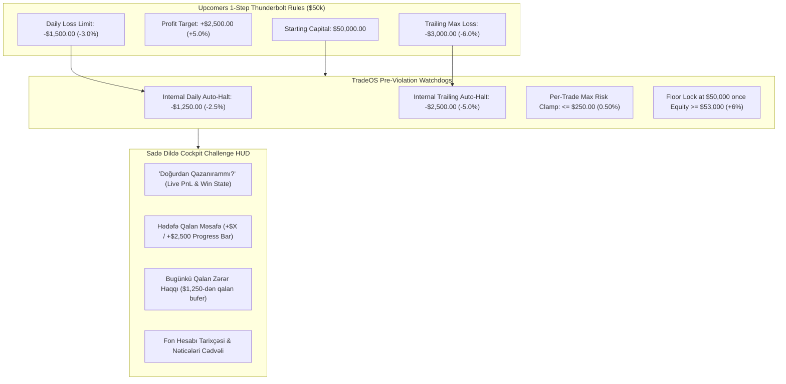

# TradeOS Upcomers $50,000 "1-Step Thunderbolt" Challenge Simulation & Risk Guard Engine

* **Author:** fxbluster
* **Status:** Implemented
* **Date:** 2026-11-25
* **Target Firm & Account:** Upcomers (upcomers.com) — 1-Step Thunderbolt $50K (MT5 / No Consistency)

---

## Overview

The user is preparing to purchase and deploy capital to the **Upcomers 1-Step Thunderbolt $50,000 Account** ($49.90 entry fee, MetaTrader 5, No Consistency rule). Before committing capital, TradeOS must execute a 1:1 identical live simulation on Binance Demo/Testnet with zero guesswork. The system must enforce every contractual rule of Upcomers, provide fail-closed risk buffers to prevent account termination, and surface a dedicated "Sadə Dildə" (Plain Language) Cockpit Monitor so any operator can immediately see if the account is truly winning, how close it is to the profit target, and how much drawdown buffer remains.

### Upcomers 1-Step Thunderbolt Contractual Rules:
1. **Starting Capital Benchmark:** Exactly **$50,000.00 USD**.
2. **Profit Target to Pass:** **+5.0%** ($2,500.00 net profit). Once equity reaches **$52,500.00**, the challenge is PASSED.
3. **Daily Drawdown Limit:** **3.0%** ($1,500.00) from 00:00 UTC balance. Breaching this instantly fails the challenge.
4. **Maximum Trailing Drawdown (Dynamic Risk Shield™):** **6.0%** ($3,000.00) from the highest equity point (High-Water Mark). The trailing floor trails upward with profit until profit reaches +6.0%, at which point the floor locks permanently at the starting balance ($50,000.00).
5. **Time Limit & Minimum Trading Days:** None (unlimited days, 0 minimum days).
6. **Consistency Rule:** None (No Consistency variant selected).

---

## Problem Statement

1. **Intraday Drawdown Asymmetry:** Upcomers enforces a strict **3.0% ($1,500)** daily loss ceiling and **6.0% ($3,000)** trailing loss ceiling. If an algorithmic bot enters trades without pre-violation safety buffers, a single market spike or bid-ask slippage will breach the 3% boundary and disqualify the account.
2. **Over-Leveraging on Small Moves:** Standard uncalibrated leverage can lose $1,000+ on a single 15m candle. For Upcomers, a single trade loss must never exceed 0.50% ($250.00) so the account can survive multiple consecutive stop-outs without endangering the daily 3.0% limit.
3. **Operator Opacity ("Mən Doğurdan Qazanırammı?"):** Complex quantitative matrices and raw indicator charts leave non-trader operators confused about whether the challenge is actually succeeding. The operator needs a zero-jargon Cockpit HUD that answers 3 fundamental questions in 2 seconds: Am I in profit? How close am I to the $2,500 target? How safe is my account from failing?

---

## Goals

* **G-1 (Exact Upcomers 1-Step Rule Invariants):**
  * Capital Baseline: $50,000.00.
  * Profit Target: +$2,500.00 (+5.0%).
  * Daily Loss Limit: -$1,500.00 (-3.0%), protected by an internal **pre-violation auto-halt at -$1,250.00 (-2.5%)**.
  * Trailing Loss Limit: -$3,000.00 (-6.0%), protected by an internal **pre-violation auto-halt at -$2,500.00 (-5.0%)**, with floor locking permanently at $50,000 once equity hits $53,000.
* **G-2 (Fractional Risk Clamping per Trade):** Clamps maximum loss on any single trade to $\le 0.50\%$ ($250.00 max risk) with an algorithmic bracket Stop-Loss submitted within 200ms of entry fill.
* **G-3 (Testnet Balance Verification & Top-Up Reminder):** If the Binance Testnet account balance is not $50,000 (e.g. current $4,606.01), display an explicit top-up reminder banner with faucet instructions.
* **G-4 (Sadə Dildə Cockpit Challenge Monitor):** Implement a dedicated visual widget in the Cockpit displaying:
  * "Doğurdan Qazanırammı?" (Yes/No, live dollar and percent).
  * Profit target progress bar: `+$X / +$2,500.00 (X% tamamlandı)`.
  * Remaining daily safety buffer: `-$X / -$1,250.00 (Safe)`.
  * Remaining trailing safety buffer: `-$X / -$2,500.00 (Safe)`.
  * Historical cycle scorecard table showing exact results for every session.
* **G-5 (5-Cycle Consistency Certification):** Validate the strategy across 5 consecutive profitable cycles before recommending real capital deployment.

---

## Non-Goals

* **NG-1 (Direct MT5 Bridge Execution):** Live challenge testing runs on Binance Futures Demo/Testnet (crypto perp equivalent); direct MT5 terminal COM/socket bridges are out of scope for Phase 1.
* **NG-2 (Martingale Averaging):** Position averaging down or grid stacking is strictly disabled.

---

## Technical Plan (Architecture)

### Mathematical Risk Invariants (Upcomers Thunderbolt Specifics)



### Component Details

#### 1. Contract & Sizing Calibration (`apps/server/src/quant/propAccountManager.ts`)

```typescript
export interface UpcomersChallengeConfig {
  accountSizeUsd: 50_000;
  profitTargetUsd: 2_500;          // +5.0%
  contractualDailyLossUsd: 1_500;   // -3.0%
  internalDailyHaltUsd: 1_250;     // -2.5% pre-violation buffer
  contractualTrailingLossUsd: 3_000;// -6.0%
  internalTrailingHaltUsd: 2_500;  // -5.0% pre-violation buffer
  maxRiskPerTradeUsd: 250;         // 0.50% max risk per trade
  maxConcurrentPositions: 1;
}
```

* **Dynamic Quantity Formula:**
  $$	ext{Contract Quantity} = rac{\$250.00}{|	ext{Entry Price} - 	ext{Stop Loss Price}|}$$
  Ensures that even if Stop Loss is hit, the loss is mathematically capped to $\$250.00$ ($0.50\%$).
* **Trailing Floor Lock Rule:**
  $$	ext{Trailing Floor} = egin{cases} 
  HWM_t - \$3,000 & 	ext{if } HWM_t < \$53,000 \ 
  \$50,000.00 & 	ext{if } HWM_t \ge \$53,000 	ext{ (Locked Floor)}
  \end{cases}$$

#### 2. Cockpit Monitor: "Upcomers $50K Challenge (Sadə Dildə)" (`apps/web/src/components/PropFirmChallengeHUD.tsx`)

Mounted prominently above the Confluence Matrix, providing total visual clarity:

1. **"Doğurdan Qazanırammı?" Status Box:**
   * **BƏLİ, QAZANCDASAN** (Yaşıl qutu) əgər xalis PnL $> 0$ (məs: `+$840.50 (+1.68%)`).
   * **XEYR, ZƏRƏRDƏSƏN** (Qırmızı qutu) əgər xalis PnL $< 0$ (məs: `-$120.00 (-0.24%)`).
   * **GÖZLƏMƏDƏ** (Boz qutu) əməliyyat yoxdursa.
2. **Upcomers $2,500 Hədəf Barı:**
   * `Hədəf: +$2,500.00 | Cari: +$1,450.00 (58.0% Tamamlandı) | Qalan: $1,050.00`
   * Canlı rəngli tərəqqi xətti.
3. **Gündəlik Təhlükəsizlik Zolağı:**
   * `Gündəlik Zərər Həddi: $1,250.00 | Qalan Haqq: $1,130.00 (90.4% Təhlükəsiz)`
4. **Hesabın Yanma Riski (Ümumi Geriləmə):**
   * `Maksimum Geriləmə Həddi: $2,500.00 | Qalan Haqq: $2,180.00 (Çox Təhlükəsiz)`
5. **Açılan Tarixçə Cədvəli:**
   * Hər tamamlanmış sessiyanın nəticəsi: Dövrə #, Qazanc/Ziyan, Max Drawdown, Tarix, Status (`✓ UĞURLU` / `LİMİT HALT`).

---

## Detailed Implementation Plan (5 Buildable Phases)

* **Phase 1 (Contracts & Types):** Add Upcomers challenge types and error reasons (`UPCOMERS_DAILY_HALT`, `UPCOMERS_TRAILING_HALT`) in `packages/shared/src/contracts.ts`.
* **Phase 2 (Database & Persistence):** Create `propfirm_challenge_cycles` and `propfirm_daily_snapshots` in SQLite.
* **Phase 3 (Risk Guard & Engine):** Implement `PropFirmRiskGuard.ts` ($1,250 daily halt, $2,500 trailing halt, $250 max risk clamp) and wire into `AutoPilotManager`.
* **Phase 4 (API Layer):** Implement `GET /api/propfirm/status` and `GET /api/propfirm/certificate`.
* **Phase 5 (Cockpit HUD):** Build `PropFirmChallengeHUD.tsx` with "Sadə Dildə" question boxes, drawdown gauges, and top-up reminder banner. Verify live on Chrome DevTools (`http://127.0.0.1:3400`).

---

## Verification Plan

* **Unit Tests:** Validate $250 risk clamping, $1,250 daily auto-halt, $2,500 trailing halt with floor lock at $50k.
* **Build:** `npm run build` passes 100%.
* **Live Cockpit Inspection:** Chrome DevTools screenshot verifying the "Sadə Dildə" Upcomers monitor on `127.0.0.1:3400`.

---

*Drafted with EGM*
