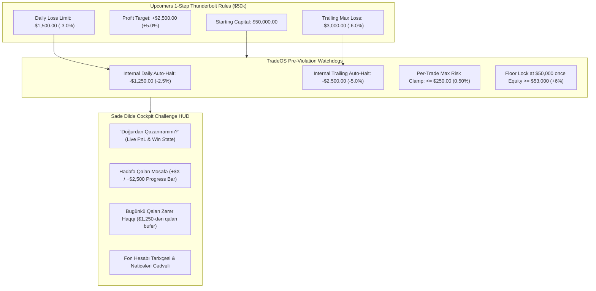

# TradeOS Upcomers $50,000 "1-Step Thunderbolt" Challenge Simulation & Risk Guard Engine

* **Author:** fxbluster
* **Status:** Implemented (Phase 1 + Phase 2 Hardening)
* **Date:** 2026-11-25
* **Target Firm & Account:** Upcomers (upcomers.com) — 1-Step Thunderbolt $50K (MT5 / No Consistency)

---

## Overview

The user is preparing to purchase and deploy capital to the **Upcomers 1-Step Thunderbolt $50,000 Account** ($49.90 entry fee, MetaTrader 5, No Consistency rule). Before committing capital, TradeOS must execute a 1:1 identical live simulation on Binance Demo/Testnet with zero guesswork. The system must enforce every contractual rule of Upcomers, provide fail-closed risk buffers to prevent account termination, and surface a dedicated "Sadə Dildə" (Plain Language) Cockpit Monitor so any operator can immediately see if the account is truly winning, how close it is to the profit target, and how much drawdown buffer remains.

### Upcomers 1-Step Thunderbolt Contractual Rules:
1. **Starting Capital Benchmark:** Exactly **$50,000.00 USD**.
2. **Profit Target to Pass:** **+5.0%** ($2,500.00 net profit). Once equity reaches **$52,500.00**, the challenge is PASSED.
3. **Daily Drawdown Limit:** **3.0%** ($1,500.00) from 00:00 UTC balance. Breaching this instantly fails the challenge.
4. **Maximum Trailing Drawdown (Dynamic Risk Shield™):** **6.0%** ($3,000.00) from the highest equity point (High-Water Mark). The trailing floor trails upward with profit until profit reaches +6.0%, at which point the floor locks permanently at the starting balance ($50,000.00).
5. **Time Limit & Minimum Trading Days:** None (unlimited days, 0 minimum days).
6. **Consistency Rule:** None (No Consistency variant selected).

---

## Problem Statement

1. **Intraday Drawdown Asymmetry:** Upcomers enforces a strict **3.0% ($1,500)** daily loss ceiling and **6.0% ($3,000)** trailing loss ceiling. If an algorithmic bot enters trades without pre-violation safety buffers, a single market spike or bid-ask slippage will breach the 3% boundary and disqualify the account.
2. **Over-Leveraging on Small Moves:** Standard uncalibrated leverage can lose $1,000+ on a single 15m candle. For Upcomers, a single trade loss must never exceed 0.50% ($250.00) so the account can survive multiple consecutive stop-outs without endangering the daily 3.0% limit.
3. **Operator Opacity ("Mən Doğurdan Qazanırammı?"):** Complex quantitative matrices and raw indicator charts leave non-trader operators confused about whether the challenge is actually succeeding. The operator needs a zero-jargon Cockpit HUD that answers 3 fundamental questions in 2 seconds: Am I in profit? How close am I to the $2,500 target? How safe is my account from failing?

---

## Goals

* **G-1 (Exact Upcomers 1-Step Rule Invariants):**
  * Capital Baseline: $50,000.00.
  * Profit Target: +$2,500.00 (+5.0%).
  * Daily Loss Limit: -$1,500.00 (-3.0%), protected by an internal **pre-violation auto-halt at -$1,250.00 (-2.5%)**.
  * Trailing Loss Limit: -$3,000.00 (-6.0%), protected by an internal **pre-violation auto-halt at -$2,500.00 (-5.0%)**, with floor locking permanently at $50,000 once equity hits $53,000.
* **G-2 (Fractional Risk Clamping per Trade):** Clamps maximum loss on any single trade to $\le 0.50\%$ ($250.00 max risk) with an algorithmic bracket Stop-Loss submitted within 200ms of entry fill.
* **G-3 (Testnet Balance Verification & Top-Up Reminder):** If the Binance Testnet account balance is below `$49,000` (e.g. current `$4,606.01`), display a pure Azerbaijani top-up reminder banner with a clickable external link to `Binance Demo Faucet` (`https://testnet.binancefuture.com`).
* **G-4 (Sadə Dildə Cockpit Challenge Monitor):** Implement a dedicated visual widget in the Cockpit displaying:
  * "Doğurdan Qazanırammı?" (Yes/No, live dollar and percent).
  * Profit target progress bar (`Hədəf: +$2,500.00`, `Qalan`, `Cari`, `% Tamamlandı`).
  * Remaining daily safety buffer (`Gündəlik Zərər Həddi: $1,250.00`, `Qalan Haqq`, `% Təhlükəsiz` / `HALT`).
  * Remaining trailing safety buffer (`Maksimum Geriləmə Həddi: $2,500.00`, `Qalan Haqq`, `Çox Təhlükəsiz` / `Təhlükəsiz` / `Diqqət` / `HALT`).
  * Historical cycle scorecard table and `"Yeni Dövrə Başlat"` cycle rollover control.
* **G-5 (5-Cycle Consistency Certification):** Validate the strategy across 5 consecutive profitable cycles (`POST /api/propfirm/new-cycle`, `GET /api/propfirm/certificate?format=json|markdown`) before recommending real capital deployment.

---

## Non-Goals

* **NG-1 (Direct MT5 Bridge Execution):** Live challenge testing runs on Binance Futures Demo/Testnet (crypto perp equivalent); direct MT5 terminal COM/socket bridges are out of scope for Phase 1.
* **NG-2 (Martingale Averaging):** Position averaging down or grid stacking is strictly disabled.

---

## Technical Plan (Architecture)

### Mathematical Risk Invariants (Upcomers Thunderbolt Specifics)



### Component Details

#### 1. Contract & Sizing Calibration (`apps/server/src/quant/propFirmRiskGuard.ts`, `packages/shared/src/contracts.ts`)

```typescript
export interface UpcomersChallengeConfig {
  accountSizeUsd: number;            // 50_000 default
  profitTargetUsd: number;           // 2_500 (+5.0%)
  contractualDailyLossUsd: number;   // 1_500 (-3.0%)
  internalDailyHaltUsd: number;      // 1_250 (-2.5% pre-violation buffer)
  contractualTrailingLossUsd: number;// 3_000 (-6.0%)
  internalTrailingHaltUsd: number;   // 2_500 (-5.0% pre-violation buffer)
  trailingLockHwmUsd: number;        // 53_000 (HWM lock trigger)
  lockedTrailingFloorUsd: number;    // 50_000 (locked floor)
  maxRiskPerTradeUsd: number;        // 250 (0.50% max risk per trade)
  maxConcurrentPositions: number;    // 1
}
```

* **Dynamic Quantity Formula:**
  $$\text{Contract Quantity} = \frac{\$250.00}{|\text{Entry Price} - \text{Stop Loss Price}|}$$
  Ensures that even if Stop Loss is hit, the loss is mathematically capped to $\$250.00$ ($0.50\%$).
* **Trailing Floor Lock Rule:**
  $$\text{Trailing Floor} = \begin{cases}
  HWM_t - \$3,000 & \text{if } HWM_t < \$53,000 \\
  \$50,000.00 & \text{if } HWM_t \ge \$53,000 \text{ (Locked Floor)}
  \end{cases}$$
* **Two-Phase Target Settlement (`PROPFIRM_TARGET_REACHED`):**
  * When an open position lifts simulated equity (including ~5 bps `estimatedCloseFeeUsd` exit taker cushion) to `>= $52,500.00`, `evaluateLiveEquity({ ..., hasOpenPosition: true, estimatedCloseFeeUsd })` keeps the cycle `'ACTIVE'` and returns `emergencyExitReason: 'PROPFIRM_TARGET_REACHED'`.
  * `AutoPilotManager` closes the position via `tradeManager.closePosition(symbol, 'PROPFIRM_TARGET_REACHED')` (restoring prior active `trade.status` if close fails transiently). Once settled realized equity confirms `>= $52,500.00` with `hasOpenPosition: false`, `recordTradeClosed()` finalizes the cycle as `'PASSED'`.

#### 2. Cockpit Monitor: "Upcomers $50K Challenge (Sadə Dildə)" (`apps/web/src/components/PropFirmChallengeHUD.tsx`)

Mounted prominently above the Confluence Matrix in a responsive 12-column grid (`lg:col-span-3` / `lg:col-span-4` / `lg:col-span-5`) without `truncate` clipping on dollar values:

1. **Testnet Top-Up Banner (`propfirm-topup-banner`):**
   * Rendered in pure Azerbaijani when `status.needsTopUp` is true (`Balans {formatUsd(...)} / $50,000.00 — Simulyasiya $50,000.00 kapitala sabitlənib; real test üçün tamamlayın:`) alongside a clickable `<a data-testid="propfirm-faucet-link" href="https://testnet.binancefuture.com" target="_blank" rel="noopener noreferrer">Binance Demo Faucet ↗</a>`.
2. **"Doğurdan Qazanırammı?" Status Box (`lg:col-span-3`):**
   * **BƏLİ, QAZANCDASAN** (Yaşıl qutu) əgər xalis PnL $> 0$ (məs: `+$840.50 (+1.68%)`).
   * **XEYR, ZƏRƏRDƏSƏN** (Qırmızı qutu) əgər xalis PnL $< 0$ (məs: `-$120.00 (-0.24%)`).
   * **GÖZLƏMƏDƏ** (Boz qutu) əməliyyat yoxdursa.
3. **Upcomers $2,500 Hədəf Kartı (`lg:col-span-4`, 2 sətir + bar):**
   * Sətir 1: `Hədəf: +$2,500.00` / `Qalan: $1,050.00`
   * Sətir 2: `Cari: +$1,450.00` / `58.0% Tamamlandı` + rəngli tərəqqi xətti.
4. **Gündəlik və Ümumi Təhlükəsizlik Zolaqları (`lg:col-span-5`, hər biri 2 sətir):**
   * Gündəlik: Sətir 1 `Gündəlik Zərər Həddi: $1,250.00` / `{dailyBufferPct.toFixed(1)}% Təhlükəsiz` (və ya `HALT`); Sətir 2 `Qalan Haqq: $1,130.00` + sətiriçi `flex-1 h-1` progress bar.
   * Geriləmə: Sətir 1 `Maksimum Geriləmə Həddi: $2,500.00` / `{trailingStatusLabel}` (`HALT` | `Çox Təhlükəsiz` | `Təhlükəsiz` | `Diqqət`); Sətir 2 `Qalan Haqq: $2,180.00` + sətiriçi `flex-1 h-1` progress bar.
5. **Dövrə Yeniləmə Düyməsi (`propfirm-new-cycle-btn`) & Açılan Tarixçə Cədvəli (`propfirm-history-table`):**
   * `"Yeni Dövrə Başlat"` button appears for `PASSED`, `FAILED_DAILY`, `FAILED_TRAILING`, and `HALTED_TRAILING_BUFFER` cycles, stays disabled while an active position or in-flight Auto-Pilot order exists, and surfaces dismissible inline conflict/error alerts (`propfirm-new-cycle-error`).
   * History table shows each cycle's `Dövrə #`, `Qazanc/Ziyan`, `Max Drawdown`, `Tarix`, and `Status` (`✓ UĞURLU`, `LİMİT HALT`, `LİMİT AŞILDI`, `AKTİV`).

---

## Detailed Implementation Plan

### Phase 1: Core Challenge Simulation & Guard Engine
* **Contracts & Types (`packages/shared/src/contracts.ts`, `packages/shared/src/types.ts`):** Define Upcomers config/status/certificate interfaces, `ExitReason` (`UPCOMERS_DAILY_HALT`, `UPCOMERS_TRAILING_HALT`), and `BlockReason`.
* **Database & Persistence (`apps/server/src/db/sqlite.ts`):** Create `propfirm_challenge_cycles` and `propfirm_daily_snapshots` tables and `PropFirmRepo`.
* **Risk Guard & Engine (`apps/server/src/quant/propFirmRiskGuard.ts`, `apps/server/src/services/autoPilotManager.ts`):** Enforce $1,250 daily halt, $2,500 trailing halt, $53K -> $50K floor lock, and $250 per-trade risk clamp in `AutoPilotManager`.
* **API Layer (`apps/server/src/api/routes.ts`):** Implement authenticated `GET /api/propfirm/status` and `GET /api/propfirm/certificate`.
* **Cockpit HUD (`apps/web/src/components/PropFirmChallengeHUD.tsx`):** Build initial "Sadə Dildə" Upcomers monitor above `ConfluenceHUD`.

### Phase 2: Remediation & Hardening
* **Shared Types & Contracts (`packages/shared/src/types.ts`, `packages/shared/src/contracts.ts`):** Add `'PROPFIRM_TARGET_REACHED'` to `ExitReason`, `'CYCLE_TERMINAL'` to `BlockReason`, and `realizedPnlUsd?: number` to `PropFirmChallengeCycle`.
* **SQLite Crash-Safe Realized PnL & Atomic Rollover (`apps/server/src/db/sqlite.ts`):** Add additive `realized_pnl_usd REAL NOT NULL DEFAULT 0` column to `propfirm_challenge_cycles` and implement `PropFirmRepo.rolloverCycle()` inside `BEGIN IMMEDIATE` transaction (rejecting open/in-flight trades or non-terminal cycles, finalizing `HALTED_TRAILING_BUFFER` -> `FAILED_TRAILING`, and creating Cycle `N+1`).
* **Two-Phase Target Close & Ledger Settlement (`propFirmRiskGuard.ts`, `tradeManager.ts`, `autoPilotManager.ts`, `index.ts`):**
  * Add `hasOpenPosition` and `estimatedCloseFeeUsd` (~5 bps cushion) handling to `PropFirmRiskGuard.evaluateLiveEquity()`, keeping cycles `'ACTIVE'` on unrealized target breach until `TradeManager.onTradeClosed` (plus an idempotent `recordedClosedTradeIds` fallback in `AutoPilotManager.handlePositionClosed()` for standalone unit tests) settles closed fills cleanly via deduplicated `recordTradeClosed({ tradeId })`.
  * Add `AutoPilotManager.clearPropFirmBlock()`, map `CYCLE_TERMINAL`, guard `manageOpenPosition()` with `isManagingPosition` latch and transient close-failure recovery, and skip legacy `cachedBalance * dailyDrawdownLimitPct` cooldowns when `propFirmRiskGuard` is active (`if (!this.propFirmRiskGuard)`).
* **Rollover, Guard & Markdown Certificate Routes (`apps/server/src/api/routes.ts`):**
  * Extract shared `resolvePropFirmWalletBalance(ctx)`, add authenticated `POST /api/propfirm/new-cycle` (calling `ctx.autoPilotManager?.clearPropFirmBlock()` on success and returning localized `409` JSON errors), extend `GET /api/propfirm/certificate?format=json|markdown` (`formatPropFirmCertificateMarkdown()`), and enforce the `409` active-position guard on `POST /api/symbol`.
* **Frontend Client, Store & Unclipped HUD (`apiClient.ts`, `useMarketStore.ts`, `PropFirmChallengeHUD.tsx`):** Extract `{ message, error, code }` cleanly, add `startNewPropFirmCycle()`, refactor metric cards to compact unclipped 2-row flex layout (`<= 116px` / `<= 148px` with top-up banner), localize daily status to `% Təhlükəsiz`, render clickable `Binance Demo Faucet ↗`, and wire `"Yeni Dövrə Başlat"`.

---

## Verification Plan

* **Typechecks:** `npx tsc --noEmit` passes across `packages/shared`, `apps/server`, and `apps/web`.
* **Unit & Integration Tests:** `npx vitest run` passes across all workspace tests (`propFirmRiskGuard.test.ts`, `propFirmRuntime.test.ts`, `propFirmRoutes.test.ts`, `PropFirmChallengeHUD.test.tsx`).
* **Build:** `npm run build` passes cleanly and outputs `apps/web/dist/`.
* **Live Cockpit Inspection:** Verify `http://127.0.0.1:3400` endpoints and Playwright screenshots (`1280×768` and `1920×1080`) with zero truncated dollar amounts, pure Azerbaijani copy, clickable Faucet link, and compliant collapsed height (`<= 148px`).

---

*Drafted with EGM*
