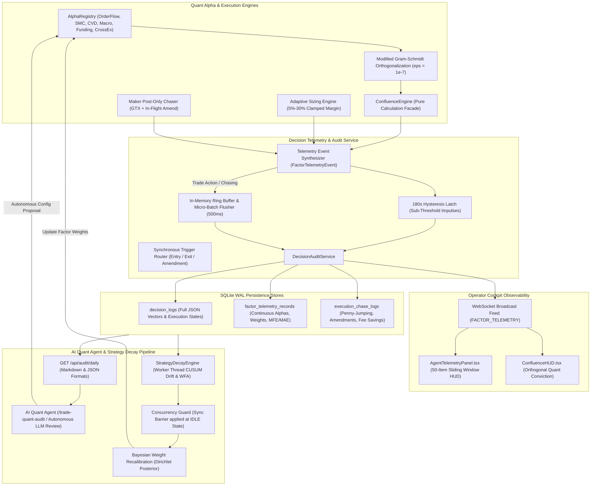

# TradeOS Next-Gen Modular Quant Decision Telemetry, Autonomous Audit Trail & AI Continuous Learning Pipeline

* **Author:** fxbluster
* **Status:** In Review
* **Date:** 2026-11-24

---

## Overview

TradeOS is an autonomous quantitative trading system operating on perpetual futures markets. While the core alpha generation, execution routing, and sizing subsystems have been refactored into a Next-Gen Modular Architecture (pluggable `AlphaRegistry`, Modified Gram-Schmidt orthogonalization, Maker Post-Only Limit Chasing, and convex dynamic margin sizing), the system's observability and telemetry pipelines remain coupled to an obsolete 7-pillar model. Specifically:

1. **Cockpit Thought Telemetry Disconnect:** The live HUD panel (`AgentTelemetryPanel.tsx`) and WebSocket broadcasts still render legacy pillar tags (`P1`–`P7`, `4/7 Aktiv`), concealing active orthogonal factors, Gram-Schmidt residual weights, collinearity suppressions, and limit-chasing execution metrics.
2. **AI & Autonomous Strategy Learning Starvation:** Autonomous quantitative optimization engines—including the off-thread Bayesian decay engine (`StrategyDecayEngine.ts`) and AI quant audit agents—require high-fidelity, machine-readable telemetry logs. Because the decision audit logger (`decisionAuditService.ts`) and SQLite audit tables record discrete categorical pillar votes rather than full continuous alpha vectors and execution parameters, automated strategy auditing, walk-forward analysis, and parameter recalibration are completely blinded.

This design document establishes the Next-Gen Quant Decision Telemetry, Autonomous Audit Trail, and AI Continuous Learning Pipeline. It deprecates all legacy pillar logging, introduces continuous factor vector recording, restructures the SQLite WAL decision stores, updates the live Cockpit telemetry interface, and exposes machine-readable decision audit trails for autonomous AI analysis and strategy calibration.

---

## Problem Statement

1. **Telemetry-Architecture Divergence in Live Cockpit:**
   The alpha engine evaluates independent market phenomena using orthogonalized factors (`ORDER_FLOW_L2`, `CVD_ABSORPTION`, `LIQ_CLUSTERS`, `MACRO_REGIME`, `FUNDING_ARBITRAGE`, `CROSS_EXCHANGE_SWEEP`) and suppresses collinear signals. However, the telemetry feed broadcast over WebSockets and rendered in `AgentTelemetryPanel.tsx` continues to display legacy labels like `P1 (Makro)`, `P6 (Momentum)`, `P7 (Xəbər)` and `4/7 Aktiv`. The human operator cannot inspect the actual quantitative drivers behind order decisions.

2. **Starvation of AI & Autonomous Strategy Recalibration:**
   To autonomously calibrate factor weights and detect alpha decay, an AI agent or the background decay worker must compute rolling Information Coefficients ($IC$) and Information Ratios ($IR$) against post-trade price paths ($MFE$, $MAE$ at 1m, 5m, 15m, 1h). Because `decisionAuditService.ts` currently logs only discrete strings under legacy pillar fields, neither the AI quant agent nor Bayesian learners have access to the underlying quantitative residuals, raw alphas, or variance matrices.

3. **Execution & Dynamic Sizing Attribution Blindness:**
   The execution engine utilizes convex dynamic margin scaling ($5\%$ to $30\%$) and maker post-only limit chasing (`GTX` with penny-jumping and price amendments). None of these execution variables (anchor mark price, amendments count, duration in book, realized maker fee vs taker fee, Kelly multiplier, volatility parity factor) are persisted in the decision audit trail. Consequently, trade performance cannot be attributed between signal alpha and execution efficiency.

4. **Lack of Machine-Readable AI Audit Export:**
   The current daily audit endpoint (`GET /api/audit/daily`) outputs a basic summary of legacy pillar counts. There is no structured, self-contained export format (such as an analytical markdown report or schema-validated JSON) designed for direct AI consumption, making post-session strategy review and automated git-backed calibration workflows impossible.

---

## Goals

* **G-1 (Orthogonal Factor Telemetry Schema):** Define a unified data contract (`FactorTelemetryEvent`, `DecisionAuditTrail`) in `@tradeos/shared` capturing continuous raw alpha values, Gram-Schmidt orthogonal weights, collinear suppression flags, noise band state, and macro vetoes across all active factors.
* **G-2 (High-Fidelity SQLite Decision Store):** Upgrade `decision_logs` and `factor_telemetry_records` tables in `apps/server/src/db/sqlite.ts` to persist full factor alpha vectors, sizing breakdowns (Kelly, volatility parity, circuit breaker), and asynchronous ring-buffered maker limit-chasing telemetry (amendment count, spread capture, fee savings).
* **G-3 (Cockpit Thought Telemetry Transformation):** Refactor `AgentTelemetryPanel.tsx` in `apps/web` to render the live orthogonal quant stream: dynamic conviction scores (e.g., `82% (High-Conviction Core)`), active factor badges with Gram-Schmidt weights, collinearity status tags, and expandable execution and sizing telemetry, removing all legacy `P1..P7`, `4/7 Aktiv`, and 5-second polling intervals in favor of bounded WebSocket event appending.
* **G-4 (Autonomous AI Audit Interface & Export):** Enhance `decisionAuditService.ts` and `GET /api/audit/daily` to generate structured, self-contained Markdown and JSON decision audit reports containing full attribution analytics, capped at a deterministic 4,000 token budget for seamless LLM context window ingestion.
* **G-5 (Zero-Downtime Data Continuity & Migration):** Implement backward-compatible database handling so existing historical session records can coexist or be migrated cleanly without breaking SQLite queries.

---

## Non-Goals

* **NG-1 (Modifying Live Exchange Order Types):** This design does not alter exchange order types or broker execution logic (which are defined in the execution engine design); it strictly standardizes how execution telemetry is captured, persisted, and surfaced.
* **NG-2 (Real-Time Tick Storage for Full Order Books):** Storing full L2 order book depth history for every tick across the entire trading day is out of scope. Telemetry records snapshot factor evaluation events at decision points (impulse triggers, order placement, order fill, and position exit).
* **NG-3 (Manual Strategy Editing UI):** A graphical interactive drag-and-drop factor weight editor in the Cockpit is out of scope. Factor weights are calibrated autonomously via the Bayesian decay engine or via AI-assisted configuration updates.

---

## Open Questions

* **Q-1 (Telemetry Sampling Frequency & SQLite WAL Pressure):** Evaluation cycles run at 2Hz–4Hz. Writing every sub-threshold impulse tick to SQLite could cause disk I/O bottlenecks. What is the optimal hysteresis threshold for logging telemetry events?
  * *Investigation Plan:* Enforce a 180s rising-edge hysteresis latch for sub-threshold impulses and an in-memory ring buffer flushed in 500ms micro-batches for active execution events.
* **Q-2 (LLM Token Consumption on Daily Audit Exports):** When an AI agent audits daily trading decisions, what is the maximum recommended token payload for the analytical Markdown report?
  * *Investigation Plan:* Structure the daily audit report into high-level aggregated summary tables with top 5 best and top 5 worst trade deep-dives to clamp context consumption strictly under 4,000 tokens.

---

## Critical User Journeys (CUJs)

### CUJ 1: Operator Inspects Real-Time Orthogonal Quant Conviction in Cockpit
* **Given**: AutoPilot is running on SOLUSDT. The market regime triggers an orthogonal buy signal.
* **When**: The operator looks at the "Agent Loqları & Canlı Düşüncə Telemetriyası" panel in the Cockpit.
* **Then**:
  1. The event header displays: `SOLUSDT BUY | Score: 84% (High-Conviction Core) | Noise Band: CLEAR`.
  2. The factor badge row shows active independent factors with weights: `Order Flow L2 (54.6% wt, BULLISH)`, `CVD Absorption (30.7% wt, BULLISH)`, `Liquidation Clusters (14.7% wt, NEUTRAL)`.
  3. Collinear factors are explicitly grouped under a subdued tag: `[COLLINEAR]: Native SMC, Macro Regime, Funding Arbitrage`.
  4. Expanding the row reveals the execution telemetry: `Maker Chasing: 2 amendments, duration 840ms, fee saved: $3.80` and sizing breakdown: `Margin: $1,200 (25.0%), Kelly: 0.85x, Vol Parity: 1.10x`.

### CUJ 2: Autonomous AI Agent Ingests Decision Audit Trail for Strategy Evolution
* **Given**: An AI quant agent runs a scheduled daily performance review.
* **When**: The agent requests `GET /api/audit/daily?format=markdown`.
* **Then**:
  1. The API returns a self-contained, structured analytical Markdown report capped under 4,000 tokens.
  2. The report breaks down empirical factor hit rates, Information Ratios ($IR$), and execution fee savings across all sessions.
  3. The AI agent identifies that `ORDER_FLOW_L2` maintained an $IR = 1.82$ while `NATIVE_SMC` dropped to $IR = 0.24$ with high collinearity.
  4. The AI agent generates a calibrated Bayesian weight update proposal for review.

---

## Technical Plan (Architecture)

### Architectural Overview

The Next-Gen Quant Decision Telemetry, Autonomous Audit Trail, and AI Continuous Learning Pipeline connects the real-time alpha and execution engines to human operator observability and autonomous AI strategy calibration.



### Component Details

#### 1. Shared Isomorphic Data Contracts (`packages/shared/src/contracts.ts`)

Data contracts standardize the telemetry payloads shared across backend services, the SQLite persistence layer, and the React Cockpit frontend without introducing Node.js native dependencies:

```typescript
export type QuantConvictionArchetype =
  | 'SUB_THRESHOLD'
  | 'EXPLORATORY_PROBE'
  | 'STANDARD_INSTITUTIONAL'
  | 'HIGH_CONVICTION_CORE'
  | 'A_PLUS_INSTITUTIONAL';

export interface FactorStateDetail {
  factorId: string;
  name: string;
  bias: 'BULLISH' | 'BEARISH' | 'NEUTRAL';
  rawAlpha: number;          // Continuous in [-1.0, +1.0]
  orthogonalAlpha: number;   // Gram-Schmidt residual
  effectiveWeight: number;   // Posterior Dirichlet normalized weight [0.0, 1.0]
  isCollinear: boolean;      // True if ||u_k||^2 < 1e-6 (suppressed)
  confidence: number;        // [0.0, 1.0]
  summaryText: string;       // Human-readable rationale (e.g. "Depth Imbalance 1.8x Bid")
}

export interface ChasingTelemetrySnapshot {
  orderId?: string;
  status: 'PENDING' | 'AMENDING' | 'FILLED' | 'CANCELED' | 'ABORTED';
  anchorMarkPrice: number;
  currentLimitPrice: number;
  spreadPennyJumps: number;
  amendmentCount: number;
  durationMs: number;
  realizedFeeUsd: number;
  feeSavedVsTakerUsd: number;
}

export interface SizingTelemetrySnapshot {
  allocatedMarginUsd: number;
  allocatedMarginPct: number;
  baseConvictionMargin: number;
  quarterKellyMultiplier: number;
  volatilityParityMultiplier: number;
  circuitBreakerMultiplier: number;
  solvencyAirbagIntact: boolean;
}

export interface FactorTelemetryEvent {
  id?: number;
  timestamp: number;
  symbol: string;
  triggerType: 'SUB_THRESHOLD_IMPULSE' | 'SIGNAL_CONFIRMED' | 'ORDER_AMENDED' | 'POSITION_ENTERED' | 'POSITION_EXITED';
  markPrice: number;
  compositeScore: number;
  convictionArchetype: QuantConvictionArchetype;
  consensusSide: 'BUY' | 'SELL' | 'NEUTRAL';
  noiseBandActive: boolean;
  macroVetoActive: boolean;
  macroVetoReason?: string;
  activeFactors: FactorStateDetail[];
  collinearFactors: string[];
  chasingTelemetry?: ChasingTelemetrySnapshot;
  sizingTelemetry?: SizingTelemetrySnapshot;
}

export interface DecisionLogRecord {
  id: string;
  timestamp: number;
  symbol: string;
  side: TradeSide;
  action: DecisionAction;
  price: number;
  margin_usd: number;
  leverage: number;
  atr: number;
  composite_score?: number | null;
  trade_id?: string | null;
  error_message?: string | null;
  macro_regime?: MacroRegime | null;
  macro_veto_active?: number | null;
  veto_reasons_json?: string | null;
  // Upgraded Next-Gen Quant Telemetry JSON Columns
  factor_telemetry_json?: string | null;
  execution_chase_json?: string | null;
  sizing_breakdown_json?: string | null;
  noise_band_state?: number;
}

export interface DailyAuditResponse {
  date: string;
  total_trades: number;
  successful_trades: number;
  failed_trades: number;
  win_rate: number;
  gross_pnl_usd: number;
  maker_fee_savings_usd: number;
  net_pnl_usd: number;
  decisions: DecisionLogRecord[];
  factor_telemetry_events: FactorTelemetryEvent[];
  factor_attribution_summary: Array<{
    factorId: string;
    name: string;
    empiricalHitRate: number;
    informationRatio: number;
    informationCoefficient: number;
    effectiveWeight: number;
  }>;
}
```

#### 2. High-Fidelity SQLite Decision Audit Schema & Persistence (`apps/server/src/db/sqlite.ts`)

The SQLite schema is upgraded to persist structured JSON vectors and factor-level records while guaranteeing idempotent migrations on server boot:

```sql
-- Upgraded decision_logs schema with structured quant telemetry
CREATE TABLE IF NOT EXISTS decision_logs (
  id TEXT PRIMARY KEY,
  timestamp INTEGER NOT NULL,
  symbol TEXT NOT NULL,
  side TEXT NOT NULL,
  action TEXT NOT NULL,
  price REAL NOT NULL,
  margin_usd REAL NOT NULL,
  leverage REAL NOT NULL,
  atr REAL NOT NULL,
  trade_id TEXT,
  error_message TEXT,
  composite_score REAL,
  macro_regime TEXT,
  macro_veto_active INTEGER DEFAULT 0,
  veto_reasons_json TEXT,
  factor_telemetry_json TEXT,
  execution_chase_json TEXT,
  sizing_breakdown_json TEXT,
  noise_band_state INTEGER DEFAULT 0
);

-- Canonical factor attribution table with UUID foreign key
CREATE TABLE IF NOT EXISTS factor_telemetry_records (
  id INTEGER PRIMARY KEY AUTOINCREMENT,
  decision_log_id TEXT REFERENCES decision_logs(id) ON DELETE CASCADE,
  timestamp INTEGER NOT NULL,
  symbol TEXT NOT NULL,
  factor_id TEXT NOT NULL,
  raw_alpha REAL NOT NULL,
  orthogonal_alpha REAL NOT NULL,
  effective_weight REAL NOT NULL,
  is_collinear INTEGER NOT NULL,
  status TEXT DEFAULT 'EVALUATING',
  settle_timestamp INTEGER,
  post_1m_mfe REAL,
  post_1m_mae REAL,
  post_5m_mfe REAL,
  post_5m_mae REAL,
  post_15m_mfe REAL,
  post_15m_mae REAL,
  post_1h_mfe REAL,
  post_1h_mae REAL
);

-- Indexing for fast rolling factor attribution queries
CREATE INDEX IF NOT EXISTS idx_factor_telemetry_factor_time 
ON factor_telemetry_records (factor_id, timestamp);
```

#### 3. Backend Telemetry Ingestion & Hysteresis Service (`apps/server/src/services/decisionAuditService.ts`)

`DecisionAuditService` decouples execution from persistence and ensures durable horizon tracking:

* **Rising-Edge Hysteresis Filter:** Sub-threshold evaluation impulses (score $< 70$) are filtered through a 180-second per-symbol hysteresis latch (`lastLoggedAt + 180_000`), preventing event-loop and disk I/O starvation.
* **Asynchronous Ring-Buffered Execution Logging:** High-frequency maker limit-chasing penny-jumping amendments append to an in-memory ring buffer. Telemetry is flushed to `execution_chase_logs` and `decision_logs` asynchronously in 500ms micro-batches or upon terminal order states (`FILLED`, `CANCELED`, `ABORTED`), guaranteeing zero synchronous disk I/O blocking on the order dispatch hot path.
* **Durable Horizon Trajectory State Machine:** In `onCandleClose(candle)`, the service queries pending `factor_telemetry_records` where `candle.time * 1000 >= record.timestamp + horizonMs`, computes high/low price excursions ($MFE$, $MAE$), commits updates to SQLite, and computes the rolling Information Coefficient ($IC$) as Spearman rank correlation across $N = 60$ settled observations.
* **Crash Recovery Routine:** Upon server startup, `recoverDowntimeGaps()` scans pending records with `status = 'EVALUATING'` and settles them against historical 1m Kline candles fetched from the database or exchange.

#### 4. Cockpit Live Thought HUD (`apps/web/src/components/AgentTelemetryPanel.tsx`)

`AgentTelemetryPanel.tsx` is completely refactored to render the Next-Gen Quant telemetry stream:

* **Transport Streamlining:** The legacy 5-second `setInterval` polling loop is eliminated. On component mount, an initial bootstrap fetch queries `apiClient.getDailyAudit()`. Subsequent updates arrive via WebSocket message `{ type: 'FACTOR_TELEMETRY'; data: FactorTelemetryEvent }` and append to a bounded 50-item sliding window buffer in React state.
* **Header Row:** Symbol, side (`BUY` / `SELL`), timestamp, Orthogonal Quant Conviction badge (`Score: 84% (High-Conviction Core)`), Noise Band badge (`CLEAR` or `ACTIVE`), and Macro Veto status.
* **Active Orthogonal Factors Row:** Badges for all independent factors rendering factor name, effective Gram-Schmidt weight (e.g. `54.6% wt`), and bias color (`BULLISH` in `#0ecb81`, `BEARISH` in `#f6465d`, `NEUTRAL` in `#7d8590`).
* **Collinear Factor Tags:** Subdued `[COLLINEAR]` tag listing all suppressed redundant factors (`Native SMC, Macro Regime, Funding Arbitrage`).
* **Expandable Accordion Rows:** Maker Chasing telemetry (anchor mark, amendments, fill duration, fee savings) and Dynamic Sizing breakdown (margin $, Kelly multiplier, volatility parity).
* **Legacy Artifact Elimination:** All occurrences of `P1`–`P7`, `${active_count}/7 Aktiv`, and legacy pillar score bars are permanently purged.

#### 5. Machine-Readable AI Decision Audit API (`GET /api/audit/daily`)

`GET /api/audit/daily` supports dual export modes via the `?format=` parameter:

1. **`format=markdown` (AI Quant Agent Mode):** Generates a dense, self-contained Markdown report strictly clamped to a 4,000 token budget for LLM ingestion:
   * Executive Session Summary (Total trades, win rate, profit factor, gross vs net PnL, fee savings).
   * Orthogonal Factor Attribution Matrix (empirical $IC$, $IR$, and hit rate per factor).
   * Trade Execution Attribution Table (Maker vs Taker fills, penny-jump efficiency, slippage).
   * Granular Deep-Dives (Hard-capped to the Top 5 most profitable and Top 5 worst-slippage trades).
   * Tabular raw impulse streams are excluded from Markdown, guaranteeing predictable token overhead.
2. **`format=json` (Programmatic Engine Mode):** Returns structured JSON adhering to `DailyAuditResponse`, supporting client-side charting and paginated raw event queries (`limit=50&offset=...`).

#### 6. Off-Thread Continuous Learning & Calibration Pipeline (`strategyDecayEngine.ts`)

1. Rolling factor predictions and price excursions are aggregated by `strategyDecayEngine.ts`.
2. A dedicated Node.js worker thread (`monteCarloWorker.ts`) executes CUSUM change-point drift detection ($S_k = \max(0, S_{k-1} + (IC_k - \mu_0) - k)$) over rolling 60-observation windows.
3. If $S_k > 4.0\sigma$, the factor is flagged as decaying.
4. **Synchronization Barrier:** Weight updates dispatched by `StrategyDecayEngine` are buffered and applied to `AlphaRegistry` only when `autoPilotManager.getState() === 'IDLE'`, preventing erratic order cancellations or opposite-direction exits mid-chase.

---

## Alternatives Considered

### Alternative A: Synchronous Immediate SQLite WAL Writes vs Asynchronous Buffered Ring-Buffer Flushing

* **Pros of Synchronous Writes**: Trivial code implementation; immediate on-disk write guarantee.
* **Cons of Synchronous Writes**: Severe disk I/O bottleneck; `node:sqlite` `DatabaseSync` blocks the single-threaded Node.js event loop for 10ms–50ms during rapid penny-jump order amendments (50ms–200ms intervals), risking Binance API timeouts and delayed stop-loss executions.
* **Reason for Rejection**: Synchronous disk I/O on the order amendment hot path degrades execution latency and introduces critical trading risk. Decoupling order amendments into an in-memory ring buffer flushed in 500ms micro-batches achieves complete audit durability without event-loop blocking.

### Alternative B: Streaming Full Uncompressed 4Hz Tick Snapshots to Disk & WebSocket

* **Pros**: Captures maximal granular data fidelity across every sub-second order book state; eliminates the need for hysteresis sampling logic.
* **Cons**: Severe disk I/O bottleneck; SQLite WAL file expands by multiple gigabytes within hours; Node.js event-loop tick processing latency spikes by $> 40	ext{ms}$; saturates client browser WebSocket buffers.
* **Reason for Rejection**: 4Hz raw tick persistence overwhelms disk I/O and degrades critical order execution latency. A 180s rising-edge hysteresis latch for sub-threshold impulses combined with zero-latency trade event capture achieves complete auditability without event-loop overhead.

### Alternative C: Volatile Client-Side State Logging without Persistent Server Audit Tables

* **Pros**: Requires zero backend database schema modifications; simple frontend-only code refactor in React component state.
* **Cons**: Telemetry is lost upon page refresh or network disconnection; autonomous background services (`StrategyDecayEngine`) and off-thread AI quant evaluation agents cannot access historical factor performance; impossible to compute empirical post-trade Information Coefficients ($IC$) or Information Ratios ($IR$).
* **Reason for Rejection**: Volatile in-memory logging destroys autonomous AI strategy evaluation and violates institutional audit standards. Persistent SQLite storage with rolling horizon price tracking is non-negotiable for quantitative continuous learning.

---

## Non-Functional Requirements

### 1. Performance & Latency
* **Serialization Overhead:** Telemetry object serialization into JSON must complete in $\le 1.5	ext{ms}$ to ensure zero degradation of the 2Hz–4Hz evaluation loop.
* **WebSocket Message Size:** Real-time telemetry payloads must remain $\le 4	ext{KB}$ per message, avoiding browser WebSocket frame fragmentation.
* **Worker Thread Isolation:** CUSUM change-point drift detection and Monte Carlo walk-forward analysis execute entirely within isolated Node.js worker threads, preventing event-loop blocking.

### 2. Reliability & Data Integrity
* **Atomic SQLite Writes:** Telemetry records and trade execution logs are committed within atomic SQLite WAL transactions, ensuring zero partial state writes during unexpected server restarts.
* **Fail-Closed Horizon Evaluation:** If external price feeds disconnect during a 1h post-trade evaluation horizon, the evaluation task logs a graceful `INCOMPLETE_FEED` outcome rather than crashing the timer queue.

### 3. Storage Footprint & Lifecycle Retention
* **Rolling Pruning Policy:** Sub-threshold impulses older than 7 days are automatically pruned via a scheduled SQLite clean-up job. Executed trade decisions and their associated factor vectors are retained indefinitely.
* **Storage Cap:** Total telemetry database size is bounded to $150	ext{MB} - 200	ext{MB}$ under normal continuous operating conditions, managed with explicit `PRAGMA wal_autocheckpoint = 1000;` and automated vacuuming during weekly maintenance.

---

## Risks & Mitigations

| Risk | Impact | Likelihood | Mitigation Strategy |
| :--- | :--- | :---: | :--- |
| **SQLite WAL Write Lock Contention** | Event loop stall on high-frequency penny-jumping | High | Buffer chasing amendments in an in-memory ring buffer; flush asynchronously in 500ms micro-batches. |
| **External Price Feed Interruption** | Horizon evaluation timers unable to compute MFE/MAE | Medium | Persist horizon tracking in SQLite; log `INCOMPLETE_FEED` gracefully and reconcile gaps on boot via historical Klines. |
| **Worker Thread Crash in CUSUM WFA** | Factor decay evaluation halts silently | Low | Wrap worker in supervisor process; auto-respawn worker on exit and fall back to static Dirichlet priors. |
| **LLM Context Window Overflow** | Token limit exhaustion during daily AI audit reviews | High | Deterministic ceiling on `format=markdown` (< 4,000 tokens) with aggregated matrices and Top 5 trade deep-dives. |
| **Mid-Chase Signal Flips on Factor Weight Updates** | Erratic order cancellations or opposite exits during active limit chasing | Medium | Enforce an execution synchronization barrier: factor weight shifts are applied to `AlphaRegistry` only when AutoPilot is `IDLE`. |

---

## Detailed Implementation Plan

### Phase 1: Shared Domain Types & Isomorphic Contracts
* **Target Files**:
  * `packages/shared/src/contracts.ts` (Modify)
  * `packages/shared/src/types.ts` (Modify)
  * `packages/shared/src/__tests__/contracts.test.ts` (Modify)
* **Execution Tasks**:
  1. Export `QuantConvictionArchetype`, `FactorStateDetail`, `ChasingTelemetrySnapshot`, `SizingTelemetrySnapshot`, and `FactorTelemetryEvent`.
  2. Extend `DecisionLogRecord` with the 4 optional Next-Gen JSON columns:
     ```typescript
     factor_telemetry_json?: string | null;
     execution_chase_json?: string | null;
     sizing_breakdown_json?: string | null;
     noise_band_state?: number;
     ```
  3. Extend `DailyAuditResponse` with `factor_telemetry_events` and `factor_attribution_summary`.
  4. Define WebSocket broadcast message contract:
     ```typescript
     | { type: 'FACTOR_TELEMETRY'; data: FactorTelemetryEvent }
     ```
  5. Verify browser bundle compilation with zero Node.js native dependencies (`node:sqlite`).
* **Verification Gate**: `npm run build -w @tradeos/shared` and `npm test packages/shared` pass 100%.

### Phase 2: Database Persistence & Defensive Migrations
* **Target Files**:
  * `apps/server/src/db/schema.sql` (Modify)
  * `apps/server/src/db/sqlite.ts` (Modify)
  * `apps/server/src/db/__tests__/factorTelemetryRepo.test.ts` (Create)
* **Execution Tasks**:
  1. In `schema.sql`, add `factor_telemetry_json`, `execution_chase_json`, `sizing_breakdown_json`, and `noise_band_state` directly to `CREATE TABLE IF NOT EXISTS decision_logs`.
  2. Declare `CREATE TABLE IF NOT EXISTS factor_telemetry_records` with UUID foreign key `decision_log_id TEXT REFERENCES decision_logs(id) ON DELETE CASCADE`.
  3. In `sqlite.ts:initializeDatabase()`, add defensive idempotent column additions:
     ```typescript
     try { db.exec('ALTER TABLE decision_logs ADD COLUMN factor_telemetry_json TEXT;'); } catch {}
     try { db.exec('ALTER TABLE decision_logs ADD COLUMN execution_chase_json TEXT;'); } catch {}
     try { db.exec('ALTER TABLE decision_logs ADD COLUMN sizing_breakdown_json TEXT;'); } catch {}
     try { db.exec('ALTER TABLE decision_logs ADD COLUMN noise_band_state INTEGER DEFAULT 0;'); } catch {}
     ```
  4. Implement `FactorTelemetryRecordsRepo` supporting batch inserts and horizon evaluation updates.
  5. Configure `PRAGMA wal_autocheckpoint = 1000;`.
* **Verification Gate**: `factorTelemetryRepo.test.ts` passes with 100% assertions on fresh and migrated SQLite databases.

### Phase 3: Telemetry Ingestion, Ring-Buffer & Horizon State Machine
* **Target Files**:
  * `apps/server/src/services/decisionAuditService.ts` (Modify)
  * `apps/server/src/services/__tests__/decisionAuditService.test.ts` (Modify)
* **Execution Tasks**:
  1. Purge legacy `p1`–`p7` recording methods (`recordPillarTelemetry`).
  2. Implement `recordFactorTelemetry(event: FactorTelemetryEvent)`.
  3. Implement 180s rising-edge hysteresis latch for `SUB_THRESHOLD_IMPULSE`.
  4. Implement in-memory ring-buffer queue for high-frequency chasing amendments, flushing in 500ms micro-batches.
  5. Implement durable horizon evaluation state machine in `onCandleClose(candle)` querying pending `factor_telemetry_records` and computing $IC$ via Spearman rank correlation over rolling $N=60$.
  6. Implement startup gap recovery in `recoverDowntimeGaps()`.
* **Verification Gate**: Unit tests validate 180s latching, async ring-buffer flushing, and horizon price excursion calculations.

### Phase 4: Confluence Facade, Trigger Routing & AI Audit API Layer
* **Target Files**:
  * `apps/server/src/quant/confluenceEngine.ts` (Modify)
  * `apps/server/src/api/routes.ts` (Modify)
  * `apps/server/src/api/__tests__/dailyAuditRoute.test.ts` (Modify)
* **Execution Tasks**:
  1. In `confluenceEngine.evaluate()`, construct `FactorTelemetryEvent` containing active orthogonal factors and collinear tags, embedding it into `ConfluenceSnapshot` without coupling `ConfluenceEngine` directly to the database.
  2. Route trade execution triggers (`ORDER_AMENDED`, `POSITION_ENTERED`, `POSITION_EXITED`) from `ChasingExecutionEngine` and `AutoPilotManager` directly to `decisionAuditService.recordFactorTelemetry()`.
  3. Update `GET /api/audit/daily`:
     * If `?format=markdown`, generate a dense, structured Markdown report clamped to 4,000 tokens with aggregated summary tables and Top 5 trade deep-dives.
     * If `?format=json`, return structured `DailyAuditResponse`.
* **Verification Gate**: `dailyAuditRoute.test.ts` asserts valid Markdown generation under token budget and structured JSON responses.

### Phase 5: Presentation Tier WebSocket HUD Refactor & Live Verification
* **Target Files**:
  * `apps/web/src/components/AgentTelemetryPanel.tsx` (Modify)
  * `apps/web/src/lib/apiClient.ts` (Modify)
  * `apps/web/src/components/__tests__/AgentTelemetryPanel.test.tsx` (Create)
* **Execution Tasks**:
  1. Purge the 5-second `setInterval` polling loop in `AgentTelemetryPanel.tsx`.
  2. Implement initial bootstrap fetch via `apiClient.getDailyAudit()`.
  3. Subscribe to WebSocket `{ type: 'FACTOR_TELEMETRY'; data: FactorTelemetryEvent }` and append events into a bounded 50-item sliding window buffer in React state.
  4. Render Orthogonal Quant Conviction badge (`Score: 84% (High-Conviction Core)`), active factor badges with Gram-Schmidt weights, and subdued `[COLLINEAR]` tag.
  5. Render expandable accordions for Maker Chasing telemetry and Dynamic Sizing breakdown.
  6. Completely purge all occurrences of `P1`–`P7` and `X/7 Aktiv`.
* **Verification Gate**:
  * `npm run build` succeeds across all workspaces.
  * `npm test` passes 100%.
  * Chrome DevTools live DOM inspection on `http://127.0.0.1:3400` verifies 0 occurrences of legacy pillar strings.

---

## Verification Plan

### Test Traceability Matrix

| Test Suite File | Subsystem Under Test | Key Assertions & Verification Criteria |
| :--- | :--- | :--- |
| `packages/shared/src/__tests__/contracts.test.ts` | Shared Contracts | Validates isomorphic browser bundle compatibility; zero `node:sqlite` imports in shared contracts. |
| `apps/server/src/db/__tests__/factorTelemetryRepo.test.ts` | SQLite Storage | Validates table creation, idempotent schema migrations, and batch inserts for `factor_telemetry_records`. |
| `apps/server/src/services/__tests__/decisionAuditService.test.ts` | Audit Service | Validates `FactorTelemetryEvent` recording, 180s hysteresis latch, async ring-buffer flushing, and horizon price tracking. |
| `apps/server/src/api/__tests__/dailyAuditRoute.test.ts` | Audit API Routes | Validates `GET /api/audit/daily` returns valid Markdown clamped under 4,000 tokens and structured JSON for `format=json`. |
| `apps/web/src/components/__tests__/AgentTelemetryPanel.test.tsx` | Presentation Tier HUD | Asserts presence of orthogonal factor badges and verifies zero legacy `P1`–`P7` strings in rendered DOM. |

### Standard Verification Categories

* **Compilation/Build**:
  * `npm run build` must succeed with zero errors across all workspaces: `@tradeos/shared`, `apps/server`, and `apps/web`.
* **Unit Tests**:
  * `npm test` (`vitest run`) must pass 100% across all server, shared, and web test suites.
* **Static Analysis & Linting**:
  * `npm run lint` (`eslint`) must pass with zero errors and zero warnings.
* **Live Cockpit DOM & Visual Verification**:
  * Use Chrome DevTools MCP on `http://127.0.0.1:3400` to inspect the `Agent Loqları & Canlı Düşüncə Telemetriyası` panel in the live browser.
  * Capture DOM snapshot and screenshot confirming that:
    1. Event headers display Orthogonal Quant Conviction (e.g. `Score: 84%`).
    2. Active factor badges display Gram-Schmidt weights and directional bias.
    3. Collinear factors are cleanly grouped under `[COLLINEAR]`.
    4. Zero occurrences of `P1`, `P6`, `P7`, or `4/7 Aktiv` remain anywhere in the panel.

---

*Drafted with EGM*
