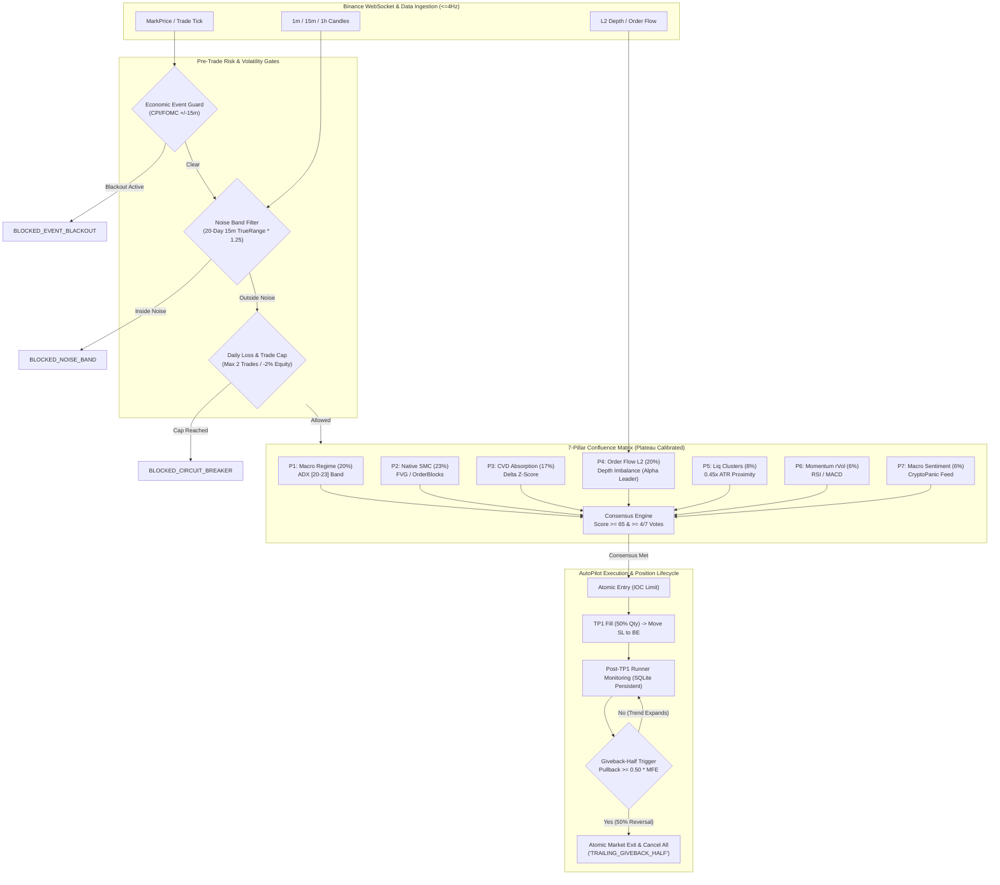

# TradeOS-v2 Quantitative Edge & Execution Architecture Upgrade

* **Author:** Lead Quant Auditor & Antigravity EGM Architect
* **Status:** Ready for Implementation (Reviewed & Approved)
* **Date:** 2026-11-23
* **Target System:** `TradeOS-v2` (`apps/server`, `packages/shared`)

---

## Overview

This design document outlines the quantitative engineering specification for upgrading the autonomous algorithmic trading engine of **TradeOS-v2**.

Based on empirical live telemetry audits and historical volatility analysis, this upgrade resolves live-trading discrepancies: premature profit givebacks, excessive taker commission drag, parameter fragility, and high-impact news slippage. It integrates four core quantitative controls:
1. Dynamic **Giveback-Half Trailing Stop** (`MFE * 0.50` pullback exit with SQLite persistence and atomic cancellation).
2. Volatility **Noise Band Filter** (rolling 20-day hourly-bucketed 15m True Range filter) with session trade caps.
3. High-Impact **Economic Event Blackout Engine** (CPI/FOMC volatility freeze with deterministic pre-event order geometry).
4. Plateau-Calibrated **Pillar Weights & Mark-to-Market Risk Limits** (Daily Max Dollar Loss Ceiling on total portfolio equity).

---

## The Problem

Live execution audits of TradeOS-v2 (SOLUSDT futures on Binance) revealed critical quantitative and architectural flaws:

1. **Unprotected Unrealized Gains (Peak Giveback):**
   - Positions that hit Take Profit 1 (TP1) have static Take Profit 2 (TP2) targets with no dynamic trailing stop.
   - In today's session, a position entered at $75.67 surged +3.72% to $78.49 (peak unrealized gain of +$91.45 USDT), falling just $0.28 short of static TP2 ($78.77). Lacking a trailing mechanism, price retreated back to $77.14, surrendering $43.00+ (over 47% of peak gains) back to the market.

2. **Severe Commission Drag (Taker Churn):**
   - The engine utilizes aggressive marketable limit orders (0.05% taker fee).
   - Because of frequent entries and immediate breakeven triggers with only a 0.15% fee buffer, round-trip taker commissions (0.10%) consumed **38.45%** of daily profits ($14.53 fees on $37.79 gross PnL) and **72.4%** of weekly performance (-$56.06 fees on -$77.37 gross loss).

3. **Parameter Fragility & False Negative Spikes:**
   - The 7-pillar consensus uses rigid step-function thresholds (e.g., ADX strictly > 25.0).
   - In the 385-sample scorecard, `MACRO_REGIME` recorded **130 False Negatives** with a low 26.8% hit rate—declaring trending breakouts as "MACRO_RANGING" and missing clean continuation waves.
   - `LIQ_CLUSTERS` recorded **0 active votes** (dead pillar) due to an overly wide trigger radius (>1.0x ATR).

4. **News Event Vulnerability (Slippage & Spread Blowout):**
   - High-impact macro events (US CPI, FOMC, NFP) create momentary liquidity vacuums where spreads widen 10x-20x and 1-minute candles whip-saw +/-300 pips. Unhedged market orders during these windows cause catastrophic stop-loss slippage and mutual liquidation.

---

## Goals

* **[G-01] Dynamic Peak-Profit Capture:** Implement an automated "Giveback-Half" trailing stop mechanism for post-TP1 open runners, locking in at least 50% of Maximum Favorable Excursion (MFE) when MFE exceeds 2.0x ATR, with persistent SQLite state and atomic exchange order cancellation.
* **[G-02] Cut Commission Drag by >= 50%:** Implement a 20-day hourly-bucketed noise band filter and enforce an A+ setup threshold with a hard cap of maximum 2 filled round-trip trades per calendar day.
* **[G-03] Volatility Vacuum Protection:** Integrate an Economic Event Blackout Window that freezes order dispatch 15 minutes before and 15 minutes after high-impact (Red-Folder) macro releases, enforcing deterministic pre-event position unwinding for underwater trades.
* **[G-04] Robust Parameter Plateaus:** Recalibrate the 7-pillar matrix from rigid single-point thresholds to smooth plateau bands, raising `ORDER_FLOW_L2` weight from 15% to 20%, reducing `MACRO_REGIME` to 20% (ADX threshold 20-23), and tightening `LIQ_CLUSTERS` institutional wall proximity to 0.45x ATR.
* **[G-05] Hard Dollar Drawdown Ceiling:** Introduce a `daily_max_loss_usd` circuit breaker that forces a hard halt for the calendar day if cumulative session mark-to-market loss (realized + unrealized) crosses 2.0% of wallet balance.

---

## Non-Goals

* **[NG-01] LLM-in-the-Loop High Frequency Execution:** No synchronous LLM calls (e.g. Claude prompt chains) inside the <= 4Hz tick loop or order routing path. All fast execution remains purely deterministic TypeScript math.
* **[NG-02] Cross-Exchange Arbitrage:** No multi-exchange latency arbitrage or triangular order routing. Execution remains strictly focused on Binance Futures (Demo and Live).
* **[NG-03] Reinforcement Learning Black-Box Models:** No non-interpretable neural network weights. All scoring remains auditable via the 7-pillar consensus matrix.

---

## Open Questions (Resolved)

* **[RESOLVED] OQ-01: Economic Calendar Provider:**
  - *Decision:* Ingest ForexFactory weekly calendar JSON (`https://nfs.faireconomy.media/ff_calendar_thisweek.json`) via an hourly cron in `EconomicEventGuard`. Persist events into SQLite `economic_events` table.
  - *Failure Policy:* Fail-Open with `logger.warn` alert logging. If the calendar feed is unreachable, autonomous trading continues with standard technical stop-loss protection rather than stalling execution.
* **[RESOLVED] OQ-02: Trailing Order Placement Method:**
  - *Decision:* Managed client-side within `AutoPilotManager` using dynamic cancel-and-replace market exits with `reduceOnly: true`.
  - *Rationale:* Binance native `TRAILING_STOP_MARKET` uses static percentage callbacks that cannot calculate adaptive MFE proportionality ($0.50 \times \text{MFE}$) and triggers REST rate limits (`-1003`) during frequent amendments.

---

## Critical User Journeys (CUJs)

### CUJ 1: High-Runup Trailing Stop Exit (Peak Protection)
* **Given:** AutoPilot enters SOLUSDT Long at $75.00 with 60 SOL (10x leverage, ATR = $0.40). TP1 is placed at $76.00 (half-size: 30 SOL).
* **When:** Price reaches $76.00, TP1 fills. The remaining 30 SOL runs up to $78.00 (MFE = $3.00, which is 7.5x ATR). Then price reverses to $76.50.
* **Then:** The Giveback-Half rule activates: peak unrealized gain from entry was $3.00; giving back 50% ($1.50) triggers an atomic market exit at $76.50. `tradeManager.closePosition` cancels the resting Breakeven SL and TP2 orders, and submits a `reduceOnly: true` market order. Net result: +$1.50/unit locked on the second half instead of falling back to breakeven ($75.11).

### CUJ 2: Noise Band Chop Rejection (Commission Shield)
* **Given:** SOLUSDT is in an intraday consolidation range of +/-$0.15. The 20-day hourly noise band threshold for the current hour is $0.35.
* **When:** Momentum pillar triggers a speculative BUY vote with RSI = 58, but the current 15m candle range is $0.18.
* **Then:** The Noise Band filter evaluates price position: range is below the 1.25x historical threshold. The consensus engine rejects the trade as `BLOCKED_NOISE_BAND`, saving $4.80 in taker fees.

### CUJ 3: US CPI Release Blackout Protection
* **Given:** US CPI is scheduled for release at 16:30 UTC+4.
* **When:** At 16:22 UTC+4, SOLUSDT experiences an aggressive order flow delta spike generating a 5/7 bullish consensus score.
* **Then:** The Event Blackout Engine overrides the trigger with `BLOCKED_EVENT_BLACKOUT` (within the -15m window). At 16:30, price whipsaws +$2.50 then -$4.00; the account remains 100% in cash with zero slippage or liquidated stops.

### CUJ 4: Session Trade Cap Enforcement (Max 2 Filled Trades)
* **Given:** AutoPilot has already executed 2 completed round-trip trades within the current UTC day.
* **When:** At 20:15 UTC, a clean 6/7 A+ Long consensus trigger develops.
* **Then:** AutoPilot checks the database filled trade count for today. Reaching the limit of 2, it suppresses order dispatch and logs `BLOCKED_SESSION_TRADE_CAP`, preventing overtrading and preserving daily net gains.

### CUJ 5: Daily Dollar Drawdown Circuit Breaker (-2% Portfolio Equity)
* **Given:** Account equity starts the session at $5,000 USDT. The daily drawdown limit is set to 2.0% ($100 USDT).
* **When:** Two consecutive stop-outs generate a cumulative net loss of -$102.50 USDT (inclusive of commissions).
* **Then:** AutoPilot immediately transitions into `DAILY_DRAWDOWN_LOCKED`. All new entry gates are hard-locked until 00:00 UTC. Any currently open positions remain fully protected by active stops and trailing logic, but no new exposure can be opened.

---

## Technical Plan

### Architectural Flow Diagram



---

### Component Specifications

#### 1. Dynamic "Giveback-Half" Trailing Stop Engine
* **Location:** `apps/server/src/services/autoPilotManager.ts` & `tradeManager.ts`
* **Concurrency Latch & Mutex:**
  - An in-flight symbol mutex (`orderInFlight[symbol] = true`) is acquired immediately when the trailing exit trigger condition is met.
  - State is synchronously latched to `trade.status = 'CLOSING_IN_PROGRESS'`, suppressing subsequent tick evaluations during the REST call.
* **State Tracking & Persistence:**
  - When `trade.status === 'PARTIALLY_CLOSED'` (TP1 executed):
    - Initialize:
      ```typescript
      trade.peak_price = markPrice;
      trade.peak_mfe = Math.abs(markPrice - trade.entry_price);
      trade.trailing_stop_active = false;
      ```
    - On every incoming tick:
      - For BUY:
        ```typescript
        if (markPrice > trade.peak_price) {
          trade.peak_price = markPrice;
          trade.peak_mfe = markPrice - trade.entry_price;
          // Persist new peak to SQLite trades table asynchronously
          this.tradesRepo.update(trade.id, { peak_price: trade.peak_price, peak_mfe: trade.peak_mfe });
        }
        ```
      - For SELL:
        ```typescript
        if (markPrice < trade.peak_price) {
          trade.peak_price = markPrice;
          trade.peak_mfe = trade.entry_price - markPrice;
          this.tradesRepo.update(trade.id, { peak_price: trade.peak_price, peak_mfe: trade.peak_mfe });
        }
        ```
* **Mathematical Activation Criteria:**
  - Trailing activation requires minimum expansion: `trade.peak_mfe >= 2.0 * atr`. Once true, set `trade.trailing_stop_active = true`.
  - While active, compute Trailing Floor:
    $$\text{TriggerPrice}_{\text{Long}} = \text{trade.peak\_price} - (0.50 \times \text{trade.peak\_mfe})$$
    $$\text{TriggerPrice}_{\text{Short}} = \text{trade.peak\_price} + (0.50 \times \text{trade.peak\_mfe})$$
* **Atomic Execution Trigger:**
  - If Long `markPrice <= TriggerPrice_Long` or Short `markPrice >= TriggerPrice_Short`:
    - Set `orderInFlight[symbol] = true`.
    - In `tradeManager.closePosition(symbol, 'TRAILING_GIVEBACK_HALF')`:
      1. First execute `await this.broker.cancelAllOrders(symbol)` (cancels resting Breakeven SL and TP2 limit orders).
      2. Submit market order with `reduceOnly: true` for `trade.remaining_qty`.
      3. Update SQLite record to `status: 'CLOSED'` with `exit_reason: 'TRAILING_GIVEBACK_HALF'`.
      4. Release `orderInFlight[symbol] = false`.

---

#### 2. Localized Volatility Noise Band Engine
* **Location:** `apps/server/src/quant/noiseBandEngine.ts`
* **Mathematical Formulation:**
  - Pre-load the preceding 20 trading days of 15m klines ($20 \times 96 = 1,920$ candles).
  - Group candles by hour of day ($h \in [0, 23]$ UTC).
  - For each hour $h$, calculate the Mean True Range ($\text{MTR}_h$):
    $$\text{MTR}_h = \frac{1}{20 \times 4} \sum_{i=1}^{80} \text{TrueRange}_{i, h}$$
  - Define Dynamic Noise Threshold for hour $h$:
    $$\text{NoiseThreshold}_h = \text{MTR}_h \times 1.25$$
* **Gate Logic:**
  - A trade candidate setup is blocked if:
    1. Current 15m candle high-low range is less than $\text{NoiseThreshold}_h$, OR
    2. Distance between mark price and rolling 15m VWAP is less than $\text{NoiseThreshold}_h \times 0.5$.
  - Rejection code: `BLOCKED_NOISE_BAND`.

---

#### 3. Economic Event Blackout Guard
* **Location:** `apps/server/src/quant/economicEventGuard.ts`
* **Event Ingestion:**
  - Hourly background cron fetches ForexFactory weekly economic calendar JSON (`https://nfs.faireconomy.media/ff_calendar_thisweek.json`).
  - Filters for high-impact USD events: CPI, Core PCE, FOMC Rate Decision, Non-Farm Payrolls, PPI, Fed Chair Powell Speeches.
  - Upserts into SQLite `economic_events` table: `(id, name, timestamp, impact, currency)`.
* **Guard Window & Pre-Event Order Geometry:**
  - Freeze Period: $[T_{\text{event}} - 15\text{ minutes}, T_{\text{event}} + 15\text{ minutes}]$.
  - New Entries: 100% blocked under `BLOCKED_EVENT_BLACKOUT`.
  - Existing Open Position Handling at $T_{\text{event}} - 15m$:
    - If unrealized PnL is positive ($\text{markPrice} \ge \text{entryPrice} + \text{feeBuffer}$): move Stop-Loss to Breakeven.
    - If position is in unrealized loss ($\text{markPrice} < \text{entryPrice} + \text{feeBuffer}$): do NOT attempt an invalid stop order; execute immediate market close (`EVENT_BLACKOUT_UNWIND`) to eliminate unhedged event slippage risk.

---

#### 4. Recalibrated 7-Pillar Confluence Weights & Plateaus
* **Location:** `apps/server/src/quant/confluenceEngine.ts`
* **Scorecard-Driven Weights:**

| Pillar ID | Old Weight | New Weight | Delta | Calibration & Rationale |
| :--- | :---: | :---: | :---: | :--- |
| **`ORDER_FLOW_L2`** | 15.0% | **20.0%** | **+5.0%** | Highest empirical win-rate pillar. 51.6% hit rate, 2.56x MFE/MAE ratio. |
| **`NATIVE_SMC`** | 25.0% | **23.0%** | -2.0% | Core institutional structural zone identification. |
| **`CVD_ABSORPTION`** | 20.0% | **17.0%** | -3.0% | Volume delta exhaustion & passive absorption trigger. |
| **`MACRO_REGIME`** | 25.0% | **20.0%** | -5.0% | Shifted from rigid ADX > 25 to smooth plateau `[20, 23]` to eliminate 130 False Negatives. |
| **`LIQ_CLUSTERS`** | 7.5% | **8.0%** | +0.5% | Maximum allowable distance to resting limit cluster tightened to 0.45x ATR for high-conviction walls. |
| **`MOMENTUM_RVOL`** | 5.0% | **6.0%** | +1.0% | Filtered impulse confirmation with volume validation. |
| **`SENTIMENT_MACRO`** | 2.5% | **6.0%** | **+3.5%** | Enhanced macro news impact weighting. |

---

#### 5. Asymmetric Risk Limits & Trade Churn Throttles
* **Location:** `apps/server/src/services/autoPilotManager.ts`
* **Session Trade Cap:** Maximum 2 completed round-trip trades per calendar day per symbol. Cancelled or rejected IOC limit orders do not increment this counter.
* **Daily Mark-to-Market Drawdown Ceiling:**
  - Calculated on total portfolio equity:
    $$\text{SessionDrawdown} = \text{CumulativeRealizedNetPnL} + \text{CurrentUnrealizedPnL}$$
  - If $\text{SessionDrawdown} \le -(\text{WalletBalance} \times 0.02)$, AutoPilot latches into `DAILY_DRAWDOWN_LOCKED` until 00:00 UTC.

---

### Data Model & Shared Interface Changes (`packages/shared/src/types.ts`)

```typescript
export type ExitReason =
  | 'STOP_LOSS'
  | 'TAKE_PROFIT_1'
  | 'TAKE_PROFIT_2'
  | 'BREAKEVEN'
  | 'TRAILING_GIVEBACK_HALF'
  | 'OPPOSITE_CONFLUENCE_REVERSAL'
  | 'MANUAL_CLOSE'
  | 'EVENT_BLACKOUT_UNWIND';

export type BlockReason =
  | 'BLOCKED_NOISE_BAND'
  | 'BLOCKED_EVENT_BLACKOUT'
  | 'BLOCKED_SESSION_TRADE_CAP'
  | 'BLOCKED_DAILY_MAX_LOSS'
  | 'BLOCKED_MACRO_VETO';

export interface TrailingStopState {
  enabled: boolean;
  active: boolean;
  peakPrice: number;
  peakMfe: number;
  activationMfeThreshold: number; // 2.0 * ATR
  givebackFloorPrice: number;
}

export interface NoiseBandSnapshot {
  hourOfDay: number;
  noiseThreshold: number;
  currentRange: number;
  isNoise: boolean;
  timestamp: number;
}

export interface EconomicEvent {
  id: string;
  name: string;
  timestamp: number;
  impact: 'HIGH' | 'CRITICAL';
  currency: string;
}

export interface TradeRecord {
  id: string;
  symbol: string;
  broker_mode: string;
  side: 'BUY' | 'SELL';
  status: 'OPEN' | 'PARTIALLY_CLOSED' | 'CLOSING_IN_PROGRESS' | 'CLOSED';
  entry_price: number;
  exit_price: number | null;
  quantity: number;
  remaining_qty: number;
  leverage: number;
  margin_usd: number;
  stop_loss: number | null;
  tp1: number | null;
  tp2: number | null;
  be_price: number | null;
  is_breakeven: number;
  peak_price?: number | null;
  peak_mfe?: number | null;
  trailing_stop_active?: number;
  exit_reason: ExitReason | null;
  opened_at: number;
  closed_at: number | null;
}
```

---

## Alternatives Considered

### Alternative A: Exchange-Native `TRAILING_STOP_MARKET` Algo Orders on Binance
* **Pros:** Managed directly on Binance infrastructure; survives local server restarts.
* **Cons:** Binance's native trailing orders require a static percentage `callbackRate` (e.g. 1.0%), which cannot dynamically calculate our proportional "Giveback 50% of captured MFE once expansion exceeds 2.0x ATR" rule. Furthermore, modifying callback rates under volatility encounters Binance rate limits (`-1003 Too Many Requests`).
* **Decision Rationale:** Lacks proportional MFE adaptability. Static percentage callbacks cause premature stopouts during normal intra-candle expansions before the macro wave has matured.

### Alternative B: Fixed Static Target Scaling (Static TP1, TP2, TP3 without Trailing)
* **Pros:** Predictable risk-to-reward geometry established entirely at order entry.
* **Cons:** Directly responsible for today's failure where price surged +3.72% (+91 USDT gain), missed static TP2 by $0.28, and subsequently gave back $43.00 of open profits. Fixed price targets ignore dynamic volatility exhaustion.
* **Decision Rationale:** Fails to protect captured alpha against sudden trend reversals and regime shifts.

### Alternative C: Synchronous LLM Multi-Agent Consensus in the Tick Loop (e.g., Torq / AutoGen)
* **Pros:** Rich natural-language debate across news headlines and social sentiment.
* **Cons:** LLM API roundtrips incur latencies between 2,000ms and 15,000ms. In high-leverage crypto futures (SOLUSDT 1m), order flow absorption and breakouts occur within 200–500ms. Introducing multi-second synchronous LLM gating guarantees severe execution slippage and missed fills.
* **Decision Rationale:** Unacceptable execution latency. Fast tick evaluation and order dispatch must remain deterministic TypeScript code running in sub-millisecond memory.

### Alternative D: Coarse Daily Time-of-Day Cutoff (e.g., Freeze All Trades After 16:00 UTC)
* **Pros:** Trivial to implement with no external calendar dependencies.
* **Cons:** Major economic catalysts occur on specific scheduled dates, not every day. A static daily time shutdown needlessly kills high-volume trading on regular days while remaining completely unprotected against unscheduled midday announcements.
* **Decision Rationale:** Event-driven calendar scheduling provides 15-minute protection without sacrificing normal trading volume.

---

## Risks, Failure Modes & Mitigations

### 1. Exchange API Rate Limit Exhaustion (`HTTP 429` / `-1003`)
* **Risk:** Frequent order amend requests or excessive kline pre-warming on boot trips Binance REST rate limits.
* **Mitigation:** Pre-warm 15m klines ($20 \times 96 = 1,920$ candles) in batch requests of 1,000 candles (only 2 REST calls). Trailing stop logic runs purely in-memory and only issues one final market close order rather than continuously amending exchange resting orders.

### 2. WebSocket Stream Dropout During Open Runner Excursion
* **Risk:** Binance WebSocket drops connection while price is in a trailing stop zone, preventing incoming ticks from evaluating the giveback trigger.
* **Mitigation:** The resting Stop-Loss order at Breakeven remains active on Binance orderbook at all times as a hard floor. On WebSocket disconnect, the `BinanceStreamsManager` watchdog automatically initiates reconnect within 1,000ms. If disconnected for $> 15$ seconds, the server executes a defensive audit sync via REST `getPosition()`.

### 3. Economic Calendar Scraper Failure or Schema Drift
* **Risk:** The external ForexFactory JSON endpoint is blocked, returns an HTTP error, or changes JSON keys.
* **Mitigation:** The parser is wrapped in a fail-open try/catch block. If the fetch fails, it logs `logger.warn('Failed to update economic calendar, falling back to cached events')` and retains existing SQLite events without halting autonomous execution.

---

## Detailed Implementation Plan

### Target Files to Create and Modify

#### 1. `packages/shared/src/types.ts` (Modify)
* **Type / Scope:** Core TypeScript Domain Interfaces & Enums
* **Proposed Changes:**
  - Add `TRAILING_GIVEBACK_HALF` and `EVENT_BLACKOUT_UNWIND` to `ExitReason`.
  - Add `BLOCKED_NOISE_BAND`, `BLOCKED_EVENT_BLACKOUT`, `BLOCKED_SESSION_TRADE_CAP`, and `BLOCKED_DAILY_MAX_LOSS` to `BlockReason`.
  - Export `TrailingStopState`, `NoiseBandSnapshot`, and `EconomicEvent` interfaces.
  - Extend `TradeRecord` with `peak_price`, `peak_mfe`, and `trailing_stop_active`.

#### 2. `apps/server/src/quant/noiseBandEngine.ts` (Create)
* **Type / Scope:** Quantitative Volatility & Range Modeling Service
* **Proposed Changes:**
  - Implement `NoiseBandEngine` class with 20-day historical 15m True Range hourly distribution caching.
  - Expose `getThreshold(hourOfDay: number): number`.
  - Expose `isNoise(candle15m: KlineCandle, vwap: number): boolean`.

#### 3. `apps/server/src/quant/economicEventGuard.ts` (Create)
* **Type / Scope:** Macro Risk Calendar Gatekeeper
* **Proposed Changes:**
  - Implement `EconomicEventGuard` class with hourly ForexFactory JSON scraper.
  - Expose `isBlackoutActive(timestamp: number): { active: boolean; eventName?: string; remainingSeconds?: number }`.

#### 4. `apps/server/src/quant/confluenceEngine.ts` (Modify)
* **Type / Scope:** Multi-Pillar Scoring & Consensus Aggregator
* **Proposed Changes:**
  - Update pillar weights: `ORDER_FLOW_L2 = 20.0`, `NATIVE_SMC = 23.0`, `CVD_ABSORPTION = 17.0`, `MACRO_REGIME = 20.0`, `LIQ_CLUSTERS = 8.0`, `MOMENTUM_RVOL = 6.0`, `SENTIMENT_MACRO = 6.0`.
  - Update Macro Regime to use plateau band `adx >= 20.0 && adx <= 23.0`.
  - Tighten Liquidity Cluster entry proximity threshold to `0.45 * atr`.
  - Wire pre-consensus evaluation gates for `EconomicEventGuard` and `NoiseBandEngine`.

#### 5. `apps/server/src/services/autoPilotManager.ts` (Modify)
* **Type / Scope:** Autonomous State Machine & Position Manager
* **Proposed Changes:**
  - Implement Giveback-Half trailing stop tracking with in-flight symbol mutex and SQLite peak price persistence.
  - Add session trade count latch (max 2 filled trades per UTC day).
  - Add mark-to-market daily drawdown ceiling check ($2\%$ of wallet balance).

#### 6. `apps/server/src/services/tradeManager.ts` (Modify)
* **Type / Scope:** Atomic Order Execution & Exchange Synchronization
* **Proposed Changes:**
  - In `handleOrderTradeUpdate()`: ensure deterministic deduction of `remaining_qty` on partial TP1 fills by tracking cumulative `executedQty` per order ID to prevent double-decrementing to 0.
  - In `closePosition()`: ensure atomic `cancelAllOrders(symbol)` execution before dispatching `reduceOnly: true` market close orders.
  - In `reconcileWithExchange()`: remove the premature `if (!activeTrade) return;` return gate; query `this.broker.getPosition(symbol)` regardless, and resurrect orphaned live exchange positions if found.

#### 7. `apps/server/src/db/sqlite.ts` (Modify)
* **Type / Scope:** Database Schema & Migration
* **Proposed Changes:**
  - Add migration adding `peak_price REAL`, `peak_mfe REAL`, `trailing_stop_active INTEGER DEFAULT 0` to `trades` table.
  - Add `economic_events` table initialization.

#### 8. `apps/server/test/quant/trailingStop.test.ts` (Create)
* **Type / Scope:** Unit Test Driver
* **Proposed Changes:**
  - Test runner lifecycle for both Long and Short positions: asserts activation at $2.0 \times \text{ATR}$, ignores minor pullbacks, and asserts market close dispatch at exactly 50% retracement of peak MFE.

#### 9. `apps/server/test/quant/noiseBand.test.ts` (Create)
* **Type / Scope:** Unit Test Driver
* **Proposed Changes:**
  - Tests 20-day hourly True Range calculations and asserts rejection inside noise thresholds.

#### 10. `apps/server/test/quant/economicEventGuard.test.ts` (Create)
* **Type / Scope:** Unit Test Driver
* **Proposed Changes:**
  - Tests $\pm 15$m blackout boundary calculations and fail-open scraper error handling.

---

## Verification Plan

* **Compilation & Type Check:**
  - Execute: `npm --workspace=@tradeos/shared run build && npm --workspace=@tradeos/server run build`
  - Pass criterion: Zero TypeScript compilation errors (`tsc --noEmit` returns exit code 0).
* **Unit Tests Execution:**
  - Execute: `npm test` (Vitest across all suites in `apps/server/test`).
  - Pass criterion: 100% pass across `trailingStop.test.ts`, `noiseBand.test.ts`, `economicEventGuard.test.ts`, and regression tests in `tradeManager.test.ts`.
* **Telemetry & Scorecard Verification:**
  - Start test runner on mock tick stream with historical SOLUSDT data.
  - Verify `GET /api/audit/pillars` reflects the updated weights and confirms `LIQ_CLUSTERS` generates active votes under the 0.45x ATR threshold.
* **Paper Trade Run:**
  - Run AutoPilot in `LOCAL_PAPER` mode for 100 simulated ticks with artificial 4.0x ATR pump-and-dump to verify that Giveback-Half triggers market close at precisely 50% retracement.
